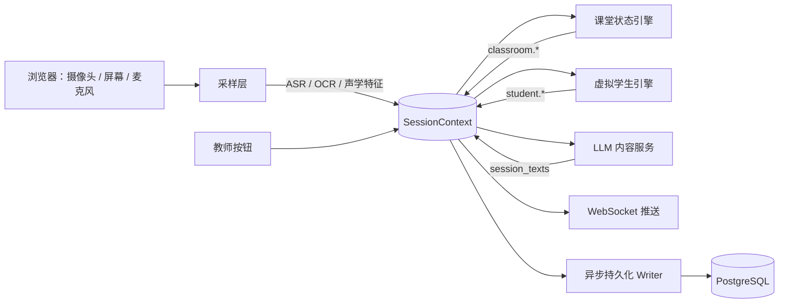
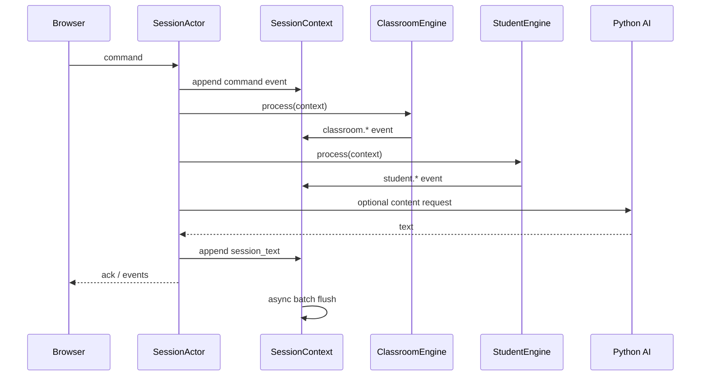
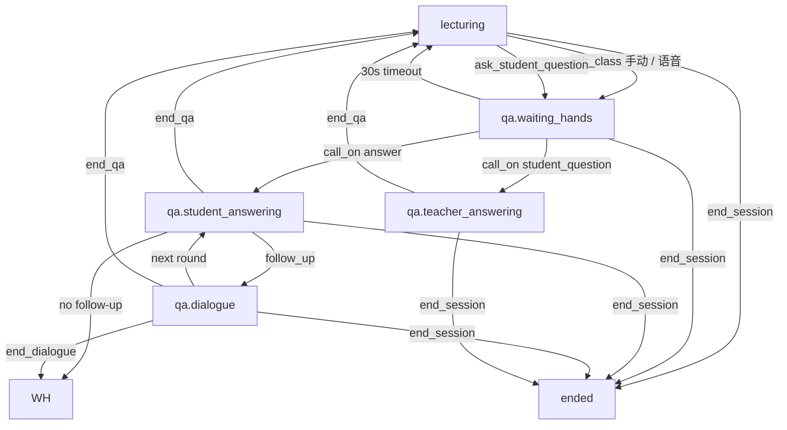
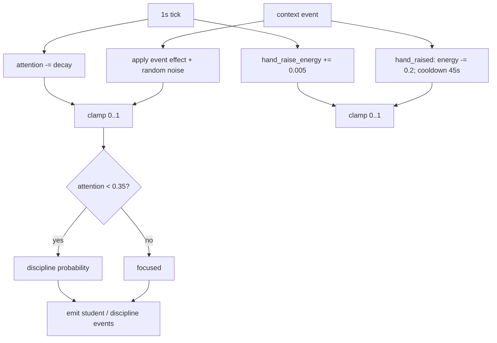
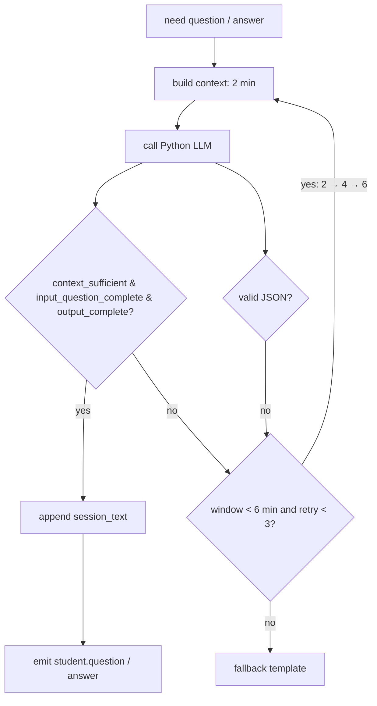
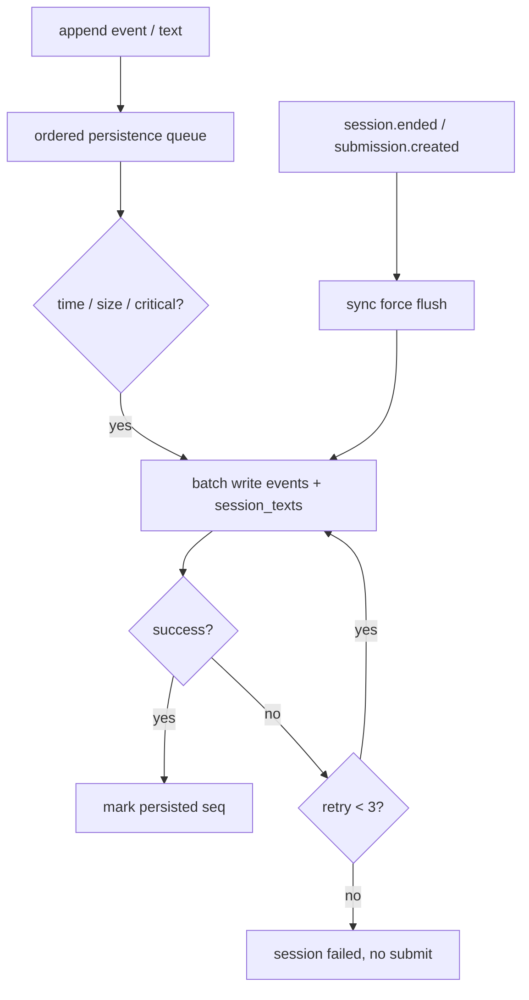
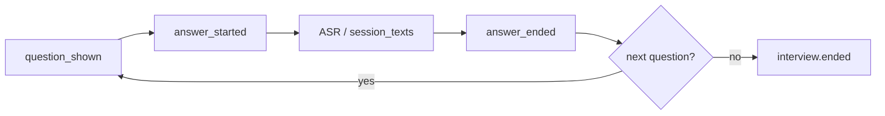
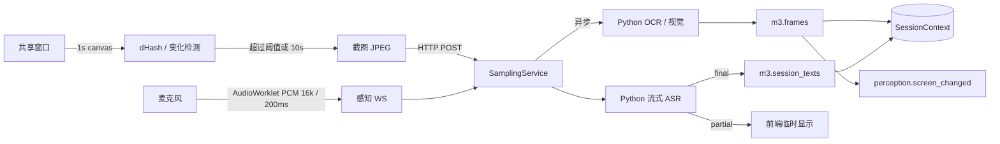
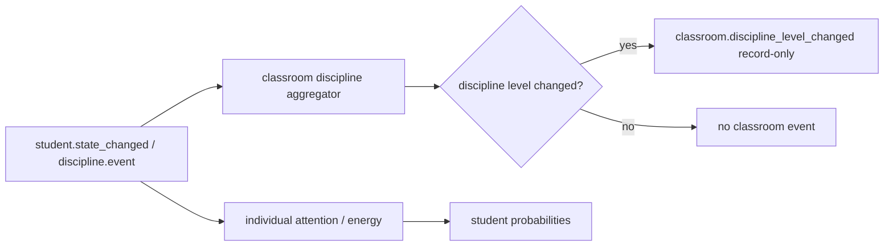

# 05A M3 课堂状态机与 WebSocket

> 上位文档：[M3 虚拟课堂与录制](../requirements/M3-虚拟课堂与录制.md)、[00 总体设计](00-总体设计.md)、[01 数据模型与迁移](01-数据模型与迁移.md)、[02 API 与实时协议](02-API与实时协议.md)、[04 M5 结构化面试题库设计](04-M5-结构化面试题库设计.md)、[05C 任务配置与结构化面试](05C-M3-任务配置与结构化面试.md)
> 版本：V1.0（讨论稿）　状态：待评审　更新日期：2026-11-03
> 范围：05A；05B 录制 / 上传 / 回放、05C 任务配置 / 结构化面试 UI 见对应文档

## 1. 范围

### 1.1 本轮实现

- Session 状态机：任务与非任务训练共用
- 课堂 WebSocket：命令、事件、快照、心跳、时钟同步
- 虚拟学生状态机：注意力、纪律、举手、回答、多轮对话
- 教师按钮动作：让学生提问、向全班提问、点名、标记对 / 错 / 不完整、提醒、结束对话、结束试讲
- 事件落库与 seq 单调
- Java 做状态与业务判断；Python 只做 LLM / 云模型内容封装
- M6 训练 session 复用同一状态机，终态不同

### 1.2 不做

- 录制、上传、回放（05B）
- 任务配置、M5 选题、结构化面试 UI（05C）
- 录制续传、页面刷新 / Java 重启后的会话恢复
- 自动 ASR 问句识别、语音点名、A 阶段自主举手
- 教姿教态、普通话评测
- 实时教师在线观摩

### 1.3 FR 映射

| FR | 覆盖 |
|---|---|
| FR-M3-04 开始试讲与共享窗口 | session 开始、录制就绪、共享窗口前置 |
| FR-M3-05 自由 / 情景课堂 | 课堂状态、虚拟学生、WS |
| FR-M3-06 学生提问触发 | 举手窗口、语音高置信 / 低置信 |
| FR-M3-07 学生回答与多轮对话 | 回答、标记、对话轮次 |
| FR-M3-08 纪律与课堂管理 | 注意力、纪律聚合、管理动作 |
| FR-M3-11 事件、状态机与 WebSocket | 命令 / 事件、seq、快照、重连 |
| FR-M3-12 任务关闭与课程归档 | 只读、提交截止、归档失败处理 |

## 2. 模块架构

```text
com.shijiangtai
└── m3classroom/
    ├── api/                 # StudentTaskController, SessionController, WsTicketController
    ├── ws/                  # ClassroomWebSocketHandler, WsSessionRegistry
    ├── application/         # SessionService, SessionActor, SessionCommandService
    ├── engine/              # VirtualStudentEngine, DisciplineEngine, HandRaiseEngine, DialogueEngine
    ├── domain/              # Session, VirtualStudent, ClassroomEvent, Command
    ├── client/              # AiContentClient（调 Python 内部 API）
    ├── infrastructure/      # repositories, event store, scheduler
    └── dto/
```

- 每个 session 一个 `SessionActor` + 单线程 mailbox；同一 session 的命令串行处理，避免锁竞争。
- 时间 tick 由 Java 调度器驱动；actor 内更新注意力、纪律、计时。
- Java 决定“谁、何时、做什么、对 / 错 / 不完整”；Python 只返回“说什么”。
- 事件先写入**有序持久化队列**再推送；DB 异步批量落库；WS 只是实时通道，不是状态源。关键事件在结束 / 提交 / 失败前同步 flush。
- M6 训练复用 `SessionActor`、`VirtualStudentEngine`、WS 协议；`session_type='training'`、`task_id=null`。

## 3. 核心概念

| 概念 | 说明 |
|---|---|
| Session | 一次试讲 / 训练；状态机主体 |
| SessionActor | 单 session 串行执行器；命令、tick、异步 AI 回调都进入 mailbox |
| Command | 学生（试讲者）通过 WS 发来的动作 |
| Event | 状态变化 / 交互事实；带 `seq`、`at_ms`、`payload` |
| VirtualStudent | 虚拟学生；参数、状态、注意力、对话 |
| Attention | 0—1；随时间衰减，教师互动拉回 |
| HandRaiseEnergy | 0—1 动态举手积极性；每次举手下降，随 tick 恢复 |
| Discipline | 课堂纪律等级 0—3；由低注意力学生触发 |
| HandRaise | 一次举手窗口；1—3 人、30 秒超时 |
| Dialogue | 教师与一个学生的问答回合；最多 3 轮 |
| SessionContext | 课堂上下文：事件流 + 统一文本流；所有层读写的唯一黑板 |
| ContextPersistenceWriter | 异步增量持久化 writer；按时间 / 内容量批量落库 |
| ContentClient | Java 调 Python 的 LLM / 云模型接口；无状态 |

### 3.2 课堂上下文

课堂上下文是唯一黑板，逻辑上包含三条流：

1. **事件流**：`m3.events`，所有 `session.*`、`classroom.*`、`teacher.*`、`student.*`、`perception.*`、`interview.*` 事件，带 `seq`、`at_ms`、`type`、`payload`。
2. **统一文本流**：`m3.session_texts`，教师 ASR、学生 LLM 生成、结构化面试考官 / 考生文本，按 `speaker_type` / `source` / `kind` 区分。
3. **屏幕变化流**：`m3.frames`，记录屏幕截图、OCR 文本、框、置信度、`change_score`、`frame_type`、`timestamp_ms`；只在内容显著变化或达到最大间隔时写入。

读写规则：

- 采样层把 ASR / OCR / 声学特征转成事件和文本，写入上下文；
- 课堂状态层读上下文，判断讲解 / 问答 / 结束，写 `classroom.*` 事件；
- 虚拟学生层读上下文，更新注意力 / 纪律 / 行为，写 `student.*` 事件；
- LLM 内容服务读上下文窗口，生成学生问题 / 回答，写入 `session_texts`；行为事件通过 `text_id` 引用；
- 所有层只追加，不修改历史；当前状态放在 `SessionActor` 内存（课堂状态、qa_phase、虚拟学生动态参数、当前题 / answer_id）；`sessions` / `virtual_students` 表不存运行时状态；
- 事件来源和类型用于防止自触发循环；同一 tick / 命令内按“课堂状态 → 虚拟学生 → 内容生成”顺序处理。

### 3.3 采样层与感知通道

- **控制通道**：`/ws/v1/sessions/{id}` 只走 JSON 命令 / 事件。
- **感知通道**：`/ws/v1/sessions/{id}/perception` 只传二进制 PCM 音频；首条 JSON `audio.start`，结束 `audio.stop`。
- **屏幕截图**：HTTP `POST /api/v1/sessions/{id}/perception/screen`，频率低，不需要长连接；Java 异步调 Python OCR / 视觉。

#### 屏幕采样

| 参数 | 默认值 |
|---|---|
| 采样间隔 | 1 秒 |
| 哈希 | dHash 64 bit，对比上一次截图 |
| 变化阈值 | 8/64 |
| 最小截图间隔 | 2 秒 |
| 最大截图间隔 | 10 秒 |
| 每分钟上限 | 30 张 |
| 截图规格 | 最大宽度 1600，JPEG 0.8 |

- 浏览器每 1 秒绘制共享窗口到 canvas，计算 dHash；
- 与上一次截图比较，超过阈值或达到最大间隔 → 截 JPEG；
- Java 收图 → 写 `m3.frames`（pending）→ 调 Python OCR / 视觉 → 更新文字 / 框 / 置信度 / frame_type → 发 `perception.screen_changed`；
- 翻页、板书定稿、OCR 低置信、图表页标记为关键帧，必要时走视觉模型；
- OCR 文本按 hash 去重，相同内容不重复写上下文；
- 截图失败 / OCR 失败不终止录制，只降低相关评测置信度。

#### 音频采样

| 参数 | 默认值 |
|---|---|
| 格式 | PCM 16k 单声道 16 bit |
| 分片 | 200ms |
| partial | 约 500ms 一次，只推前端 |
| final | 静音 500ms 或最长 10 秒 |
| 声学特征 | 每 1 秒；音量、静音、语速 |
| 声学事件 | 音量过低 / 过高、停顿 > 3 秒时写 `perception.acoustic` |

- 通过感知 WS 发给 Java；Java 转发 Python 流式 ASR；
- Python 返回 partial / final；final 写 `m3.session_texts`（`speaker_type=teacher`、`source=asr`）；
- 感知 WS 断开只影响 ASR / 声学特征，录制继续，M4 标记 partial；控制 WS 断开进入 30 秒 grace，超时 / 页面刷新 / 录制器丢失才 session failed。

## 4. Session 状态机

### 4.1 任务 session

```text
preparing → in_progress → ended → reviewing → submitted
     │           │           │
     └───────────┴───────────┴──→ cancelled / failed
```

| 状态 | 进入条件 | 允许操作 |
|---|---|---|
| `preparing` | 学生创建 session / 获得 WS ticket | 连接 WS、`recording.ready`、`session.start`、取消 |
| `in_progress` | `recording.ready` 且必需流就绪；`session.start` | 课堂命令、tick、结束；控制 WS 断线 30 秒 grace |
| `ended` | 到最高时长 / `teacher.end_session` / 录制停止 | 回看、提交、重做 |
| `reviewing` | 学生打开回看 | 提交、重做 |
| `submitted` | 学生提交一次试讲 | 只读；M4 评测 |
| `cancelled` | 学生主动放弃 / 创建后未开始 / `POST /sessions/{id}/cancel` | 终态 |
| `failed` | 30 秒 grace 超时、页面刷新 / 录制器丢失、录制中断、技术失败 | 终态；任务未关闭可重做 |

- `required_streams` 按模式：自由 / 情景 camera + screen + audio；结构化面试 camera + audio。
- 客户端先发 `recording.ready`，服务端 `recording.ready_ack` 后允许 `session.start`；t0 为 `session.started`。
- 任务 session cancel：`POST /api/v1/sessions/{id}/cancel`，允许 `preparing / in_progress`，abort multipart 并清理临时录像。
- 控制 WS 断线 30 秒 grace；重连需 `session.resume` + `recording_state=active`；页面刷新 / 录制器丢失直接 failed。

### 4.2 训练 session

```text
preparing → in_progress → ended → reviewing → selected → evaluated
     │           │           │
     └───────────┴───────────┴──→ cancelled / failed
```

- 训练不生成 Submission；`selected` 表示学生选中并生成 TrainingRecord；`evaluated` 表示 M4 进入终态（completed / partial / failed），评测状态单独展示。
- 训练任务 `task_id=null`；M6 元数据在 `m6.training_session_meta`。

### 4.3 任务关闭 / 课程归档

- 任务关闭：不再创建新 session；`in_progress` 允许完成；`ended / reviewing` 允许 24 小时内提交。
- 任务关闭不得提前删除临时录像：保留期取 `max(ended_at + 24h, task_closed_at + 24h)`；清理任务先检查提交截止时间。
- 课程归档：所有 session 只读；不能新建 / 开始；已提交报告按 M3 / M4 保留期可查看。
- `end_at` 已过：不再新建任务 / session、不发布草稿；已有 session 可结束 / 提交，已有提交可评分（M7）。

### 4.4 课堂宏观状态

课堂状态层只维护三个宏观状态：`lecturing` / `qa` / `ended`。`qa` 内部用 `qa_phase` 细化，避免状态爆炸。

| 宏观状态 | qa_phase | 进入 | 退出 |
|---|---|---|---|
| `lecturing` | — | 开始 / 问答结束 | 老师提问 / 学生提问 / 结束 |
| `qa` | `waiting_hands` | 老师手动提问、语音高置信触发、让学生提问 | 点名 / 30 秒超时 / 结束 |
| `qa` | `student_answering` | 点名回答 | 回答结束：追问 → `dialogue`；不追问 → `waiting_hands`；`teacher.end_qa` → `lecturing` |
| `qa` | `dialogue` | 学生追问 | 最多 3 轮 / `teacher.end_dialogue` → `waiting_hands`；`teacher.end_qa` → `lecturing` |
| `qa` | `teacher_answering` | 学生提问被点名 | 教师结束问答 → `lecturing` |
| `ended` | — | 结束试讲 | — |

触发规则：

- **老师提问（answer intent）**：
  - 手动按钮「向全班提问」→ `qa.waiting_hands`；
  - 语音：ASR final 段 → Python 问题分类；置信度 ≥ 0.8、当前 `lecturing`、冷却 > 10 秒 → 自动进入 `qa.waiting_hands`；低置信只发 `classroom.question_suggested`，由老师确认；
  - 手动按钮始终可用。
- **学生提问（student_question intent）**：
  - 老师点「让学生提问」→ `qa.waiting_hands`；点名后进入 `teacher_answering`。
- **举手**：1—3 人，保底至少 1 人；30 秒未点名 → `classroom.hand_window_timeout`，回 `lecturing`。
- **对话 / 问答结束**：`teacher.end_dialogue` 只结束当前对话 → `waiting_hands`；`teacher.end_qa` 结束整个问答 → `classroom.qa_ended`，回 `lecturing`；不做自动超时 / 语音判断结束。
- **结束试讲**：`teacher.end_session` → `ended`。
- **结构化面试**：不进入 `qa` 的虚拟学生分支；由 05C 定义 `interview.*` 状态与事件。

状态层事件：

- `classroom.state_changed`：`{from, to, qa_phase, trigger}`
- `classroom.question_asked`：`{intent: answer | student_question, source: manual | voice}`
- `classroom.question_suggested`：`{confidence}`
- `classroom.hand_window_timeout`：`{hand_raise_ids}`
- `classroom.qa_ended`：`{reason}`

## 5. 虚拟学生状态机

### 5.1 静态参数与动态状态

| 参数 | 类型 | 作用 |
|---|---|---|
| `activity` | 静态 0—1 | 参与课堂的总体倾向；举手评分 0.3，越高反应越快 |
| `question_rate` | 静态 0—1 | 主动提问 / 追问倾向；举手评分 0.2，追问概率 0.5× |
| `ability` | 静态 0—1 | 回答质量与问题深度；回答质量公式的基准 |
| `attention_baseline` | 静态 0—1 | 初始注意力；基线越高，tick 衰减越慢 |
| `discipline_probability` | 静态 0—1 | 低注意力时走神 / 说话 / 吵闹的倾向 |
| `attention` | 动态 0—1 | 初始 = `attention_baseline`，随事件和 tick 变化 |
| `hand_raise_energy` | 动态 0—1 | 初始 1.0；每次举手 -0.2，每 tick +0.005 |
| `cooldown_until` | 动态时间 | 举手后 45 秒冷却 |

公式：

```text
decay_rate = 0.002 + 0.004 * (1 - attention_baseline)
attention = clamp(attention - decay_rate + Σ event_delta + noise, 0.05, 1)
hand_raise_energy = clamp(hand_raise_energy + 0.005 + Σ event_delta + noise, 0, 1)
hand_raise_score = activity*0.3 + question_rate*0.2 + attention*0.2
                 + hand_raise_energy*0.2 + random*0.1
answer_quality = clamp(ability*0.7 + question_clarity*0.3 + random(-0.15, 0.15), 0, 1)
p_follow_up = question_rate * 0.5
p_discipline = discipline_probability * (1 - attention) * state_factor
```

- `question_clarity` 本轮默认 0.5；后续接教师话语分类。
- `state_factor` 本轮固定 1.0；后续可接课堂宏观状态修正。
- `teacher.manage_student` 的注意力增量统一为 +0.25。

- 静态参数由教师建任务时配置，训练时学生可改；发布后写入快照；
- 试讲学生看不到静态参数和个性文本；
- `personality_text` 只影响 LLM 说话风格，不直接参与概率公式。

### 5.2 行为状态

| 状态 | 说明 | 转移 |
|---|---|---|
| `focused` | 专注 | 注意力下降 / 纪律概率 → `distracted / whispering` |
| `distracted` | 走神 | 教师提醒 / 互动 → `focused` |
| `whispering` | 小声说话 | 教师提醒 / 纪律升级 → `focused / discipline` |
| `hand_raised` | 举手 | 被点名 → `called_on`；30 秒未点名 → `focused` + timeout |
| `called_on` | 被点名 | 内容就绪 → `answering` |
| `answering` | 回答 | 回答结束 → `dialogue` / `focused` |
| `dialogue` | 对话中 | 结束对话 → `focused` |

- 每个学生同一时间只处于一个状态。
- 状态变化必须落库为事件；前端只渲染服务端状态。

### 5.3 注意力、事件影响与纪律聚合

- 每个学生初始 `attention = attention_baseline`（0—1，默认 0.5）；
- `decay_rate = 0.002 + 0.004 * (1 - attention_baseline)`；
- 每 tick：`attention = clamp(attention - decay_rate + Σ event_delta + noise, 0.05, 1)`；
- 每个事件 delta 带 ±20% 随机扰动，最小 ±0.005；每个事件只应用一次；
- 当 `attention < 0.35` 时，按概率触发走神 / 小声：
  - `p = discipline_probability * (1 - attention) * state_factor`；
  - 状态持续 10—40 秒；教师 `teacher.manage_student` 提醒后回升。

#### 事件影响矩阵（默认）

| 事件 | 作用对象 | attention | hand_raise_energy | 备注 |
|---|---|---|---|---|
| `classroom.question_asked` | 全班 | +0.05 | — | 举手窗口内 hand_raise ×1.2 |
| `teacher.call_on` | 被点学生 | +0.15 | +0.05 | 其他学生 -0.02 |
| `teacher.mark_answer` correct | 回答学生 | +0.10 | +0.05 | partial +0.02；wrong -0.10 |
| `teacher.manage_student` | 被提醒学生 | +0.25 | — | 纪律等级下降 |
| `student.hand_raised` | 举手学生 | +0.05 | -0.20 | 45 秒冷却 |
| `student.answer` | 回答学生 | +0.10 | — | |
| `student.follow_up` | 追问学生 | +0.05 | — | |
| `student.question` | 提问学生 | +0.10 | +0.05 | |
| `student.state_changed` → distracted | 当事学生 | -0.05 | -0.05 | 邻近 -0.02 |
| `student.state_changed` → whispering | 当事学生 | -0.08 | -0.05 | 邻近 -0.03；小声概率小幅上升 |
| `discipline.event` | 当事学生 | -0.10 | — | 邻近 -0.03 |
| `perception.screen_changed` | 全班 | +0.01 | — | 可选，避免过度 |
| `perception.acoustic` 长停顿 / 音量低 | 全班 | -0.03 | — | 超过阈值 |
| `classroom.state_changed → qa` | 全班 | +0.03 | — | |
| `classroom.hand_window_timeout` | 全班 | -0.02 | — | 教师未响应 |
| `session.time_tick` | 每个学生 | -decay_rate / 秒 | +0.005 / 秒 | 基础衰减 / 恢复 |

#### 课堂纪律聚合（record-only）

课堂状态层根据学生行为事件统计整堂课：

| 等级 | 条件 |
|---|---|
| 0 安静 | 0 人说话；或仅 1 人走神、无人说话 |
| 1 轻微 | 1—2 人小声 / 走神，或 noisy_ratio 10%—25% |
| 2 吵闹 | 3—5 人，或 noisy_ratio 25%—50% |
| 3 混乱 | ≥ 6 人，或 noisy_ratio > 50%，或等级 2 持续 > 20 秒 |

- 同时用人数和比例，取较大等级；小班 / 大班都不失真；
- 统计字段：`distracted_count`、`whispering_count`、`noisy_ratio`、`avg_attention`、`level_duration_ms`；
- 状态变化写 `classroom.discipline_level_changed`；
- **这些聚合事件只记录 / 供 UI / 供 M4 控场维度使用，不回灌虚拟学生概率**；
- 局部传染仍由虚拟学生层处理（邻近学生的小声概率小幅上升）；
- 结构化面试没有虚拟学生，不产生纪律聚合。

### 5.4 举手

- 教师命令 `teacher.ask_class` 或 `teacher.ask_student_question` 触发举手窗口。
- 候选：`focused` / `distracted`，不在对话中，冷却期已过。
- 选择 1—3 人，**保底至少 1 人**：
  - 基础评分：`activity * 0.3 + question_rate * 0.2 + attention * 0.2 + hand_raise_energy * 0.2 + random * 0.1`；
  - 取高于阈值的最多 3 人；
  - 如果没有人过阈值，强制选评分最高的 1 人；
  - 如果所有候选都在冷却期，忽略冷却，强制选最高 1 人。
- 每个学生有动态 `hand_raise_energy`（0—1）：
  - 初始 1.0；
  - 每次 `student.hand_raised` 后 `-0.2`；
  - 每 tick 恢复 `+0.005`；
  - 举手概率乘上 `hand_raise_energy`；
  - 举手后 45 秒硬冷却，避免同一学生连续举手。
- 每次举手都写 `student.hand_raised` 事件；事件进入上下文，驱动该学生能量下降。
- 反应延迟 1—3 秒；服务端调度，到点发 `student.hand_raised`。
- 问题内容在举手时由 Python 预生成；Java 保存到 actor 内存 / 事件；超时用兜底模板。
- **30 秒超时从第一个举手事件开始计时**：
  - 教师未点名 → 全部举手放下，写 `student.hand_lowered`（reason=`teacher_timeout`）；
  - 写 `classroom.hand_window_timeout`；
  - 状态从 `qa.waiting_hands` 回到 `lecturing`，写 `classroom.state_changed`。
- 教师点名：`teacher.call_on`，其余举手放下；被点学生进入 `called_on`。

### 5.5 回答与多轮对话

- `teacher.ask_class` 后也可直接点名，不要求先举手。
- 点名后 Java 请求 Python 生成回答：
  - 质量档 = f(ability, question_clarity, difficulty)；
  - 默认：`clamp(ability*0.7 + question_clarity*0.3 + random(-0.15, 0.15), 0, 1)`；
    - ≥ 0.7 → correct；≥ 0.4 → partial；否则 wrong；
  - `question_clarity` 本轮默认 0.5；后续接教师话语分类。
- 回答以文字出现；教师点 `teacher.mark_answer` 标记 correct / partial / wrong。
- 多轮：回答结束后，Java 按 `question_rate` / `ability` / 当前轮次决定是否追问，最多 3 轮；教师可 `teacher.end_dialogue` 或说“请坐”结束当前对话。
- `teacher.end_dialogue` 写 `dialogue.ended`，回 `waiting_hands`；`teacher.end_qa` 写 `classroom.qa_ended`，回 `lecturing`；不做自动超时 / 语音判断。
- 一个学生同一时间只能在一个对话中；对话事件必须绑定 `dialogue_id`。

### 5.6 结构化面试

- 结构化面试不使用虚拟学生、举手、纪律；`session.mode='interview'`。
- 题目来自 05C 的任务快照；考官文字提问，考生语音回答。
- `interview.*` 事件由 05A 的状态机写入；题目 / 回答时间线供 M4。
- 题目展示即打开作答窗口：`interview.question_shown` 后立即 `interview.answer_started`；下一题先 `answer_ended`，再 `next_question` / `question_shown` / `answer_started`。
- `interview.end` 或到总时长时，先 `answer_ended`，再 `interview.ended`、`session.ended`；结束原因 `manual` / `timeout`。
- 本轮不做 LLM 追问；面试 UI / 题目选择见 05C。

## 6. 命令与事件

### 6.1 命令

| 命令 | 前置状态 | 作用 |
|---|---|---|
| `recording.ready` | preparing / grace 重连 | 上报录制器状态；服务端确认必需流 |
| `session.start` | preparing | 进入 in_progress；启动 tick |
| `session.resume` | grace 内 | 携带 `last_seq` / `recording_state` 重连；服务端补发事件 |
| `teacher.ask_class` | in_progress | 老师向全班提问，触发举手窗口；intent=answer |
| `teacher.ask_student_question` | in_progress | 让学生提问，触发举手窗口；intent=student_question |
| `teacher.call_on` | in_progress | 点名；进入 called_on |
| `teacher.mark_answer` | in_progress | 标记回答 |
| `teacher.manage_student` | in_progress | 提醒 / 纪律管理 |
| `teacher.end_dialogue` | in_progress | 结束当前对话，回 waiting_hands |
| `teacher.end_qa` | in_progress | 结束问答，回 lecturing |
| `teacher.end_session` | in_progress | 结束试讲 |
| `interview.next_question` | in_progress + interview | 下一题 |
| `interview.end` | in_progress + interview | 结束面试 |
| `time.sync` | 任意 | 时钟同步 |
| `pong` | 任意 | 心跳响应 |

- 命令带 `command_id`；actor 按 session 串行处理；重复 command_id 直接回 ack，不重复执行。
- 非法状态 / 模式返回 `error`，不改变状态。
- 命令处理顺序：校验 → actor mailbox → 状态变更 → 事件落库 → WS 推送 → `server.ack`。

### 6.2 事件

| 事件 | payload | 说明 |
|---|---|---|
| `classroom.state_changed` | `{from, to, qa_phase, trigger}` | 讲解 / 问答 / 结束切换 |
| `classroom.question_asked` | `{intent, source}` | 老师提问 / 让学生提问 |
| `classroom.question_suggested` | `{confidence}` | 语音低置信，等待教师确认 |
| `classroom.hand_window_timeout` | `{hand_raise_ids}` | 30 秒未点名 |
| `classroom.qa_ended` | `{reason}` | 问答结束 |
| `classroom.discipline_level_changed` | `{from, to, distracted_count, whispering_count, noisy_ratio, avg_attention, duration_ms, reason}` | 课堂纪律聚合；record-only |
| `student.state_changed` | `{student_id, from, to, reason}` | 单个学生行为状态变化 |
| `session.started` | `{started_at_ms}` | 课堂开始（t0） |
| `session.time_tick` | `{elapsed_ms, remaining_ms?, discipline_level, states}` | 时间 tick；默认 1 秒推送、5 秒落库 |
| `session.ended` | `{reason, duration_ms}` | 课堂结束 |
| `session.failed` | `{reason, error_code?}` | 30 秒 grace 超时 / 录制器丢失 / 技术失败 |
| `session.resumed` | `{last_seq, server_time_ms}` | 重连成功；随后补发缺失事件 |
| `recording.ready_ack` | `{required_streams, ok}` | 客户端录制器就绪确认 |
| `perception.screen_changed` | `{frame_id, at_ms, frame_type}` | 屏幕 OCR / 变化 |
| `perception.acoustic` | `{at_ms, event, value}` | 音量 / 停顿 / 语速异常 |
| `student.hand_raised` | `{student_id, hand_raise_id}` | 举手 |
| `student.hand_lowered` | `{student_id, hand_raise_id, reason}` | 放下 |
| `teacher.called_on` | `{student_id, hand_raise_id?}` | 点名 |
| `teacher.marked` | `{answer_id, correctness}` | 对 / 错 / 不完整 |
| `teacher.management_action` | `{student_id, action}` | 提醒 / 管理 |
| `student.question` | `{student_id, text_id, question_id}` | 学生提问；全文在 `session_texts` |
| `student.answer` | `{student_id, answer_id, text_id, quality}` | 学生回答；全文在 `session_texts` |
| `student.follow_up` | `{student_id, answer_id, text_id}` | 追问；全文在 `session_texts` |
| `dialogue.started` | `{dialogue_id, student_id}` | 对话开始 |
| `dialogue.ended` | `{dialogue_id, reason}` | 对话结束 |
| `discipline.event` | `{level, student_ids, event_type}` | 纪律事件 |
| `interview.question_shown` | `{question_id, order, total, text}` | 面试题目 |
| `interview.answer_started` | `{question_id, answer_id}` | 回答开始 |
| `interview.answer_ended` | `{question_id, answer_id}` | 回答结束 |
| `interview.next_question` | `{question_id, order}` | 下一题 |
| `interview.ended` | `{}` | 面试结束 |
| `submission.created` | `{submission_id}` | 提交（M3 任务） |

- 所有事件：`event_id`、`seq`、`session_id`、`at_ms`、`payload`。
- `seq` 按 session 单调递增；先入有序持久化队列再推送，关键事件同步 flush。
- 事件只追加，不更新；状态快照从 `SessionActor` 内存读取，不读 `sessions` / `virtual_students` 动态字段。
- `session.snapshot` 额外包含 `last_seq`、面试当前题 / `answer_id` / 剩余时间、虚拟学生当前状态、录制状态。
- 30 秒 grace：控制 WS 断线不立即写 `session.failed`；重连 `session.resume` 后从 `last_seq` 补发事件；`time_tick` / `ping` 不回放。
- `session.failed.reason`：`grace_timeout` / `recording_lost` / `track_ended` / `ws_error` / `internal`；`session.ended.reason`：`manual` / `timeout` / `recording_stopped`。

## 7. Python 内容生成

### 7.1 职责

- Python 只负责：
  - 学生提问内容；
  - 学生回答内容；
  - 可选的教师话语分类；
  - 云模型 / LLM 高级封装、限流、重试、成本。
- Java 负责：
  - 谁举手、谁被点名、回答质量档、对 / 错 / 不完整、纪律、计时、对话轮次；
  - 上下文窗口构建与扩窗；
  - 内容落库与事件时间。

### 7.2 上下文窗口

| 内容 | 说明 |
|---|---|
| 课堂状态 | 当前 `lecturing / qa`、qa_phase、最近课堂事件 |
| 教师讲解 | 窗口内 `session_texts` 中 `speaker_type=teacher`、`source=asr` 的文本 |
| 屏幕内容 | 窗口内 `m3.frames` 的 OCR 文本，按变化去重 |
| 最近问答 | 窗口内学生问题 / 回答 / 追问 |
| 学生设定 | 当前学生 ability、personality、quality tier（回答时） |
| 任务上下文 | 课题、教材版本、模式；不注入参考材料 / 答案要点，避免学生说破答案 |

- 初次窗口：最近 2 分钟；
- 不够 → 4 分钟；仍不够 → 6 分钟；最多 3 次；
- 窗口不早于 session 开始；总 token 上限 6k—8k；
- 超限时优先保留最近教师讲解、屏幕变化、当前问题；
- 扩窗由 Java 做；Python 只返回“够不够”和内容。

### 7.3 Prompt 完整性判断

Prompt 返回 JSON：

```json
{
  "context_sufficient": true,
  "input_question_complete": true,
  "output_complete": true,
  "missing": [],
  "text": "老师，这里为什么用“愁”字？",
  "confidence": 0.86
}
```

- `context_sufficient`：窗口内是否有足够内容生成问题 / 回答；
- `input_question_complete`：回答教师问题时，教师问题本身是否完整（ASR 可能截断 / 含糊）；
- `output_complete`：生成的问题 / 回答是否完整、自洽、没有半句；
- 任一 flag 为 false，或 JSON 不合法 → Java 扩窗重试；
- 重试仍失败 → 兜底模板 / 通用问题；
- 记录 `model_version`、`prompt_version`、耗时、token 用量。

### 7.4 接口与超时

- `POST /internal/v1/classroom/question`
- `POST /internal/v1/classroom/answer`
- `POST /internal/v1/classroom/classify`（可选）
- 提问 2 秒超时 → 兜底问题模板；
- 回答 3 秒超时 → 兜底回答模板；
- 不阻塞 tick；actor 用异步回调或未来结果。

### 7.5 落库与预生成

- 生成文本写 `session_texts`（`source=llm`），行为事件通过 `text_id` 引用；
- 本轮按需生成；后续可加课前问题池 / 批量回答变体。

## 8. WebSocket 行为

- 路径：`/ws/v1/sessions/{session_id}?ticket=...`
- 连接后：
  1. 校验 ticket / session / account；
  2. 发 `session.snapshot`（状态、模式、公开配置、虚拟学生当前状态、面试当前题 / `answer_id` / 剩余时间、录制状态、`last_seq`、elapsed_ms）；
  3. 进入事件流。
- 信封、seq、at_ms、心跳、时钟同步、关闭码沿用 02：
  - 15 秒 ping / 30 秒超时；
  - 关闭码 4001—4005；
  - 控制 WS 断线进入 30 秒 grace；30 秒内可重新申请 ticket 并 `session.resume {last_seq, recording_state}`；超时 / 页面刷新 / 录制器丢失才 `failed`。
- 同一 session 的 WS 只允许一个活跃连接；重连时新连接替换旧连接，旧连接关闭不触发 grace 失败。
- 事件推送失败 / 慢消费者：关闭连接并进入 30 秒 grace；30 秒内未恢复才 failed，避免误杀瞬时网络抖动。

## 9. 上下文持久化与时间

### 9.1 内存上下文

- 每个 `SessionActor` 持有 `SessionContext`：事件流 + 统一文本流 + 屏幕变化流（frames）；
- 活跃课堂的课堂状态层、虚拟学生层、LLM 上下文构建都读内存，不等待 DB；
- 事件 `seq` 在 actor 内分配；文本 `id` 在写入前生成；行为事件通过 `text_id` 引用文本；
- 内存上下文只追加，历史不修改；当前状态只保存在 `SessionActor` 内存，不写回 `sessions` / `virtual_students` 行；30 秒 grace 依赖 actor 存活，Java 重启则不恢复。

### 9.2 异步增量持久化

- 每个 session 一个**有序持久化队列** + 单 writer；共享线程池消费；
- 触发条件：
  - 时间：默认每 1 秒 flush；
  - 内容量：默认 100 条或 64 KB，先到先 flush；
  - 关键事件强制 flush：`session.ended`、`submission.created`、`interview.ended`、`session.failed`。
- 一批 `events` + `session_texts` + `frames` 在同一事务内批量写入：
  - 事件按 `id` / `seq` 幂等 upsert；
  - 文本按 `id` 幂等 upsert；
  - 帧按 `id` 幂等 upsert，`status` 从 pending 更新为 processed / failed；
  - 单 session 单 writer，保证顺序。
- 活跃课堂读内存；回放 / M4 在 flush 后读 DB。
- 队列有界；满时对 actor 施加背压，tick / 命令短暂排队；持续满则本次 session 失败。
- tick：
  - Java 每 1 秒更新注意力 / 纪律 / 计时；
  - `session.time_tick` 每 1 秒推送；持久化跟随异步批次，默认每 5 秒或按内容量触发；
  - 结束 / 失败时强制 flush。

### 9.3 flush 失败与结束边界

- 结束、提交、面试结束、失败前执行**同步强制 flush**：
  - 等待 pending frames 变为 processed / failed（OCR barrier，最多 5 秒）；
  - 重试 3 次，指数退避；
  - 仍失败 → `session.status = failed`，写 `session.failed` 事件，禁止提交；
  - 学生可重做；M4 不会读取半份上下文或 pending 帧。
- 提交顺序：结束采集 → 最后 part 上传完成 → 同步 flush 事件 / 文本 / 帧 → 校验 required_streams → 同一事务写 submission / session submitted / `submission.created` → commit → 触发 M4 / M7；flush 失败不生成 submission。
- 普通异步 flush 失败：记录错误、保留内存数据、后台重试；不阻塞 tick。
- Java 重启：`in_progress` session 标记 `failed`，未持久化尾部丢失；不做 session 恢复。

### 9.4 时间基准

- session 相对毫秒 `at_ms`，录制开始为 0；
- 三路录制 `offset_ms` 在 05B 处理；
- 事件 / 文本 / OCR 帧共用同一基准；
- 教师 ASR 段有 `start_ms / end_ms / at_ms`；LLM 文本只有 `at_ms`。

## 10. 训练复用

- `session_type='training'`、`task_id=null`；
- 复用同一 `SessionActor`、虚拟学生引擎、WS 协议；
- 训练虚拟学生从 `training_session_meta.effective_config_snapshot` 构造，不读 `virtual_students` 表；session 级 ID 在启动时生成；
- 终态：`selected / evaluated`，不进入 `submitted`；
- 训练不生成 Submission；不进入教师任务提交列表；
- 训练报告仅学生本人可见；
- 训练模式无结构化面试；本轮训练为自由试讲。

## 11. 权限与可见性

- 学生：只能连接本人的 session；只能看本人的事件 / 回放 / 报告。
- 教师（课程老师组）：只能看本课程任务提交件的事件 / 回放 / 报告；不能加入学生课堂 WS。
- 管理员：不可访问 M3 课堂、录像、报告。
- 训练：仅学生本人；教师、管理员不可见。
- WS ticket 绑定 session + account，一次性、30 秒。

## 12. 错误与关闭码

- WS 错误事件 payload：`{code, message, command_id?}`。
- 业务错误：
  - `SESSION_STATE_INVALID`：状态不允许；
  - `SESSION_FAILED`：session 已失败；
  - `WS_TICKET_INVALID`：ticket 无效；
  - `WS_SESSION_FORBIDDEN`：无权连接；
  - `AI_TIMEOUT`：内容生成超时（内部降级，不直接暴露给学生）。
- 关闭码：4001 认证、4002 失败、4003 状态、4004 心跳、4005 消息过大 / 慢消费者。

## 13. 页面与交互

- 课堂布局 A：共享窗口主画面 + 右侧虚拟学生网格 + 摄像头小窗 + 底部控制条。
- 前端只发命令、渲染事件；不自行随机学生行为，不用本地计时器做业务判断。
- 控件按状态禁用：
  - 非 `in_progress` 禁用提问 / 点名 / 提醒；
  - 举手窗口内显示候选；30 秒倒计时；
  - 回答中显示「对 / 错 / 不完整」；
  - 对话中显示「结束对话」。
- 学生列表展示姓名、头像、状态；不展示参数与个性文本。
- 参考材料、答案要点、权重不下发到学生端。
- 05A 只定义课堂页面行为；具体视觉在 09 / 05B / 05C 细化。

## 14. 测试

- 状态机：任务 / 训练全路径；非法命令；关闭 / 归档 / end_at。
- Actor：并发命令串行；重复 command_id；tick 与命令交错。
- 虚拟学生：注意力衰减、纪律概率、提醒恢复、举手 1—3 人且保底 1 人、`hand_raise_energy` 下降 / 恢复 / 45 秒冷却、30 秒未点名回讲解、多轮最多 3 轮、语音高置信触发 / 低置信提示、教师显式结束问答。
- 静态参数：五个参数默认 / 边界；`attention_baseline` 影响衰减、`ability` 影响回答质量、`question_rate` 影响追问、`activity` 影响举手。
- 纪律聚合：走神 / 小声触发等级变化，写 `classroom.discipline_level_changed`；聚合事件不回灌概率；教师提醒后降级。
- WebSocket：ticket、快照、seq 单调、心跳、时钟同步、慢消费者、30 秒 grace / 重连、超时失败。
- 事件：actor 内 `seq` 唯一；上下文追加后推送；异步批量落库；关键事件强制 flush；重复批次幂等。
- 持久化：时间 / 内容量触发；队列背压；flush 失败重试；结束 / 提交 flush 失败 → session failed；重复 batch 幂等。
- Python 内容：超时 / 失败兜底；不阻塞 tick。
- 训练复用：`session_type=training`、无 Submission、终态 selected / evaluated。
- 权限：学生本人、教师组只读、管理员 403、跨校 403。
- 性能：3 个课堂 × 默认 3 名虚拟学生；tick 与事件写入延迟。

## 15. 开放问题

| 编号 | 事项 | 当前处理 |
|---|---|---|
| Q1 | tick 落库频率 | 已确认：异步增量持久化；1 秒 / 100 条 / 64 KB 触发；tick 1 秒推送、随批次落库；结束 / 提交强制 flush |
| Q2 | 注意力 / 纪律默认参数 | 已确认：`decay=0.002+0.004*(1-baseline)`、阈值 0.35、提醒 +0.25；静态参数公式见 5.1 |
| Q3 | 举手选择权重 | activity 0.3 + question_rate 0.2 + attention 0.2 + hand_raise_energy 0.2 + random 0.1；保底 1 人；举手后 energy -0.2、45 秒冷却、每 tick +0.005 |
| Q4 | 回答质量公式 | ability + random + clarity；clarity 默认 0.5 |
| Q5 | 问题 / 回答内容生成时机 | 本轮按需生成；后续可课前批量 / 问题池 |
| Q6 | 教师话语分类 | 可选；本轮按钮埋点为主 |
| Q7 | 事件 payload 版本 | 增加 `v` 字段；后续兼容旧版本 |
| Q8 | 结构化面试状态细节 | 已细化，见 [05C](05C-M3-任务配置与结构化面试.md) |
| Q9 | 训练纪律模型 | 与任务一致；训练无提交 |
| Q10 | 30 名虚拟学生性能 | 默认 3 人演示；30 人需压测 |
| Q11 | 结束 / 提交 flush 失败 | 已确认：重试 3 次仍失败 → session failed，禁止提交，学生重做 |
| Q12 | 屏幕 / 音频采样阈值 | 已确认：1 秒采样、dHash 8/64、最小 2 秒、最大 10 秒、30 张/分钟、1600px / 0.8；PCM 16k / 200ms、final 静音 500ms / 最长 10 秒；声学事件阈值待实测 |
| Q13 | 语音提问触发 | 置信度 ≥ 0.8、冷却 > 10 秒自动；低置信只提示；手动按钮始终可用 |
| Q14 | 问答结束 | `teacher.end_dialogue` 回 waiting_hands；`teacher.end_qa` 回 lecturing；不自动超时 / 不靠语音判断 |
| Q15 | LLM 上下文扩窗与完整性 | 已确认：2 → 4 → 6 分钟、最多 3 次；`context_sufficient` / `input_question_complete` / `output_complete` 三 flag |
| Q16 | 课堂纪律聚合 | 已确认：0—3 级，人数 + 比例取大；record-only，不回灌概率 |
| Q17 | 事件影响矩阵 | 已确认：加性 delta + ±20% 噪声 + clamp；默认权重见 5.3 |

## 16. 流程图与设计思路

### 16.1 分层与上下文



### 16.2 事件处理顺序



### 16.3 课堂状态机



纪律不是顶层状态，而是事件 / 学生状态修饰；避免“讲解 / 问答 / 纪律”三套状态互相切换造成状态爆炸。

### 16.4 虚拟学生 tick / 事件更新



### 16.5 LLM 上下文与重试



### 16.6 异步持久化与 flush 失败



### 16.7 结构化面试事件流



### 16.8 设计取舍

- **Java 是状态权威**：课堂状态、虚拟学生参数、对 / 错 / 不完整、计时都在 Java；Python 只生成内容。
- **上下文是唯一黑板**：事件流 + 统一文本流 + 屏幕变化流；课堂状态层、虚拟学生层、LLM 都读写它。
- **事件与文本分离**：事件表示“发生了什么”，文本表示“说了什么”；事件通过 `text_id` 引用文本。
- **异步增量持久化**：活跃课堂不被 DB 阻塞；按时间 / 内容量批量落库。
- **边界强制 flush**：结束 / 提交 / 面试结束 / 失败前同步 flush；失败则 session failed，不生成半份报告。
- **tick 驱动状态演化**：1 秒 tick 更新注意力 / 纪律 / 计时；事件驱动概率修正。
- **结构化面试复用事件流**：没有虚拟学生，但仍以 `question_shown / answer_started / answer_ended` 驱动。

### 16.9 采样层



### 16.10 学生事件到课堂纪律聚合


