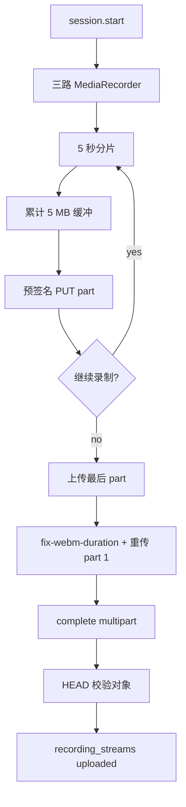
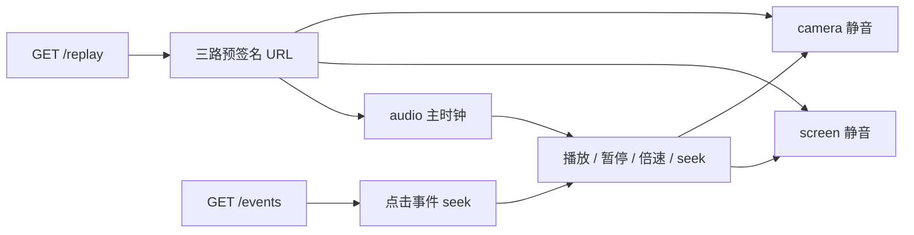
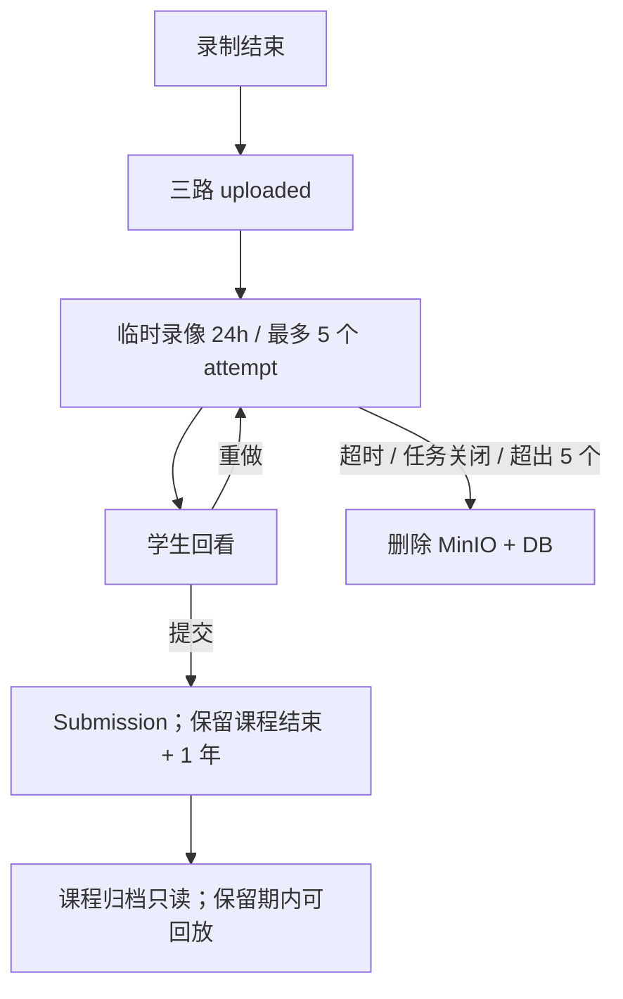

# 05B M3 录制、上传与回放

> 上位文档：[M3 虚拟课堂与录制](../requirements/M3-虚拟课堂与录制.md)、[00 总体设计](00-总体设计.md)、[01 数据模型与迁移](01-数据模型与迁移.md)、[02 API 与实时协议](02-API与实时协议.md)、[05A 课堂状态机与 WebSocket](05A-M3-课堂状态机与WebSocket.md)
> 版本：V0.2（讨论稿）　状态：待评审　更新日期：2026-11-03
> 范围：05B；05A 状态 / WS、05C 任务配置 / 结构化面试 UI 见对应文档

## 1. 范围

### 1.1 本轮实现

- 自由 / 情景三路录制：摄像头、共享窗口、麦克风；结构化面试 camera + audio
- 录制中分片上传到 MinIO multipart
- 浏览器补 WebM 时长；补时长失败不允许提交
- 临时录像回看、提交、重做
- 回放 A：屏幕主画面 + 摄像头小窗 + 音频 + 事件流
- 临时录像 24 小时 / 最多 5 个 attempt；任务关闭后至少保留到提交截止
- 提交件保留至课程结束 + 1 年
- 训练录像复用同一套录制 / 回放

### 1.2 不做

- 服务端转码、H.264 / MP4、Safari 兼容
- 分片断点续传、浏览器崩溃恢复
- 直播、教师在线观摩
- 本地保存录像
- 暂停 / 继续录制
- 录像剪辑
- 字幕烧录

### 1.3 FR 映射

| FR | 覆盖 |
|---|---|
| FR-M3-04 开始试讲与共享窗口 | 录制就绪、共享窗口 |
| FR-M3-10 录制、回放与提交 | 三路 / 两路录制、上传、回放、提交 |
| FR-M3-12 任务关闭与课程归档 | 临时录像保留、提交截止、归档只读 |

## 2. 架构

```text
Browser
├─ camera MediaRecorder
├─ screen MediaRecorder
└─ audio MediaRecorder
        │ 5s timeslice → 5 MB part
        ▼
Java RecordingService
  ├─ MinIO multipart start / part URLs / complete / abort
  ├─ recording_streams 状态
  └─ replay presigned GET
        ▼
MinIO（私有 bucket）
```

- 录制在浏览器完成；Java 只编排 multipart、元数据和权限。
- Python 不参与录制 / 上传 / 回放；ASR / OCR 走 05A 感知通道。
- 回放只支持 Chrome / Edge；WebM 由浏览器原生播放。

## 3. 录制流

| 流 | 内容 | MIME | 建议码率 |
|---|---|---|---|
| camera | 人像，无音频 | `video/webm;codecs=vp8` | 800 kbps，1280×720 |
| screen | 共享窗口，无音频 | `video/webm;codecs=vp8` | 2 Mbps，最大 1920×1080 |
| audio | 教师麦克风 | `audio/webm;codecs=opus` | 64 kbps |

- `required_streams` 按模式：自由 / 情景 camera + screen + audio；结构化面试 camera + audio。
- `getDisplayMedia` 只取用户选定的窗口；UI 提示不要共享整个桌面。
- 每个 recorder 记录 `offset_ms`（相对 `session.started` / t0）；写入 `sessions.stream_offsets`。
- `MediaRecorder` `timeslice=5000ms`；分片进入内存缓冲，累计 5 MB 上传一个 part。
- 客户端先发 `recording.ready`；服务端确认必需流后才允许 `session.start`。
- 控制 WS 断线 30 秒 grace：页面仍存活时录制继续、分片上传重试；页面刷新 / `recording_state=lost` / grace 超时 → session failed。
- 任一路权限拒绝、track ended、recorder error → 本次 session failed；`ended` 后的正常 track stop 不改变状态。
- 不做暂停 / 继续；结束即停止。

## 4. 分片上传

### 4.1 Multipart 流程

1. `recording.ready` 后，客户端调用 Java `multipart/start`；Java 为每路调用 MinIO `createMultipartUpload`；
2. 返回 `upload_id`、`object_key`、`part_size=5MB`；客户端只拿预签名 part URL；
3. 浏览器累计 5 MB → 调 `part-url` 获取下一段预签名 PUT URL；
4. PUT 到 MinIO，记录 `part_number`、`etag`；
5. 录制结束：上传最后不足 5 MB 的 part；
6. 三路 `complete` 提交 parts 列表、`duration_ms`、`size`、`mime`；
7. Java HEAD 校验对象存在、大小、类型；
8. `recording_streams.status=uploaded`；三路都上传后才允许提交。

### 4.2 时长补全

- 保留第一段 5 MB part；
- 录制结束用 `fix-webm-duration` 写入总时长；
- 用同一 `part_number` 重新上传 part 1；
- 然后 complete multipart；
- 补时长失败：本次不可提交，提示重做；不使用 `Infinity` 的原生 duration，避免 seek / 漂移未定义。若后续要降级，必须提供音频推导时长或手动时间轴，并单独设计。

### 4.3 失败与背压

- part 上传失败重试 3 次；
- 上传缓冲积压 > 30 MB，或重试耗尽 → 该路 `failed`；不暂停录制，直接失败。
- 结束时任一路 failed / 缺失 → session `failed`，禁止提交；
- 未完成 multipart 由清理任务 `abort`；
- 浏览器崩溃 / 断网：本次失败，不做断点续传。

### 4.4 对象键

```text
recordings/{school_id}/task/{task_id}/{session_id}/{stream_type}.webm
```

- 训练：`recordings/{school_id}/training/{session_id}/{stream_type}.webm`。
- bucket 私有；浏览器只用短时效预签名 URL。

## 5. 数据模型

沿用 01，`recording_streams` 增加：

| 字段 | 说明 |
|---|---|
| `upload_id` | MinIO multipart upload id |
| `part_size` | 默认 5 MB |
| `parts_uploaded` | 已上传 part 数 |
| `bytes_uploaded` | 已上传字节数 |
| `object_key` | 对象键 |
| `duration_ms` | 流时长 |
| `offset_ms` | 相对 session 开始 |
| `mime` | WebM MIME |
| `status` | uploading / uploaded / failed / deleted |

- `recordings`：session 级汇总，status `recording / uploading / uploaded / failed / deleted`。
- `sessions.stream_offsets`：三路 offset。
- `submissions`：提交后绑定 session；其他 attempt 删除。
- `m6.training_records`：训练选中后绑定 session；保留 1 个月。

## 6. 录制生命周期

```text
preparing
  → start: 建立三路 MediaRecorder + multipart
  → recording: 5s 分片、5MB part 上传
  → stop: flush 最后 part、补时长、complete
  → uploaded: 必需流完成
  → reviewing: 学生回看
  → submitted: 提交（任务）/ selected（训练）
```

- 临时录像：保留 `max(ended_at + 24h, task_closed_at + 24h)`；同时最多 5 个未提交 attempt，超出按最旧丢弃。
- 提交：只保留选中 session 的录像；其他 attempt 的 DB 与 MinIO 对象删除。
- 训练：选中一次生成 TrainingRecord；未选中按临时录像清理；TrainingRecord 保留 1 个月。
- 录像保留：提交件至课程结束 + 1 年；课程归档只读，不删除。
- 任务清理根为 submission：先删 MinIO，再删 submission（级联 M4/M7），再删 session；训练清理根为 TrainingRecord。
- 清理任务先删 MinIO 对象，再删 DB 行；失败重试并记录日志。

## 7. 回放

### 7.1 接口

`GET /api/v1/sessions/{session_id}/replay`：

```json
{
  "session_id": "uuid",
  "mode": "free",
  "duration_ms": 1200000,
  "streams": [
    {"stream_type": "screen", "url": "...", "offset_ms": 0, "duration_ms": 1200000, "mime": "video/webm"},
    {"stream_type": "camera", "url": "...", "offset_ms": 120, "duration_ms": 1198000, "mime": "video/webm"},
    {"stream_type": "audio", "url": "...", "offset_ms": 0, "duration_ms": 1200000, "mime": "audio/webm"}
  ]
}
```

- 预签名 GET URL 默认 15 分钟；过期重新获取。
- 事件通过 `GET /sessions/{id}/events` 拉取；文本通过 `GET /sessions/{id}/texts`。
- 权限：任务提交件为学生本人 + 课程老师组；管理员 403；临时录像仅学生本人，教师不可看；训练仅本人。
- 教师访问 `/replay` 时，service 必须校验 session 已绑定 submission；未提交 attempt 一律 403。

### 7.2 同步

- **音频为主时钟**；screen / camera 静音跟随；
- seek：`currentTime = (session_ms - offset_ms) / 1000`，clamp 到 `[0, duration]`；
- 播放 / 暂停 / 倍速同时作用于三路；
- 每 500 ms 检查漂移，超过 200 ms 校正画面；
- 事件点击 → 三路 seek 到 `at_ms`；
- 全屏：screen 主画面，camera 小窗叠加；结构化面试 camera 主画面。

### 7.3 布局 A

```text
┌──────────────────────────────────────────────┐
│ 返回 | 课程 / 任务 / 学生 / 时长 / 报告入口   │
├───────────────────────────────┬──────────────┤
│                               │ 事件流       │
│  屏幕主画面                   │ 教师 / 学生  │
│  + 摄像头小窗                 │ 纪律 / 面试  │
│                               │ 点击 seek    │
├───────────────────────────────┴──────────────┤
│ 播放 / 时间 / 倍速 / 音量 / 全屏              │
└──────────────────────────────────────────────┘
```

- 事件列表筛选：教师、学生、纪律、面试；
- 倍速 0.5 / 1 / 1.5 / 2；音量、全屏；
- 临时回看：同一组件 + 「提交 / 重做」；
- 提交后只读；
- 上传未完成时显示进度，提交按钮禁用。

## 8. 权限

| 操作 | 学生 | 教师（课程老师组） | 管理员 |
|---|---|---|---|
| 录制本人 session | 可 | — | — |
| 回看本人临时录像 | 可 | — | — |
| 提交 | 本人 | — | — |
| 查看提交录像 / 回放 | 本人 | 本课程 | 不可 |
| 训练录像 / 回放 | 本人 | 不可 | 不可 |
| 预签名 URL | 本人 | 本课程 | 不可 |

- 预签名 URL 生成前做权限校验；不暴露 bucket。
- 跨校 403。

## 9. 异常与边界

- 摄像头 / 麦克风 / 共享窗口缺失或中断：session failed，不能提交，可重做。
- 共享窗口停止：session failed。
- part 上传失败：重试 3 次；仍失败 → 该路 failed；结束时会话 failed。
- 上传积压 > 30 MB：暂停录制或标记 failed；本轮直接 failed，学生重做。
- complete 失败：重试；仍失败 → session failed；abort multipart。
- 时长补全失败：记录降级，仍可提交；回放自定义时间轴。
- 临时录像超过 24 小时 / 任务关闭 / 超过 5 个 attempt：清理。
- 提交时三路未全部 uploaded：拒绝。
- 回放 URL 过期：重新获取。
- 管理员访问录像 / 回放：403。
- 训练录像对教师 / 管理员不可见。
- 课程归档：录像只读，可回放，不能新建 / 上传。

## 10. 页面与交互

- 课堂页底部显示三路录制状态：摄像头 / 屏幕 / 麦克风；
- 结束试讲 → 上传进度 → 回看页；
- 回看页：回放 A + 「提交 / 重做」；提交后只读；
- 教师提交列表 → 回放 A；学生报告 → 回放 A；
- 结构化面试回放：摄像头主画面 + 题目 / 回答时间线；
- 训练回放：同一组件，仅本人；
- 上传失败 / 录制失败：明确提示重做。

## 11. 测试

- 三路录制；结构化面试两路；track ended / 权限拒绝 → failed。
- MediaRecorder 5s 分片；5MB part；三路并行；complete。
- part 重试；积压阈值；abort 清理。
- 时长补全；part 1 重传；失败降级。
- 提交校验三路 uploaded；只保留选中录像；临时 attempt 清理。
- 回放同步：offset、seek、漂移 < 200ms、倍速、全屏、事件点击。
- 权限：学生本人、教师组、管理员 403、训练私有、跨校 403。
- 保留期：临时 24h / 5 个；提交课程结束 +1 年；训练 1 个月。
- 3 个课堂同时录制上传；MinIO 带宽和 Java 编排。

## 12. 开放问题

| 编号 | 事项 | 当前处理 |
|---|---|---|
| Q1 | 浏览器范围 | 本轮只支持 Chrome / Edge；Safari 后续转 MP4 |
| Q2 | 时长补全库 | `fix-webm-duration`；失败降级 |
| Q3 | 分片 part 大小 | 5 MB；低于 S3 最小非末分片 |
| Q4 | 码率 | camera 800kbps、screen 2Mbps、audio 64kbps；可调 |
| Q5 | 漂移阈值 | 200 ms；500 ms 检查 |
| Q6 | 上传积压阈值 | 30 MB；超过本次 failed |
| Q7 | 预签名 URL TTL | 15 分钟 |
| Q8 | 临时 attempt 清理 | 24h / 任务关闭 / 最多 5 个，最旧优先 |
| Q9 | 服务端转码 / MP4 | 本轮不做 |
| Q10 | 训练回放 | 复用同一组件；仅本人 |

## 13. 流程图

### 13.1 录制与分片上传



### 13.2 回放同步



### 13.3 临时录像生命周期


