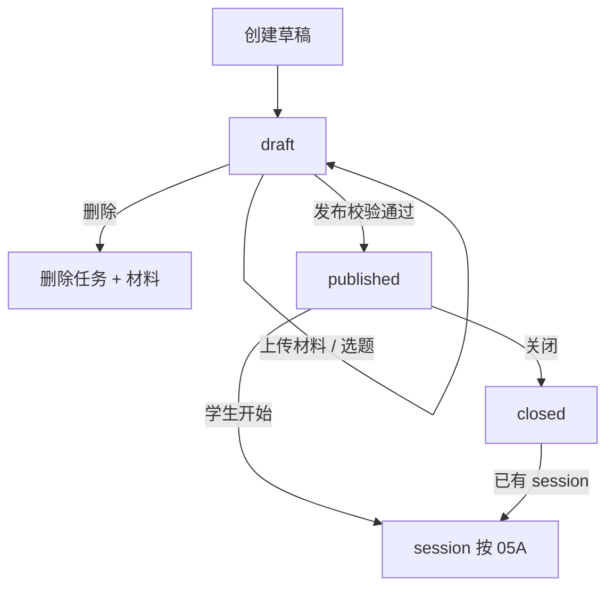
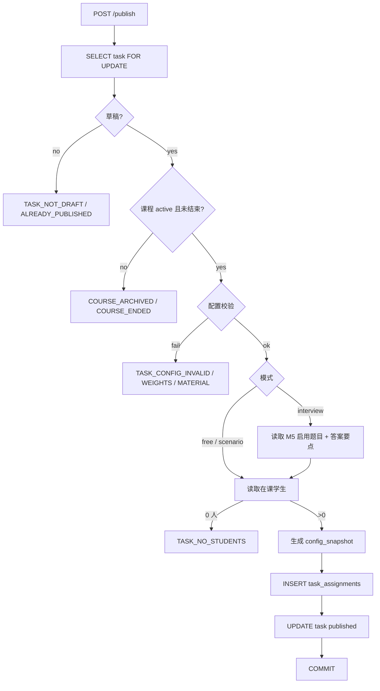
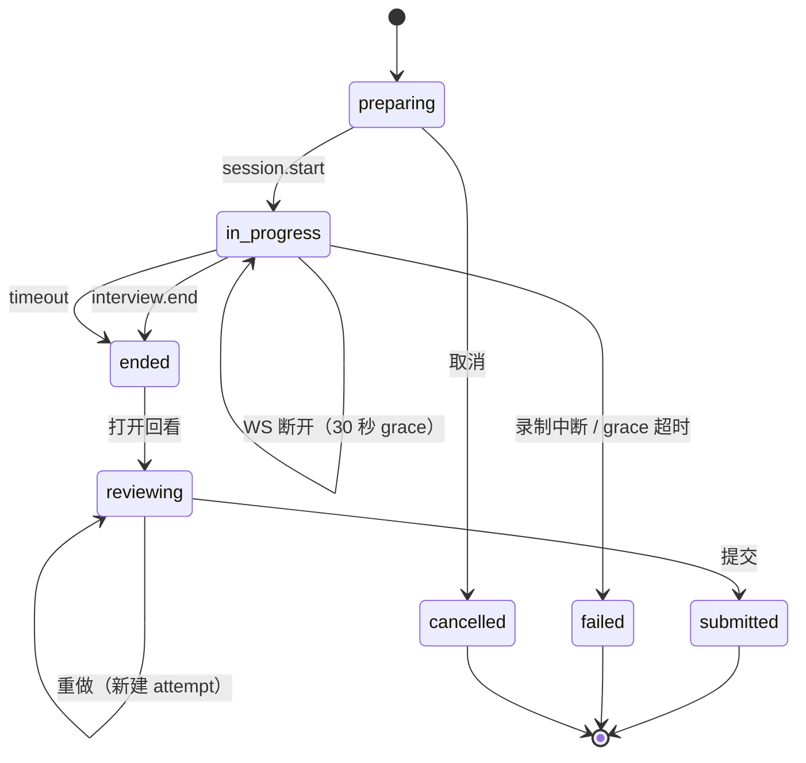
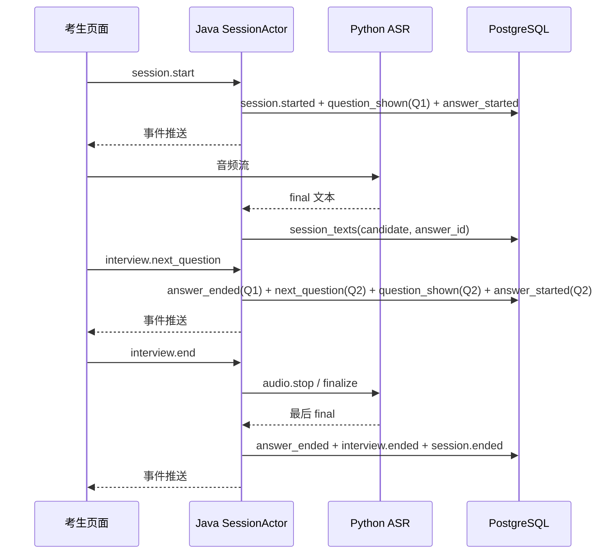
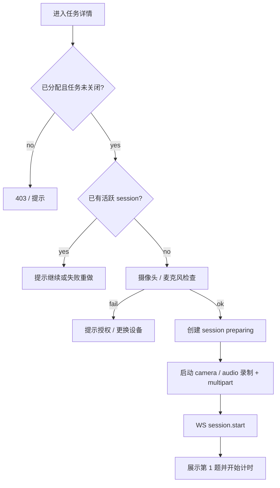

# 05C M3 任务配置与结构化面试

> 上位文档：[M3 虚拟课堂与录制](../requirements/M3-虚拟课堂与录制.md)、[M4 AI 评测与反馈](../requirements/M4-AI评测与反馈.md)、[M5 结构化面试题库](../requirements/M5-结构化面试题库.md)、[00 总体设计](00-总体设计.md)、[01 数据模型与迁移](01-数据模型与迁移.md)、[02 API 与实时协议](02-API与实时协议.md)
> 版本：V0.3（讨论稿）　状态：待评审　更新日期：2026-11-03
> 范围：任务配置、M5 选题、发布快照、结构化面试 UI 与状态；课堂状态 / WS 见 05A，录制 / 上传 / 回放见 05B

## 1. 范围

### 1.1 本轮实现

- 教师创建、编辑草稿、发布、关闭试讲任务
- 三种模式：自由试讲、情景模拟、结构化面试
- 参考材料上传、解析、预览与替换
- 虚拟学生配置：1—30 人、五个参数、个性文本
- 评分权重：自由 / 情景五维、结构化面试三维
- 从本校 M5 题库筛选、手动选题、排序、设置总时长
- 发布校验、在课学生快照、不可变配置快照
- 学生任务列表、任务详情、面试前设备检查
- 结构化面试房间：逐题展示、语音作答、实时转写、总计时、下一题、结束
- 面试结束后的回看、提交、重做
- 面试事件与统一文本流写入，供 M4 评测

### 1.2 不做

- 教材 / 教案资源库、板书模板、优秀范例（M5 后续）
- 任务复制、任务模板、跨课程复用
- 草稿协作编辑、版本历史、字段级冲突合并
- 结构化面试 LLM 追问、考官语音提问
- 面试题预览给学生、答案要点展示给学生
- 面试暂停 / 恢复、单题限时、提前准备倒计时
- 服务端 PDF / DOCX 转码、扫描版 PDF OCR
- 管理员创建 / 编辑任务
- 移动端适配

### 1.3 FR 映射

| FR | 覆盖 |
|---|---|
| FR-M3-01 任务创建与发布 | 完整：草稿、模式配置、校验、发布快照、分配名单 |
| FR-M3-02 虚拟学生配置 | 完整：人数、五参数、个性文本、预览 |
| FR-M3-03 学生任务列表 | 页面与分组；session 状态以 05A 为准 |
| FR-M3-04 开始试讲与共享窗口 | 面试设备检查与开始流程；共享窗口见 05A / 05B |
| FR-M3-09 结构化面试 | 完整：选题、快照、面试房间、事件、计时、结束 |
| FR-M3-10 录制、回放与提交 | 面试回看 / 提交入口；录制与回放见 05B |
| FR-M3-11 事件、状态机与 WebSocket | 面试命令 / 事件；session 状态机见 05A |
| FR-M4-11 结构化面试评测模板 | 提供快照、`interview.*` 事件与统一文本流 |

## 2. 依赖与边界

| 依赖 | 关系 |
|---|---|
| M1 账号 | JWT 身份、`account_type`、学校范围 |
| M2 课程 | 课程老师组、在课学生、课程状态与 `end_at` |
| M5 题库 | 只读类别 / 题目；发布时取题干与答案要点 |
| 05A 状态机 | session 创建、开始、结束、WS 命令与事件、tick |
| 05B 录制 | 面试 camera + audio 两路录制、上传、回看 |
| M4 | 只读 `config_snapshot`、`session_texts`、`interview.*` 事件 |

- 05C 只负责配置、发布和面试交互；session 生命周期以 05A 为准，录制以上传 05B 为准。
- Java 持有任务、快照、面试题目状态；Python 只做 ASR / 评测，不参与选题与发布。
- 学生端永远拿不到参考材料、答案要点、权重、虚拟学生参数。

## 3. 任务模型与状态机

### 3.1 任务状态

```text
draft ──publish──→ published ──close──→ closed
  │                    │
  └──delete──→ (删除)   └── 已有 session 按 05A 继续
```

| 状态 | 进入 | 可编辑 | 学生可见 | 允许操作 |
|---|---|---|---|---|
| `draft` | 创建任务 | 是 | 否 | 编辑、上传材料、选题、删除、发布 |
| `published` | 发布成功 | 否 | 已分配学生 | 查看、关闭；学生开始试讲 |
| `closed` | 教师关闭 | 否 | 已分配学生 | 只读；不创建新 session；已有 session 按 05A |

- 发布后配置锁定，任何字段不可改；需要调整只能新建任务。
- 草稿删除为物理删除：删除任务、虚拟学生、MinIO 材料对象；已发布任务不能删除。
- 任务关闭不删除提交件、录像、评测与分数。
- 课程归档或 `end_at` 已过：不能新建 / 发布任务；已有提交按 M7 规则可评分。

### 3.2 模式

| 模式 | `mode` | 课堂形态 | 评测维度 |
|---|---|---|---|
| 自由试讲 | `free` | 虚拟学生 + 共享窗口 + 三路录制 | 五维 |
| 情景模拟 | `scenario` | 同自由试讲，附角色 / 情境 | 五维 |
| 结构化面试 | `interview` | 考官文字提问 + 人像 / 麦克风 | 三维 |

- 模式在创建时选择；草稿内允许切换，切换时必须确认并清空不兼容配置（参考材料、虚拟学生、情景、题目）。
- 切换模式后权重恢复为新模式默认值。
- 已发布任务模式不可变。

### 3.3 基本字段

| 字段 | 必填 | 规则 |
|---|---|---|
| `course_id` | 是 | 路由带入；课程 active 且未过 `end_at`；操作者在老师组 |
| `mode` | 是 | `free` / `scenario` / `interview` |
| `topic` | 是 | 1—100 字 |
| `textbook_version` | 条件 | 自由 / 情景必填 1—100 字；结构化面试可空 |
| `duration_recommended_seconds` | 是 | 1—3600 秒；自由 / 情景默认 900 秒 |
| `duration_max_seconds` | 是 | 1—3600 秒；自由 / 情景默认 1200 秒；不得小于推荐时长 |
| `rubric_weights` | 是 | 按模式校验；发布时和必须为 100 |
| `reference_material` | 条件 | 自由 / 情景必填；结构化面试必须为空 |
| `virtual_students` | 条件 | 自由 / 情景 1—30 人；结构化面试必须为空 |
| `scenario_config` | 否 | 仅情景模式可填 |
| `question_config` | 条件 | 仅结构化面试；1—10 题 |

- 结构化面试只有一个总时长：`duration_recommended_seconds = duration_max_seconds = 总时长`，学生界面只显示总时长。
- 自由 / 情景到 `duration_max_seconds` 自动结束；结构化面试到总时长自动结束。
- 草稿允许字段不完整（例如权重和暂不为 100、未选够题），但类型、范围、长度必须合法；完整性在发布时统一校验。

## 4. 任务配置

### 4.1 参考材料

自由试讲 / 情景模拟必须上传教材原文或教案；结构化面试不需要。

| 项目 | 规则 |
|---|---|
| 格式 | `.pdf` / `.docx` / `.txt` / `.md` |
| 大小 | ≤ 20 MB |
| 编码 | TXT / MD 按 UTF-8，失败回退 GB18030 |
| 解析 | Java 同步解析：PDFBox / POI；PDF 无可提取文字时报错 |
| 解析文本 | 20—100,000 字符；超限要求拆分上传 |
| 存储 | 原文件存 MinIO；解析文本存 `tasks.reference_material` 与配置快照 |
| 学生可见 | 不可见；接口永不返回 |

- 对象键：`materials/{school_id}/{course_id}/{task_id}/{material_id}.{ext}`。
- 上传成功返回 `material_id`、文件名、大小、字符数、解析状态与前 500 字预览。
- 替换材料：先上传并解析成功，再删除旧对象；解析失败保留旧材料。
- 草稿删除时删除材料对象；已发布任务的材料只读，随任务保留。
- PDF 扫描件本轮不做 OCR，提示“请上传可复制文字的 PDF 或教案文本”。
- 材料解析失败不阻塞草稿保存；若没有有效旧材料则阻止发布；替换失败且旧材料仍有效时保留旧材料，发布不受影响，错误响应返回当前材料。

### 4.2 虚拟学生

仅自由试讲 / 情景模拟。

| 字段 | 规则 |
|---|---|
| 人数 | 1—30，默认 3 |
| `name` | 1—20 字；可重新生成 |
| `avatar` | 预置头像 ID；可重新生成 |
| `personality_text` | ≤ 500 字；供 LLM 生成提问 / 回答 / 行为 |
| `activity` | 0—1，默认 0.5 |
| `question_rate` | 0—1，默认 0.5 |
| `ability` | 0—1，默认 0.5 |
| `attention_baseline` | 0—1，默认 0.5 |
| `discipline_probability` | 0—1，默认 0.5 |
| `seat_no` / `sort_order` | 由前端排序生成 |

- UI 以百分比显示五个参数；保存时转 0—1。
- 支持添加、删除、逐个调整、随机姓名 / 头像、预览。
- `PATCH` 采用整组替换：请求带完整 `virtual_students` 数组，后端事务内删除旧行、插入新行。
- 发布时复制到配置快照；学生只看到姓名、头像、状态，不返回参数与个性文本。

### 4.3 情景配置

仅情景模拟，可选：

```json
{
  "role": "班主任",
  "situation": "学生上课玩手机，课堂开始骚动"
}
```

- `role` ≤ 200 字，`situation` ≤ 1000 字。
- 情景只影响 LLM 生成内容，不赋予虚拟学生自主触发权；MVP 仍由教师按钮触发提问。
- 发布时写入快照；自由试讲固定为 `null`。

### 4.4 评分权重

| 模式 | 维度 key | 默认权重 |
|---|---|---|
| 自由 / 情景 | `content` 教学内容 | 30 |
| 自由 / 情景 | `expression` 教学表达 | 20 |
| 自由 / 情景 | `interaction` 课堂互动与控场 | 20 |
| 自由 / 情景 | `board` 板书 / PPT | 15 |
| 自由 / 情景 | `time` 时间管理 | 15 |
| 结构化面试 | `content` 教学内容 | 40 |
| 结构化面试 | `expression` 教学表达 | 30 |
| 结构化面试 | `time` 时间管理 | 30 |

- 每个维度 0—100 整数；发布时适用维度权重和必须为 100。
- 0 表示该维度不计入总分，但 M4 仍可生成维度分；报告展示“权重 0%”。
- UI 提供滑杆 + 数字输入，实时显示合计；合计不为 100 时不允许发布。
- 提供“恢复默认权重”。
- 权重写入 `tasks.rubric_weights` 与快照；M4 按快照权重合成总分。
- M7 的 AI / 教师权重是另一套配置，不在本页设置。

### 4.5 结构化面试选题

#### 4.5.1 来源与过滤

- 只读本校 M5 题库：`GET /question-bank/categories`、`GET /question-bank/questions`。
- 只显示启用类别下的启用题目；答案要点为空的题目不可选。
- 支持类别筛选、关键词搜索（题干 / 答案要点）、分页。
- 跨校题目一律不可见；后端再次校验 `school_id`。

#### 4.5.2 选择规则

| 项目 | 规则 |
|---|---|
| 数量 | 1—10 题；发布时至少 1 题 |
| 去重 | 同一任务不能重复选择同一 `question_id` |
| 顺序 | 教师可拖动或上下移动；顺序写入快照 |
| 时长 | 总时长 1—60 分钟，默认 5 分钟 |
| 默认 | 新建面试任务时优先预选前 2 道可用题目；不足 2 道则全选；教师可取消 |
| 同题 | 同一任务所有学生题目、顺序完全一致 |
| 预览 | 教师可展开查看题干与答案要点 |

- 选择器跨分页保留已选题目。
- 题目在草稿保存后到发布前被编辑：发布时读取 M5 最新题干与答案要点。
- 题目被停用 / 删除 / 答案要点被清空：发布失败，返回具体题目。
- 类别被停用：已选题目若本身仍启用，不阻止发布；快照保存类别名称。
- M5 不可用：不能新建面试任务，草稿可保存；发布返回 503。
- 总时长唯一来源为 `question_config.total_duration_seconds`；任务的 `duration_recommended_seconds` / `duration_max_seconds` 在保存 / 发布时由它派生，必须三者相等，PATCH 不允许单独修改面试任务的时长字段。

#### 4.5.3 草稿与快照

草稿只存题目 ID、顺序与总时长：

```json
{
  "question_ids": ["q1", "q2"],
  "total_duration_seconds": 300
}
```

发布时读取 M5 并写入快照：

```json
{
  "total_duration_seconds": 300,
  "question_count": 2,
  "questions": [
    {
      "question_id": "q1",
      "order": 1,
      "stem": "题干",
      "answer_points": "答案要点",
      "category_id": "c1",
      "category_name": "教育理念"
    }
  ]
}
```

- 快照是学生面试与 M4 评测的唯一题目来源；M5 后续编辑、停用、改名不影响已发布任务。
- 学生接口只返回当前题目的 `order`、`total`、`stem`；不返回 `answer_points`、全部题目列表、权重或参考材料，也不一次性返回所有题目。
- 回放时间线从 `interview.*` 事件与快照恢复题目文本。

### 4.6 配置快照

发布时生成不可变 `config_snapshot`，`config_version=1`。

```json
{
  "schema_version": 1,
  "task_id": "uuid",
  "course_id": "uuid",
  "school_id": "uuid",
  "mode": "interview",
  "topic": "教师资格证结构化面试",
  "textbook_version": null,
  "duration": {
    "recommended_seconds": 300,
    "max_seconds": 300
  },
  "weights": {
    "content": 40,
    "expression": 30,
    "time": 30
  },
  "reference_material": null,
  "scenario": null,
  "virtual_students": [],
  "interview": {
    "total_duration_seconds": 300,
    "question_count": 2,
    "questions": [
      {
        "question_id": "q1",
        "order": 1,
        "stem": "题干",
        "answer_points": "答案要点",
        "category_id": "c1",
        "category_name": "教育理念"
      }
    ]
  },
  "published_at": "2026-11-03T10:00:00Z",
  "published_by": "account_uuid"
}
```

自由 / 情景的差异：

```json
{
  "mode": "free",
  "reference_material": {
    "material_id": "uuid",
    "filename": "教材第三章.pdf",
    "object_key": "materials/.../material.pdf",
    "mime": "application/pdf",
    "size": 123456,
    "parsed_text": "……",
    "char_count": 12000
  },
  "scenario": null,
  "virtual_students": [
    {
      "virtual_student_id": "uuid",
      "name": "林小雨",
      "avatar": "avatar-03",
      "personality_text": "……",
      "activity": 0.6,
      "question_rate": 0.5,
      "ability": 0.7,
      "attention_baseline": 0.5,
      "discipline_probability": 0.4,
      "seat_no": 1,
      "sort_order": 1
    }
  ],
  "interview": null
}
```

- 快照不含学生名单；名单在 `task_assignments`。
- 快照写入后不再更新；M4 通过 `tasks.config_snapshot` / `config_version` 读取。
- 快照中的 `published_at` 使用 UTC ISO-8601。

## 5. 发布流程

### 5.1 发布校验清单

| 校验 | 失败错误 |
|---|---|
| 操作者在课程老师组 | `TEACHER_NOT_IN_GROUP` 403 |
| 课程 active 且 `end_at` 未过 | `COURSE_ARCHIVED` / `COURSE_ENDED` 422 |
| 任务为草稿 | `TASK_NOT_DRAFT` 422 / `TASK_ALREADY_PUBLISHED` 409 |
| 课题、教材版本、时长合法 | `TASK_CONFIG_INVALID` 422 |
| 权重和 = 100 | `WEIGHT_SUM_INVALID` 422 |
| 自由 / 情景：材料已解析 | `REFERENCE_MATERIAL_MISSING` / `MATERIAL_PARSE_FAILED` 422 |
| 自由 / 情景：虚拟学生 1—30 | `TASK_CONFIG_INVALID` 422 |
| 面试：题目 1—10、无重复 | `QUESTION_COUNT_INVALID` / `QUESTION_DUPLICATED` 422 |
| 面试：题目启用、答案要点非空、本校 | `QUESTION_DISABLED` / `ANSWER_POINTS_MISSING` / `CROSS_SCHOOL_ACCESS` |
| 面试：题库可用 | `QUESTION_BANK_EMPTY` 422 / `SERVICE_UNAVAILABLE` 503 |
| 课程至少 1 名在课学生 | `TASK_NO_STUDENTS` 422 |

- 校验一次返回全部字段错误：`{"code":"TASK_CONFIG_INVALID","fields":[{"field":"rubric_weights","message":"权重和必须为 100"}]}`。
- 面试题目错误返回 `question_ids`，前端在选题器中定位。

### 5.2 发布事务

```text
BEGIN
  SELECT task FOR UPDATE
  校验任务为 draft
  校验课程 / 老师组 / 在课学生
  按模式校验配置
  面试：读取 M5 当前题目（启用 + 答案要点）
  生成 config_snapshot（config_version = 1）
  INSERT task_assignments SELECT 在课学生
  UPDATE task SET status=published, config_snapshot, config_version=1, published_at
COMMIT
```

- 分配名单：`task_assignments` 写入当时 `course_students.status='active'` 的学生；`status=assigned`。
- 若插入 0 行 → 回滚并返回 `TASK_NO_STUDENTS`。
- 学生之后加入 / 退出课程不改变已发布任务的分配名单。
- 发布不发送 WS；学生任务列表轮询 / 下次进入时可见。
- 发布成功后配置只读；教师可关闭任务。

### 5.3 并发与幂等

- 发布用 `SELECT ... FOR UPDATE` 锁任务行；并发发布只有一个成功，另一个返回 `TASK_ALREADY_PUBLISHED`。
- 重复发布已发布任务返回 409；前端可提示“已发布”并刷新。
- 发布事务失败全部回滚，不留下部分分配或快照。
- 发布后不允许再次上传材料、修改题目、改权重。

### 5.4 关闭任务

- `published → closed`；记录 `closed_at`。
- 关闭后不创建新 session；`in_progress` 可继续到结束；`ended / reviewing` 允许 24 小时内提交。
- 关闭不删除任务、提交件、录像、评测。
- 关闭后不可重新发布；需要新任务另建。

## 6. 结构化面试

### 6.1 面试状态机

session 外层沿用 05A：

```text
preparing → in_progress → ended → reviewing → submitted
     │           │           │
     └───────────┴───────────┴──→ cancelled / failed
```

`in_progress` 内部：

```text
question 1 shown / answer window
        │ next_question
        ▼
question 2 shown / answer window
        │ ...
        ▼
question n shown / answer window
        │ end / timeout
        ▼
      ended
```

| 状态 | 说明 |
|---|---|
| `presenting` | 当前题目已展示，作答窗口打开；考生可随时说话 |
| `ended` | 面试结束，停止计时与录音，进入回看 |

- 不设“开始作答”按钮：题目展示即打开作答窗口，`interview.answer_started` 与 `interview.question_shown` 同时产生。
- 本题阅读时间计入总时长，也计入本题用时；M4 以 ASR 文本时间戳定位实际说话段。
- 不设单题限时、暂停、返回上一题。
- 最后一题展示后，“下一题”不可用，主按钮变为“结束面试”。

### 6.2 事件时序

| 触发 | 事件顺序 | 写入 |
|---|---|---|
| `session.start` | `session.started` → `interview.question_shown` → `interview.answer_started` | 考官题目文本、当前 `answer_id` |
| `interview.next_question` | `interview.answer_ended` → `interview.next_question` → `interview.question_shown` → `interview.answer_started` | 新考官题目文本、新 `answer_id` |
| `interview.end` | `interview.answer_ended` → `interview.ended` → `session.ended` | 结束原因 `manual` |
| 到总时长 | `interview.answer_ended` → `interview.ended` → `session.ended` | 结束原因 `timeout` |
| 最后一题再下一题 | 无事件，返回 `INTERVIEW_NO_MORE_QUESTIONS` | 状态不变 |

- 事件 payload 沿用 05A / 02：
  - `interview.question_shown`：`{question_id, order, total, text}`
  - `interview.answer_started` / `interview.answer_ended`：`{question_id, answer_id}`
  - `interview.next_question`：`{question_id, order}`（新题）
  - `interview.ended`：`{}`
  - `session.ended`：`{reason, duration_ms}`，`reason` 为 `manual` / `timeout`
- `answer_id` 在题目展示时生成，UUIDv7；同一题的所有 ASR final 段共用该 `answer_id`。
- 事件先落库再推送；`seq` 按 session 单调递增。

### 6.3 计时与结束

- 总计时以服务端 `session.started` 为起点，权威时间在 Java；前端只做展示。
- `session.time_tick` 每秒携带 `interview.remaining_ms`、`current_index`、`total`、`question_elapsed_ms`。
- 剩余 60 秒提示一次；剩余 30 秒再次提示并变红；到 0 自动结束。
- 提前结束：允许；若有未展示题目，确认框提示“还有 N 题未作答”。
- 当前题未检测到作答文本时点“下一题”，确认“尚未检测到作答，确定进入下一题？”。
- 结束流程：
  1. 客户端停止采集并发送 `audio.stop`；
  2. Java 请求 Python 对流式 ASR 做最终收尾，最多等待 2 秒；
  3. 写入最后 final 文本；
  4. 写 `interview.answer_ended`、`interview.ended`、`session.ended`；
  5. 按 05A 强制 flush 事件与文本；
  6. 进入 05B 上传 / 回看。
- ASR 收尾超时或失败：不阻塞结束；已获得文本保留，M4 将表达维度标低置信或 partial。
- 录制中断 / 摄像头或麦克风 track ended：session `failed`，不能提交，按 05B 重做。
- 控制 WS 断开：进入 30 秒 grace；session 保持 `in_progress`，页面仍存活且 `recording_state=active` 时可 `session.resume` 重连并补发事件；超时 / 页面刷新 / 录制器丢失 → session `failed`。

### 6.4 文本与事件

统一写入 `m3.session_texts`：

| 角色 | `speaker_type` | `source` | `kind` | `speaker_ref` |
|---|---|---|---|---|
| 考官题目 | `examiner` | `manual` | `question` | `question_id` |
| 考生回答 | `candidate` | `asr` | `answer` | `answer_id` |

- 考官题目在 `interview.question_shown` 时写一行，`at_ms` 为展示时间。
- 考生按 ASR final 段一行；`start_ms / end_ms / at_ms` 来自 ASR；`confidence` 为 ASR 置信度。
- partial 文本只推前端临时显示，不落库。
- 同一 `answer_id` 可对应多行考生文本；M4 按 `answer_id` 聚合。
- 答案要点只存在快照，不写入 `session_texts`，不推送给学生。
- 事件通过 `question_id` / `answer_id` 与文本关联。

### 6.5 学生可见性

学生任务详情与面试快照只返回：

```json
{
  "mode": "interview",
  "topic": "...",
  "duration_ms": 300000,
  "question_count": 2,
  "teacher_group": ["..."],
  "interview": {
    "current_index": 1,
    "total": 2,
    "question": {"order": 1, "stem": "题干"},
    "question_elapsed_ms": 12000,
    "remaining_ms": 288000
  }
}
```

- 不返回：`answer_points`、全部题目列表、`rubric_weights`、`reference_material`、其他学生信息。
- 30 秒 grace 内重连快照只恢复当前题目，不返回历史题目全文；历史题目可通过回放时间线查看。
- 页面刷新 / MediaRecorder 丢失 / 30 秒超时：session failed，不能靠重连快照恢复。
- 面试中不显示答案要点、不显示其他考生、不显示评分。

## 7. 接口

### 7.1 任务配置

| 方法 | 路径 | 权限 | 说明 |
|---|---|---|---|
| POST | `/api/v1/courses/{course_id}/tasks` | `task:create` | 创建草稿 |
| PATCH | `/api/v1/tasks/{task_id}` | `task:create` | 编辑草稿 |
| DELETE | `/api/v1/tasks/{task_id}` | `task:create` | 删除草稿 |
| GET | `/api/v1/tasks/{task_id}` | `task:read` | 任务详情（按角色裁剪） |
| POST | `/api/v1/tasks/{task_id}/publish` | `task:publish` | 发布 |
| POST | `/api/v1/tasks/{task_id}/close` | `task:close` | 关闭 |
| POST | `/api/v1/tasks/{task_id}/material` | `task:create` | 上传 / 替换参考材料 |
| GET | `/api/v1/tasks/{task_id}/material` | `task:read` | 材料元数据 + 解析文本（教师组） |
| DELETE | `/api/v1/tasks/{task_id}/material` | `task:create` | 删除材料 |

创建请求：

```json
{
  "mode": "interview",
  "topic": "教师资格证结构化面试",
  "textbook_version": null,
  "duration_recommended_seconds": 300,
  "duration_max_seconds": 300,
  "rubric_weights": {"content": 40, "expression": 30, "time": 30},
  "question_config": {"question_ids": ["q1", "q2"], "total_duration_seconds": 300}
}
```

- `PATCH` 为部分更新；`virtual_students`、`question_config`、`rubric_weights` 按整体替换。
- `mode` 变更只允许在草稿；服务端清空不兼容字段并返回新配置。
- 草稿保存不要求权重和为 100、题目数量达标；范围与类型错误返回 422。
- 发布响应：

```json
{
  "task_id": "uuid",
  "status": "published",
  "config_version": 1,
  "assigned_count": 28,
  "published_at": "2026-11-03T10:00:00Z"
}
```

### 7.2 材料接口

`POST /api/v1/tasks/{task_id}/material`：`multipart/form-data`，字段 `file`。

```json
{
  "material_id": "uuid",
  "filename": "教材第三章.pdf",
  "size": 123456,
  "mime": "application/pdf",
  "char_count": 12000,
  "parse_status": "parsed",
  "preview": "前 500 字……"
}
```

- 仅草稿；已发布 / 关闭返回 `TASK_NOT_DRAFT`。
- 结构化面试上传材料返回 `MATERIAL_NOT_APPLICABLE`。
- 解析失败返回 422 `MATERIAL_PARSE_FAILED`，不保存为有效材料。
- `GET` 返回完整 `parsed_text`；仅课程老师组可访问，学生 403。
- `DELETE` 删除 MinIO 对象并清空 `reference_material`。

### 7.3 面试会话

沿用 02 / 05A：

| 方法 / 通道 | 路径 | 说明 |
|---|---|---|
| POST | `/api/v1/tasks/{task_id}/sessions` | 创建面试 session |
| POST | `/api/v1/sessions/{session_id}/start` | 开始（幂等兜底） |
| POST | `/api/v1/sessions/{session_id}/end` | 结束（幂等兜底） |
| WS | `/ws/v1/sessions/{session_id}` | 控制通道 |
| WS | `/ws/v1/sessions/{session_id}/perception` | 音频通道 |

- 创建 session 时校验：任务已发布、学生已分配、任务未关闭、学生当前在课程 `course_students.status='active'`、无其他 `preparing / in_progress` session。
- 同一学生同一任务同时只允许一个活跃 session；重复创建返回 `SESSION_ACTIVE_EXISTS`。
- `interview.next_question` / `interview.end` 为 WS 命令；REST `/end` 等价于 `interview.end`。
- 创建响应包含 `session_id`、`attempt_no`、`mode`、`public_config`（不含答案要点）。

### 7.4 新增错误码

| 错误码 | HTTP | 说明 |
|---|---|---|
| `COURSE_ENDED` | 422 | 课程已结束，不能新建 / 发布任务 |
| `TASK_CONFIG_INVALID` | 422 | 任务配置不完整或字段非法 |
| `MATERIAL_NOT_APPLICABLE` | 422 | 结构化面试不需要参考材料 |
| `MATERIAL_PARSE_FAILED` | 422 | 材料解析失败 |
| `MATERIAL_TOO_LARGE` | 422 | 材料超过 20 MB 或解析文本超限 |
| `MATERIAL_TYPE_UNSUPPORTED` | 422 | 材料格式不支持 |
| `QUESTION_COUNT_INVALID` | 422 | 面试题目数量不在 1—10 |
| `QUESTION_DUPLICATED` | 422 | 面试题目重复 |
| `INTERVIEW_NO_MORE_QUESTIONS` | 422 | 已是最后一题 |
| `SESSION_ACTIVE_EXISTS` | 409 | 已有进行中的面试 session |

## 8. 权限

| 操作 | 学生（已分配） | 课程老师组 | 其他教师 | 管理员 |
|---|---|---|---|---|
| 查看任务公开信息 | 可 | 可 | 不可 | 不可 |
| 查看完整配置 / 答案要点 / 材料 | 不可 | 可 | 不可 | 不可 |
| 创建 / 编辑 / 删除草稿 | 不可 | 可 | 不可 | 不可 |
| 发布 / 关闭 | 不可 | 可 | 不可 | 不可 |
| 上传 / 删除材料 | 不可 | 可 | 不可 | 不可 |
| 开始面试 | 本人 | — | — | — |
| 查看面试录像 / 报告 | 本人 | 本课程 | 不可 | 不可 |
| 管理 M5 题库 | 不可 | 本校 | 不可 | 本校 |

- 资源级校验：课程老师组、任务所属课程、学生分配关系、同校。
- 跨校一律 403 `CROSS_SCHOOL_ACCESS`。
- 管理员不能创建、发布、查看任务配置或录像。

## 9. 页面与交互

### 9.1 路由

| 路由 | 页面 | 角色 |
|---|---|---|
| `/courses/{courseId}/tasks` | 课程任务列表 | 课程老师组 |
| `/courses/{courseId}/tasks/new` | 新建任务 | 课程老师组 |
| `/tasks/{taskId}/edit` | 编辑草稿 | 课程老师组 |
| `/tasks/{taskId}` | 任务详情 / 提交名单 | 课程老师组 |
| `/student/tasks` | 学生任务列表 | 学生 |
| `/student/tasks/{taskId}` | 任务详情 / 面试前检查 | 已分配学生 |
| `/student/sessions/{sessionId}/interview` | 结构化面试房间 | 本人 |
| `/student/sessions/{sessionId}/review` | 回看 / 提交 | 本人 |
| `/student/sessions/{sessionId}/report` | 评测报告 | 本人 / 老师组 |

- 管理员访问任务路由返回 403 页面；本轮管理员不参与 M3。
- 学生访问非本人 session 返回 403。

### 9.2 教师任务列表

```text
┌ 课程 / 任务 ──────────────────────────────────────────────┐
│ [全部] [草稿] [已发布] [已关闭]   模式 [全部 ▾]  [+ 新建任务] │
├───────────────────────────────────────────────────────────┤
│ 课题              模式      时长    题目/学生   状态   提交   │
│ 教师资格证面试    结构化    5 分钟   2 题       已发布 18/28  │
│ 荷塘月色          自由      20 分钟  3 人       草稿   —      │
└───────────────────────────────────────────────────────────┘
```

- 行点击进入任务详情；草稿行显示“继续编辑”。
- 已发布行显示提交进度；已关闭行灰显。
- 空态：“还没有任务，创建第一个试讲任务”。

### 9.3 新建 / 编辑任务（布局 B）

```text
┌ 返回 / 新建任务 ───────────────────────────────────────────┐
│ ┌ 左侧表单 720 ─────────────────────┐ ┌ 右侧摘要 320 ───┐ │
│ │ 1 基本信息                         │ │ 模式：结构化面试 │ │
│ │   课题 [________________]          │ │ 时长：5 分钟     │ │
│ │   教材版本 [____________]          │ │ 题目：2 题       │ │
│ │                                    │ │ 权重：40/30/30   │ │
│ │ 2 模式与内容                       │ │                  │ │
│ │   [自由] [情景] [结构化]           │ │ 发布检查         │ │
│ │   ┌ 面试：已选题目列表 ─────────┐  │ │ ✓ 基本信息       │ │
│ │   │ 1 题干...        [↑][↓][×] │  │ │ ✓ 题目 2/10      │ │
│ │   │ 2 题干...        [↑][↓][×] │  │ │ ✓ 权重 100%      │ │
│ │   └ [从题库选题] ──────────────┘  │ │ ✓ 在课学生 28    │ │
│ │                                    │ │                  │ │
│ │ 3 评分权重                         │ │ [保存草稿]       │ │
│ │   教学内容 [====----] 40           │ │ [发布任务]       │ │
│ │   教学表达 [======--] 30           │ │                  │ │
│ │   时间管理 [======--] 30  合计 100 │ │                  │ │
│ │                                    │ │                  │ │
│ │ 4 发布设置                         │ │                  │ │
│ │   总时长 [5] 分钟  [保存] [发布]   │ │                  │ │
│ └────────────────────────────────────┘ └──────────────────┘ │
└─────────────────────────────────────────────────────────────┘
```

- 左侧按 1—4 分节；右侧摘要 `position: sticky`，随滚动固定。
- 模式切换为分段卡片；切换时弹确认，说明将清空不兼容配置。
- 自由 / 情景显示：参考材料上传、虚拟学生配置、情景设定（仅情景）。
- 结构化面试显示：题目选择器、总时长；隐藏参考材料与虚拟学生。
- 草稿自动保存：变更后 2 秒防抖 `PATCH`；右上角显示“保存中 / 已保存 HH:mm / 保存失败”。
- 离开页面时若有未保存变更，弹确认。
- 发布前打开确认弹窗，展示检查清单、分配人数、发布后不可修改提示。
- 发布成功后跳转任务详情；失败定位到具体字段。

### 9.4 选题抽屉

```text
┌ 从题库选择题目 ──────────────────────────────────────────────┐
│ 搜索 [______________]  类别 [全部 ▾]                         │
│ ┌ 类别 200 ─┐ ┌ 题目列表 420 ─────────┐ ┌ 已选 300 ───────┐ │
│ │ 全部      │ │ ☑ 题干第一行...        │ │ 1 题干... [×]   │ │
│ │ 教育理念  │ │   教育理念 · 答案要点 ▸│ │ 2 题干... [×]   │ │
│ │ 班级管理  │ │ ☐ 题干第一行...        │ │ 3 题干... [×]   │ │
│ │ 应急应变  │ │   班级管理 · 答案要点 ▸│ │                 │ │
│ └───────────┘ └───────────────────────┘ └─────────────────┘ │
│ 已选 3/10    总时长 [5] 分钟        [取消] [确定]            │
└──────────────────────────────────────────────────────────────┘
```

- 抽屉宽 960 px；类别栏固定，题目列表滚动，已选栏固定。
- 题目行：复选框、题干两行截断、类别标签、答案要点预览入口。
- 答案要点预览用 popover；学生端永不出现。
- 不可选题目显示禁用原因：“无答案要点 / 已停用”。
- 已选栏支持拖动排序和上下移动；超过 10 题时阻止勾选并提示。
- 搜索 300 ms 防抖；翻页保留已选。
- 确定后回到表单，已选列表立即更新；取消不改变原选择。

### 9.5 发布确认

```text
┌ 发布任务 ───────────────────────────────┐
│ 发布后配置锁定，学生将看到该任务。       │
│                                        │
│ ✓ 基本信息完整                          │
│ ✓ 题目 2 道，均有答案要点               │
│ ✓ 权重合计 100%                         │
│ ✓ 在课学生 28 人                        │
│                                        │
│ 分配学生：28 人                         │
│ [取消]                       [确认发布] │
└────────────────────────────────────────┘
```

- 校验未通过时“确认发布”禁用，展示失败项与跳转。
- 发布请求进行中按钮 loading，防重复点击。

### 9.6 教师任务详情

```text
┌ 教师资格证结构化面试   已发布   [关闭任务] ────────────────┐
│ 课程：语文教学论  模式：结构化面试  时长：5 分钟            │
│ 题目：2 题  权重：40/30/30  发布时间：2026-11-03 10:00     │
├────────────────────────────────────────────────────────────┤
│ 学生名单（18/28 已提交）                                    │
│ 学生      班级      状态     提交时间      操作             │
│ 张三      语文2201  已提交   11-03 14:20   [回放] [报告]    │
│ 李四      语文2201  进行中   —            —                │
└────────────────────────────────────────────────────────────┘
```

- 草稿详情显示“继续编辑 / 删除草稿 / 发布”。
- 已发布详情只读配置 + 名单；可关闭任务。关闭后不立即删除临时录像：保留到 `max(ended_at + 24h, closed_at + 24h)`，已有 `ended / reviewing` 仍可在 24 小时内提交。
- 已关闭详情灰显，名单仍可查看回放 / 报告。
- 面试题目标题可展开查看题干与答案要点（教师组）。

### 9.7 学生任务列表与详情

```text
┌ 我的任务 ───────────────────────────────────────────────┐
│ [待开始 3] [进行中 1] [已提交 8]                         │
│ ┌ 教师资格证结构化面试 ────────────────────────────────┐ │
│ │ 结构化面试 · 2 题 · 5 分钟 · 语文教学论              │ │
│ │ 教师组：王老师 / 李老师        [开始面试]            │ │
│ └──────────────────────────────────────────────────────┘ │
└──────────────────────────────────────────────────────────┘
```

- 卡片只显示模式、题目数 / 时长、课程、老师组、状态。
- 进行中卡片显示“继续回看 / 重做”；已提交显示“查看回放 / 报告”。
- 任务关闭未提交显示“已关闭”，不可开始。

### 9.8 面试前检查

```text
┌ 返回 / 教师资格证结构化面试 ──────────────────────────────┐
│ ┌ 摄像头预览 16:9 ──────────────┐ ┌ 任务信息 ────────────┐ │
│ │                               │ │ 结构化面试            │ │
│ │                               │ │ 2 题 · 5 分钟         │ │
│ │                               │ │ 全程录制，不能暂停     │ │
│ └───────────────────────────────┘ │ 题目逐题展示           │ │
│ 麦克风 [||||||||......] 正常       │ 不显示答案要点         │ │
│ 摄像头 ✓   麦克风 ✓   网络 ✓       │ 到时间自动结束         │ │
│                                   │ [开始面试]            │ │
└───────────────────────────────────┴───────────────────────┘
```

- 必须摄像头 + 麦克风权限；不需要共享窗口。
- 设备检查通过前“开始面试”禁用，并给出具体原因。
- 已有进行中 session：显示“继续”或提示刷新失败需重做。
- 已有回看中的 attempt：显示“继续回看 / 重新开始”，并提示最多 5 个临时 attempt。
- 不展示题目内容、答案要点、权重。

### 9.9 结构化面试房间

```text
┌ 教师资格证结构化面试   第 1/2 题   04:32   ● REC ─────────┐
│ ┌ 摄像头 16:9 ───────────────────┐ ┌ 第 1 题 / 共 2 题 ┐ │
│ │                                │ │                  │ │
│ │                                │ │ 题干文字（28px）  │ │
│ │                                │ │                  │ │
│ │                                │ │ 本题用时 00:42    │ │
│ └────────────────────────────────┘ │                  │ │
│ 实时转写：……                       │ [下一题]          │ │
│                                    │ [结束面试]        │ │
├────────────────────────────────────┴──────────────────┤ │
│ 麦克风 [||||||||....]  摄像头 ✓  字幕 [开]   [结束面试]  │ │
└──────────────────────────────────────────────────────────┘
```

- 顶部：任务名、题号进度、总倒计时（monospace）、录制指示。
- 左侧：摄像头主画面 + 实时转写（可折叠）；右侧：题干、本题用时、操作。
- 底部：麦克风电平、设备状态、字幕开关、结束按钮。
- 题目切换时右侧淡入并短暂高亮题号；不弹全屏遮挡。
- 最后一题：“下一题”禁用，主按钮为“结束面试”。
- 剩余 60 秒倒计时变琥珀，30 秒变红并 toast；到 0 显示“时间到，正在结束面试”。
- “下一题”无作答文本时二次确认；结束面试有未作答题时二次确认。
- 不做暂停；页面刷新 / 录制器丢失 / 30 秒 grace 超时按 05A 失败，提示重做；控制 WS 断开 30 秒内可重连。
- 摄像头 / 麦克风中断立即提示并结束为 failed，跳转失败页。

### 9.10 回看与提交

- 复用 05B 布局 A，面试场景调整：
  - 主画面为摄像头；无屏幕流；
  - 右侧时间线按题目分组：题目展示、回答开始 / 结束；
  - 点击题目跳转到对应时间；
  - 底部播放控制同 05B。
- 上传未完成时显示进度，提交禁用。
- “提交”二次确认；提交后只读，不能重做该次。
- “重做”创建新 attempt，旧临时录像按 24 小时 / 5 个上限清理。
- 提交失败可重试；重复提交返回 `DUPLICATE_RESOURCE`。

### 9.11 视觉规范

沿用 B · 深蓝 + 琥珀：

| 元素 | 规则 |
|---|---|
| 页面背景 | 深蓝近黑 `#0B1220`；卡片 `#111C33` |
| 主色 | 琥珀 `#F5A524`；主按钮填充琥珀、深色文字 |
| 文本 | 主 `#E8EEF9`；次 `#8FA3C0` |
| 边框 | `rgba(255,255,255,0.08)`，1 px |
| 圆角 | 卡片 12 px；按钮 8 px；输入 8 px |
| 面试舞台 | 更深背景 `#070D18`，摄像头卡片 16:9 |
| 录制指示 | 红色圆点 + `REC`，呼吸动画 1.5 s |
| 倒计时 | 等宽字体；正常白、60 s 琥珀、30 s 红 |
| 动效 | 150—200 ms ease-out；避免大面积动画 |
| 字体 | 题干 28—32 px / 1.6；正文 14—16 px |

- 顶部导航 64 px；头像与账号菜单在右。
- 面试页隐藏非必要导航，保留退出 / 结束入口。
- 所有状态不只靠颜色区分，配文字 / 图标。

## 10. 组件与前端状态

| 组件 | 职责 |
|---|---|
| `TaskModeSelector` | 三模式卡片与切换确认 |
| `DurationFields` | 推荐 / 最高时长；面试只显示总时长 |
| `WeightEditor` | 五维 / 三维滑杆 + 数字，合计校验 |
| `MaterialUploader` | 拖拽上传、解析状态、预览、替换、删除 |
| `VirtualStudentEditor` | 学生卡片、五参数、增删、随机 |
| `QuestionPickerDrawer` | 类别筛选、搜索、勾选、排序、答案要点预览 |
| `PublishChecklist` | 右侧摘要与发布校验 |
| `PublishConfirmDialog` | 发布确认、分配人数、锁定提示 |
| `TaskSummaryCard` | 模式、时长、题目 / 学生、权重 |
| `AssignmentTable` | 学生名单、提交状态、回放 / 报告入口 |
| `DeviceCheck` | 摄像头预览、麦克风电平、权限与网络 |
| `InterviewRoom` | 面试房间容器、WS、计时、状态 |
| `InterviewQuestionPanel` | 题干、题号、本题用时、下一题 / 结束 |
| `InterviewTimer` | 总倒计时与颜色阈值 |
| `TranscriptPanel` | 实时转写与折叠 |
| `EndInterviewDialog` | 未作答题提示与确认 |
| `InterviewTimeline` | 回放题目 / 回答时间线 |

Pinia：

- `taskDraftStore`：当前草稿、脏标记、自动保存、校验结果。
- `interviewSessionStore`：session、当前题、剩余时间、录制状态、WS 连接状态。
- 服务端状态用 Pinia store / composable 缓存；不把答案要点放入全局持久化。

自动保存：

- 监听表单变更，2 秒防抖 `PATCH`；
- 保存中禁止发布按钮；
- 保存失败保留本地草稿并提示重试；
- 发布前强制保存并等待最新版本；
- 页面离开用 `beforeunload` / 路由守卫提示。

面试状态：

- 连接控制 WS 后先收 `session.snapshot`，恢复当前题与剩余时间；
- `interview.question_shown` 更新题干与题号；
- `interview.answer_started` / `ended` 更新作答状态；
- `session.time_tick` 更新倒计时；
- `session.ended` 跳转回看；
- 控制 WS 关闭 → 30 秒 grace 倒计时；重连成功恢复当前题与计时；超时 / 页面刷新 / 录制器丢失 → 失败页。

## 11. 测试

### 11.1 任务配置

- 三种模式创建、编辑、模式切换清空不兼容配置。
- 时长边界 1 / 60 分钟；推荐时长大于最高时长被拒绝。
- 权重默认值、合计 100、0 权重、发布拦截。
- 参考材料 PDF / DOCX / TXT / MD 解析；扫描 PDF、超大文件、错误格式。
- 材料替换、删除、草稿删除清理 MinIO。
- 虚拟学生 1 / 30 / 31 人；参数越界；个性文本超长。
- 草稿保存不完整配置；发布统一校验并返回字段错误。

### 11.2 选题与发布

- 选题 1 / 10 / 11 道；重复题目；跨校题目。
- 停用题目、无答案要点题目不可选；草稿后被停用则发布失败。
- 排序与快照顺序一致；同任务所有学生同题。
- 发布分配在课学生；0 名学生阻止；并发发布只有一个成功。
- 发布后 M5 编辑不影响快照；新任务读取最新题目。
- 发布后配置不可改；关闭任务不删除数据。
- 草稿删除物理清理；已发布不能删除。

### 11.3 结构化面试

- 开始面试：Q1 的 `question_shown` / `answer_started` 顺序与文本行。
- 下一题：`answer_ended` → `next_question` → `question_shown` → `answer_started`。
- 最后一题再下一题返回 `INTERVIEW_NO_MORE_QUESTIONS`。
- 结束面试：`answer_ended` → `interview.ended` → `session.ended`；reason `manual`。
- 到时自动结束：reason `timeout`；剩余 60 / 30 秒提示。
- 未作答切题确认；未作答题结束确认。
- ASR final 写入 `session_texts`，`speaker_ref=answer_id`；收尾等待 ≤ 2 秒。
- ASR 超时 / 失败不阻塞结束；M4 标记 partial。
- 摄像头 / 麦克风中断 → failed；控制 WS 断开进入 30 秒 grace，重连成功不 failed，超时 / 页面刷新 / 录制器丢失 → failed。
- 同一学生同一任务并发创建 session → `SESSION_ACTIVE_EXISTS`。
- 30 秒 grace 重连快照只返回当前题，不泄露答案要点；页面刷新 / 录制器丢失仍 failed。
- 学生接口不返回参考材料、答案要点、权重、全部题目。
- 3 个面试 session 同时进行，计时与事件互不干扰。

### 11.4 页面

- 任务列表筛选、空态、状态操作。
- 草稿自动保存、保存失败、离开确认。
- 选题抽屉搜索、分页保留、排序、答案要点预览。
- 发布确认清单与失败定位。
- 设备检查权限拒绝、设备缺失、网络异常。
- 面试房间计时、题号、字幕、下一题 / 结束确认。
- 回看时间线跳转、提交 / 重做、上传进度。
- 权限：非老师组、非分配学生、管理员、跨校。

## 12. 开放问题

| 编号 | 事项 | 当前处理 |
|---|---|---|
| Q1 | 作答开始时机 | 题目展示即开始，不设“开始作答”；如需准备阶段，后续加 `interview.begin_answer` |
| Q2 | 默认选题 | 新建面试任务预选前 2 道可用题；不足则全选 |
| Q3 | 材料格式 | PDF / DOCX / TXT / MD；扫描 PDF 不做 OCR |
| Q4 | 草稿删除 | 仅草稿物理删除；已发布只能关闭 |
| Q5 | 模式切换 | 草稿内允许，确认后清空不兼容配置并重置权重 |
| Q6 | 草稿并发 | 最后写入生效；不做版本冲突 |
| Q7 | 单题限时 | 本轮不做；只有总时长 |
| Q8 | 面试追问 | 本轮不做 LLM 追问 |
| Q9 | 题目预览 | 学生开始前只看题数 / 时长，不看题干 |
| Q10 | 时间提示 | 剩余 60 秒 / 30 秒提示；到 0 自动结束 |
| Q11 | 任务复制 | 本轮不做；需要时另建 |
| Q12 | 管理员 | 不参与 M3 任务与录像 |

## 13. 流程图

### 13.1 任务生命周期



### 13.2 发布事务



### 13.3 面试状态机



### 13.4 面试事件时序



### 13.5 学生开始面试


