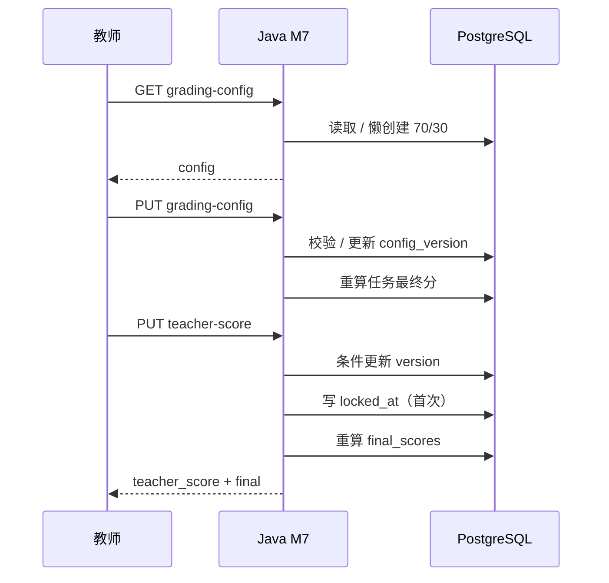
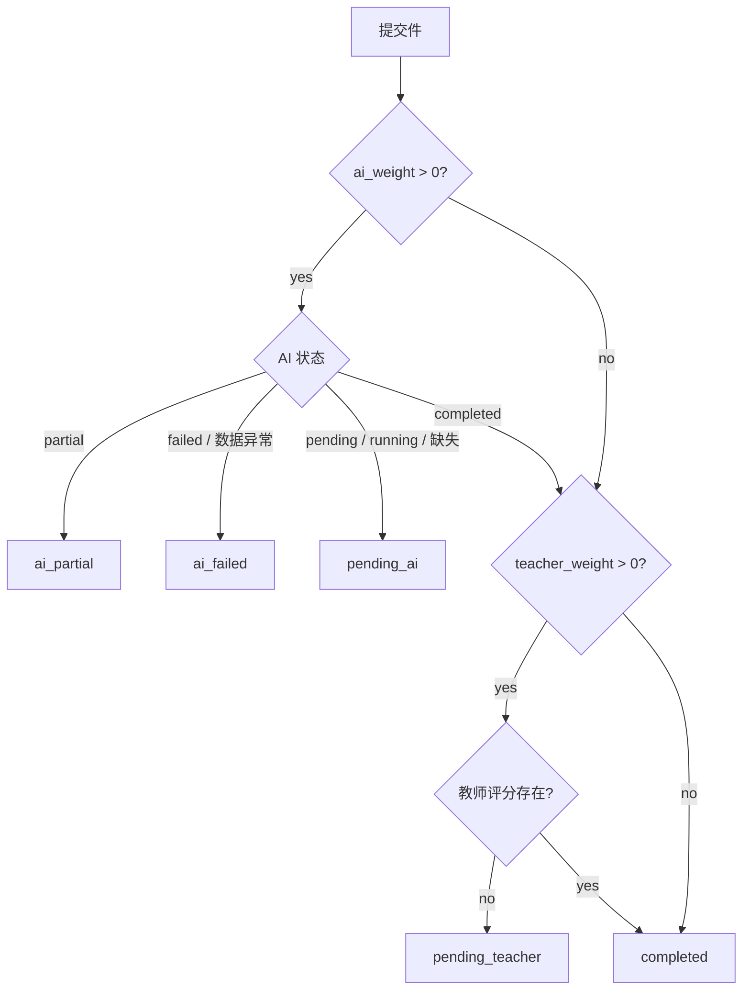
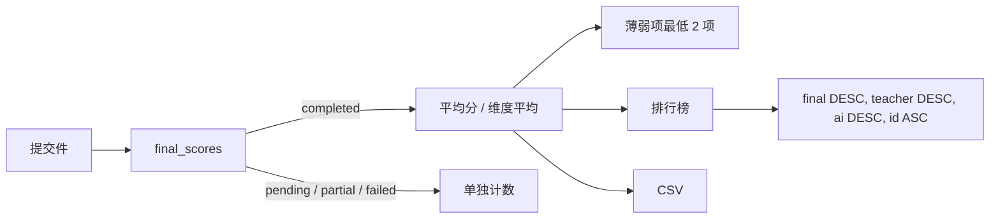
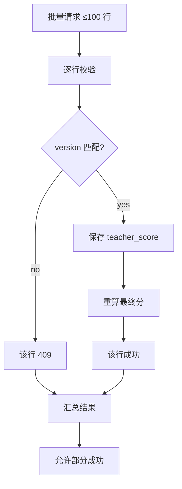

# 07 M7 教师评测与数据统计

> 上位文档：[M7 教师评测与数据统计](../requirements/M7-教师评测与数据统计.md)、[00 总体设计](00-总体设计.md)、[01 数据模型与迁移](01-数据模型与迁移.md)、[02 API 与实时协议](02-API与实时协议.md)、[03 M1/M2 账号、组织与课程设计](03-M1-M2-账号组织课程设计.md)、[06 M4 AI 评测与反馈](06-M4-AI评测与反馈.md)
> 版本：V0.2（讨论稿）　状态：待评审　更新日期：2026-11-03
> 范围：M7 教师评分配置、评分、最终分、统计、排行榜、CSV、学生结果；M4 评测与 M3 提交见对应文档

## 1. 范围

### 1.1 本轮实现

- 课程老师组按任务设置 AI / 教师权重与打分模式
- 任务评分名单与状态
- 教师按五维（结构化面试三维）或总分打分、评语
- 表格逐行保存与批量保存
- 最终总分 / 最终维度分合成
- 任务、班级、课程统计；平均分、完成情况、薄弱项
- 排行榜
- CSV 导出
- 学生本人结果查看
- 只读消费 M3 / M4；演示模式可用种子数据独立运行

### 1.2 不做

- 管理员进入 M7；管理员只做 M1 / M2 元数据
- 训练记录进入 M7；训练报告仅学生本人
- 语音点评、附件、富文本、自定义评分细则
- 学生申诉、复核、仲裁
- 历史进步曲线、达标认证（M8 暂缓）
- AI 自动评语、自动批阅
- 修改 / 重跑 M4 评测
- 跨校统计、跨课程排行榜
- Excel / PDF 导出；只做 CSV
- 管理员评分、统计、导出
- 逐次评分修订历史；只保留当前版本与最后编辑人

### 1.3 FR 映射

| FR | 覆盖 |
|---|---|
| FR-M7-01 任务评分配置 | 完整：默认 70/30、模式、锁定、清空、版本 |
| FR-M7-02 评分名单与状态 | 完整：分配名单、提交 / AI / 教师 / 最终状态、筛选 |
| FR-M7-03 教师评分 | 完整：维度 / 总分、批量、评语、乐观锁 |
| FR-M7-04 最终分合成 | 完整：公式、状态优先级、维度、重算 |
| FR-M7-05 统计、薄弱项与排行榜 | 完整：任务 / 班级 / 课程、平均分、薄弱项、排行榜 |
| FR-M7-06 导出 | 完整：CSV、UTF-8 BOM、筛选、10000 行上限 |
| FR-M7-07 学生结果查看 | 完整：本人最终分、AI 分、教师分、评语 |
| FR-M7-08 权限与边界 | 完整：老师组、学生本人、管理员 403、跨校 403 |
| FR-M7-09 只读集成与演示数据 | 完整：只读适配层、种子数据、同一套接口 |
| FR-M7-10 保留、归档与清理 | 完整：课程结束 + 1 年、归档只读、任务关闭可评分 |

## 2. 架构与边界

```text
Teacher / Student
        │
        ▼
Java M7 TeacherEvaluationService
  ├─ 只读 M3：tasks / task_assignments / submissions / sessions / config_snapshot
  ├─ 只读 M4：evaluations / dimension_scores / status
  ├─ 写 M7：task_grading_configs / teacher_scores / final_scores
  ├─ 统计 / 排行榜 / CSV
  └─ 不调用 Python
        │
        ▼
PostgreSQL（m3 / m4 / m7 schema）
```

| 组件 | 职责 |
|---|---|
| M3 | 任务、分配名单、提交件、班级快照、维度权重 |
| M4 | AI 状态、AI 总分、维度分、报告 |
| M7 | 权重配置、教师评分、最终分、统计、排行榜、导出 |
| Python | 不参与 M7 |

- **只读 M3 / M4**：M7 不写回任务、提交件、AI 评测；最终分是 M7 独立派生结果。
- **Java 计算最终分**：不调用 Python，不使用前端计算值。
- **同一数据库**：演示阶段 M3 / M4 / M7 同库；拆服务时改为只读 API / 事件。
- **演示数据**：M7 可用种子提交件、AI 评测、教师评分独立运行，不要求启动课堂或评测 worker。

## 3. 核心对象

### 3.1 任务评分配置

| 字段 | 说明 |
|---|---|
| `task_id` | 任务唯一 |
| `course_id` | 课程 |
| `ai_weight` | AI 分权重 0—100，默认 70 |
| `teacher_weight` | 教师分权重 0—100，默认 30 |
| `scoring_mode` | `dimension`（默认）/ `total` |
| `config_version` | 从 1 开始，配置修改递增 |
| `locked_at` | 首次教师评分后写入；清空评分后置空 |
| `updated_by` | 最后修改人 |

- 一个任务一条有效配置；首次访问时懒创建默认配置。
- `ai_weight + teacher_weight = 100`；两项均为整数。
- 课程归档后配置只读。

### 3.2 教师评分

| 字段 | 说明 |
|---|---|
| `submission_id` | 一个提交件最多一条评分 |
| `task_id` / `course_id` / `student_account_id` | 归属 |
| `class_id_snapshot` | 提交时班级快照；缺失时回退当前班级 |
| `scoring_mode` | 与任务配置一致 |
| `dimension_scores` | `dimension` 模式下的维度分 JSONB |
| `teacher_total` | 教师总分，一位小数 |
| `comment` | 纯文本，≤ 1000 字 |
| `version` | 乐观锁；新建为 1，修改递增 |
| `graded_by` / `graded_at` / `updated_at` | 最后编辑人与时间 |

- 课程老师组共享同一条评分；任何有效成员可修改。
- 不保留逐次修订历史；只保留当前值、最后编辑人、时间。

### 3.3 最终分

| 字段 | 说明 |
|---|---|
| `submission_id` | PK |
| `ai_evaluation_id` | M4 评测 ID |
| `teacher_score_id` | 教师评分 ID，可空 |
| `ai_total` | AI 总分，可空 |
| `teacher_total` | 教师总分，可空 |
| `final_total` | 最终总分，仅 `completed` 有值 |
| `final_dimensions` | 最终维度分，仅 `completed` 有值 |
| `status` | `pending_ai` / `pending_teacher` / `completed` / `ai_partial` / `ai_failed` |
| `class_id_snapshot` | 统计用班级快照 |
| `config_version` | 计算使用的配置版本 |
| `error_code` / `error_message` | 数据异常 / 计算失败原因，可空 |
| `computed_at` | 最后计算时间 |

- 派生结果；可由 M3 / M4 / 教师评分重新计算，不替代 M4 报告。
- 一个提交件一条；未提交学生没有最终分行，列表合成 `not_submitted`。

## 4. 任务评分配置

### 4.1 默认配置

- 首次 `GET /tasks/{id}/grading-config` 或评分名单时懒创建：
  - `ai_weight=70`、`teacher_weight=30`、`scoring_mode=dimension`、`config_version=1`。
- 只读 GET 对归档课程不写库：返回默认配置视图，`can_edit=false`。
- 并发创建由 `UNIQUE(task_id)` 保证；冲突时读取已有配置。
- 维度集合来自任务模式：
  - 自由 / 情景：`content`、`expression`、`interaction`、`board`、`time`；
  - 结构化面试：`content`、`expression`、`time`。
- 维度权重来自 M3 `config_snapshot.weights` / `rubric_weights`；M7 只读。

### 4.2 修改配置

- 请求携带当前 `config_version`；版本不一致返回 409 `GRADING_CONFIG_VERSION_CONFLICT`。
- 配置修改、清空评分、首次评分保存使用同一任务级锁顺序：`SELECT task FOR UPDATE` 后重新检查 `locked_at`；配置 PUT 也可条件更新 `WHERE locked_at IS NULL`。
- 校验：
  - 两项 0—100 整数，和为 100；
  - `scoring_mode` 为 `dimension` / `total`；
  - 课程未归档；
  - 任务不是草稿；
  - 操作者在课程老师组。
- 配置修改后 `config_version += 1`，写 `updated_by`、`updated_at`。
- 未锁定：重算该任务所有最终分。
- 已锁定：返回 409 `GRADING_CONFIG_LOCKED`，要求先清空全部评分。
- 已有教师评分但 `locked_at` 为空（异常数据）：同样按锁定处理，拒绝修改。

### 4.3 锁定与清空

- 首次成功保存教师评分时写 `locked_at`，锁定 `scoring_mode` 与两项权重。
- 清空全部评分：
  - `DELETE /api/v1/tasks/{task_id}/teacher-scores`，请求 `{confirm:true}`；
  - 删除该任务所有 `teacher_scores`；
  - `final_scores.teacher_score_id` 置空、`teacher_total` 置空；
  - `locked_at=null`；
  - 重算所有最终分为 `pending_teacher` / `pending_ai`；
  - 不递增 `config_version`；下一次配置修改再递增。
- 只清空评分，不删除提交件、AI 评测、录像、报告。
- 清空操作二次确认，前端明确提示“将删除该任务全部教师评分”。

### 4.4 归档与关闭

| 场景 | 配置 | 评分 | 统计 / 导出 |
|---|---|---|---|
| 任务关闭 | 可改（未锁定） | 可继续 | 可 |
| 课程 `end_at` 已过 | 可改（未锁定） | 可继续 | 可 |
| 课程归档 | 只读 | 只读 | 可查看 / 导出 |
| 草稿任务 | 不可评分 | 不可 | 不可 |

- 课程归档后写入接口返回 422 `COURSE_ARCHIVED`。
- 任务关闭不影响已有提交件评分。

## 5. 教师评分

### 5.1 名单与可评分条件

- 名单来自 `task_assignments`，不是当前课程学生；发布后加入的学生不进入该任务。
- 可评分条件：
  - 学生有 `submissions` 记录；
  - 提交件属于该任务；
  - 课程未归档；
  - 操作者在老师组。
- 未提交 / 进行中的学生只显示状态，不显示评分输入。
- 学生退课 / 被移出：仍显示历史提交与评分，标注「已退课 / 已移出」。

### 5.2 打分模式

**维度模式 `dimension`（默认）**

- 输入适用维度分，0—100，一位小数。
- 维度 key 与任务模式一致；多传 / 少传适用维度拒绝。
- 维度权重为 0 的维度可省略。
- 教师总分：

```text
teacher_total = Σ(teacher_dimension_score_i × rubric_weight_i) / 100
```

- `rubric_weight` 来自 M3 任务配置快照；权重和必须为 100；缺失时返回 `DATA_INCONSISTENT`。
- 服务端计算 `teacher_total`，不接受客户端传入的教师总分；客户端可预览。

**总分模式 `total`**

- 直接输入 `teacher_total`，0—100，一位小数。
- 不接受维度分；提交维度分则拒绝该行。
- 最终维度分按第 6 章规则处理（通常使用 AI 维度分）。

### 5.3 校验

| 校验 | 错误 |
|---|---|
| 提交件存在且已提交 | `SUBMISSION_NOT_SUBMITTED` 422 |
| 课程未归档 | `COURSE_ARCHIVED` 422 |
| 操作者在老师组 | `TEACHER_NOT_IN_GROUP` 403 |
| 分数 0—100，一位小数 | `TEACHER_SCORE_INVALID` 422 |
| 维度与任务模式一致 | `TEACHER_SCORE_INVALID` 422 |
| 评语 ≤ 1000 字 | `TEACHER_SCORE_INVALID` 422 |
| `scoring_mode` 与配置一致 | `TEACHER_SCORE_INVALID` 422 |
| `version` 匹配 | `TEACHER_SCORE_CONFLICT` 409 |

- 分数使用 `BigDecimal`，`HALF_UP` 保留一位小数。
- 评语纯文本，不做富文本 / 附件。

### 5.4 新建与修改

- 新建：`version=0`；服务端插入并返回 `version=1`。
- 修改：请求带当前 `version`；服务端条件更新：

```sql
UPDATE teacher_scores
SET dimension_scores=?, teacher_total=?, comment=?,
    version=version+1, graded_by=?, graded_at=now(), updated_at=now()
WHERE submission_id=? AND version=?
```

- 影响行数 0 → 409 `TEACHER_SCORE_CONFLICT`，前端提示刷新后重试。
- 同一提交件多名教师并发编辑：只有一个成功；不静默覆盖；首次并发插入命中 `UNIQUE(submission_id)` 时捕获并按 `TEACHER_SCORE_CONFLICT` 409 返回。
- 保存成功后：写 `class_id_snapshot`、`graded_by`、`graded_at`，触发最终分重算。
- 首次保存同时写任务配置 `locked_at`。

### 5.5 批量保存

- `POST /tasks/{id}/teacher-scores/batch`，最多 100 行。
- 每行独立校验、独立版本；允许部分成功。
- 响应逐行返回：
  - `ok=true` + 教师评分 + 最终分；
  - `ok=false` + `error_code` + `message`。
- 成功行立即参与最终分计算；失败行不整批回滚。
- 同一行重复提交按版本冲突处理。
- 批量保存不改变任务配置。

## 6. 最终分合成

### 6.1 总分公式

```text
final_total = ai_total × ai_weight / 100 + teacher_total × teacher_weight / 100
```

- 一位小数，`HALF_UP`。
- 权重为 0 的项不要求对应分数，不参与公式。
- `ai_weight=0`：`final_total = teacher_total`。
- `teacher_weight=0`：`final_total = ai_total`。
- 两项权重和必须为 100，否则数据异常，不计算。

### 6.2 最终维度分

- 教师为 `dimension` 模式且提供维度分：
  - 对每个适用维度：若 AI 与教师都有分，按同一权重合成；
  - `ai_weight=0` 时用教师维度分；
  - `teacher_weight=0` 时用 AI 维度分。
- 教师为 `total` 模式（只有总分）：
  - 最终维度分直接使用 AI 维度分；
  - 若 `ai_weight=0` 且教师只有总分，最终维度分为空。
- AI 维度缺失但教师维度存在：使用教师维度分。
- 两边都缺失：该维度为空。
- 只在 `completed` 时写 `final_dimensions`；其他状态为 null。
- 维度分一位小数；只保留适用维度。

### 6.3 状态优先级

按以下顺序判定：

1. `ai_weight > 0` 且 AI 终态 `partial` → `ai_partial`；
2. `ai_weight > 0` 且 AI 终态 `failed` / 数据异常 → `ai_failed`；
3. `ai_weight > 0` 且 AI `pending / running` / 缺失 → `pending_ai`；
4. `teacher_weight > 0` 且无教师评分 → `pending_teacher`；
5. 否则 → `completed`。

| AI 权重 | AI 状态 | 教师权重 | 教师评分 | 最终状态 |
|---|---|---|---|---|
| >0 | completed | >0 | 有 | completed |
| >0 | pending / running | 任意 | 任意 | pending_ai |
| >0 | partial | 任意 | 任意 | ai_partial |
| >0 | failed / 数据异常 | 任意 | 任意 | ai_failed |
| >0 | completed | >0 | 无 | pending_teacher |
| 0 | 任意 | >0 | 有 | completed |
| 0 | 任意 | >0 | 无 | pending_teacher |
| >0 | completed | 0 | 无 | completed |
| 0 | 任意 | 0 | 任意 | 配置非法（权重和不为 100） |

- 权重为 0 的项不参与状态判定。
- `pending_ai` 优先于 `pending_teacher`：教师可先评分，但最终分等待 AI。
- `ai_partial / ai_failed` 保留教师评分，但不计算最终分，不进入统计。
- `completed` 才写 `final_total` / `final_dimensions`。

### 6.4 重算触发

| 触发 | 范围 |
|---|---|
| 提交件创建 | 该提交件初始化最终分 |
| 教师评分保存 / 批量保存 | 该提交件 |
| 清空任务全部评分 | 该任务全部提交件 |
| 任务评分配置修改 | 该任务全部提交件 |
| M4 评测进入终态 | 该提交件 |
| 定时对账 | 缺失 / 过期的最终分 |

- M4 终态事件：`EvaluationTerminalEvent`；M7 在事务提交后重算。事件载荷含 `evaluation_id`、`source_type`、`source_id`、`status`、`completed_at`、`attempt`；M7 消费 completed / partial / failed，训练评测忽略。
- 事件丢失：`FinalScoreReconciler` 每 5 分钟扫描：
  - 有提交件但无 `final_scores`；
  - `final_scores.config_version` 与当前配置不一致；
  - M4 评测 `completed_at` 晚于 `final_scores.computed_at`；
  - 教师评分 `updated_at` 晚于 `computed_at`。
- 重算按 `submission_id` 幂等 upsert；相同输入产生相同结果。
- 配置修改 / 清空评分使用**批量 SQL** 重算（`INSERT ... ON CONFLICT ... SELECT` 或一条 `UPDATE ... FROM`），不逐条 200ms；≤200 人同步完成，>200 人转异步 job 并返回 202 / job_id。

### 6.5 班级快照

- 优先 `submissions.class_id_snapshot`（M3 提交时写入）。
- 缺失时使用 `teacher_scores.class_id_snapshot`。
- 再缺失时保留 `final_scores.class_id_snapshot` 已有值；最后回退当前 `course_students.class_id`。
- 班级快照一旦写入，不因学生转班而改变。
- 无班级归入「未分班」。

### 6.6 数据异常

- 提交件不存在 / 不属于任务：不生成最终分，`ai_failed` + `DATA_INCONSISTENT`（终态数据错误桶），不进入统计。
- 任务维度权重缺失或和不为 100：不生成最终分，`ai_failed` + `DATA_INCONSISTENT`。
- M4 评测 ID 不一致、维度 key 不合法：`ai_weight>0` 时 `ai_failed` + `DATA_INCONSISTENT`；`ai_weight=0` 时忽略 AI 异常。
- AI 评测行缺失且 `ai_weight>0`：`pending_ai` + `error_code=DATA_INCONSISTENT`，UI 提示“AI 评测未创建”。
- 不伪造分数；不把 0 分当作缺失。
- 异常修复后对账任务自动重算；`ai_failed` 行在名单 / CSV 显示 `error_code`。

## 7. 统计与排行榜

### 7.1 任务统计

筛选：任务、班级（可选）。

| 指标 | 口径 |
|---|---|
| 分配人数 | `task_assignments` |
| 提交人数 | `submissions` |
| 未提交 | 分配人数 - 提交人数 |
| 进行中 | 有 `preparing / in_progress` session；单独计数，不进入 average |
| 已完成 | `final_scores.status=completed` |
| 待 AI | `pending_ai` |
| 待教师 | `pending_teacher` |
| AI 不完整 / 失败 | `ai_partial` / `ai_failed` |
| 平均最终分 | `AVG(final_total)`，仅 completed，一位小数 |

- 进行中的学生可额外显示 `in_progress`，统计仍归入未提交。
- 学生退课 / 移出：历史提交与 completed 统计保留，名单标注。

### 7.2 维度统计与薄弱项

- 对 `completed` 的 `final_dimensions` 求平均，一位小数。
- 每个维度返回平均分、有效样本数。
- 薄弱项：按平均分从低到高取最低 2 项；样本 < 3 的维度仍参与排序，但标注「样本不足」。
- 平均分 < 60 标红；有效样本 < 3 标注「样本不足」。
- 顶层 `sample_sufficient = completed 数 >= 3`，表示任务整体是否达到统计样本；每个维度另带 `sample_count`，不要用一个布尔掩盖维度差异。
- 无 completed 数据：平均分为 null，薄弱项为空，展示空态。

### 7.3 排行榜

- 只统计 `completed`。
- 排序：`final_total DESC NULLS LAST, teacher_total DESC NULLS LAST, ai_total DESC NULLS LAST, student_account_id ASC`；避免权重 0 的空值排到有分学生之前。
- 排名按排序后序号；同分通过后续字段区分。
- 支持按任务、班级筛选；分页。
- 字段：名次、学生、班级、AI 分、教师分、最终分。
- 学生本人不展示排行榜入口；本轮不做班级公开榜单。

### 7.4 课程统计

- 按课程聚合任务：
  - 任务数、分配人数、提交人数、completed 人数；
  - 课程平均最终分 = 该课程所有 `completed` 提交件的 `final_total` 之和 / 完成件数（pooled average，不是先按任务平均再加权）；
  - 每个任务一行：任务、模式、分配 / 提交 / 完成、平均分。
- 支持班级筛选；班级使用 `task_assignments.class_id_snapshot` / 提交快照。
- 不跨课程、不跨校。

```json
{
  "course_id": "uuid",
  "summary": {
    "tasks": 3,
    "assigned": 90,
    "submitted": 84,
    "completed": 70,
    "average_final": 82.4
  },
  "tasks": [
    {"task_id": "uuid", "topic": "荷塘月色", "mode": "free", "assigned": 30, "submitted": 28, "completed": 20, "average_final": 82.1}
  ]
}
```

## 8. CSV 导出

- 入口：任务评分页 / 统计页；按当前筛选条件导出。
- 格式：UTF-8 BOM（``），逗号分隔，CRLF，字段按 RFC 4180 转义。
- 防 CSV 公式注入：以 `=`、`+`、`-`、`@` 开头的文本字段前置单引号 `'`。
- 表头固定 + 维度列按任务模式动态：
  - 任务、课程、班级、学生姓名、账号 ID、学生状态、提交时间、AI 总分、教师总分、最终总分、各维度分、教师评语、成绩状态、评分教师、评分时间。
- 空结果也输出表头。
- 最多 10,000 行；超过返回 422 `EXPORT_TOO_LARGE`，提示缩小筛选。
- 不落盘保存；流式下载。
- 文件名：`task-{taskId}-scores-{yyyyMMddHHmm}.csv`。
- 课程归档后仍可导出；管理员 403。

## 9. 学生结果

- 学生只能查看本人。
- 列表：任务、课程、提交时间、状态、最终分。
- 详情：
  - AI 分、教师分、最终分分开展示；
  - 最终维度分；
  - 教师评语；
  - 状态未完成时显示「待 AI 评测 / 待教师评分 / AI 评测不完整」，不展示半成品最终分；
  - 链接到 M4 报告 / 回放。
- 不展示他人、班级统计、排行榜、教师评分名单。
- 训练记录不在 M7；训练报告从 M6 / M4 入口查看。
- 管理员 403。

## 10. 数据模型

沿用 01，本轮补充：

| 表 | 说明 |
|---|---|
| `task_grading_configs` | 每任务一条；`UNIQUE(task_id)`；两项 0—100 且和为 100 |
| `teacher_scores` | 每提交件一条；`UNIQUE(submission_id)`；`version` 乐观锁 |
| `final_scores` | PK `submission_id`；只 `completed` 有总分 / 维度分；增加 `error_code`、`error_message` |

- `final_scores.status`：`pending_ai` / `pending_teacher` / `completed` / `ai_partial` / `ai_failed`。
- `final_scores.final_total` / `final_dimensions` 仅 `completed` 非空。
- `final_scores.class_id_snapshot` 用于统计；一旦写入不随转班变化。
- `teacher_scores.scoring_mode` 与配置一致；配置锁定后不可变。
- 外键 / 级联沿用 01：`teacher_scores.submission_id`、`final_scores.submission_id` → `submissions.id ON DELETE CASCADE`；`final_scores.teacher_score_id → teacher_scores.id ON DELETE SET NULL`；`final_scores.ai_evaluation_id → evaluations.id ON DELETE SET NULL`。
- `task_assignments.class_id_snapshot` 用于未提交 / 进行中学生的班级筛选与名单展示。
- 索引：`final_scores(task_id, status)`、`(course_id, status)`、`(class_id_snapshot, status)`；`teacher_scores(task_id, student_account_id)`。

## 11. 接口

### 11.1 任务评分配置

| 方法 | 路径 | 权限 | 说明 |
|---|---|---|---|
| GET | `/api/v1/tasks/{task_id}/grading-config` | `teacher_eval:config` | 获取 / 懒创建默认配置 |
| PUT | `/api/v1/tasks/{task_id}/grading-config` | `teacher_eval:config` | 修改权重 / 模式 |
| DELETE | `/api/v1/tasks/{task_id}/teacher-scores` | `teacher_eval:config` | 清空全部评分并解锁 |

`GET` 响应：

```json
{
  "task_id": "uuid",
  "course_id": "uuid",
  "mode": "free",
  "dimensions": ["content", "expression", "interaction", "board", "time"],
  "rubric_weights": {"content": 30, "expression": 20, "interaction": 20, "board": 15, "time": 15},
  "ai_weight": 70,
  "teacher_weight": 30,
  "scoring_mode": "dimension",
  "config_version": 1,
  "locked_at": null,
  "can_edit": true,
  "has_scores": false
}
```

- `can_edit = 课程未归档 && locked_at 为空 && has_scores=false`；已有评分但 `locked_at` 为空的异常数据按锁定处理，`can_edit=false`。

`PUT` 请求：

```json
{
  "ai_weight": 70,
  "teacher_weight": 30,
  "scoring_mode": "dimension",
  "config_version": 1
}
```

- 版本不一致 409 `GRADING_CONFIG_VERSION_CONFLICT`。
- 已锁定 409 `GRADING_CONFIG_LOCKED`。
- 权重和不为 100 / 越界 422 `GRADING_CONFIG_INVALID`。

`DELETE` 请求：

```json
{"confirm": true}
```

- 返回删除数量、解锁状态、重算数量。
- 非老师组 403；课程归档 422。

### 11.2 评分名单

| 方法 | 路径 | 权限 | 说明 |
|---|---|---|---|
| GET | `/api/v1/tasks/{task_id}/grading-submissions` | `teacher_eval:read` | 名单、AI / 教师 / 最终状态 |

查询：`class_id`、`status`、`keyword`、`page`、`size`。

```json
{
  "task_id": "uuid",
  "course_id": "uuid",
  "mode": "free",
  "scoring_mode": "dimension",
  "rubric_weights": {"content": 30, "expression": 20, "interaction": 20, "board": 15, "time": 15},
  "summary": {
    "assigned": 30,
    "submitted": 28,
    "completed": 20,
    "pending_ai": 5,
    "pending_teacher": 2,
    "ai_partial": 1,
    "ai_failed": 0,
    "not_submitted": 2,
    "in_progress": 0
  },
  "items": [
    {
      "submission_id": "uuid",
      "student_account_id": "uuid",
      "student_name": "张三",
      "class_id": "uuid",
      "class_name": "语文2201",
      "class_id_snapshot": "uuid",
      "student_status": "active",
      "session_status": "submitted",
      "submitted_at": "2026-11-03T14:20:00Z",
      "ai": {
        "evaluation_id": "uuid",
        "status": "completed",
        "total_score": 85.0,
        "dimension_scores": {"content": 86.0, "expression": 82.0, "interaction": 80.0, "board": 85.0, "time": 88.0}
      },
      "teacher_score": {
        "teacher_score_id": "uuid",
        "scoring_mode": "dimension",
        "dimension_scores": {"content": 84.0, "expression": 80.0, "interaction": 78.0, "board": 82.0, "time": 86.0},
        "teacher_total": 82.0,
        "comment": "……",
        "version": 2,
        "graded_by": "uuid",
        "graded_at": "2026-11-03T15:00:00Z"
      },
      "final": {
        "status": "completed",
        "ai_total": 85.0,
        "teacher_total": 82.0,
        "final_total": 84.1,
        "final_dimensions": {"content": 85.4, "expression": 81.4, "interaction": 79.4, "board": 84.1, "time": 87.4},
        "error_code": null,
        "computed_at": "2026-11-03T15:00:01Z"
      }
    }
  ],
  "total": 30,
  "page": 1,
  "size": 20
}
```

- 未提交学生 `submission_id` 为空，`ai` / `teacher_score` / `final` 为 null，状态 `not_submitted`；`session_status` 为 `not_started / preparing / in_progress / reviewing / submitted / ended`。
- `student_status`：`active` / `left` / `removed`。
- 班级筛选优先使用 `task_assignments.class_id_snapshot`；缺失时回退提交快照 / 当前班级。
- `status` 过滤支持最终状态、`not_submitted`、`in_progress`。
- 响应补 `total / page / size`，与 02 分页契约一致。

### 11.3 教师评分

| 方法 | 路径 | 权限 | 说明 |
|---|---|---|---|
| PUT | `/api/v1/submissions/{submission_id}/teacher-score` | `teacher_eval:write` | 单条保存 |
| POST | `/api/v1/tasks/{task_id}/teacher-scores/batch` | `teacher_eval:write` | 批量保存 |

单条请求（维度模式）：

```json
{
  "scoring_mode": "dimension",
  "dimension_scores": {
    "content": 84.0,
    "expression": 80.0,
    "interaction": 78.0,
    "board": 82.0,
    "time": 86.0
  },
  "comment": "……",
  "version": 1
}
```

单条请求（总分模式）：

```json
{
  "scoring_mode": "total",
  "teacher_total": 82.0,
  "comment": "……",
  "version": 0
}
```

- 新建 `version=0`；更新传当前版本。
- 服务端按维度权重计算 `teacher_total`；客户端传的 `teacher_total` 忽略。
- 响应包含教师评分与最终分；最终分可能为 pending。

批量请求：

```json
{
  "items": [
    {"submission_id": "uuid", "scoring_mode": "dimension", "dimension_scores": {}, "comment": "……", "version": 1},
    {"submission_id": "uuid", "scoring_mode": "total", "teacher_total": 80.0, "comment": "……", "version": 0}
  ]
}
```

批量响应：

```json
{
  "success_count": 1,
  "failure_count": 1,
  "results": [
    {"submission_id": "uuid", "ok": true, "teacher_score": {}, "final": {}},
    {"submission_id": "uuid", "ok": false, "error_code": "TEACHER_SCORE_CONFLICT", "message": "版本冲突"}
  ]
}
```

- 最多 100 行；超过 422。
- 允许部分成功；成功行已提交，失败行不回滚。

### 11.4 统计与排行榜

| 方法 | 路径 | 权限 | 说明 |
|---|---|---|---|
| GET | `/api/v1/tasks/{task_id}/stats` | `teacher_eval:read` | 任务 / 班级统计、薄弱项 |
| GET | `/api/v1/tasks/{task_id}/leaderboard` | `teacher_eval:read` | 排行榜 |
| GET | `/api/v1/courses/{course_id}/stats` | `teacher_eval:read` | 课程统计 |

任务统计响应：

```json
{
  "task_id": "uuid",
  "course_id": "uuid",
  "class_id": null,
  "summary": {
    "assigned": 30,
    "submitted": 28,
    "not_submitted": 2,
    "completed": 20,
    "pending_ai": 5,
    "pending_teacher": 2,
    "ai_partial": 1,
    "ai_failed": 0,
    "average_final": 82.4
  },
  "dimensions": [
    {"dimension": "content", "average": 84.2, "sample_count": 20, "weak": false},
    {"dimension": "interaction", "average": 58.0, "sample_count": 20, "weak": true}
  ],
  "weak_dimensions": ["interaction", "board"],
  "sample_sufficient": true
}
```

排行榜响应：

```json
{
  "task_id": "uuid",
  "class_id": null,
  "items": [
    {"rank": 1, "student_account_id": "uuid", "student_name": "张三", "class_name": "语文2201", "ai_total": 85.0, "teacher_total": 82.0, "final_total": 84.1}
  ],
  "total": 20,
  "page": 1,
  "size": 20
}
```

- 统计只使用 `completed`；pending / partial / failed 单独计数。
- `sample_sufficient=false` 时前端标注「样本不足」。
- 空数据平均分为 null。

### 11.5 导出

| 方法 | 路径 | 权限 | 说明 |
|---|---|---|---|
| GET | `/api/v1/tasks/{task_id}/export` | `teacher_eval:export` | CSV 下载 |

- Query：`class_id`、`status`、`keyword`。
- 响应 `text/csv; charset=UTF-8`，带 BOM，`Content-Disposition: attachment`。
- 超过 10000 行 422 `EXPORT_TOO_LARGE`。
- 空结果返回表头。

### 11.6 学生结果

| 方法 | 路径 | 权限 | 说明 |
|---|---|---|---|
| GET | `/api/v1/student/results` | `student_result:read` | 本人成绩列表；`page/size` |
| GET | `/api/v1/submissions/{submission_id}/result` | `student_result:read` / `teacher_eval:read` | 本人 / 老师组查看 |

学生列表响应：

```json
{
  "items": [
    {
      "submission_id": "uuid",
      "task_id": "uuid",
      "task_title": "荷塘月色",
      "course_name": "语文教学论",
      "submitted_at": "2026-11-03T14:20:00Z",
      "status": "completed",
      "final_total": 84.1
    }
  ],
  "total": 8,
  "page": 1,
  "size": 20
}
```

学生详情响应：

```json
{
  "submission_id": "uuid",
  "task_id": "uuid",
  "task_title": "荷塘月色",
  "course_name": "语文教学论",
  "submitted_at": "2026-11-03T14:20:00Z",
  "status": "completed",
  "ai_total": 85.0,
  "teacher_total": 82.0,
  "final_total": 84.1,
  "final_dimensions": {"content": 85.4, "expression": 81.4, "interaction": 79.4, "board": 84.1, "time": 87.4},
  "teacher_comment": "……",
  "ai_report_url": "/api/v1/evaluations/{evaluation_id}/report",
  "replay_url": "/api/v1/sessions/{session_id}/replay"
}
```

- 未完成状态：`final_total` / `final_dimensions` 为 null，返回 `status`；`pending_ai` / `pending_teacher` 时只显示状态，不显示教师分 / 评语，避免半成品；`ai_partial` / `ai_failed` 显示失败原因，不显示分数。
- 学生查看他人：403；管理员：403。
- 训练记录不在本接口。

### 11.7 错误码

| 错误码 | HTTP | 说明 |
|---|---|---|
| `GRADING_CONFIG_INVALID` | 422 | 权重 / 模式非法 |
| `GRADING_CONFIG_LOCKED` | 409 | 首次评分后配置锁定 |
| `GRADING_CONFIG_VERSION_CONFLICT` | 409 | 配置版本冲突 |
| `TEACHER_SCORE_INVALID` | 422 | 分数 / 维度 / 评语非法 |
| `TEACHER_SCORE_CONFLICT` | 409 | 教师评分版本冲突 |
| `SUBMISSION_NOT_SUBMITTED` | 422 | 提交件不存在或未提交 |
| `AI_SCORE_NOT_READY` | 409 | AI 分未完成，无法计算最终分 |
| `DATA_INCONSISTENT` | 422 | M3 / M4 数据缺失或 ID 不一致 |
| `EXPORT_TOO_LARGE` | 422 | 导出超过 10000 行 |

> `AI_SCORE_NOT_READY` 不作为写入失败；最终分状态返回 `pending_ai`。仅当调用方要求立即取最终分时使用。

## 12. 权限

| 操作 | 学生 | 教师（课程老师组） | 管理员 |
|---|---|---|---|
| 查看任务评分配置 | — | 本课程 | 不可 |
| 修改权重 / 模式 / 清空评分 | — | 本课程，未归档 | 不可 |
| 查看评分名单 | — | 本课程 | 不可 |
| 录入 / 修改教师评分 | — | 本课程，未归档 | 不可 |
| 查看任务 / 班级 / 课程统计 | — | 本课程 | 不可 |
| 查看排行榜 | — | 本课程 | 不可 |
| 导出 CSV | — | 本课程 | 不可 |
| 查看本人结果 | 可 | — | — |
| 查看他人结果 | 不可 | 本课程 | 不可 |
| 查看训练记录 | 本人（M6） | 不可 | 不可 |
| 跨校 / 跨课程 | 不可 | 不可 | 不可 |

- 资源级校验：课程老师组、`course_id`、`task_id`、`submission_id`、`school_id`。
- 课程归档：写操作 422，读 / 导出允许。
- 管理员没有 `teacher_eval:*` / `student_result:*` 权限。

## 13. 页面与交互

### 13.1 路由

| 路由 | 页面 | 角色 |
|---|---|---|
| `/teacher/courses/{courseId}/tasks/{taskId}/grading` | 任务评分 | 课程老师组 |
| `/teacher/courses/{courseId}/tasks/{taskId}/stats` | 任务统计 / 排行榜 | 课程老师组 |
| `/teacher/courses/{courseId}/stats` | 课程统计 | 课程老师组 |
| `/student/results` | 我的成绩 | 学生 |
| `/student/results/{submissionId}` | 成绩详情 | 学生本人 |

- 任务详情 / 课程详情提供「评分」「统计」入口。
- 管理员访问返回 403。
- 学生访问教师路由返回 403。

### 13.2 任务评分页

```text
┌ 课程 / 任务 / 评分 ─────────────────────────────────────────┐
│ 荷塘月色  自由试讲  权重 70 / 30  维度模式  [评分配置] [导出] │
│ 分配 30 | 提交 28 | 已完成 20 | 待 AI 5 | 待教师 2 | 平均 82.4 │
│ 班级 [全部 ▾]  状态 [全部 ▾]  搜索 [______]  [批量评分]       │
├──────────────────────────────────────────────────────────────┤
│ 学生   班级     提交     AI     教师    最终    状态    操作  │
│ 张三   语文2201  14:20   85.0   82.0    84.1   已完成  [评分] │
│ 李四   语文2201  14:25   —      —       —      待 AI   [评分] │
│ 王五   语文2202  —       —      —       —      未提交   —     │
└──────────────────────────────────────────────────────────────┘
```

- 顶部摘要卡：分配、提交、已完成、待 AI、待教师、平均分。
- 表格列：学生、班级、提交时间、AI、教师、最终、状态、操作。
- AI 分数可点击查看 M4 报告；最终状态用 badge。
- 未提交 / 进行中行灰显，评分按钮禁用。
- 班级筛选使用提交快照；无班级归入「未分班」。
- 退课 / 移出学生保留行并标注。

### 13.3 评分抽屉

```text
┌ 评分：张三 ───────────────────────────────┐
│ AI 85.0 · 已完成   [查看报告]             │
│ 教学内容 [85.0]                           │
│ 教学表达 [80.0]                           │
│ 课堂互动 [78.0]                           │
│ 板书/PPT [82.0]                           │
│ 时间管理 [86.0]                           │
│ 教师总分 82.0（按 30/20/20/15/15）        │
│ 最终预览 84.1（70/30）                    │
│ 评语 [.................................]  │
│ [取消] [保存]                             │
└───────────────────────────────────────────┘
```

- 维度模式：输入维度分，实时显示教师总分与最终预览。
- 总分模式：只显示一个教师总分输入。
- AI 未完成：显示「待 AI」，仍可保存教师评分；最终预览显示 `pending_ai`。
- AI partial / failed：显示风险提示；最终分不计算。
- 版本冲突：提示“已被其他教师修改，请刷新后重试”，保留本地输入。
- 评语 1000 字计数。

### 13.4 评分配置抽屉

```text
┌ 评分配置 ─────────────────────────────────┐
│ AI 分权重 [70]  教师分权重 [30]  合计 100  │
│ 打分模式 [维度分] [总分]                   │
│ 状态：未锁定 / 已锁定（首次评分后）        │
│ [清空全部评分]（危险）                     │
│ [取消] [保存]                              │
└───────────────────────────────────────────┘
```

- 权重滑杆 + 数字联动；合计不为 100 时保存禁用。
- 已锁定：控件禁用，提示先清空全部评分。
- 清空二次确认，需输入确认或勾选“我确认删除该任务全部教师评分”。
- 课程归档：只读，不显示保存 / 清空。

### 13.5 批量评分

- 点击「批量评分」切换表格编辑态：
  - 维度列变为数字输入；评语列可编辑；
  - 底部固定「保存全部」和「退出批量」；
  - 只提交有变更的行；
  - 保存后逐行标记成功 / 失败原因；失败行保留输入。
- 超过 100 行分批提交，前端串行或小并发。
- 版本冲突行高亮，提供刷新单行。

### 13.6 任务统计页

```text
┌ 荷塘月色 / 统计 ────────────────────────────────┐
│ 班级 [全部 ▾]   [导出 CSV]                       │
│ 分配 30 | 提交 28 | 已完成 20 | 平均 82.4         │
│ ┌ 维度平均分柱状图 ─────────────┐ ┌ 完成情况 ─┐  │
│ │ 内容 84.2  表达 81.0 ...      │ │ 已完成 20 │  │
│ └───────────────────────────────┘ └───────────┘  │
│ 薄弱项：课堂互动 58.0 / 板书 61.0                 │
│ 排行榜：名次 学生 班级 AI 教师 最终               │
└──────────────────────────────────────────────────┘
```

- 摘要卡 + 维度平均分图表（ECharts 柱状 / 雷达）+ 完成情况。
- 薄弱项最低 2 项；<60 红色；样本 <3 灰字「样本不足」。
- 排行榜分页；同分按教师分、AI 分、账号 ID。
- 无 completed 数据：空态 + “暂无可统计成绩”。

### 13.7 课程统计页

- 顶部：课程、班级筛选、总平均分、任务数、提交 / 完成。
- 任务表：任务、模式、分配、提交、完成、平均分、操作（进入任务统计）。
- 不跨课程。

### 13.8 学生成绩页

```text
┌ 我的成绩 ──────────────────────────────────────┐
│ 荷塘月色  自由试讲  已完成  最终 84.1           │
│ AI 85.0 | 教师 82.0 | 最终 84.1                │
│ 维度：内容 85.4 / 表达 81.4 / ...               │
│ 教师评语：……                                   │
│ [查看 AI 报告] [查看回放]                       │
└────────────────────────────────────────────────┘
```

- 列表：任务、课程、提交时间、状态、最终分。
- 详情：三张分数卡（AI / 教师 / 最终），维度表，评语，报告 / 回放入口。
- 未完成：只显示状态，不显示半成品分数。
- 不显示班级排名、他人成绩。

### 13.9 视觉

沿用 B · 深蓝 + 琥珀：

| 元素 | 规则 |
|---|---|
| 背景 / 卡片 | `#0B1220` / `#111C33` |
| 主色 | 琥珀 `#F5A524`；主按钮、关键分数 |
| 文本 | 主 `#E8EEF9`；次 `#8FA3C0` |
| 状态 | 已完成绿 `#3DD68C`；待 AI / 待教师琥珀；partial 红 `#FF6B6B`；未提交灰 |
| 表格 | 紧凑行高 44—48 px；斑马纹低对比 |
| 分数 | tabular numerals；最终分加粗 |
| 图表 | ECharts；琥珀 / 蓝灰；坐标轴文字可读 |
| 危险操作 | 清空评分用红色描边按钮 + 二次确认 |

## 14. 非功能、并发与可观测性

- 演示规模：单课程 ≤ 200 学生、单任务 ≤ 200 提交件；统计查询 < 500 ms。
- 评分保存 < 300 ms；单提交件重算 < 100 ms；200 人任务批量 SQL 重算 < 2 秒。
- 批量保存 ≤ 100 行 / 请求；前端分批。
- 配置修改 / 清空评分：≤200 人批量 SQL 同步；>200 人异步 job（返回 202 + job_id）。
- 并发：
  - 教师评分 `version` 乐观锁；
  - 配置修改 `config_version` 校验 + 行锁；
  - 清空评分与评分保存互斥（任务级锁）。
- 指标：
  - `m7_grading_saved_total` / `m7_score_conflict_total`
  - `m7_final_score_status{status}`
  - `m7_final_recompute_duration`
  - `m7_export_rows` / `m7_export_rejected_total`
- 日志：`trace_id`、`task_id`、`submission_id`、`operator_id`、`config_version`、`score_version`；不记录评语全文。
- 保留：教师评分 / 最终分随提交件至课程结束 + 1 年；训练不进入 M7。
- 清理：随 submission 级联；过期接口返回 404。

## 15. 测试

### 15.1 单元

- 教师总分按维度权重计算；一位小数；权重 0 维度。
- 最终总分公式；AI / 教师权重 0 / 100 边界。
- 最终维度分：维度模式、总分模式、AI 缺失、教师缺失。
- 状态优先级：pending_ai、pending_teacher、completed、ai_partial、ai_failed。
- 配置版本 / 评分版本冲突。
- 班级快照回退链。
- 统计平均分、薄弱项、样本不足、排行榜排序。

### 15.2 集成

- 默认配置懒创建；重复创建唯一。
- 首次评分锁定配置；修改被拒；清空解锁。
- 权重和不为 100 / 越界拒绝。
- 评分保存 → 最终分重算；AI 未完成 → pending_ai。
- AI 完成后自动重算 → completed。
- AI partial / failed → ai_partial / ai_failed；教师评分保留。
- 批量保存部分成功；版本冲突行。
- 课程归档写操作 422；统计 / 导出可读。
- 任务关闭仍可评分。
- 学生退课 / 转班：名单与统计快照不变。
- 数据缺失：不生成伪造分数，返回 `DATA_INCONSISTENT`。
- 对账任务补算缺失 / 过期最终分。

### 15.3 统计与导出

- 任务 / 班级 / 课程统计口径。
- 只统计 completed；pending / partial / failed 单独计数。
- 薄弱项最低 2 项、<60、样本 <3。
- 排行榜同分排序。
- CSV 表头、BOM、转义、空结果、10001 行拒绝。
- 管理员导出 403；非老师组 403；跨校 403。

### 15.4 端到端

- 教师配置 70/30 → 评分 → 查看最终分 → 统计 → 排行榜 → 导出。
- 学生查看本人成绩；不能看他人。
- AI pending 时教师先评分，AI 完成后最终分自动出现。
- 课程归档后只读，统计与导出仍可用。
- 演示种子数据不启动 M3 / M4 也能完成流程。

## 16. 开放问题

| 编号 | 事项 | 当前处理 |
|---|---|---|
| Q1 | 默认权重 / 模式 | 70/30，`dimension` |
| Q2 | 教师维度分是否必填 | 权重 > 0 的维度必填；权重 0 可省略 |
| Q3 | 批量保存大小 | 100 行 / 请求；前端分批 |
| Q4 | 课程统计口径 | 按 completed 提交件加权；任务行单独展示 |
| Q5 | 数据异常状态 | `ai_failed` + `DATA_INCONSISTENT`；缺失 AI 行 `pending_ai` |
| Q6 | 未提交 / 进行中 | 名单显示 `not_submitted`；统计计入未提交 |
| Q7 | 学生成绩列表 | 新增 `/student/results`；也可从任务卡片进入 |
| Q8 | CSV 文件名 | `task-{id}-scores-{yyyyMMddHHmm}.csv` |
| Q9 | 配置修改重算 | 批量 SQL；≤200 人同步，>200 人异步 job |
| Q10 | 评分历史 | 本轮不做；只保留当前值与最后编辑人 |
| Q11 | 管理员 | 无任何 M7 权限 |
| Q12 | 训练记录 | 不进入 M7 |

## 17. 流程图

### 17.1 配置、评分与最终分



### 17.2 最终分状态判定



### 17.3 统计与排行榜



### 17.4 批量保存


