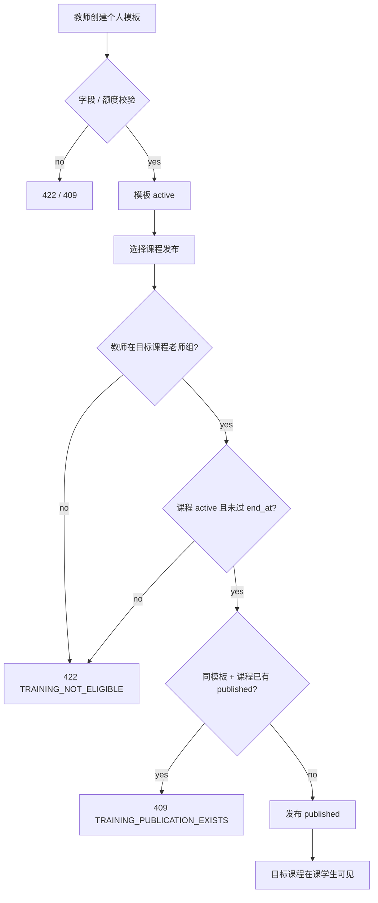
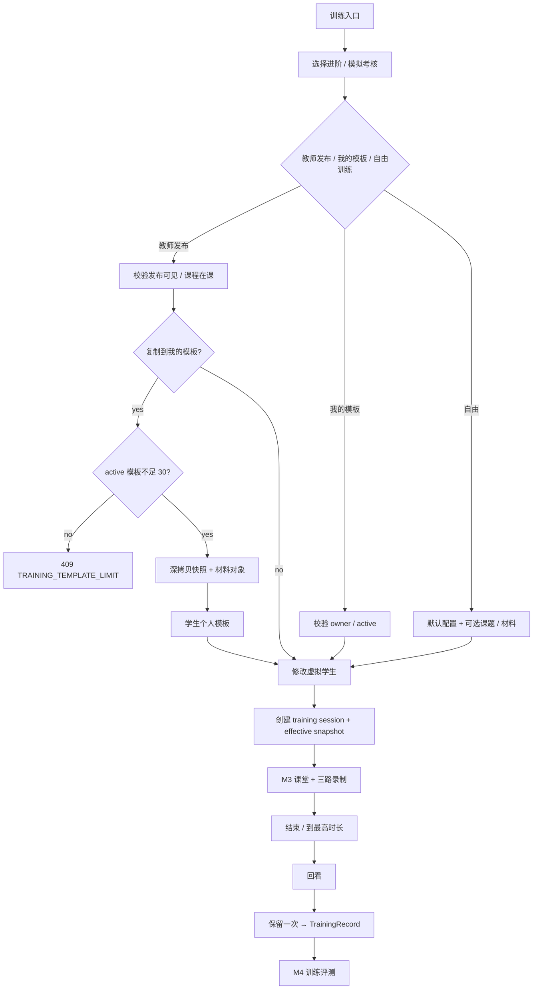
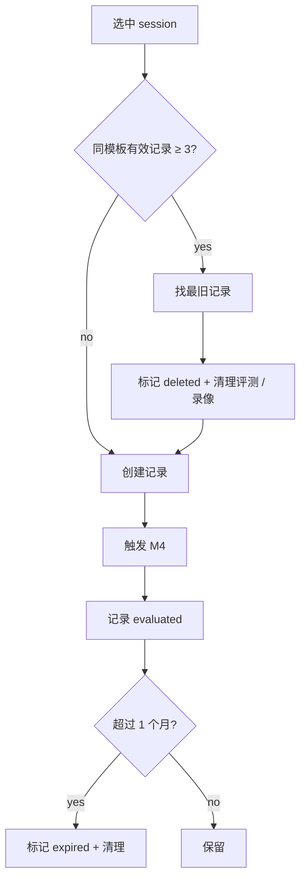
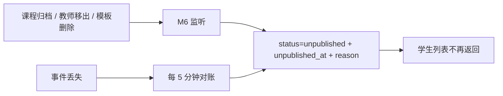
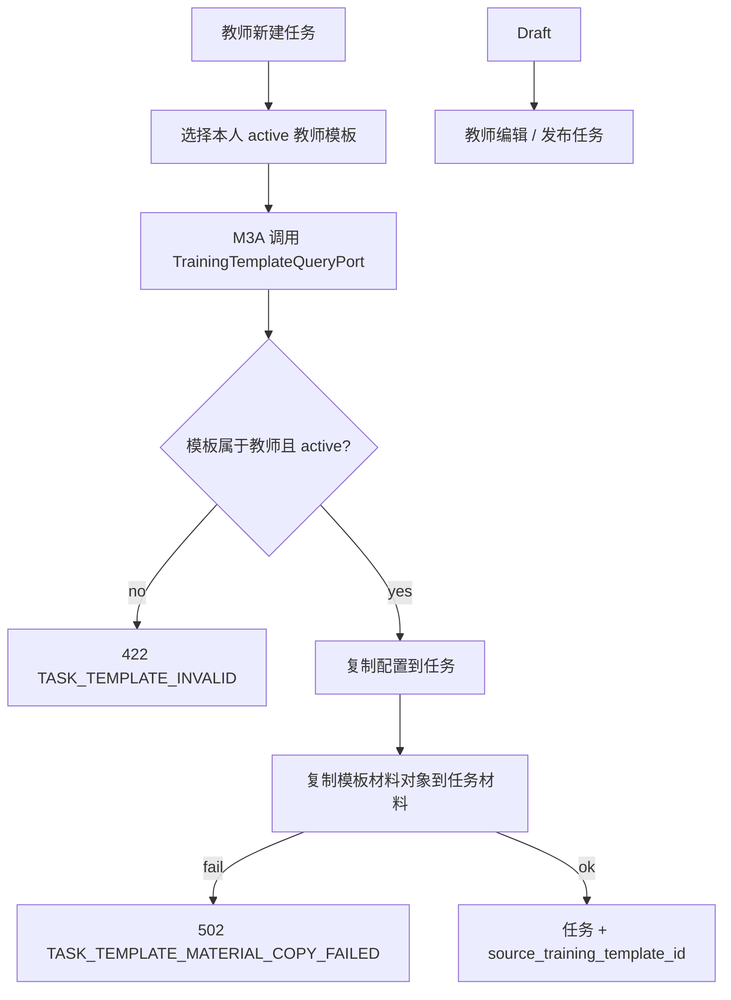

# 08 M6 训练模式

> 上位文档：[M6 训练模式](../requirements/M6-训练模式.md)、[00 总体设计](00-总体设计.md)、[01 数据模型与迁移](01-数据模型与迁移.md)、[02 API 与实时协议](02-API与实时协议.md)、[05A 课堂状态机与 WebSocket](05A-M3-课堂状态机与WebSocket.md)、[05B 录制、上传与回放](05B-M3-录制上传与回放.md)、[05C M3 任务配置与结构化面试](05C-M3-任务配置与结构化面试.md)、[06 M4 AI 评测与反馈](06-M4-AI评测与反馈.md)
> 版本：V0.5（契约对齐）　状态：待评审　更新日期：2026-11-18
> 范围：M6 个人训练模板、课程发布、训练 session、训练记录、保留与页面；M3 课堂 / 录制、M4 评测复用、M3A 任务预填

## 1. 范围

### 1.1 本轮实现

- 两档训练：进阶 `progressive`、模拟考核 `mock_exam`
- 学生独立训练入口，不依赖课程任务
- 教师和学生各有个人模板库；每账号 active 模板上限 30
- 教师从零创建个人模板；教师模板可发布到一门或多门课程
- 学生可直接使用教师发布模板，或复制为个人模板、或从零创建个人模板
- 学生个人模板可用于训练；教师个人模板可用于预填新任务
- 模板配置快照；训练 session 只能替换虚拟学生，不能覆盖课题 / 时长 / 权重 / 材料
- 模板发布后教师配置锁定；学生副本可全字段修改
- 模拟考核固定时长与权重；进阶按模板 / 默认时长
- 无限次练习；回看后选一次生成评测并保留
- 每个模板 / 自由训练分组最多 3 条训练记录
- 训练录像与报告仅学生本人可见，保留 1 个月
- 复用 M3 课堂 / 录制 / 事件、M4 评测 / 报告
- 训练不生成 Submission，不进入 M7

### 1.2 不做

- 入门跟读、语音语调纠正
- 高阶突发情景（学生质疑、课堂混乱、设备故障）
- 模板分享、模板市场、学生之间互相复制模板
- 模板版本历史、多人协作编辑、模板导入导出
- 教师查看训练录像、报告、使用情况
- 训练进度、等级解锁、达标认证
- 训练计入课程任务 / 作业 / 成绩
- 跨校训练模板
- 情景模拟、结构化面试作为模板来源
- 示范片段、TTS
- 训练排行榜、训练统计
- 训练评测进入 M7

### 1.3 FR 映射

| FR | 覆盖 |
|---|---|
| FR-M6-01 训练入口 | 完整：独立入口、档位、教师发布 / 我的模板 / 自由训练 |
| FR-M6-02 个人模板管理 | 完整：创建、编辑、删除、30 上限；V1.5 UI 不提供归档 / 恢复 |
| FR-M6-03 教师发布模板 | 完整：多课程发布、下架、自动下架 |
| FR-M6-04 学生复制 / 自建模板 | 完整：复制、深拷贝材料、全字段编辑、额度 |
| FR-M6-05 进阶训练 | 完整：时长、权重、多次练习 |
| FR-M6-06 模拟考核 | 完整：固定时长、固定权重、多次练习 |
| FR-M6-07 训练评测与保留 | 完整：选中、记录上限、1 个月、删除 |
| FR-M6-08 权限与可见性 | 完整：学生本人、教师模板 / 发布管理、管理员 403 |
| FR-M6-09 复用 M3 / M4 | 完整：session 复用、无 Submission、M4 source_type |
| FR-M6-10 教师用模板预填任务 | 完整：M3A 任务创建预填、材料复制、来源追溯 |

## 2. 架构与边界

```text
Teacher ──创建 / 编辑──→ M6 PersonalTemplate(teacher)
   │                          │
   │                          ├──发布到多门课程──→ M6 TemplatePublication
   │                          │                         │
   │                          │                         ▼
   │                          │                 目标课程在课学生可见
   │                          │                         │
   │                          │                 复制 / 直接训练
   │                          │                         ▼
   │                          │                  M6 TrainingSession
   │                          └──预填任务──→ M3A Task（创建后解耦）
   │
Student ──创建 / 编辑──→ M6 PersonalTemplate(student)
   │                          │
   └──────────训练────────────┴──→ M6 TrainingSession
                                      │ effective_config_snapshot
                                      ▼
                            M3 课堂 / 录制 / 事件（session_type=training）
                                      │
                                      ▼
                            M6 TrainingRecord（选中一次）
                                      │
                                      ▼
                            M4 Evaluation（source_type=training_record）
                                      │
                                      ▼
                            学生本人报告 / 回放
```

| 组件 | 职责 |
|---|---|
| M3 | 课堂状态机、虚拟学生、录制、事件、回放 |
| M3A | 任务创建；从 M6 教师模板读取配置并复制材料；任务创建后与模板解耦 |
| M4 | 训练评测、报告、问题 / 建议 |
| M6 | 个人模板、课程发布、训练 session 元数据、训练记录、保留与清理 |
| M7 | 不读取训练记录；训练不进入教师统计 |
| Python | 只做 M3 内容 / ASR / OCR 与 M4 评测，不持有训练状态 |

- **复用而不是复制**：训练 session 直接使用 `m3.sessions`，`session_type=training`、`task_id=null`；录像 / 文本 / 帧 / 事件仍按 session_id 关联。
- **不生成 Submission**：训练不进入任务分配、提交列表、M7。
- **评测复用 M4**：`source_type=training_record`、`source_id=record_id`；报告仅学生本人。
- **个人模板与任务解耦**：教师模板只在创建任务时提供初始配置；任务创建后不再读取模板。模板删除不影响任务。
- **快照不可变**：模板保存在 `training_templates.config_snapshot`；训练开始时再生成 session 级 `effective_config_snapshot`。之后的模板修改不影响已开始 session 与已保存记录。
- **发布与模板分离**：课程可见性由 `training_template_publications` 控制；模板删除 / 课程归档 / 教师移出课程只改发布状态。
- 模板下架 / 退课后：禁止通过该发布新建训练；`preparing` 取消，`in_progress` 可自然结束，`ended / reviewing` 允许在保留期内选中；未选中录像按临时 24h 规则清理。

## 3. 核心对象

### 3.1 个人模板 TrainingTemplate

| 字段 | 说明 |
|---|---|
| `id` | 模板 ID |
| `school_id` | 学校；同校隔离 |
| `owner_account_id` | 拥有者账号 |
| `owner_role` | `teacher` / `student`；创建时角色快照 |
| `name` | 模板名称，1—100 字 |
| `training_level` | `progressive` / `mock_exam` |
| `classroom_mode` | 本轮固定 `free` |
| `source_type` | `manual`（从零创建）/ `template`（学生复制）/ `task`（历史任务派生，只读来源） |
| `source_task_id` | 历史任务派生来源；新模板为空 |
| `source_task_config_version` | 历史任务快照版本；新模板为空 |
| `source_template_id` | 学生复制来源模板；可空 |
| `source_publication_id` | 学生复制来源发布；可空 |
| `config_snapshot` | 完整配置快照（schema_version=2） |
| `status` | `active` / `archived`（内部软删除；UI 文案为删除） |
| `archived_at` | 软删除时间；`active` 时为空 |
| `created_at` / `updated_at` | 创建 / 更新时间 |

- 一个账号 active 模板最多 30 个；`archived`（已删除）不计数。
- `owner_role=teacher` 的模板才能发布到课程、用于任务预填。
- `owner_role=student` 的模板不能发布；只能本人训练使用。
- 历史 `source_type=task` 模板保留来源任务 ID，可继续发布 / 使用，但不允许新建。
- 模板不物理删除；删除为 `status=archived` 软删除。删除时下架发布，并清理该模板关联的 TrainingRecord（含录像 / 报告）与模板参考材料；学生副本、任务快照继续保留。
- 模板名称允许重复；列表按 `updated_at` 倒序，前端可用名称 + 档位区分。

### 3.2 课程发布 TemplatePublication

| 字段 | 说明 |
|---|---|
| `id` | 发布 ID |
| `template_id` | 被发布的教师个人模板 |
| `course_id` | 目标课程 |
| `status` | `published` / `unpublished` |
| `published_at` | 发布时间 |
| `unpublished_at` | 下架时间；`published` 时为空 |
| `unpublish_reason` | `manual` / `course_archived` / `teacher_removed` / `template_deleted` |
| `created_by` | 发布教师（必须等于模板 owner） |
| `created_at` / `updated_at` | 创建 / 更新时间 |

- 一个模板可发布到多门课程；`UNIQUE(template_id, course_id) WHERE status='published'`。
- 重复发布同一模板 + 课程 → 409 `TRAINING_PUBLICATION_EXISTS`。
- 下架只改状态，不删除发布行；重新发布创建新行，旧行保留审计。
- 发布不复制模板配置；模板配置在存在 published 发布期间锁定。

### 3.3 模板配置快照

`training_templates.config_snapshot`：

```json
{
  "schema_version": 2,
  "training_level": "progressive",
  "classroom_mode": "free",
  "topic": "荷塘月色",
  "textbook_version": "部编版",
  "duration": {
    "recommended_seconds": 900,
    "max_seconds": 1200
  },
  "weights": {
    "content": 30,
    "expression": 20,
    "interaction": 20,
    "board": 15,
    "time": 15
  },
  "virtual_students": [
    {
      "name": "林小雨",
      "avatar": "avatar-03",
      "personality_text": "……",
      "activity": 0.6,
      "question_rate": 0.5,
      "ability": 0.7,
      "attention_baseline": 0.5,
      "discipline_probability": 0.4,
      "seat_no": 1,
      "sort_order": 1
    }
  ],
  "reference_material": {
    "filename": "教材第三章.pdf",
    "object_key": "training-template-materials/...",
    "mime": "application/pdf",
    "size": 123456,
    "parsed_text": "……",
    "char_count": 12000
  }
}
```

- 快照包含完整参考材料解析文本，不只摘要；M4 训练评测使用。
- 快照不含模板名称 / owner / 发布课程；这些在表列中维护。
- 历史任务派生模板的 `config_snapshot` 可能为 `schema_version=1`（含 `source_task_id` / `course_id`）；服务读取时兼容，复制 / 新建统一写 `schema_version=2` 并去掉这两个字段。
- 虚拟学生只是默认值；学生开始训练时可整组替换。
- 训练 session 启动时由 `SessionActor` 为每个虚拟学生生成 session 级 `virtual_student_id`（UUIDv7），事件 / 文本使用该 ID；不写 `m3.virtual_students` 表，运行时状态只在内存。
- `mock_exam` 模板必须满足 `recommended_seconds = max_seconds`。
- 学生使用教师发布模板时不可见 `reference_material` 与 `weights`；使用自己的模板时可编辑全部字段。

### 3.4 训练 session

| 字段 | 说明 |
|---|---|
| `session_id` | `m3.sessions.id` |
| `session_type` | `training` |
| `task_id` | `null` |
| `student_account_id` | 学生 |
| `course_id` | 目标课程，可空 |
| `training_level` | `progressive` / `mock_exam` |
| `template_id` | 可空；自由训练为空；直接使用教师发布时为教师模板 ID |
| `publication_id` | 可空；直接使用教师发布时非空；学生个人模板 / 自由训练为空 |
| `effective_config_snapshot` | 本次训练实际配置 |
| `status` | `preparing` / `in_progress` / `ended` / `reviewing` / `selected` / `evaluated` / `cancelled` / `failed` |

- 训练状态机沿用 05A；不进入 `submitted`。
- 同一学生同时只允许一个 `preparing / in_progress` 训练 session。
- `effective_config_snapshot` 包含学生修改后的虚拟学生，以及模板或自由训练决定的课题、时长、权重、参考材料。
- 训练 session 的录像、文本、帧、事件全部按 session_id 存 M3 表。
- `publication_id` 仅用于追溯来源；模板 / 发布后续下架不影响已开始 session。

### 3.5 训练记录

| 字段 | 说明 |
|---|---|
| `id` | record_id |
| `training_session_id` | 被选中的 session |
| `student_account_id` | 学生 |
| `template_id` | 可空；自由训练为空 |
| `publication_id` | 可空；直接使用教师发布时非空 |
| `selected_at` | 选中时间 |
| `evaluation_id` | 不落列；通过 `evaluations.training_record_id` 查询 |
| `expires_at` | `selected_at + 1 个月` |
| `status` | `selected` / `evaluated` / `deleted` / `expired` |
| `deleted_at` | 删除时间，可空 |

- 一个 session 最多生成一条记录；`UNIQUE(training_session_id)`。
- 每个模板最多 3 条有效记录；自由训练按 `(student_id, template_id=null)` 分组同样 3 条。
- 学生复制教师模板会生成新的 `template_id`，副本拥有独立的一组 3 条额度；30 模板上限把总量约束在 90 条以内。
- 记录保留 1 个月；学生可提前删除。
- 记录删除 / 过期后，报告与录像不可访问。

## 4. 个人模板与教师发布

### 4.1 创建

`POST /api/v1/training/my-templates`：

```json
{
  "owner_role": "teacher",
  "name": "荷塘月色 · 进阶",
  "training_level": "progressive",
  "topic": "荷塘月色",
  "textbook_version": "部编版高中语文必修上册",
  "duration": {
    "recommended_seconds": 900,
    "max_seconds": 1200
  },
  "weights": {
    "content": 30,
    "expression": 20,
    "interaction": 20,
    "board": 15,
    "time": 15
  },
  "virtual_students": [],
  "material_id": null
}
```

| 字段 | 规则 |
|---|---|
| `owner_role` | 可选；`teacher` / `student`；默认账号主身份；必须属于当前账号已有角色 |
| `name` | 1—100 字 |
| `training_level` | `progressive` / `mock_exam` |
| `topic` | 1—100 字 |
| `textbook_version` | 0—100 字，可空 |
| `duration` | 1—3600 秒；推荐 ≤ 最高；`mock_exam` 推荐 = 最高 |
| `weights` | 五维 `content / expression / interaction / board / time`，每项 0—100，合计 100 |
| `virtual_students` | 1—30 人；五参数 0—1；个性文本 ≤ 500 字；空数组使用默认 3 人 |
| `material_id` | 可选；必须是本人 `usage='template'`、`status='uploaded'` 的材料 |

- 教师、学生都使用同一接口；`owner_role` 可显式指定，未指定时取账号主身份；服务端校验该角色属于当前账号（多角色账号可用同一账号创建两类模板，共用一个 30 额度）。
- 一个模板固定一个档位；需要进阶 / 模拟考核两档时创建两个模板，各占 1 个 active 额度。
- 创建时生成 `config_snapshot`，`schema_version=2`；虚拟学生为空时取系统默认值。
- 参考材料可选；缺失时训练仍可开始，M4 将知识点准确性标「不可评估」。
- 额度校验与插入在同一事务内；超限 409 `TRAINING_TEMPLATE_LIMIT`。

### 4.2 编辑

`PATCH /api/v1/training/my-templates/{template_id}` 为部分更新：

| 可改字段 | 规则 |
|---|---|
| `name` | owner 随时可改 |
| `training_level` / `topic` / `textbook_version` / `duration` / `weights` / `virtual_students` | owner 可改；教师模板存在 published 发布时锁定 |
| `material_id` | 替换 / 移除参考材料；旧材料标记删除并异步清理 |

- `owner_role`、`source_type`、来源模板 / 发布 ID 创建后不可改；需要另一角色模板请新建。
- 教师模板存在任一 published 发布时，除 `name` 外的配置字段锁定；返回 409 `TRAINING_TEMPLATE_LOCKED`，提示先下架。
- 学生模板无发布，owner 可随时修改全部字段；修改只影响之后的 session，已开始的 session 使用自己的 `effective_config_snapshot`。
- 修改档位 / 时长 / 权重时必须重新校验；`mock_exam` 下推荐时长与最高时长必须相等。
- 修改成功后 `updated_at` 更新；模板列表排序使用 `updated_at DESC`。

### 4.3 删除 / 额度

> V1.5 原型 UI 不提供归档 / 恢复，只提供删除。后端使用 `status='archived'` 表示软删除，`archived_at` 记录删除时间；UI 文案统一为「删除」。

- `DELETE /api/v1/training/my-templates/{template_id}`：
  - 仅 owner；
  - 先自动下架该模板所有 published 发布（`unpublish_reason=template_deleted`）；
  - `status=archived`、`archived_at=now()`；
  - 释放 30 个 active 模板额度；
  - 清理该模板关联的 TrainingRecord 及其录像 / 评测报告；清理模板参考材料（MinIO + DB）；
  - 学生副本与关联任务快照不受影响；
  - 删除不可恢复。
- 删除后模板不可编辑、不可发布、不可复制、不可用于新训练或任务预填。
- 额度：`active` 模板数 ≤ 30 / `owner_account_id`；教师、学生统一；已删除模板不计数；发布不计数。
- 并发创建 / 复制：事务内对 owner 加 advisory lock，再计数；避免并发突破 30。
- 升级兼容：若某账号历史 active 模板已超过 30，新建 / 复制会按上限拒绝，教师需先删除超额模板。
- 清理顺序：先删录像 / 关键帧 / 报告等外部对象，再删 TrainingRecord / session / 评测数据，最后删模板材料对象；模板行保留软删除状态用于审计引用。
- 删除模板不影响已创建任务：任务使用发布时配置快照。

### 4.4 发布条件

| 条件 | 说明 |
|---|---|
| 模板属于当前教师 | `owner_account_id = teacher` |
| 模板与目标课程同校 | `template.school_id = course.school_id`；跨校不可发布 |
| `owner_role=teacher` | 学生模板不可发布 |
| 模板 `status=active` | 已删除模板不可发布 |
| 教师在目标课程老师组 | `course_teachers.status='active'` |
| 目标课程 active 且未过 `end_at` | 课程可用 |
| 同模板 + 课程无 published 发布 | 唯一约束 |

- 一个模板可发布到多门课程；每门课程一条当前发布。
- 发布不复制模板；模板配置在发布期间锁定。
- 发布行 `created_by` = 模板 owner；服务端校验，防止代发布。

### 4.5 发布 / 下架 / 自动下架

- 发布：`POST /api/v1/training/my-templates/{template_id}/publications`，请求 `{course_id}`。
- 响应发布 + 模板摘要（名称、档位、课程、状态、发布时间）。
- 下架：`POST /api/v1/training/publications/{publication_id}/unpublish`，仅模板 owner；幂等。
- 重复发布：同模板 + 课程已有 published → 409 `TRAINING_PUBLICATION_EXISTS`。
- 重新发布：旧发布行保持 `unpublished`，创建新行；保留审计。
- 自动下架：
  - 目标课程归档 → 该课程所有 published 发布下架（`course_archived`）；
  - 模板 owner 被移出目标课程老师组 → 其发布下架（`teacher_removed`）；
  - 模板删除 → 该模板所有发布下架（`template_deleted`）；
  - 通过 M2 `CourseArchivedEvent` / `CourseTeacherRemovedEvent` 触发；事件丢失由 `TrainingTemplateReconciler` 每 5 分钟对账：
    - 发布 `status='published'`；
    - 模板 `status='active'` 且 `owner_role='teacher'`；
    - `course.status='active'`（`end_at` 已过只影响学生可见性，不自动下架）；
    - 模板 owner 在 `course_teachers.status='active'`。
- 目标课程 `end_at` 已过：发布可保持 published，但学生列表不再展示；课程归档时再自动下架。
- 源任务关闭 / 源课程归档不影响历史任务派生模板；快照已独立。

### 4.6 可见性

| 角色 | 可见范围 |
|---|---|
| 学生 | 目标课程在课、课程 active 且未过 `end_at`、发布 published、模板 active |
| 教师 | 自己的 active 个人模板（已删除不返回）、自己的发布（含 unpublished） |
| 管理员 | 不可见 |

- 学生发布列表不返回参考材料、权重、模板 owner、来源任务；返回 `publication_id`、模板名称、课题、课程、档位、时长、虚拟学生默认数量、是否已复制。
- 教师发布列表返回模板名称、目标课程、档位、状态、发布时间、来源（是否历史任务派生）；不返回使用次数。
- 学生个人模板列表 / 详情返回完整可编辑配置，但不返回 `parsed_text` / `object_key`；参考材料只返回文件名、大小、字符数。
- 教师 / 学生都不能查看他人的个人模板。

## 5. 学生训练入口与配置

### 5.1 入口

- 学生端独立「训练」入口，不与课程任务列表混排。
- 先选档位：进阶 / 模拟考核。
- 再选：教师发布模板 / 我的模板 / 自由训练。
- 教师发布列表只显示当前在课课程、对应档位、published 发布、active 模板。
- 我的模板只显示本人 active 模板；不受当前课程限制。
- 无模板时显示空态 + 自由训练入口。

### 5.2 教师发布模板训练

- 以发布对应模板的配置为起点。
- 学生可修改虚拟学生：
  - 人数 1—30；
  - 五个参数 0—1；
  - 个性文本 ≤ 500 字；
  - 姓名 / 头像可重新生成。
- 学生不能修改：
  - 训练档位；
  - 课题、教材版本、参考材料（模板固定）；
  - 推荐 / 最高时长；
  - 维度权重。
- 请求携带完整 `virtual_students` 数组；服务端整组替换模板默认值。
- 学生只看到课题、课程、档位、时长、虚拟学生姓名 / 头像 / 默认数量；看不到参考材料与权重。
- 学生可直接训练，也可先复制到个人模板。

### 5.3 复制到我的模板

- 学生可在教师发布模板卡片 / 详情页「复制到我的模板」。
- 复制条件：
  - 发布 `status='published'`，且 `publication.template_id` 对应的模板 `status='active'`、`owner_role='teacher'`；
  - 副本的 `source_template_id` 与 `source_publication_id` 必须指向同一来源模板 / 发布；服务端校验；
  - 课程 active 且未过 `end_at`；
  - 学生在该课程 `course_students.status='active'`；
  - 学生 active 模板数 < 30。
- 复制动作：
  1. 校验额度（同 owner advisory lock）；
  2. 深拷贝 `config_snapshot`；`training_level` 沿用来源模板；
  3. 参考材料对象服务端复制到 `training-template-materials/{school_id}/{owner_account_id}/{new_material_id}.{ext}`，并创建新的 `training_materials` 行（`usage='template'`、`status='attached'`、`template_id=新模板`）；
  4. 插入学生个人模板：`owner_role='student'`、`source_type='template'`、`source_template_id`、`source_publication_id`；默认名称 `{来源模板名称}（副本）`；
  5. 返回新模板详情。
- 复制失败（额度 / 材料复制 / DB）整体回滚；不留下半成品模板或孤立对象。
- 副本与来源解耦：来源下架、删除、教师退课不影响副本；来源教师看不到副本。
- 副本 owner 可修改全部字段（含档位、时长、权重、课题、虚拟学生、材料）。
- 复制不复制训练记录；副本拥有独立的一组 3 条记录额度。

### 5.4 从零创建 / 编辑个人模板

- 学生可从零创建；字段与校验同 4.1。
- 默认值：
  - `training_level=progressive` 时推荐 15 分钟 / 最高 20 分钟、默认权重 30 / 20 / 20 / 15 / 15；
  - `training_level=mock_exam` 时推荐 = 最高 = 20 分钟、默认权重同上；
  - 虚拟学生默认 3 人、参数 0.5；
  - 参考材料可选。
- 学生模板仅本人可见、可编辑、可删除；不能发布。
- 学生模板可用于训练，不要求当前仍在某门课程；训练 session 不绑定课程，`course_id` 为空。

### 5.5 自由训练

- 无模板；学生可选：
  - 档位（进阶 / 模拟考核）；
  - 课题（可选，1—100 字，默认「自由训练」）；
  - 参考材料（可选，教材原文 / 教案）；
  - 虚拟学生配置（默认 3 人、参数 0.5）。
- 默认配置：

| 档位 | 推荐时长 | 最高时长 | 权重 |
|---|---|---|---|
| 进阶 | 15 分钟 | 20 分钟 | 30 / 20 / 20 / 15 / 15 |
| 模拟考核 | 20 分钟 | 20 分钟 | 30 / 20 / 20 / 15 / 15 |

- 参考材料仅用于 M4 教学内容评测；教师 / 管理员不可见。
- 参考材料格式 / 解析沿用 05C：PDF / DOCX / TXT / MD，≤ 20 MB，Java 解析，扫描 PDF 不做 OCR。
- 参考材料可选；缺失时 M4 将知识点准确性标「不可评估」，其余子项计分，置信度降低。

### 5.6 有效配置快照

训练开始时生成：

```json
{
  "schema_version": 2,
  "template_id": "uuid|null",
  "publication_id": "uuid|null",
  "training_level": "progressive",
  "course_id": "uuid|null",
  "topic": "荷塘月色",
  "duration": {
    "recommended_seconds": 900,
    "max_seconds": 1200
  },
  "weights": {
    "content": 30,
    "expression": 20,
    "interaction": 20,
    "board": 15,
    "time": 15
  },
  "virtual_students": [
    {
      "name": "林小雨",
      "avatar": "avatar-03",
      "personality_text": "……",
      "activity": 0.6,
      "question_rate": 0.5,
      "ability": 0.7,
      "attention_baseline": 0.5,
      "discipline_probability": 0.4,
      "seat_no": 1,
      "sort_order": 1
    }
  ],
  "reference_material": {
    "filename": "教材第三章.pdf",
    "object_key": "training-template-materials/...",
    "parsed_text": "……",
    "char_count": 12000
  }
}
```

- 教师发布训练：时长 / 权重 / 课题 / 材料来自模板；`template_id` = 教师模板，`publication_id` = 发布，`course_id` = 发布课程；虚拟学生来自学生请求。
- 学生个人模板训练：配置来自自己的模板；`template_id` = 学生模板，`publication_id=null`；`course_id` 为空。
- 自由训练：使用默认时长 / 权重；课题 / 参考材料 / 虚拟学生来自学生请求；`template_id` / `publication_id` 为空。
- 模拟考核：`recommended_seconds = max_seconds`；到点自动停止，不暂停。
- 进阶：到 `max_seconds` 自动停止。
- 快照写入 `m6.training_session_meta.effective_config_snapshot`；之后不可变。

## 6. 训练 session 与状态

### 6.1 创建

`POST /api/v1/training/sessions`：

```json
{
  "template_id": null,
  "publication_id": "uuid",
  "training_level": "progressive",
  "course_id": null,
  "topic": null,
  "virtual_students": [],
  "material_id": null
}
```

- 模板训练（教师发布）：`publication_id` 必填；`template_id` 必须为空；服务端取发布对应模板，`training_level` 必须与模板一致；`course_id` / `topic` / `material_id` 忽略。
- 模板训练（自己的模板）：`template_id` 必填；`publication_id` 必须为空；服务端校验模板属于本人且 active；`training_level` 必须与模板一致；`course_id` / `topic` / `material_id` 忽略。
- 自由训练：`template_id` / `publication_id` 都为空；`training_level` 必填；`course_id` 可空；`topic` / `material_id` 可选。
- 不允许同时传 `template_id` 与 `publication_id` → 422 `TRAINING_CONFIG_INVALID`。
- 服务端：
  1. 校验来源（发布可见 / 本人模板 active）；
  2. 校验学生无其他 `preparing / in_progress` 训练 session；
  3. 校验虚拟学生 1—30、参数 0—1、个性文本 ≤ 500；
  4. 校验自由训练材料属于本人、已解析、未过期；
  5. 生成 `effective_config_snapshot`；
  6. 插入 `m3.sessions`（`session_type=training`、`task_id=null`、`mode=free`）与 `m6.training_session_meta`。
- 返回 session + `public_config`（课题、档位、时长、虚拟学生公开信息；不含参考材料 / 权重）。
- 同一学生已有活跃训练 session：409 `TRAINING_SESSION_ACTIVE`。

### 6.2 状态机

```text
preparing → in_progress → ended → reviewing → selected → evaluated
     │           │           │
     └───────────┴───────────┴──→ cancelled / failed
```

| 状态 | 进入 | 允许操作 |
|---|---|---|
| `preparing` | 创建 session | 设备检查、开始、取消 |
| `in_progress` | 录制三路就绪 + `session.start` | 课堂命令、到点结束 |
| `ended` | 主动结束 / 到最高时长 / 录制停止 | 回看 |
| `reviewing` | 学生打开回看 | 选中、删除 |
| `selected` | 创建 TrainingRecord | 等待 M4 |
| `evaluated` | M4 终态 | 查看报告、删除记录 |
| `cancelled` | 学生取消 / 未开始 | 终态 |
| `failed` | 录制 / WS 中断 | 终态；可重做 |

- 训练不进入 `submitted`。
- `selected / evaluated` 之后不能再次选中同一 session。
- 同一学生同一时间只允许一个活跃训练 session；部分唯一索引保证。

### 6.3 开始与结束

- 复用 05A 课堂：虚拟学生、共享窗口、摄像头、麦克风、三路录制。
- 训练无教师实时控制；学生使用「结束训练」按钮，等价 05A `teacher.end_session`。
- 到 `max_seconds` 自动结束。
- 结束走 05A 强制 flush；上传走 05B。
- 三路录制任一失败 → session `failed`，不能选中，可重做。
- 训练页顶部显示「训练 · 进阶 / 模拟考核」标识，不显示课程任务提交入口。

### 6.4 回看与选中

- `ended` → 学生打开回看 → `reviewing`。
- 回看复用 05B 布局 A；显示「保留这次训练」/「删除本次」。
- 选中：
  1. 校验 session 属于本人、状态 `ended / reviewing`、三路 uploaded；
  2. 创建 `training_records`，写入 `template_id` / `publication_id`、`status=selected`、`expires_at=selected_at+1 month`；
  3. session → `selected`；
  4. 触发 M4 评测（`source_type=training_record`、`source_id=record_id`）；
  5. 若该模板 / 自由分组有效记录 > 3，删除最旧记录及其评测 / 录像；
  6. 返回记录 + 评测状态。
- 选中后其他临时 attempt 仍按 05B 临时录像规则清理；不立即删除。
- 重复选中同一 session：409 `DUPLICATE_RESOURCE`。
- 选中后不能修改评测输入；M4 重试不改变记录。

## 7. 训练记录与保留

### 7.1 记录上限

- 每个模板最多 3 条有效记录；自由训练按 `(student_account_id, template_id=null)` 分组同样 3 条。
- 有效记录：`selected` / `evaluated`；`deleted` / `expired` 不计。
- 学生复制教师模板得到新 `template_id`，副本单独计 3 条；30 模板上限约束总量。
- 超过 3 条：按 `selected_at` 最旧删除，包含：
  - M6 TrainingRecord；
  - M4 Evaluation + 维度分 / 问题 / 输入快照 / job；
  - M3 session、录像、文本、帧、事件；
  - MinIO 录像 / 关键帧对象。
- 删除最旧后新增当前记录，保持 3 条。
- 删除为事务内标记 + 异步清理；对外立即不可见。

### 7.2 保留期

- `expires_at = selected_at + 1 个月`。
- 到期：记录 `status=expired`，报告 / 回放 / 下载不可访问；清理任务删除 DB + MinIO。
- 读接口同时校验 `expires_at > now()`；不只看 `status`，避免清理任务 10 分钟间隔内超期可访问。
- 学生可提前删除：`DELETE /training/records/{id}`；`status=deleted`，`deleted_at` 写入；清理任务删除。
- 训练录像与报告仅本人可见；教师 / 管理员 403。
- 通用 M3 / M4 接口（session、replay、texts、events、recordings、evaluation、report、issues）必须统一拒绝教师访问训练 session / training_record；不能只靠 M6 专用接口。
- 发布下架 / 学生退课：已选中记录保留至 `expires_at`；未选中 session 按临时录像清理。
- 课程归档：相关发布自动下架；已选中记录仍保留至 `expires_at`。
- 学生个人模板不因退课失效；但训练记录仍按 1 个月保留。

### 7.3 清理

- 未选中 session：沿用 05B 临时录像 24 小时 / 最多 5 个 attempt。
- 选中记录到期 / 删除：删除 M6 记录、M4 评测、M3 session 数据、MinIO 对象。
- 清理任务先删 MinIO 对象，再删 DB 行；失败重试并记录日志。
- 评测进行中到期 / 删除：记录立即标记 expired / deleted；M4 回调按记录已删除处理，不生成可见报告；清理任务随后删除评测与 job。
- 模板删除会清理该模板关联的 TrainingRecord、录像 / 报告与参考材料；模板行保留软删除状态。
- 模板参考材料在删除时立即清理；学生副本材料独立保留。

## 8. M4 评测复用

- `source_type=training_record`、`source_id=record_id`。
- 不生成 Submission；`task_id=null`；`course_id` 为发布课程或空。
- 配置使用 `effective_config_snapshot`：
  - 教师发布训练：教师模板快照 + 学生虚拟学生修改；
  - 学生个人模板训练：学生模板快照 + 学生虚拟学生修改；
  - 自由训练：默认配置 + 学生课题 / 材料 / 虚拟学生。
- M4 评测维度：自由 / 情景五维（训练复用自由试讲五维）。
- 训练报告仅学生本人；M4 的课程老师组可见规则被 M6 覆盖。
- 训练报告保留 1 个月，与 TrainingRecord 一致；不适用课程结束 + 1 年。
- M7 不读取训练记录；训练不进入教师统计、排行榜、导出。
- M4 终态（completed / partial / failed）发布 `EvaluationTerminalEvent`；M6 将 session / record 置 `evaluated`，M7 忽略 `source_type=training_record`。
- 训练评测失败：M4 自动重试；仍失败则记录 `evaluated`，报告显示失败；学生可删除记录后重练。

## 9. 数据模型

沿用 01，本轮补充：

| 表 | 说明 |
|---|---|
| `training_templates` | 个人模板库；owner / role / name / source / config_snapshot / status active·archived（内部软删除）；30 active 上限 |
| `training_template_publications` | 教师模板到课程的发布；published / unpublished；多课程；自动下架 |
| `training_session_meta` | `template_id`、`publication_id`、`effective_config_snapshot`、`training_level` |
| `training_records` | `template_id`、`publication_id`、`expires_at`；3 条上限按模板分组 |
| `training_materials` | 自由训练材料 + 模板参考材料；`owner_account_id`、`usage`、`template_id` |

`training_templates`：

| 字段 | 说明 |
|---|---|
| `id` | template_id |
| `school_id` | 学校 |
| `owner_account_id` | 拥有者 |
| `owner_role` | teacher / student |
| `name` | 模板名称 |
| `training_level` | progressive / mock_exam |
| `classroom_mode` | 固定 free |
| `source_type` | manual / template / task（历史） |
| `source_task_id` / `source_task_config_version` | 历史任务来源，可空 |
| `source_template_id` / `source_publication_id` | 学生复制来源，可空 |
| `config_snapshot` | 完整配置快照 |
| `status` | active / archived（内部软删除） |
| `archived_at` | 软删除时间 |
| `created_at` / `updated_at` | 时间 |

`training_template_publications`：

| 字段 | 说明 |
|---|---|
| `id` | publication_id |
| `template_id` | 模板 |
| `course_id` | 目标课程 |
| `status` | published / unpublished |
| `published_at` / `unpublished_at` | 发布 / 下架时间 |
| `unpublish_reason` | manual / course_archived / teacher_removed / template_deleted |
| `created_by` | 发布教师 |
| `created_at` / `updated_at` | 时间 |

`training_materials`：

| 字段 | 说明 |
|---|---|
| `id` | material_id |
| `owner_account_id` | 材料拥有者（学生或教师） |
| `usage` | free_session / template |
| `template_id` | 模板材料关联；自由训练为空 |
| `filename` / `mime` / `size` | 原文件 |
| `object_key` | MinIO 对象键 |
| `parsed_text` / `char_count` | 解析文本 |
| `status` | uploaded / used / attached / deleted / expired |
| `expires_at` | 自由训练材料 / 未附着模板材料 24 小时过期；已附着模板材料为空 |
| `created_at` | 上传时间 |

- 对象键：
  - 自由训练材料：`training-materials/{school_id}/{owner_account_id}/{material_id}.{ext}`；
  - 模板材料：`training-template-materials/{school_id}/{owner_account_id}/{material_id}.{ext}`。
- 学生只能使用本人 material；训练 session 创建后自由训练材料标记 used，随记录 / session 清理。
- 模板材料附着后随模板保留；替换时旧材料标记 deleted，异步清理对象。
- 训练 session 的 `m3.sessions` 部分唯一索引：`UNIQUE(student_account_id) WHERE session_type='training' AND status IN ('preparing','in_progress')`。
- `training_templates` 额度：service 层对 owner 加锁后统计 `status='active'`；数据库不加跨行约束。
- `training_template_publications` 唯一 published：`UNIQUE(template_id, course_id) WHERE status='published'`。
- `training_records` 唯一 session；索引 `(student_account_id, template_id, expires_at)`、`(expires_at, status)`、`publication_id`。
- `training_session_meta` 索引 `template_id`、`publication_id`；`CHECK (publication_id IS NULL OR template_id IS NOT NULL)`。
- `m3_classroom.tasks.source_training_template_id`：教师模板预填来源，无外键，仅追溯。

## 10. 接口

### 10.1 个人模板

| 方法 | 路径 | 权限 | 说明 |
|---|---|---|---|
| GET | `/api/v1/training/my-templates` | `training:template:personal` | 本人模板列表；`role` / `level` / `status` / `page` / `size` |
| POST | `/api/v1/training/my-templates` | `training:template:personal` | 从零创建 |
| GET | `/api/v1/training/my-templates/{template_id}` | `training:template:personal` | 本人模板详情 |
| PATCH | `/api/v1/training/my-templates/{template_id}` | `training:template:personal` | 编辑；发布中教师配置锁定 |
| DELETE | `/api/v1/training/my-templates/{template_id}` | `training:template:personal` | 软删除；自动下架发布、释放额度、清理关联记录 / 材料 |
| POST | `/api/v1/training/my-templates/from-publication` | `training:template:personal` | 学生复制教师发布 |
| GET | `/api/v1/training/my-templates/{template_id}/task-config` | `training:template:personal` | 教师任务预填配置；仅本人教师模板 |
| POST | `/api/v1/training/template-materials` | `training:template:personal` | 上传 / 解析模板参考材料 |
| DELETE | `/api/v1/training/template-materials/{material_id}` | `training:template:personal` | 删除未附着材料 |

复制请求：

```json
{
  "publication_id": "uuid",
  "name": "荷塘月色（我的副本）"
}
```

- `name` 可空；默认 `{来源模板名称}（副本）`。
- 返回新模板详情；额度超限 409；来源不可见 404 / 422。

列表项：

```json
{
  "template_id": "uuid",
  "owner_role": "teacher",
  "name": "荷塘月色 · 进阶",
  "training_level": "progressive",
  "topic": "荷塘月色",
  "status": "active",
  "source_type": "manual",
  "published_course_count": 1,
  "duration_seconds": 1200,
  "virtual_student_count": 3,
  "updated_at": "2026-11-16T10:00:00Z"
}
```

- 列表不返回参考材料全文 / `object_key`。
- 详情返回完整配置（owner 可见），但 `reference_material` 只返回文件名 / 大小 / 字符数。

### 10.2 教师发布

| 方法 | 路径 | 权限 | 说明 |
|---|---|---|---|
| GET | `/api/v1/training/publications` | `training:template:manage` | 本人发布列表（教师）；`template_id` / `course_id` / `status` |
| POST | `/api/v1/training/my-templates/{template_id}/publications` | `training:template:manage` | 发布到课程 |
| POST | `/api/v1/training/publications/{publication_id}/unpublish` | `training:template:manage` | 下架 |

发布请求：

```json
{"course_id": "uuid"}
```

- 错误：模板不可用 `TRAINING_TEMPLATE_UNAVAILABLE`；课程 / 教师不满足 `TRAINING_NOT_ELIGIBLE`；重复 `TRAINING_PUBLICATION_EXISTS`。
- 响应返回发布 ID、模板摘要、课程、状态、发布时间；不返回参考材料全文。
- 下架仅模板 owner；非 owner 403。

### 10.3 学生可见发布

| 方法 | 路径 | 权限 | 说明 |
|---|---|---|---|
| GET | `/api/v1/student/training/templates` | `training:template:read` | 当前在课、published 发布；`level` / `course_id` / `page` / `size` |
| GET | `/api/v1/student/training/templates/{publication_id}` | `training:template:read` | 发布公开配置 |

```json
{
  "items": [
    {
      "publication_id": "uuid",
      "name": "荷塘月色 · 进阶",
      "topic": "荷塘月色",
      "course_id": "uuid",
      "course_name": "语文教学论",
      "training_level": "progressive",
      "duration_ms": 1200000,
      "virtual_student_count": 3,
      "copied": false
    }
  ],
  "total": 2,
  "page": 1,
  "size": 20
}
```

- 不返回参考材料、权重、模板 owner、来源任务。
- 已下架、模板已删除、课程归档 / 已过 `end_at`、学生不在课：不返回。
- 详情额外返回 `public_config`：课题、档位、时长、维度 key、虚拟学生公开字段；不返回参考材料 / 权重。

### 10.4 模板参考材料

| 方法 | 路径 | 权限 | 说明 |
|---|---|---|---|
| POST | `/api/v1/training/template-materials` | `training:template:personal` | 上传 / 解析模板材料（multipart） |
| DELETE | `/api/v1/training/template-materials/{material_id}` | `training:template:personal` | 删除未附着材料 |

- 格式 / 大小 / 解析同 05C：PDF / DOCX / TXT / MD，≤ 20 MB。
- 返回 `material_id`、文件名、字符数、前 500 字预览。
- 未附着 24 小时自动过期；只能由 owner 使用。
- 错误：`MATERIAL_PARSE_FAILED` / `MATERIAL_TOO_LARGE` / `MATERIAL_TYPE_UNSUPPORTED` / `TRAINING_MATERIAL_INVALID`。

### 10.5 训练 session

| 方法 | 路径 | 权限 | 说明 |
|---|---|---|---|
| POST | `/api/v1/training/sessions` | `training:session:start` | 创建训练 session |
| GET | `/api/v1/training/sessions/{session_id}` | `training:session:start` | 训练 session |
| POST | `/api/v1/training/sessions/{session_id}/end` | `training:session:start` | 结束训练（幂等兜底） |
| POST | `/api/v1/training/sessions/{session_id}/cancel` | `training:session:start` | 取消未开始 session |

创建请求：

```json
{
  "template_id": null,
  "publication_id": "uuid",
  "training_level": "progressive",
  "course_id": null,
  "topic": null,
  "virtual_students": [],
  "material_id": null
}
```

- 教师发布：`publication_id` 必填；`template_id` 为空；`training_level` 与模板一致；`course_id` / `topic` / `material_id` 忽略。
- 自己的模板：`template_id` 必填；`publication_id` 为空；`training_level` 与模板一致；`course_id` / `topic` / `material_id` 忽略。
- 自由训练：两者为空；`training_level` 必填；`course_id` 可空；`topic` / `material_id` 可选。
- 同时传两者：422 `TRAINING_CONFIG_INVALID`。
- 返回 session_id、状态、`public_config`、训练档位、时长。
- 同一学生已有活跃训练 session：409 `TRAINING_SESSION_ACTIVE`。
- 训练 session 复用 M3 WS / 录制接口；`session_type=training`。
- 2026-11-16 实现基线：M6 仍写入 `m3_classroom.sessions` 训练行，但 M3 已能通过 `TrainingSessionConfigPort` 读取 M6 的 effective config，构建课堂 actor；训练录制使用 `recordings/{school}/training/{session}/...` 对象键。前端训练配置页直接进入 `/student/training/sessions/{id}/classroom`，回看页嵌入 M3 `ReplayPage`。
- 训练记录详情只保留摘要与回放入口；完整评测报告统一走 M4 `/student/training/records/{record_id}/report`，不再在 M6 页面内重复渲染一份报告。

### 10.6 训练记录

| 方法 | 路径 | 权限 | 说明 |
|---|---|---|---|
| POST | `/api/v1/training/records` | `training:record:manage` | 选中一次训练生成评测 |
| GET | `/api/v1/training/records` | `training:record:read` | 本人训练记录 |
| GET | `/api/v1/training/records/{record_id}` | `training:record:read` | 本人记录详情 |
| DELETE | `/api/v1/training/records/{record_id}` | `training:record:manage` | 删除记录 |

选中请求：

```json
{"session_id": "uuid"}
```

- 只允许本人 `ended / reviewing` session；三路 uploaded。
- 生成记录、触发 M4、返回记录 + 评测状态。
- 超过 3 条自动删除最旧；响应带 `deleted_record_id`（可空）。
- 记录列表返回状态、档位、模板 / 自由训练、选中时间、到期时间、评测状态、报告入口。
- 删除后立即 404；异步清理。

### 10.7 训练评测

| 方法 | 路径 | 权限 | 说明 |
|---|---|---|---|
| GET | `/api/v1/training/records/{record_id}/evaluation` | `evaluation:read` | 训练评测报告（复用 M4 实现与 06 §9.2 DTO），仅本人 |

- 该接口由 M4 的 `TrainingEvaluationController` 提供，M6 不重复实现；响应复用 06 §9.2 报告 DTO，`source_type=training_record`。
- 教师 / 管理员 403。
- 评测 `pending / running` 返回 409 `EVALUATION_NOT_READY`；`failed` 返回 422 `EVALUATION_FAILED`。
- 记录过期 / 删除：404。

### 10.8 教师任务预填（M3A 契约）

`POST /api/v1/courses/{course_id}/tasks` 增加可选字段：

```json
{
  "source_training_template_id": "uuid",
  "mode": "free",
  "topic": "荷塘月色"
}
```

- 仅教师；模板必须属于当前教师、`owner_role=teacher`、`status=active`，且与目标任务课程同校。
- M3A 定义消费方端口 `TrainingTemplateQueryPort`（consumer-owned），由 M6 提供适配器实现；M3A 通过 `getTaskConfig(teacherId, templateId, courseId)` 读取：
  - 模板不存在 / 非本人 / 已删除：422 `TASK_TEMPLATE_INVALID`；
  - 返回课题、教材版本、时长、权重、虚拟学生、参考材料元数据 / 对象键。
- 前端可用 `GET /api/v1/training/my-templates/{template_id}/task-config` 预览填充内容；实际创建任务时 M3A 通过端口再次校验并复制，不能只信任前端。
- M3A 将模板参考材料对象复制到任务材料对象键，再创建任务；复制失败返回 502 `TASK_TEMPLATE_MATERIAL_COPY_FAILED`，不留下任务。
- 任务写入 `source_training_template_id`（无外键，仅追溯）；任务创建后不再读取模板。
- 详细任务字段 / 校验见 05C §7.1。

### 10.9 错误码

| 错误码 | HTTP | 说明 |
|---|---|---|
| `TRAINING_TEMPLATE_NOT_FOUND` | 404 | 模板不存在或不可见 |
| `TRAINING_TEMPLATE_INVALID` | 422 | 模板字段 / 快照非法 |
| `TRAINING_TEMPLATE_UNAVAILABLE` | 422 | 模板已删除 / 不属于当前角色 / 发布不可用 |
| `TRAINING_TEMPLATE_LIMIT` | 409 | 每个账号 active 模板已达 30 |
| `TRAINING_TEMPLATE_LOCKED` | 409 | 教师模板存在 published 发布，配置锁定 |
| `TRAINING_TEMPLATE_COPY_FAILED` | 502 | 复制模板材料对象失败；整体回滚 |
| `TRAINING_PUBLICATION_EXISTS` | 409 | 同模板 + 课程已有 published 发布 |
| `TRAINING_PUBLICATION_NOT_FOUND` | 404 | 发布不存在或不可见 |
| `TRAINING_PUBLICATION_UNAVAILABLE` | 422 | 发布已下架 / 课程不可用 |
| `TRAINING_NOT_ELIGIBLE` | 422 | 教师 / 学生 / 课程不满足发布或训练条件 |
| `TRAINING_SESSION_ACTIVE` | 409 | 已有进行中的训练 session |
| `TRAINING_CONFIG_INVALID` | 422 | 请求配置非法（来源二选一、时长 / 权重 / 虚拟学生越界） |
| `TRAINING_CONFIG_IMMUTABLE` | 422 | 请求试图在 session 中覆盖模板时长 / 权重 / 课题 / 材料 |
| `TRAINING_MATERIAL_INVALID` | 422 | 参考材料不可用 |
| `TRAINING_RECORD_LIMIT` | 422 | 自动删除最旧记录失败时的内部兜底；正常不返回 |
| `TRAINING_RECORD_EXPIRED` | 404 | 记录已过期 / 删除；对外统一 404，避免泄露存在性 |
| `TASK_TEMPLATE_INVALID` | 422 | M3A 预填时模板不可用（不存在 / 非本人 / 已删除） |
| `TASK_TEMPLATE_MATERIAL_COPY_FAILED` | 502 | M3A 复制模板材料到任务材料失败 |

## 11. 权限

| 操作 | 学生 | 教师 | 管理员 |
|---|---|---|---|
| 创建 / 编辑 / 删除个人模板 | 本人 | 本人 | 不可 |
| 复制教师发布模板 | 目标课程在课学生 | — | 不可 |
| 查看自己的个人模板 | 本人 | 本人 | 不可 |
| 发布 / 下架模板 | — | 自己的模板 + 目标课程老师组 | 不可 |
| 查看教师发布模板 | 目标课程在课学生 | 自己的发布 | 不可 |
| 用模板预填新任务 | — | 自己的 active 教师模板 | 不可 |
| 开始训练 | 可 | — | — |
| 修改虚拟学生 | 可（本人 session） | — | — |
| 修改模板时长 / 权重 | 本人模板可改；训练中不可覆盖 | 本人模板可改；有发布时锁定 | 不可 |
| 上传模板 / 自由训练材料 | 本人 | 本人模板 | 不可 |
| 查看训练录像 / 报告 | 本人 | 不可 | 不可 |
| 删除训练记录 | 本人 | — | — |
| 查看训练使用情况 | — | 不可 | 不可 |
| 跨校训练 / 模板 | 不可 | 不可 | 不可 |

- 训练报告覆盖 M4 老师组规则：仅本人。
- 管理员无任何训练权限。
- 资源级校验：session / record 的 `student_account_id`、模板 `owner_account_id`、发布 `created_by`、课程老师组、同校。

## 12. 页面与交互

### 12.1 路由

| 路由 | 页面 | 角色 |
|---|---|---|
| `/student/training` | 训练首页：教师发布 / 我的模板 / 自由训练 | 学生 |
| `/student/training/templates/{publicationId}` | 教师发布模板训练配置 | 目标课程在课学生 |
| `/student/training/my-templates/new` | 学生从零创建 / 复制模板 | 学生 |
| `/student/training/my-templates/{templateId}/edit` | 学生模板编辑 | 模板 owner |
| `/student/training/config` | 训练配置；`?mode=template / free&templateId=...`；自由训练可引用我的模板 | 学生 |
| `/student/training/free` | 重定向 `/student/training/config?mode=free` | 学生 |
| `/student/training/sessions/{sessionId}` | 训练课堂 | 本人 |
| `/student/training/sessions/{sessionId}/review` | 回看 / 选中 | 本人 |
| `/student/training/records` | 训练记录 | 本人 |
| `/student/training/records/{recordId}` | 训练记录详情 / 报告入口 | 本人 |
| `/teacher/training/templates` | 我的模板列表 | 教师 |
| `/teacher/training/templates/new` | 新建模板 | 教师 |
| `/teacher/training/templates/{templateId}` | 查看 / 编辑模板、发布管理、删除 | 模板 owner |
| `/teacher/courses/{courseId}/tasks/new` | 新建任务；支持「从训练模板填充」 | 课程老师组 |

- 管理员访问训练路由 403。
- 教师进入训练结果路由 403。
- 教师发布模板详情页对学生使用 `/student/training/templates/{publicationId}`；教师预览使用 `/teacher/training/templates/{templateId}`。

> V1.5 原型 UI 不提供模板归档 / 恢复；我的模板与教师模板使用删除。后端 `status=archived` 表示软删除，删除时自动下架、释放额度并清理关联记录 / 材料。

### 12.2 训练首页

```text
┌ 训练 ──────────────────────────────────────────────┐
│ [进阶] [模拟考核]                                   │
│ 教师发布模板                                       │
│ ┌ 荷塘月色 ─────────────┐ ┌ 少年闰土 ───────────┐ │
│ │ 语文教学论 · 进阶       │ │ 语文教学论 · 进阶    │ │
│ │ 20 分钟 · 3 名学生      │ │ 20 分钟 · 3 名学生   │ │
│ │ [开始训练] [复制到我的模板] │ [开始训练]       │ │
│ └────────────────────────┘ └─────────────────────┘ │
│ 我的模板                                           │
│ ┌ 荷塘月色（我的副本）───┐ ┌ 新建模板 ──────────┐ │
│ │ 进阶 · 20 分钟 · 3 人   │ │ [+ 从零创建]       │ │
│ │ [开始训练][引用配置][编辑][删除] │                │ │
│ └────────────────────────┘ └─────────────────────┘ │
│ ┌ 自由训练 ──────────────────────────────────────┐ │
│ │ 自选课题 / 可选参考材料 / 自定义虚拟学生        │ │
│ │ [开始自由训练]                                 │ │
│ └────────────────────────────────────────────────┘ │
│ 最近训练记录 →                                     │
└────────────────────────────────────────────────────┘
```

- 档位切换刷新教师发布列表与我的模板列表。
- 教师发布卡片不显示参考材料、权重；显示「已复制」状态。
- 我的模板卡片显示来源（复制 / 自建）与 owner 可编辑配置；支持开始训练、引用配置、编辑、删除；不提供归档。
- 自由训练可引用我的模板带入配置，带入后所有字段可修改。
- 空态：“当前课程暂无教师模板，可自由训练或从零创建个人模板”。

### 12.3 我的模板编辑

```text
┌ 返回 / 我的模板 / 荷塘月色（我的副本）────────────┐
│ 名称 [荷塘月色（我的副本）]      档位 [进阶][模拟考核] │
│ 课题 [荷塘月色]                 教材版本 [部编版]     │
│ 时长：推荐 [15] 分钟  最高 [20] 分钟                 │
│ 权重：内容 [30] 表达 [20] 互动 [20] 板书 [15] 时间 [15] │
│ 虚拟学生（可调整） [配置...]                         │
│ 参考材料 [上传 / 替换] [移除]                        │
│ [保存模板] [删除模板]                               │
└────────────────────────────────────────────────────┘
```

- 教师模板存在 published 发布时，显示「配置已锁定，先下架再编辑」。
- 学生模板可修改全部字段。
- 删除需二次确认；已发布教师模板删除前先下架，关联任务使用发布时快照。

### 12.4 训练配置

```text
┌ 返回 / 荷塘月色 · 进阶 ────────────────────────────┐
│ [使用模板] [自由训练]   [更换模板]                 │
│ 课程：语文教学论   时长：20 分钟   档位：进阶        │
│ 虚拟学生（可调整）                                 │
│ ┌ 学生 1  [头像] 姓名 [林小雨]  [删除] ──────────┐ │
│ │ 活跃度 [====--] 提问 [===---] 能力 [====--]    │ │
│ │ 注意力 [====--] 纪律 [==----] 个性 [......]    │ │
│ └────────────────────────────────────────────────┘ │
│ [+ 添加学生]  [随机姓名 / 头像]                     │
│ 时长与权重由模板固定，不可在本次训练中修改          │
│ [开始训练]                                         │
└────────────────────────────────────────────────────┘
```

- 教师发布模板：前端只显示公开配置；参考材料 / 权重不展示。
- 学生模板 / 教师发布模板接口可返回权重与参考材料；本轮不做 API 裁剪，由前端按场景隐藏。
- 我的模板：可点击「更换模板」打开搜索 + 分页窗口，选择自己创建 / 复制的全部模板。
- 当前 session 只调整虚拟学生；需要修改模板配置时进入自由训练引用模板。
- 人数 1—30；默认来自模板。
- 参数用百分比显示；个性文本 500 字。
- 模拟考核显示“固定 20 分钟，到点自动结束”。

### 12.5 自由训练配置

```text
┌ 返回 / 自由训练 ───────────────────────────────────┐
│ [引用模板填写配置]  已引用：荷塘月色（我的副本）     │
│ 档位 [进阶] [模拟考核]                             │
│ 课题 [________________________]（可选）             │
│ 时长 [20 分钟]  训练侧重 [课堂互动]                 │
│ 参考材料（可选）                                   │
│ ┌ 拖拽 PDF / DOCX / TXT / MD，≤20 MB ───────────┐ │
│ │ 已上传：教材第三章.pdf · 12,000 字             │ │
│ └────────────────────────────────────────────────┘ │
│ 虚拟学生（默认 3 人） [配置...]                     │
│ 时长：进阶 15—20 分钟 / 模拟考核 20 分钟            │
│ [开始训练]                                         │
└────────────────────────────────────────────────────┘
```

- 参考材料仅用于评测；不展示给教师 / 管理员。
- 引用模板后带入课题、档位、时长、训练侧重与虚拟学生；所有字段可自由修改，不回写原模板。
- 清除引用后回到空白配置。
- 引用只影响本次配置回填，不新增 API / DTO；训练创建仍使用现有模板 / 自由训练字段。
- 材料解析失败阻止开始，提示重新上传 / 移除。

### 12.6 训练课堂

- 复用 05A / 05C 自由试讲课堂布局：共享窗口主画面 + 虚拟学生 + 摄像头小窗 + 控制条。
- 顶部显示「训练 · 进阶 / 模拟考核」；不显示课程任务提交、教师评分入口。
- 底部「结束训练」；到最高时长自动结束。
- 三路录制状态、ASR / OCR 状态同 05B。
- 训练不显示参考材料、答案要点、权重。

### 12.7 回看与选中

```text
┌ 返回 / 训练回看 ───────────────────────────────────┐
│ 训练 · 进阶 · 20 分钟                              │
│ [回放 A：屏幕主画面 + 摄像头小窗 + 事件流]          │
│ 本次训练尚未保留                                   │
│ [删除本次]                    [保留这次训练]        │
│ 每模板最多保留 3 条，超出将删除最旧记录             │
└────────────────────────────────────────────────────┘
```

- 保留后跳转记录详情，显示评测状态。
- 删除本次：临时录像标记删除 / 清理，回训练首页。
- 保留按钮二次确认；显示当前记录数。

### 12.8 训练记录

```text
┌ 训练记录 ──────────────────────────────────────────┐
│ [全部] [评测中] [已完成] [已过期]                   │
│ ┌ 荷塘月色 · 进阶 ──────────────────────────────┐ │
│ │ 2026-11-03 14:20 · 完成度 85.0 · 剩 28 天      │ │
│ │ [查看报告] [查看回放] [删除]                   │ │
│ └────────────────────────────────────────────────┘ │
└────────────────────────────────────────────────────┘
```

- 记录卡片：课题 / 自由训练、档位、选中时间、评测状态、最终分、剩余天数。
- 过期 / 删除记录不显示或灰显；报告入口 404。
- 删除二次确认。

### 12.9 教师模板管理

- 我的模板列表：名称、档位、课题、状态、发布课程数、更新时间、操作（查看 / 发布 / 删除）。
- 新建 / 编辑页：名称、档位、课题、教材版本、时长、权重、虚拟学生、参考材料。
- 发布弹窗：目标课程多选（教师在老师组的课程）；预览课题、时长、权重、虚拟学生数量。
- 发布列表：目标课程、状态、发布时间、下架操作、下架原因。
- 不显示使用次数、学生名单、训练结果。
- 自动下架提示：“目标课程归档 / 你已被移出课程 / 模板被删除，发布已下架”。
- 删除提示：“已发布课程会先下架；模板关联训练记录 / 录像 / 报告 / 参考材料会清理；学生副本与关联任务快照不受影响；删除不可恢复”。

### 12.10 新建任务时从模板填充

- 任务新建页增加「选择模板」按钮，打开独立窗口：搜索 + 分页列表，只列当前教师的 active 教师模板。
- 选择后填充课题、教材版本、时长、权重、虚拟学生、参考材料；教师可继续修改，保存即发布。
- 模板名称显示在来源提示中；不显示模板 ID 给学生。
- 任务创建后提示“已从模板填充；模板后续修改不影响此任务”。

### 12.11 视觉

沿用 A · 浅色学术主题 + 墨夜训练舞台：

| 元素 | 规则 |
|---|---|
| 背景 / 卡片 | `--paper-1` / `--surface` |
| 主色 | 墨绿 `--brand`；主按钮墨绿底、米白字 |
| 强调 | 朱砂 `--accent`；删除 / 危险操作 |
| 文本 | 主 `--text`；次 `--text-2`；辅助 `--text-3` |
| 训练标识 | 赭石描边 badge「训练 · 进阶 / 模拟考核」 |
| 状态 | 进行中赭石；已完成绿；过期 / 删除灰 |
| 卡片 | 14 px 圆角；模板卡片 hover 提升 |
| 课堂 | 复用 M3 墨夜舞台；不显示教师评分 / 提交控件 |

## 13. 清理、并发与可观测性

- 训练 session 复用 05A 异步持久化与强制 flush；失败时 session failed，不生成记录。
- 训练录像上传复用 05B 分片；三路 uploaded 才能选中。
- 同一学生同时只允许一个活跃训练 session；数据库部分唯一索引 + service 校验。
- 模板 30 上限：事务内对 `owner_account_id` 加 advisory lock 后统计 `status='active'`；创建 / 复制共用。
- 发布唯一：`UNIQUE(template_id, course_id) WHERE status='published'`；并发发布由唯一索引兜底。
- 记录上限 / 删除按“学生 + 模板 / 自由训练分组”加锁或 `SELECT ... FOR UPDATE`，避免并发选中超过 3 条。
- 到期清理任务每 10 分钟扫描 `training_records(expires_at, status)`。
- 模板自动下架对账每 5 分钟。
- 模板材料未附着 24 小时清理；替换后的旧材料异步清理 MinIO 对象。
- 指标：
  - `m6_training_templates_total{owner_role,status}`
  - `m6_training_template_publications_total{status,reason}`
  - `m6_training_sessions_total{level,status}`
  - `m6_training_records_total{status}`
  - `m6_record_cleanup_total{reason}`
  - `m6_template_unpublish_total{reason}`
  - `m6_template_limit_rejected_total{action}`
- 日志：`training_session_id`、`record_id`、`student_account_id`、`template_id`、`publication_id`、`evaluation_id`；不记录参考材料全文。
- 保留：TrainingRecord 1 个月；未选中录像 24 小时 / 5 个 attempt；模板删除时清理该模板关联记录 / 录像 / 报告与材料；学生副本与任务快照保留。

## 14. 测试

### 14.1 个人模板

- 教师 / 学生从零创建；字段校验（名称、课题、时长、权重、虚拟学生、材料）。
- 每账号 active 模板 30 / 31；删除释放额度。
- owner 编辑全部字段；非 owner 404 / 403。
- 教师模板有 published 发布时配置锁定；下架后可编辑。
- 删除自动下架发布；删除模板不可发布 / 复制 / 训练 / 预填；关联记录 / 材料清理；学生副本保留。
- 模板材料上传 / 解析 / 未附着过期 / 替换 / 移除；跨 owner 拒绝。

### 14.2 发布

- 教师发布到多门课程；每门课程可见。
- 重复发布同模板 + 课程 → 409。
- 教师在目标课程老师组校验；课程 active / 未过 `end_at`。
- 手动下架；课程归档、教师移出、模板删除自动下架；对账兜底。
- 目标课程 `end_at` 已过：学生不可见。
- 教师只能管理自己的发布；管理员 403。

### 14.3 学生复制 / 自建

- 学生复制可见发布；副本全字段可编辑；来源下架 / 删除 / 退课不影响副本。
- 复制额度超限 → 409；材料复制失败整体回滚。
- 学生从零创建；默认值正确；可删除。
- 学生不能发布、不能查看他人模板。
- 复制后训练记录独立计 3 条。

### 14.4 训练

- 训练入口按档位过滤教师发布 / 我的模板；无模板空态。
- 教师发布训练：虚拟学生替换；时长 / 权重 / 课题 / 材料不可改。
- 自己的模板训练：虚拟学生替换；训练中不可覆盖模板配置；可先编辑模板。
- 自由训练：默认 3 人 / 0.5；进阶 15/20；模拟 20/20；可选课题 / 材料。
- 参考材料上传 / 解析 / 过期 / 跨学生拒绝。
- 虚拟学生 1 / 30 / 31；参数越界；个性文本超长。
- 同一学生并发创建 session → `TRAINING_SESSION_ACTIVE`。
- 模拟考核到点自动结束；进阶到最高时长结束。
- 训练 session 不生成 Submission；M7 不可见。

### 14.5 记录与评测

- 选中 ended / reviewing session；三路未上传拒绝。
- 生成 TrainingRecord、session selected、M4 `training_record` 评测；记录写入 template_id / publication_id。
- 每模板 3 条；第 4 条删除最旧（含评测 / 录像）。
- 自由训练按 `template_id=null` 分组 3 条。
- 复制模板得到独立 3 条分组。
- 记录到期 / 删除：报告 / 回放 404；清理 DB + MinIO。
- 训练报告仅本人；教师 / 管理员 403。
- M4 partial / failed：记录 evaluated，报告显示状态。
- 发布下架 / 退课：已选中记录保留，未选中 session 清理；模板删除时关联记录 / 材料同步清理。

### 14.6 任务预填

- 教师用本人 active 教师模板预填任务；字段一致。
- 非本人 / 学生模板 / 已删除模板 → 422。
- 参考材料对象复制到任务材料；失败不留下任务。
- 任务创建后修改 / 删除模板不影响任务。
- `source_training_template_id` 写入且仅作追溯。

### 14.7 端到端

- 教师创建模板 → 发布多课程 → 学生复制 → 编辑副本 → 训练 → 回看 → 保留 → 报告。
- 学生直接使用教师发布 → 训练 → 回看 → 保留 → 报告。
- 学生从零创建模板 → 训练 → 报告。
- 教师用模板预填新任务 → 发布任务 → 学生试讲。
- 多次训练 → 选一次 → 记录上限 → 删除最旧。
- 教师看不到训练记录 / 报告 / 使用情况。
- 演示种子数据可独立完成训练记录与报告查看。

## 15. 开放问题

| 编号 | 事项 | 当前处理 |
|---|---|---|
| Q1 | 自由训练是否关联课程 | 默认空；可传 `course_id`，仅用于上下文 |
| Q2 | 学生是否看到权重 | 自己的模板可见可编辑；教师发布模板不显示权重 |
| Q3 | 教师模板配置锁定 | 有 published 发布时锁定；下架后可编辑 |
| Q4 | 模板重新发布 | 新建发布行；旧行保留审计 |
| Q5 | 记录删除方式 | 软状态 deleted / expired + 异步清理 |
| Q6 | 选中后其他 attempt | 按 05B 临时录像规则，不立即删除 |
| Q7 | 训练材料格式 | PDF / DOCX / TXT / MD；扫描 PDF 不做 OCR |
| Q8 | 模拟考核时长 | 模板 `duration_max`；自由训练 20 分钟；学生可在自己的模板中自定义 |
| Q9 | 训练评测失败 | 记录 evaluated + 报告失败；可删除后重练 |
| Q10 | 训练是否进入 M7 | 不进入 |
| Q11 | 管理员 | 无训练权限 |
| Q12 | 训练记录上限并发 | 任务级锁 + 服务校验 |
| Q13 | 模板额度并发 | owner 级 advisory lock + 服务校验 |
| Q14 | 复制模板的记录额度 | 副本独立 3 条；30 模板上限约束总量 |
| Q15 | 模板版本历史 | 本轮不做；编辑直接改当前快照 |
| Q16 | 模板物理删除 | V1.5 使用软删除（status=archived）；删除清理关联记录 / 材料，不可恢复 |
| Q17 | 教师复制他人模板 | 本轮不做；仅学生复制教师发布 |
| Q18 | 模板材料保留 | 删除时立即清理；学生副本材料独立保留 |
| Q19 | 学生自定义权重对评测公平性 | 本轮允许学生模板自定义；后续可按课程 / 学校配置默认权重或锁定副本权重 |

## 16. 流程图

### 16.1 个人模板创建与发布



### 16.2 学生复制与训练



### 16.3 记录上限与清理



### 16.4 发布自动下架



### 16.5 教师模板预填任务


