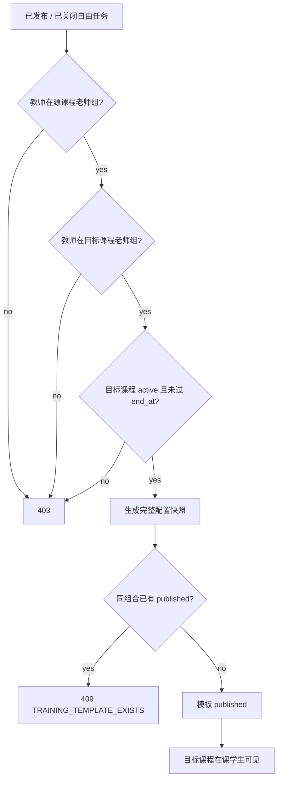
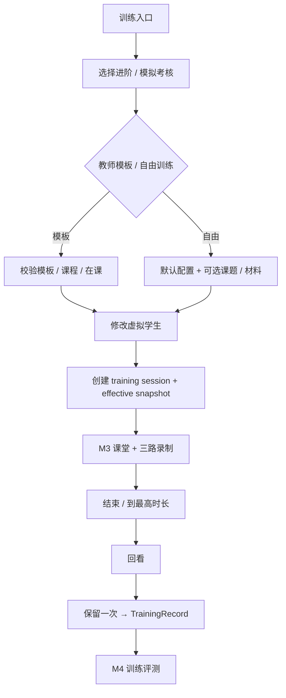
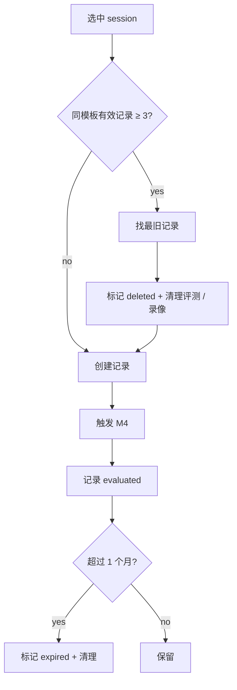
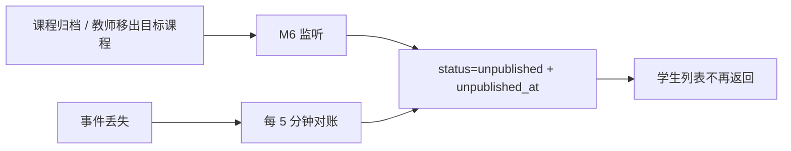

# 08 M6 训练模式

> 上位文档：[M6 训练模式](../requirements/M6-训练模式.md)、[00 总体设计](00-总体设计.md)、[01 数据模型与迁移](01-数据模型与迁移.md)、[02 API 与实时协议](02-API与实时协议.md)、[05A 课堂状态机与 WebSocket](05A-M3-课堂状态机与WebSocket.md)、[05B 录制、上传与回放](05B-M3-录制上传与回放.md)、[06 M4 AI 评测与反馈](06-M4-AI评测与反馈.md)
> 版本：V0.2（讨论稿）　状态：待评审　更新日期：2026-11-03
> 范围：M6 训练模板、训练 session、训练记录、保留与页面；M3 课堂 / 录制、M4 评测复用

## 1. 范围

### 1.1 本轮实现

- 两档训练：进阶 `progressive`、模拟考核 `mock_exam`
- 学生独立训练入口，不依赖课程任务
- 教师从已发布 / 已关闭自由试讲任务发布训练模板
- 模板只对目标课程在课学生可见；目标课程可与源任务课程不同
- 学生引用模板或自由训练
- 学生可修改虚拟学生配置，不能修改时长 / 权重
- 模拟考核固定时长与权重；进阶按模板 / 默认时长
- 无限次练习；回看后选一次生成评测并保留
- 每个模板 / 自由训练分组最多 3 条训练记录
- 训练录像与报告仅学生本人可见，保留 1 个月
- 复用 M3 课堂 / 录制 / 事件、M4 评测 / 报告
- 训练不生成 Submission，不进入 M7

### 1.2 不做

- 入门跟读、语音语调纠正
- 高阶突发情景（学生质疑、课堂混乱、设备故障）
- 学生个人模板保存
- 教师查看训练录像、报告、使用情况
- 训练进度、等级解锁、达标认证
- 训练计入课程任务 / 作业 / 成绩
- 跨校训练模板
- 情景模拟、结构化面试作为模板来源
- 示范片段、TTS
- 训练排行榜、训练统计
- 训练评测进入 M7

### 1.3 FR 映射

| FR | 覆盖 |
|---|---|
| FR-M6-01 训练入口 | 完整：独立入口、档位、模板 / 自由训练 |
| FR-M6-02 教师发布训练模板 | 完整：来源、目标课程、快照、下架、自动下架 |
| FR-M6-03 学生引用模板 / 自由训练 | 完整：配置继承、虚拟学生编辑、自由训练材料 |
| FR-M6-04 进阶训练 | 完整：时长、权重、多次练习 |
| FR-M6-05 模拟考核 | 完整：固定时长、固定权重、多次练习 |
| FR-M6-06 训练评测与保留 | 完整：选中、记录上限、1 个月、删除 |
| FR-M6-07 权限与可见性 | 完整：学生本人、教师模板管理、管理员 403 |
| FR-M6-08 复用 M3 / M4 | 完整：session 复用、无 Submission、M4 source_type |

## 2. 架构与边界

```text
Teacher ──发布 / 下架──→ M6 TrainingTemplate
                              │ config_snapshot（完整参考材料）
Student ──选择模板 / 自由训练──→ M6 TrainingSession
                              │ effective_config_snapshot
                              ▼
                    M3 课堂 / 录制 / 事件（session_type=training）
                              │
                              ▼
                    M6 TrainingRecord（选中一次）
                              │
                              ▼
                    M4 Evaluation（source_type=training_record）
                              │
                              ▼
                    学生本人报告 / 回放
```

| 组件 | 职责 |
|---|---|
| M3 | 课堂状态机、虚拟学生、录制、事件、回放 |
| M4 | 训练评测、报告、问题 / 建议 |
| M6 | 模板、训练 session 元数据、训练记录、保留与清理 |
| M7 | 不读取训练记录；训练不进入教师统计 |
| Python | 只做 M3 内容 / ASR / OCR 与 M4 评测，不持有训练状态 |

- **复用而不是复制**：训练 session 直接使用 `m3.sessions`，`session_type=training`、`task_id=null`；录像 / 文本 / 帧 / 事件仍按 session_id 关联。
- **不生成 Submission**：训练不进入任务分配、提交列表、M7。
- **评测复用 M4**：`source_type=training_record`、`source_id=record_id`；报告仅学生本人。
- **模板快照不可变**：模板发布后学生修改只影响本次 session；模板下架 / 退课不影响已选中 TrainingRecord 与已开始 session 的自然结束。
- 模板下架 / 退课后：禁止新建训练；`preparing` 取消，`in_progress` 可自然结束，`ended / reviewing` 允许在保留期内选中；未选中录像按临时 24h 规则清理。

## 3. 核心对象

### 3.1 训练模板

| 字段 | 说明 |
|---|---|
| `id` | 模板 ID |
| `source_task_id` | 来源自由试讲任务 |
| `source_task_config_version` | 来源任务配置版本 |
| `course_id` | 目标课程 |
| `training_level` | `progressive` / `mock_exam` |
| `classroom_mode` | 本轮固定 `free` |
| `config_snapshot` | 完整配置快照 |
| `created_by` | 发布教师 |
| `status` | `published` / `unpublished` |
| `published_at` / `unpublished_at` | 发布 / 下架时间 |

- 一个来源任务 + 目标课程 + 档位只允许一个 `published` 模板。
- 模板来源必须是教师可管理的已发布 / 已关闭自由试讲任务。
- 模板只对目标课程在课学生可见。
- 教师只能管理自己发布的模板；不能查看使用情况。

### 3.2 模板配置快照

```json
{
  "schema_version": 1,
  "source_task_id": "uuid",
  "source_task_config_version": 1,
  "course_id": "uuid",
  "training_level": "progressive",
  "classroom_mode": "free",
  "topic": "荷塘月色",
  "textbook_version": "部编版",
  "duration": {
    "recommended_seconds": 900,
    "max_seconds": 1200
  },
  "weights": {
    "content": 30,
    "expression": 20,
    "interaction": 20,
    "board": 15,
    "time": 15
  },
  "virtual_students": [
    {
      "name": "林小雨",
      "avatar": "avatar-03",
      "personality_text": "……",
      "activity": 0.6,
      "question_rate": 0.5,
      "ability": 0.7,
      "attention_baseline": 0.5,
      "discipline_probability": 0.4,
      "seat_no": 1,
      "sort_order": 1
    }
  ],
  "reference_material": {
    "filename": "教材第三章.pdf",
    "object_key": "materials/.../material.pdf",
    "mime": "application/pdf",
    "size": 123456,
    "parsed_text": "……",
    "char_count": 12000
  }
}
```

- 快照包含完整参考材料解析文本，不只摘要；M4 训练评测使用。
- 虚拟学生只是默认值；学生开始训练时可替换。
- 训练 session 启动时由 `SessionActor` 为每个虚拟学生生成 session 级 `virtual_student_id`（UUIDv7），事件 / 文本使用该 ID；不写 `m3.virtual_students` 表，运行时状态只在内存。
- 时长 / 权重来自来源任务；模拟考核发布时 `recommended_seconds = max_seconds = duration.max_seconds`。
- 学生不可见 `reference_material`，也不返回 `weights` 到学生端。

### 3.3 训练 session

| 字段 | 说明 |
|---|---|
| `session_id` | `m3.sessions.id` |
| `session_type` | `training` |
| `task_id` | `null` |
| `student_account_id` | 学生 |
| `course_id` | 目标课程，可空 |
| `training_level` | `progressive` / `mock_exam` |
| `template_id` | 可空；自由训练为空 |
| `effective_config_snapshot` | 本次训练实际配置 |
| `status` | `preparing` / `in_progress` / `ended` / `reviewing` / `selected` / `evaluated` / `cancelled` / `failed` |

- 训练状态机沿用 05A；不进入 `submitted`。
- 同一学生同时只允许一个 `preparing / in_progress` 训练 session。
- `effective_config_snapshot` 包含学生修改后的虚拟学生、时长、权重、课题、参考材料。
- 训练 session 的录像、文本、帧、事件全部按 session_id 存 M3 表。

### 3.4 训练记录

| 字段 | 说明 |
|---|---|
| `id` | record_id |
| `training_session_id` | 被选中的 session |
| `student_account_id` | 学生 |
| `template_id` | 可空；自由训练为空 |
| `selected_at` | 选中时间 |
| `evaluation_id` | 不落列；通过 `evaluations.training_record_id` 查询 |
| `expires_at` | `selected_at + 1 个月` |
| `status` | `selected` / `evaluated` / `deleted` / `expired` |
| `deleted_at` | 删除时间，可空 |

- 一个 session 最多生成一条记录；`UNIQUE(training_session_id)`。
- 每个模板最多 3 条有效记录；自由训练按 `(student_id, template_id=null)` 分组同样 3 条。
- 记录保留 1 个月；学生可提前删除。
- 记录删除 / 过期后，报告与录像不可访问。

## 4. 教师训练模板

### 4.1 发布条件

| 条件 | 说明 |
|---|---|
| 源任务已发布 / 已关闭 | 草稿不可用 |
| 源任务模式 `free` | 情景 / 结构化面试不可作为模板 |
| 教师在源课程老师组 | 能访问源任务 |
| 教师在目标课程老师组 | 有权发布到目标课程 |
| 目标课程 active 且未过 `end_at` | 目标课程可用 |
| 目标课程与源课程可不同 | 允许跨课程复用 |
| 同源任务 + 目标课程 + 档位无 published 模板 | 唯一约束 |

- 模板创建时读取源任务当前 `config_snapshot`，生成完整快照。
- 源任务发布后配置不可变；模板快照与源任务后续无关。
- 模板不复制任务分配、提交件、学生名单。

### 4.2 发布 / 下架

- 发布：`POST /api/v1/training/templates`，请求 `{source_task_id, course_id, training_level}`。
- 响应模板 + 快照摘要（不含参考材料全文）。
- 下架：`POST /api/v1/training/templates/{template_id}/unpublish`，仅创建者可操作。
- 下架只改 `status` 与 `unpublished_at`，不删除模板、不删除已生成训练记录。
- 可重新发布：若同组合已有 `unpublished` 模板，创建新模板行；旧行保留审计。唯一索引只约束 `published`。
- 同组合已有 published 模板：409 `TRAINING_TEMPLATE_EXISTS`。

### 4.3 自动下架

- 目标课程归档 → 该课程所有 published 模板自动下架。
- 模板创建者被移出目标课程老师组 → 其发布的模板自动下架。
- 由 M2 `CourseArchivedEvent` / `CourseTeacherRemovedEvent` 触发；事件丢失由 `TrainingTemplateReconciler` 每 5 分钟对账：
  - 目标课程 `status != active`；
  - 创建者不在 `course_teachers.status='active'`。
- 自动下架写 `unpublished_at`，不通知学生；学生列表自然消失。
- 源任务关闭 / 源课程归档不自动下架；快照已独立。
- 目标课程 `end_at` 已过：模板不再对学生展示，但状态可保持 published，等待归档或手动下架。

### 4.4 模板可见性

| 角色 | 可见范围 |
|---|---|
| 学生 | 目标课程在课、课程 active 且未过 `end_at`、模板 published |
| 教师 | 自己创建的模板（含 unpublished） |
| 管理员 | 不可见 |

- 学生列表不返回参考材料、权重、源任务内部 ID；只返回模板 ID、课题、课程、档位、时长、虚拟学生默认数量。
- 教师列表可返回来源任务、目标课程、档位、状态、发布时间；不返回使用次数（本轮不统计）。

## 5. 学生训练入口与配置

### 5.1 入口

- 学生端独立「训练」入口，不与课程任务列表混排。
- 先选档位：进阶 / 模拟考核。
- 再选：教师模板或自由训练。
- 模板列表只显示当前在课课程、对应档位、published 模板。
- 无模板时显示空态 + 自由训练入口。

### 5.2 模板训练

- 以模板配置为起点；学生可修改虚拟学生：
  - 人数 1—30；
  - 五个参数 0—1；
  - 个性文本 ≤ 500 字；
  - 姓名 / 头像可重新生成。
- 学生不能修改：
  - 推荐 / 最高时长；
  - 维度权重；
  - 课题、参考材料（模板固定）；
  - 训练档位。
- 请求携带完整 `virtual_students` 数组；服务端整组替换模板默认值。
- 学生只看到课题、课程、档位、时长、虚拟学生姓名 / 头像；看不到参考材料与权重。

### 5.3 自由训练

- 无模板；学生可选：
  - 课题（可选，1—100 字，默认「自由训练」）；
  - 参考材料（可选，教材原文 / 教案）；
  - 虚拟学生配置（默认 3 人、参数 0.5）。
- 默认配置：

| 档位 | 推荐时长 | 最高时长 | 权重 |
|---|---|---|---|
| 进阶 | 15 分钟 | 20 分钟 | 30 / 20 / 20 / 15 / 15 |
| 模拟考核 | 20 分钟 | 20 分钟 | 30 / 20 / 20 / 15 / 15 |

- 参考材料仅用于 M4 教学内容评测；教师 / 管理员不可见。
- 参考材料格式 / 解析沿用 05C：PDF / DOCX / TXT / MD，≤ 20 MB，Java 解析，扫描 PDF 不做 OCR。
- 参考材料可选；缺失时 M4 将知识点准确性标「不可评估」，其余子项计分，置信度降低。

### 5.4 有效配置快照

训练开始时生成：

```json
{
  "schema_version": 1,
  "template_id": "uuid|null",
  "training_level": "progressive",
  "course_id": "uuid|null",
  "topic": "荷塘月色",
  "duration": {
    "recommended_seconds": 900,
    "max_seconds": 1200
  },
  "weights": {
    "content": 30,
    "expression": 20,
    "interaction": 20,
    "board": 15,
    "time": 15
  },
  "virtual_students": [
    {
      "name": "林小雨",
      "avatar": "avatar-03",
      "personality_text": "……",
      "activity": 0.6,
      "question_rate": 0.5,
      "ability": 0.7,
      "attention_baseline": 0.5,
      "discipline_probability": 0.4,
      "seat_no": 1,
      "sort_order": 1
    }
  ],
  "reference_material": {
    "filename": "教材第三章.pdf",
    "object_key": "training-materials/...",
    "parsed_text": "……",
    "char_count": 12000
  }
}
```

- 模板训练：时长 / 权重 / 课题 / 参考材料来自模板；虚拟学生来自学生请求。
- 自由训练：使用默认时长 / 权重；课题 / 参考材料 / 虚拟学生来自学生请求。
- 模拟考核：`recommended_seconds = max_seconds`；到点自动停止，不暂停。
- 进阶：到 `max_seconds` 自动停止。
- 快照写入 `m6.training_session_meta.effective_config_snapshot`；之后不可变。

## 6. 训练 session 与状态

### 6.1 创建

`POST /api/v1/training/sessions`：

```json
{
  "template_id": "uuid",
  "training_level": "progressive",
  "course_id": null,
  "topic": null,
  "virtual_students": [],
  "material_id": null
}
```

- 模板训练：`template_id` 必填；档位必须与模板一致；`course_id` 忽略，取模板目标课程。
- 自由训练：`template_id=null`；`training_level` 必填；`course_id` 可空；`topic` / `material_id` 可选。
- 服务端：
  1. 校验模板 published、目标课程 active / 未过 `end_at`、学生在该课程 active；
  2. 校验学生无其他 `preparing / in_progress` 训练 session；
  3. 校验虚拟学生 1—30、参数 0—1、个性文本 ≤ 500；
  4. 校验自由训练材料属于本人、已解析、未过期；
  5. 生成 `effective_config_snapshot`；
  6. 插入 `m3.sessions`（`session_type=training`、`task_id=null`、`mode=free`）与 `m6.training_session_meta`。
- 返回 session + `public_config`（课题、档位、时长、虚拟学生公开信息；不含参考材料 / 权重）。

### 6.2 状态机

```text
preparing → in_progress → ended → reviewing → selected → evaluated
     │           │           │
     └───────────┴───────────┴──→ cancelled / failed
```

| 状态 | 进入 | 允许操作 |
|---|---|---|
| `preparing` | 创建 session | 设备检查、开始、取消 |
| `in_progress` | 录制三路就绪 + `session.start` | 课堂命令、到点结束 |
| `ended` | 主动结束 / 到最高时长 / 录制停止 | 回看 |
| `reviewing` | 学生打开回看 | 选中、删除 |
| `selected` | 创建 TrainingRecord | 等待 M4 |
| `evaluated` | M4 终态 | 查看报告、删除记录 |
| `cancelled` | 学生取消 / 未开始 | 终态 |
| `failed` | 录制 / WS 中断 | 终态；可重做 |

- 训练不进入 `submitted`。
- `selected / evaluated` 之后不能再次选中同一 session。
- 同一学生同一时间只允许一个活跃训练 session；部分唯一索引保证。

### 6.3 开始与结束

- 复用 05A 课堂：虚拟学生、共享窗口、摄像头、麦克风、三路录制。
- 训练无教师实时控制；学生使用「结束训练」按钮，等价 05A `teacher.end_session`。
- 到 `max_seconds` 自动结束。
- 结束走 05A 强制 flush；上传走 05B。
- 三路录制任一失败 → session `failed`，不能选中，可重做。
- 训练页顶部显示「训练 · 进阶 / 模拟考核」标识，不显示课程任务提交入口。

### 6.4 回看与选中

- `ended` → 学生打开回看 → `reviewing`。
- 回看复用 05B 布局 A；显示「保留这次训练」/「删除本次」。
- 选中：
  1. 校验 session 属于本人、状态 `ended / reviewing`、三路 uploaded；
  2. 创建 `training_records`，`status=selected`、`expires_at=selected_at+1 month`；
  3. session → `selected`；
  4. 触发 M4 评测（`source_type=training_record`、`source_id=record_id`）；
  5. 若该模板 / 自由分组有效记录 > 3，删除最旧记录及其评测 / 录像；
  6. 返回记录 + 评测状态。
- 选中后其他临时 attempt 仍按 05B 临时录像规则清理；不立即删除。
- 重复选中同一 session：409 `DUPLICATE_RESOURCE`。
- 选中后不能修改评测输入；M4 重试不改变记录。

## 7. 训练记录与保留

### 7.1 记录上限

- 每个模板最多 3 条有效记录；自由训练按 `(student_account_id, template_id=null)` 分组同样 3 条。
- 有效记录：`selected` / `evaluated`；`deleted` / `expired` 不计。
- 超过 3 条：按 `selected_at` 最旧删除，包含：
  - M6 TrainingRecord；
  - M4 Evaluation + 维度分 / 问题 / 输入快照 / job；
  - M3 session、录像、文本、帧、事件；
  - MinIO 录像 / 关键帧对象。
- 删除最旧后新增当前记录，保持 3 条。
- 删除为事务内标记 + 异步清理；对外立即不可见。

### 7.2 保留期

- `expires_at = selected_at + 1 个月`。
- 到期：记录 `status=expired`，报告 / 回放 / 下载不可访问；清理任务删除 DB + MinIO。
- 读接口同时校验 `expires_at > now()`；不只看 `status`，避免清理任务 10 分钟间隔内超期可访问。
- 学生可提前删除：`DELETE /training/records/{id}`；`status=deleted`，`deleted_at` 写入；清理任务删除。
- 训练录像与报告仅本人可见；教师 / 管理员 403。
- 通用 M3 / M4 接口（session、replay、texts、events、recordings、evaluation、report、issues）必须统一拒绝教师访问训练 session / training_record；不能只靠 M6 专用接口。
- 模板下架 / 学生退课：已选中记录保留至 `expires_at`；未选中 session 按临时录像清理。
- 课程归档：模板自动下架；已选中记录仍保留至 `expires_at`。

### 7.3 清理

- 未选中 session：沿用 05B 临时录像 24 小时 / 最多 5 个 attempt。
- 选中记录到期 / 删除：删除 M6 记录、M4 评测、M3 session 数据、MinIO 对象。
- 清理任务先删 MinIO 对象，再删 DB 行；失败重试并记录日志。
- 评测进行中到期 / 删除：记录立即标记 expired / deleted；M4 回调按记录已删除处理，不生成可见报告；清理任务随后删除评测与 job。
- 模板本身不随记录删除；下架模板保留审计。

## 8. M4 评测复用

- `source_type=training_record`、`source_id=record_id`。
- 不生成 Submission；`task_id=null`；`course_id` 为目标课程或空。
- 配置使用 `effective_config_snapshot`：
  - 模板训练：模板快照 + 学生虚拟学生修改；
  - 自由训练：默认配置 + 学生课题 / 材料 / 虚拟学生。
- M4 评测维度：自由 / 情景五维（训练复用自由试讲五维）。
- 训练报告仅学生本人；M4 的课程老师组可见规则被 M6 覆盖。
- 训练报告保留 1 个月，与 TrainingRecord 一致；不适用课程结束 + 1 年。
- M7 不读取训练记录；训练不进入教师统计、排行榜、导出。
- M4 终态（completed / partial / failed）发布 `EvaluationTerminalEvent`；M6 将 session / record 置 `evaluated`，M7 忽略 `source_type=training_record`。
- 训练评测失败：M4 自动重试；仍失败则记录 `evaluated`，报告显示失败；学生可删除记录后重练。

## 9. 数据模型

沿用 01，本轮补充：

| 表 | 说明 |
|---|---|
| `training_templates` | 增加 `unpublished_at`；`status` published / unpublished；唯一 published 组合 |
| `training_session_meta` | `effective_config_snapshot`、`template_id`、`training_level` |
| `training_records` | 增加 `deleted_at`；`status` selected / evaluated / deleted / expired |
| `training_materials` | 自由训练参考材料临时表 |

`training_materials`：

| 字段 | 说明 |
|---|---|
| `id` | material_id |
| `student_account_id` | 学生 |
| `filename` / `mime` / `size` | 原文件 |
| `object_key` | MinIO 对象键 |
| `parsed_text` / `char_count` | 解析文本 |
| `status` | uploaded / used / deleted / expired |
| `expires_at` | 未使用 24 小时过期 |
| `created_at` | 上传时间 |

- 对象键：`training-materials/{school_id}/{student_account_id}/{material_id}.{ext}`。
- 学生只能使用本人 material；训练 session 创建后标记 used，随记录 / session 清理。
- 训练 session 的 `m3.sessions` 部分唯一索引：`UNIQUE(student_account_id) WHERE session_type='training' AND status IN ('preparing','in_progress')`。
- `training_templates` 唯一 published：`UNIQUE(source_task_id, course_id, training_level) WHERE status='published'`。
- `training_records` 唯一 session；索引 `(student_account_id, template_id, expires_at)`、`(expires_at, status)`。

## 10. 接口

### 10.1 教师模板

| 方法 | 路径 | 权限 | 说明 |
|---|---|---|---|
| GET | `/api/v1/training/templates` | `training:template:read` | 教师自己的模板 |
| POST | `/api/v1/training/templates` | `training:template:manage` | 发布模板 |
| POST | `/api/v1/training/templates/{template_id}/unpublish` | `training:template:manage` | 下架 |

发布请求：

```json
{
  "source_task_id": "uuid",
  "course_id": "uuid",
  "training_level": "progressive"
}
```

- 错误：源任务不可用 `TRAINING_SOURCE_INVALID`；目标课程不可用 `TRAINING_NOT_ELIGIBLE`；重复 `TRAINING_TEMPLATE_EXISTS`。
- 响应返回模板 ID、状态、发布时间、来源任务、目标课程、档位、配置摘要；不返回参考材料全文。
- 下架仅创建者；非创建者 403。

### 10.2 学生模板

| 方法 | 路径 | 权限 | 说明 |
|---|---|---|---|
| GET | `/api/v1/student/training/templates` | `training:template:read` | 目标课程在课、published、可用的模板 |
| GET | `/api/v1/student/training/templates/{template_id}` | `training:template:read` | 模板公开配置；用于配置页直接打开 |

查询：`level`、`course_id`、`page`、`size`。

```json
{
  "items": [
    {
      "template_id": "uuid",
      "topic": "荷塘月色",
      "course_id": "uuid",
      "course_name": "语文教学论",
      "training_level": "progressive",
      "duration_ms": 1200000,
      "virtual_student_count": 3
    }
  ],
  "total": 2,
  "page": 1,
  "size": 20
}
```

模板详情额外返回 `public_config`：

```json
{
  "template_id": "uuid",
  "topic": "荷塘月色",
  "course_id": "uuid",
  "training_level": "progressive",
  "duration_ms": 1200000,
  "dimensions": ["content", "expression", "interaction", "board", "time"],
  "virtual_students": [
    {
      "name": "林小雨",
      "avatar": "avatar-03",
      "personality_text": "……",
      "activity": 0.6,
      "question_rate": 0.5,
      "ability": 0.7,
      "attention_baseline": 0.5,
      "discipline_probability": 0.4,
      "seat_no": 1,
      "sort_order": 1
    }
  ]
}
```

- 不返回参考材料、权重、源任务 ID。
- 已下架、目标课程归档 / 已过 `end_at`、学生不在课：不返回。
- 创建训练请求的 `virtual_students: []` 表示“使用模板默认值”；非空数组表示整组替换；自由训练空数组表示使用默认 3 名学生。

### 10.3 自由训练材料

| 方法 | 路径 | 权限 | 说明 |
|---|---|---|---|
| POST | `/api/v1/training/materials` | `training:session:start` | 上传 / 解析参考材料（multipart） |
| DELETE | `/api/v1/training/materials/{material_id}` | `training:session:start` | 删除未使用材料 |

- 格式 / 大小 / 解析同 05C：PDF / DOCX / TXT / MD，≤ 20 MB。
- 返回 `material_id`、文件名、字符数、前 500 字预览。
- 未使用 24 小时自动过期；只能用于本人训练。
- 错误：`MATERIAL_PARSE_FAILED` / `MATERIAL_TOO_LARGE` / `MATERIAL_TYPE_UNSUPPORTED` / `TRAINING_MATERIAL_INVALID`。

### 10.4 训练 session

| 方法 | 路径 | 权限 | 说明 |
|---|---|---|---|
| POST | `/api/v1/training/sessions` | `training:session:start` | 创建训练 session |
| GET | `/api/v1/training/sessions/{session_id}` | `training:session:start` | 训练 session |
| POST | `/api/v1/training/sessions/{session_id}/end` | `training:session:start` | 结束训练（幂等兜底） |
| POST | `/api/v1/training/sessions/{session_id}/cancel` | `training:session:start` | 取消未开始 session |

创建请求：

```json
{
  "template_id": "uuid",
  "training_level": "progressive",
  "course_id": null,
  "topic": null,
  "virtual_students": [],
  "material_id": null
}
```

- 模板训练：`template_id` 必填；`training_level` 与模板一致；`course_id` / `topic` / `material_id` 忽略。
- 自由训练：`template_id=null`；`training_level` 必填；`course_id` 可空；`topic` / `material_id` 可选。
- 返回 session_id、状态、`public_config`、训练档位、时长。
- 同一学生已有活跃训练 session：409 `TRAINING_SESSION_ACTIVE`。
- 训练 session 复用 M3 WS / 录制接口；`session_type=training`。

### 10.5 训练记录

| 方法 | 路径 | 权限 | 说明 |
|---|---|---|---|
| POST | `/api/v1/training/records` | `training:record:manage` | 选中一次训练生成评测 |
| GET | `/api/v1/training/records` | `training:record:read` | 本人训练记录 |
| GET | `/api/v1/training/records/{record_id}` | `training:record:read` | 本人记录详情 |
| DELETE | `/api/v1/training/records/{record_id}` | `training:record:manage` | 删除记录 |

选中请求：

```json
{"session_id": "uuid"}
```

- 只允许本人 `ended / reviewing` session；三路 uploaded。
- 生成记录、触发 M4、返回记录 + 评测状态。
- 超过 3 条自动删除最旧；响应带 `deleted_record_id`（可空）。
- 记录列表返回状态、档位、模板 / 自由训练、选中时间、到期时间、评测状态、报告入口。
- 删除后立即 404；异步清理。

### 10.6 训练评测

| 方法 | 路径 | 权限 | 说明 |
|---|---|---|---|
| GET | `/api/v1/training/records/{record_id}/evaluation` | `evaluation:read` | 训练评测报告，仅本人 |

- 复用 06 报告 DTO；`source_type=training_record`。
- 教师 / 管理员 403。
- 评测 `pending / running` 返回 409 `EVALUATION_NOT_READY`；`failed` 返回 422 `EVALUATION_FAILED`。
- 记录过期 / 删除：404。

### 10.7 错误码

| 错误码 | HTTP | 说明 |
|---|---|---|
| `TRAINING_SOURCE_INVALID` | 422 | 源任务不是已发布 / 已关闭自由试讲 |
| `TRAINING_NOT_ELIGIBLE` | 422 | 教师 / 学生 / 课程不满足模板或训练条件 |
| `TRAINING_TEMPLATE_EXISTS` | 409 | 同源任务 + 课程 + 档位已有 published 模板 |
| `TRAINING_TEMPLATE_UNAVAILABLE` | 422 | 模板已下架 / 课程不可用 |
| `TRAINING_SESSION_ACTIVE` | 409 | 已有进行中的训练 session |
| `TRAINING_CONFIG_IMMUTABLE` | 422 | 请求试图修改时长 / 权重 |
| `TRAINING_MATERIAL_INVALID` | 422 | 参考材料不可用 |
| `TRAINING_RECORD_LIMIT` | 422 | 自动删除最旧记录失败时的内部兜底；正常不返回 |
| `TRAINING_RECORD_EXPIRED` | 404 | 记录已过期 / 删除；对外统一 404，避免泄露存在性 |

## 11. 权限

| 操作 | 学生 | 教师 | 管理员 |
|---|---|---|---|
| 发布 / 下架训练模板 | — | 源任务可管理 + 目标课程老师组，仅自己的模板 | 不可 |
| 查看教师模板 | — | 自己创建的 | 不可 |
| 查看学生模板 | 目标课程在课、published | — | 不可 |
| 开始训练 | 可 | — | — |
| 修改虚拟学生 | 可（本人 session） | — | — |
| 修改时长 / 权重 | 不可 | — | — |
| 上传自由训练材料 | 本人 | — | — |
| 查看训练录像 / 报告 | 本人 | 不可 | 不可 |
| 删除训练记录 | 本人 | — | — |
| 查看训练使用情况 | — | 不可 | 不可 |
| 跨校训练 / 模板 | 不可 | 不可 | 不可 |

- 训练报告覆盖 M4 老师组规则：仅本人。
- 管理员无任何训练权限。
- 资源级校验：session / record 的 `student_account_id`、模板 `created_by`、课程老师组、同校。

## 12. 页面与交互

### 12.1 路由

| 路由 | 页面 | 角色 |
|---|---|---|
| `/student/training` | 训练首页 | 学生 |
| `/student/training/templates/{templateId}` | 模板训练配置 | 目标课程在课学生 |
| `/student/training/free` | 自由训练配置 | 学生 |
| `/student/training/sessions/{sessionId}` | 训练课堂 | 本人 |
| `/student/training/sessions/{sessionId}/review` | 回看 / 选中 | 本人 |
| `/student/training/records` | 训练记录 | 本人 |
| `/student/training/records/{recordId}` | 训练记录详情 / 报告入口 | 本人 |
| `/teacher/training-templates` | 训练模板管理 | 教师 |
| `/teacher/courses/{courseId}/tasks/{taskId}` | 任务详情「发布为训练模板」 | 课程老师组 |

- 管理员访问训练路由 403。
- 教师进入训练结果路由 403。

### 12.2 训练首页

```text
┌ 训练 ──────────────────────────────────────────────┐
│ [进阶] [模拟考核]                                   │
│ 教师模板                                           │
│ ┌ 荷塘月色 ─────────────┐ ┌ 少年闰土 ───────────┐ │
│ │ 语文教学论 · 进阶       │ │ 语文教学论 · 进阶    │ │
│ │ 20 分钟 · 3 名学生      │ │ 20 分钟 · 3 名学生   │ │
│ │ [开始训练]             │ │ [开始训练]           │ │
│ └────────────────────────┘ └─────────────────────┘ │
│ ┌ 自由训练 ──────────────────────────────────────┐ │
│ │ 自选课题 / 可选参考材料 / 自定义虚拟学生        │ │
│ │ [开始自由训练]                                 │ │
│ └────────────────────────────────────────────────┘ │
│ 最近训练记录 →                                     │
└────────────────────────────────────────────────────┘
```

- 档位切换刷新模板列表。
- 模板卡片不显示参考材料、权重。
- 空态：“当前课程暂无教师模板，可先自由训练”。
- 顶部导航「训练」独立入口。

### 12.3 模板训练配置

```text
┌ 返回 / 荷塘月色 · 进阶 ────────────────────────────┐
│ 课程：语文教学论   时长：20 分钟   档位：进阶        │
│ 虚拟学生（可调整）                                 │
│ ┌ 学生 1  [头像] 姓名 [林小雨]  [删除] ──────────┐ │
│ │ 活跃度 [====--] 提问 [===---] 能力 [====--]    │ │
│ │ 注意力 [====--] 纪律 [==----] 个性 [......]    │ │
│ └────────────────────────────────────────────────┘ │
│ [+ 添加学生]  [随机姓名 / 头像]                     │
│ 时长与权重由模板固定，不可修改                      │
│ [开始训练]                                         │
└────────────────────────────────────────────────────┘
```

- 只显示公开配置；参考材料 / 权重不展示。
- 人数 1—30；默认来自模板。
- 参数用百分比显示；个性文本 500 字。
- 模拟考核显示“固定 20 分钟，到点自动结束”。

### 12.4 自由训练配置

```text
┌ 返回 / 自由训练 ───────────────────────────────────┐
│ 档位 [进阶] [模拟考核]                             │
│ 课题 [________________________]（可选）             │
│ 参考材料（可选）                                   │
│ ┌ 拖拽 PDF / DOCX / TXT / MD，≤20 MB ───────────┐ │
│ │ 已上传：教材第三章.pdf · 12,000 字             │ │
│ └────────────────────────────────────────────────┘ │
│ 虚拟学生（默认 3 人） [配置...]                     │
│ 时长：进阶 15—20 分钟 / 模拟考核 20 分钟            │
│ [开始训练]                                         │
└────────────────────────────────────────────────────┘
```

- 参考材料仅用于评测；不展示给教师 / 管理员。
- 不提供时长 / 权重编辑。
- 材料解析失败阻止开始，提示重新上传 / 移除。

### 12.5 训练课堂

- 复用 05A / 05C 自由试讲课堂布局：共享窗口主画面 + 虚拟学生 + 摄像头小窗 + 控制条。
- 顶部显示「训练 · 进阶 / 模拟考核」；不显示课程任务提交、教师评分入口。
- 底部「结束训练」；到最高时长自动结束。
- 三路录制状态、ASR / OCR 状态同 05B。
- 训练不显示参考材料、答案要点、权重。

### 12.6 回看与选中

```text
┌ 返回 / 训练回看 ───────────────────────────────────┐
│ 训练 · 进阶 · 20 分钟                              │
│ [回放 A：屏幕主画面 + 摄像头小窗 + 事件流]          │
│ 本次训练尚未保留                                   │
│ [删除本次]                    [保留这次训练]        │
│ 每模板最多保留 3 条，超出将删除最旧记录             │
└────────────────────────────────────────────────────┘
```

- 保留后跳转记录详情，显示评测状态。
- 删除本次：临时录像标记删除 / 清理，回训练首页。
- 保留按钮二次确认；显示当前记录数。

### 12.7 训练记录

```text
┌ 训练记录 ──────────────────────────────────────────┐
│ [全部] [评测中] [已完成] [已过期]                   │
│ ┌ 荷塘月色 · 进阶 ──────────────────────────────┐ │
│ │ 2026-11-03 14:20 · 完成度 85.0 · 剩 28 天      │ │
│ │ [查看报告] [查看回放] [删除]                   │ │
│ └────────────────────────────────────────────────┘ │
└────────────────────────────────────────────────────┘
```

- 记录卡片：课题 / 自由训练、档位、选中时间、评测状态、最终分、剩余天数。
- 过期 / 删除记录不显示或灰显；报告入口 404。
- 删除二次确认。

### 12.8 教师模板管理

- 任务详情（已发布 / 已关闭自由试讲）显示「发布为训练模板」。
- 发布弹窗：
  - 档位：进阶 / 模拟考核；
  - 目标课程：教师所在课程；
  - 预览课题、时长、权重、虚拟学生数量；
  - 发布。
- 模板列表：来源任务、目标课程、档位、状态、发布时间、操作（下架）。
- 不显示使用次数、学生名单、训练结果。
- 自动下架提示：“目标课程归档 / 你已被移出课程，模板已下架”。

### 12.9 视觉

沿用 B · 深蓝 + 琥珀：

| 元素 | 规则 |
|---|---|
| 背景 / 卡片 | `#0B1220` / `#111C33` |
| 主色 | 琥珀 `#F5A524` |
| 文本 | 主 `#E8EEF9`；次 `#8FA3C0` |
| 训练标识 | 琥珀描边 badge「训练 · 进阶 / 模拟考核」 |
| 状态 | 进行中琥珀；已完成绿；过期 / 删除灰 |
| 卡片 | 12 px 圆角；模板卡片 hover 提升 |
| 课堂 | 复用 M3 深色舞台；不显示教师评分 / 提交控件 |

## 13. 清理、并发与可观测性

- 训练 session 复用 05A 异步持久化与强制 flush；失败时 session failed，不生成记录。
- 训练录像上传复用 05B 分片；三路 uploaded 才能选中。
- 同一学生同时只允许一个活跃训练 session；数据库部分唯一索引 + service 校验。
- 记录上限 / 删除按“学生 + 模板 / 自由训练分组”加锁或 `SELECT ... FOR UPDATE`，避免并发选中超过 3 条。
- 到期清理任务每 10 分钟扫描 `training_records(expires_at, status)`。
- 模板自动下架对账每 5 分钟。
- 指标：
  - `m6_training_sessions_total{level,status}`
  - `m6_training_records_total{status}`
  - `m6_record_cleanup_total{reason}`
  - `m6_template_unpublish_total{reason}`
- 日志：`training_session_id`、`record_id`、`student_account_id`、`template_id`、`evaluation_id`；不记录参考材料全文。
- 保留：TrainingRecord 1 个月；未选中录像 24 小时 / 5 个 attempt；模板长期保留（下架不删除）。

## 14. 测试

### 14.1 模板

- 从已发布 / 已关闭自由任务发布；草稿、情景、结构化面试拒绝。
- 教师在源任务 / 目标课程老师组校验；跨课程目标。
- 同源任务 + 目标课程 + 档位重复 published → 409。
- 模板快照含完整参考材料；学生列表不返回参考材料 / 权重。
- 下架；自动下架（课程归档、教师移出目标课程）。
- 目标课程 `end_at` 已过：学生不可见。
- 教师只能管理自己的模板；管理员 403。

### 14.2 学生训练

- 训练入口按档位过滤模板；无模板空态。
- 模板训练：虚拟学生替换；时长 / 权重不可改。
- 自由训练：默认 3 人 / 0.5；进阶 15/20；模拟 20/20；可选课题 / 材料。
- 参考材料上传 / 解析 / 过期 / 跨学生拒绝。
- 虚拟学生 1 / 30 / 31；参数越界；个性文本超长。
- 同一学生并发创建 session → `TRAINING_SESSION_ACTIVE`。
- 模拟考核到点自动结束；进阶到最高时长结束。
- 训练 session 不生成 Submission；M7 不可见。

### 14.3 记录与评测

- 选中 ended / reviewing session；三路未上传拒绝。
- 生成 TrainingRecord、session selected、M4 `training_record` 评测。
- 每模板 3 条；第 4 条删除最旧（含评测 / 录像）。
- 自由训练按 `template_id=null` 分组 3 条。
- 记录到期 / 删除：报告 / 回放 404；清理 DB + MinIO。
- 训练报告仅本人；教师 / 管理员 403。
- M4 partial / failed：记录 evaluated，报告显示状态。
- 模板下架 / 学生退课：已选中记录保留，未选中 session 清理。

### 14.4 端到端

- 教师发布模板 → 学生选择 → 训练 → 回看 → 保留 → 报告。
- 自由训练无参考材料 → 报告准确性「不可评估」，仍有分数 / 雷达。
- 多次训练 → 选一次 → 记录上限 → 删除最旧。
- 教师看不到训练记录 / 报告 / 使用情况。
- 演示种子数据可独立完成训练记录与报告查看。

## 15. 开放问题

| 编号 | 事项 | 当前处理 |
|---|---|---|
| Q1 | 自由训练是否关联课程 | 默认空；可传 `course_id`，仅用于上下文 |
| Q2 | 学生是否看到权重 | 不显示；时长显示，权重仅服务端使用 |
| Q3 | 教师模板可见范围 | 仅创建者管理；学生按目标课程 |
| Q4 | 模板重新发布 | 新建模板行；旧行保留审计 |
| Q5 | 记录删除方式 | 软状态 deleted / expired + 异步清理 |
| Q6 | 选中后其他 attempt | 按 05B 临时录像规则，不立即删除 |
| Q7 | 训练材料格式 | PDF / DOCX / TXT / MD；扫描 PDF 不做 OCR |
| Q8 | 模拟考核时长 | 模板 `duration_max`；自由训练 20 分钟 |
| Q9 | 训练评测失败 | 记录 evaluated + 报告失败；可删除后重练 |
| Q10 | 训练是否进入 M7 | 不进入 |
| Q11 | 管理员 | 无训练权限 |
| Q12 | 训练记录上限并发 | 任务级锁 + 服务校验 |

## 16. 流程图

### 16.1 模板发布与可见性



### 16.2 学生训练



### 16.3 记录上限与清理



### 16.4 模板自动下架


