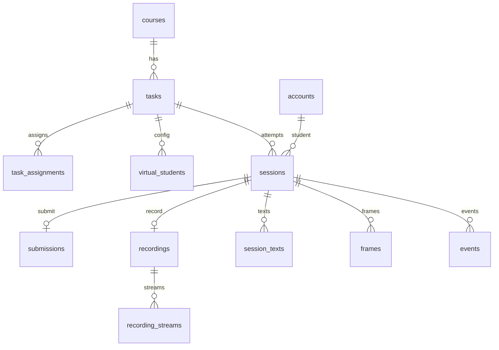
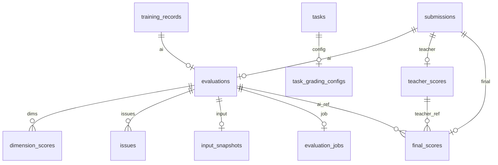
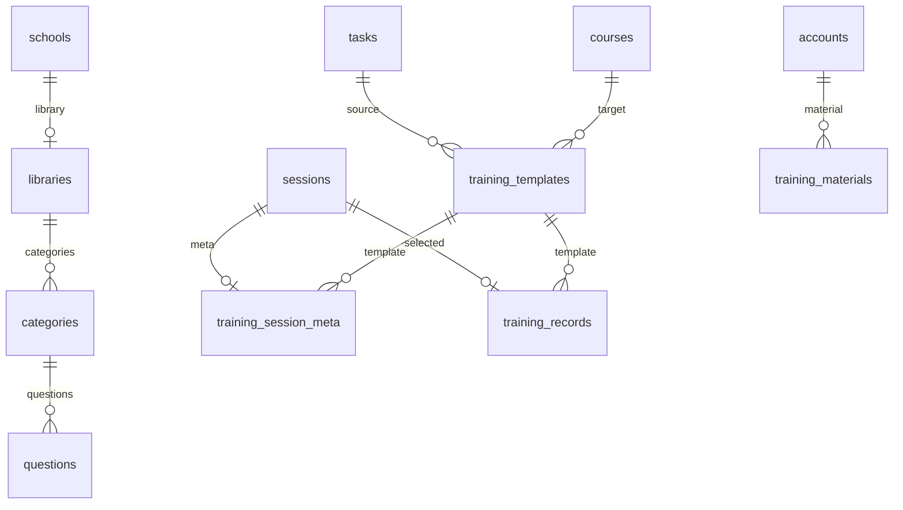

# 12 数据库设计

> 上位文档：[01 数据模型与迁移](01-数据模型与迁移.md)、[02 API 与实时协议](02-API与实时协议.md)、[11 概要设计评审](11-概要设计评审.md)
> 版本：V0.1（讨论稿）　状态：待评审　更新日期：2026-11-03
> 数据库：PostgreSQL 16；单库 + 按模块分 schema；Java 是唯一业务写入方
> 用途：把 01 的语义落成可执行 DDL、约束、索引、清理任务与 Flyway 顺序

## 1. 设计约定

### 1.1 Schema

| Schema | 归属 | 表 |
|---|---|---|
| `m1_auth` | M1 | `schools`、`account_types`、`accounts`、`school_admins`、`majors`、`classes`、`student_profiles`、`teacher_profiles`、`teacher_majors`、`api_permissions`、`account_type_permissions` |
| `m2_course` | M2 | `courses`、`course_majors`、`course_teachers`、`course_students` |
| `m3_classroom` | M3 | `tasks`、`task_assignments`、`virtual_students`、`sessions`、`submissions`、`recordings`、`recording_streams`、`session_texts`、`frames`、`events` |
| `m4_eval` | M4 | `evaluations`、`dimension_scores`、`issues`、`input_snapshots`、`evaluation_jobs` |
| `m5_question` | M5 | `libraries`、`categories`、`questions` |
| `m6_training` | M6 | `training_templates`、`training_session_meta`、`training_records`、`training_materials` |
| `m7_teacher` | M7 | `task_grading_configs`、`teacher_scores`、`final_scores` |
| `ops` | 运维 | `cleanup_jobs` |

- 业务表只由 Java 写；Python 不直连业务库。
- 跨 schema 外键保留到拆服务前；拆服务时改为 ID / 事件引用。
- 演示环境单库；生产可按 schema 拆库，但先保持外键完整。

### 1.2 类型与命名

| 项 | 约定 |
|---|---|
| 主键 | `uuid`；Java 生成 UUIDv7；DDL 用 `gen_random_uuid()` 兜底 |
| 时间 | `timestamptz`，UTC；Java 写入；默认 `now()` |
| JSON | `jsonb`；对象默认 `'{}'::jsonb`，数组默认 `'[]'::jsonb` |
| 状态 | `varchar(32)` + `CHECK`，不用 PostgreSQL enum |
| 分数 | `numeric(5,2)`，0—100，一位小数 |
| 置信度 / 概率 | `numeric(3,2)`，0—1 |
| 时长 | 运行期 `bigint duration_ms`；任务配置 `integer *_seconds` |
| 软删除 | `status` / `left_at`；业务对象不物理删除 |
| 命名 | 表 / 列 `snake_case`；索引 `idx_`；外键 `fk_`；唯一索引 `uq_` |
| 时间戳 | `created_at` / `updated_at`；由 Java 更新，不建触发器 |

- 不建数据库触发器处理业务；审计、版本、状态转移都在 Java service。
- `updated_at` 默认 `now()`，更新由 Java 显式写。
- 金额 / 分数禁止 `float` / `double`。

## 2. ER 概览

### 2.1 M1 / M2

```mermaid
erDiagram
  schools ||--o{ accounts : has
  account_types ||--o{ accounts : type
  schools ||--o{ school_admins : binds
  accounts ||--o| school_admins : admin
  schools ||--o{ majors : owns
  majors ||--o{ classes : contains
  accounts ||--o| student_profiles : profile
  classes ||--o{ student_profiles : class
  accounts ||--o| teacher_profiles : profile
  accounts ||--o{ teacher_majors : teaches
  majors ||--o{ teacher_majors : major
  schools ||--o{ courses : owns
  courses ||--o{ course_majors : scope
  majors ||--o{ course_majors : major
  courses ||--o{ course_teachers : group
  accounts ||--o{ course_teachers : teacher
  courses ||--o{ course_students : member
  accounts ||--o{ course_students : student
```

### 2.2 M3



### 2.3 M4 / M7



### 2.4 M5 / M6



## 3. M1 账号与组织

### 3.1 DDL

```sql
CREATE TABLE m1_auth.schools (
    id          uuid PRIMARY KEY DEFAULT gen_random_uuid(),
    name        varchar(100) NOT NULL UNIQUE,
    created_at  timestamptz NOT NULL DEFAULT now(),
    updated_at  timestamptz NOT NULL DEFAULT now(),
    CONSTRAINT ck_schools_name CHECK (length(btrim(name)) > 0)
);

CREATE TABLE m1_auth.account_types (
    id          uuid PRIMARY KEY DEFAULT gen_random_uuid(),
    code        varchar(32) NOT NULL UNIQUE,
    name        varchar(32) NOT NULL,
    status      varchar(16) NOT NULL DEFAULT 'active',
    created_at  timestamptz NOT NULL DEFAULT now(),
    updated_at  timestamptz NOT NULL DEFAULT now(),
    CONSTRAINT ck_account_types_status CHECK (status IN ('active', 'inactive'))
);

CREATE TABLE m1_auth.accounts (
    id               uuid PRIMARY KEY DEFAULT gen_random_uuid(),
    username         varchar(64) NOT NULL UNIQUE,
    password_hash    varchar(100) NOT NULL,
    account_type_id  uuid NOT NULL,
    school_id        uuid,
    created_at       timestamptz NOT NULL DEFAULT now(),
    updated_at       timestamptz NOT NULL DEFAULT now(),
    CONSTRAINT ck_accounts_username CHECK (length(btrim(username)) > 0)
);

CREATE TABLE m1_auth.school_admins (
    id          uuid PRIMARY KEY DEFAULT gen_random_uuid(),
    school_id   uuid NOT NULL,
    account_id  uuid NOT NULL,
    is_owner    boolean NOT NULL DEFAULT false,
    status      varchar(16) NOT NULL DEFAULT 'active',
    joined_at   timestamptz NOT NULL DEFAULT now(),
    created_at  timestamptz NOT NULL DEFAULT now(),
    updated_at  timestamptz NOT NULL DEFAULT now(),
    CONSTRAINT ck_school_admins_status CHECK (status IN ('active', 'removed'))
);

CREATE TABLE m1_auth.majors (
    id          uuid PRIMARY KEY DEFAULT gen_random_uuid(),
    school_id   uuid NOT NULL,
    name        varchar(100) NOT NULL,
    status      varchar(16) NOT NULL DEFAULT 'active',
    created_at  timestamptz NOT NULL DEFAULT now(),
    updated_at  timestamptz NOT NULL DEFAULT now(),
    CONSTRAINT uq_majors_school_name UNIQUE (school_id, name),
    CONSTRAINT ck_majors_status CHECK (status IN ('active', 'inactive')),
    CONSTRAINT ck_majors_name CHECK (length(btrim(name)) > 0)
);

CREATE TABLE m1_auth.classes (
    id          uuid PRIMARY KEY DEFAULT gen_random_uuid(),
    school_id   uuid NOT NULL,
    major_id    uuid NOT NULL,
    grade       varchar(20) NOT NULL,
    name        varchar(50) NOT NULL,
    status      varchar(16) NOT NULL DEFAULT 'active',
    created_at  timestamptz NOT NULL DEFAULT now(),
    updated_at  timestamptz NOT NULL DEFAULT now(),
    CONSTRAINT uq_classes_natural UNIQUE (major_id, grade, name),
    CONSTRAINT ck_classes_status CHECK (status IN ('active', 'inactive')),
    CONSTRAINT ck_classes_name CHECK (length(btrim(grade)) > 0 AND length(btrim(name)) > 0)
);

CREATE TABLE m1_auth.student_profiles (
    account_id  uuid PRIMARY KEY,
    class_id    uuid NOT NULL,
    created_at  timestamptz NOT NULL DEFAULT now(),
    updated_at  timestamptz NOT NULL DEFAULT now()
);

CREATE TABLE m1_auth.teacher_profiles (
    account_id  uuid PRIMARY KEY,
    created_at  timestamptz NOT NULL DEFAULT now(),
    updated_at  timestamptz NOT NULL DEFAULT now()
);

CREATE TABLE m1_auth.teacher_majors (
    id             uuid PRIMARY KEY DEFAULT gen_random_uuid(),
    account_id     uuid NOT NULL,
    major_id       uuid NOT NULL,
    status         varchar(16) NOT NULL DEFAULT 'active',
    effective_from timestamptz NOT NULL DEFAULT now(),
    effective_to   timestamptz,
    created_at     timestamptz NOT NULL DEFAULT now(),
    updated_at     timestamptz NOT NULL DEFAULT now(),
    CONSTRAINT ck_teacher_majors_status CHECK (status IN ('active', 'inactive'))
);

CREATE TABLE m1_auth.api_permissions (
    id           uuid PRIMARY KEY DEFAULT gen_random_uuid(),
    code         varchar(64) NOT NULL UNIQUE,
    name         varchar(100) NOT NULL,
    module       varchar(16) NOT NULL,
    protocol     varchar(16) NOT NULL,
    method       varchar(10) NOT NULL,
    path_pattern varchar(255) NOT NULL,
    description  text,
    status       varchar(16) NOT NULL DEFAULT 'active',
    created_at   timestamptz NOT NULL DEFAULT now(),
    updated_at   timestamptz NOT NULL DEFAULT now(),
    CONSTRAINT uq_api_permissions_route UNIQUE (protocol, method, path_pattern),
    CONSTRAINT ck_api_permissions_status CHECK (status IN ('active', 'inactive'))
);

CREATE TABLE m1_auth.account_type_permissions (
    account_type_id uuid NOT NULL,
    permission_id   uuid NOT NULL,
    created_at      timestamptz NOT NULL DEFAULT now(),
    PRIMARY KEY (account_type_id, permission_id)
);
```

### 3.2 说明

- `accounts.school_id`：学生 / 教师必填；管理员建校前为 null，建校后通过 `school_admins` 解析。
- `school_admins` 两个部分唯一索引在索引章节创建：一账号一学校、一校一管理员。
- `teacher_majors` 部分唯一 `(account_id, major_id) WHERE status='active'`。
- `api_permissions` / `account_type_permissions` 由迁移 seed；运行时不提供写接口。

## 4. M2 课程

```sql
CREATE TABLE m2_course.courses (
    id          uuid PRIMARY KEY DEFAULT gen_random_uuid(),
    school_id   uuid NOT NULL,
    name        varchar(150) NOT NULL,
    created_by  uuid NOT NULL,
    status      varchar(16) NOT NULL DEFAULT 'active',
    end_at      timestamptz,
    archived_at timestamptz,
    created_at  timestamptz NOT NULL DEFAULT now(),
    updated_at  timestamptz NOT NULL DEFAULT now(),
    CONSTRAINT uq_courses_school_name UNIQUE (school_id, name),
    CONSTRAINT ck_courses_status CHECK (status IN ('active', 'archived')),
    CONSTRAINT ck_courses_name CHECK (length(btrim(name)) > 0)
);

CREATE TABLE m2_course.course_majors (
    course_id  uuid NOT NULL,
    major_id   uuid NOT NULL,
    created_at timestamptz NOT NULL DEFAULT now(),
    PRIMARY KEY (course_id, major_id)
);

CREATE TABLE m2_course.course_teachers (
    id          uuid PRIMARY KEY DEFAULT gen_random_uuid(),
    course_id   uuid NOT NULL,
    account_id  uuid NOT NULL,
    status      varchar(16) NOT NULL DEFAULT 'active',
    joined_at   timestamptz NOT NULL DEFAULT now(),
    left_at     timestamptz,
    created_at  timestamptz NOT NULL DEFAULT now(),
    updated_at  timestamptz NOT NULL DEFAULT now(),
    CONSTRAINT ck_course_teachers_status CHECK (status IN ('active', 'removed'))
);

CREATE TABLE m2_course.course_students (
    id                 uuid PRIMARY KEY DEFAULT gen_random_uuid(),
    course_id          uuid NOT NULL,
    student_account_id uuid NOT NULL,
    join_method        varchar(16) NOT NULL,
    status             varchar(16) NOT NULL DEFAULT 'active',
    joined_at          timestamptz NOT NULL DEFAULT now(),
    left_at            timestamptz,
    created_at         timestamptz NOT NULL DEFAULT now(),
    updated_at         timestamptz NOT NULL DEFAULT now(),
    CONSTRAINT ck_course_students_method CHECK (join_method IN ('self', 'class', 'account', 'admin')),
    CONSTRAINT ck_course_students_status CHECK (status IN ('active', 'left', 'removed'))
);
```

- 课程名称校内唯一；归档课程保留名称，下一届加年份 / 后缀新建。
- `end_at` 为 `timestamptz`；`now() >= end_at` 即已结束。
- 老师组 / 学生成员为软删除，部分唯一 active 索引见索引章节。

## 5. M3 课堂与录制

### 5.1 任务与虚拟学生

```sql
CREATE TABLE m3_classroom.tasks (
    id                           uuid PRIMARY KEY DEFAULT gen_random_uuid(),
    course_id                    uuid NOT NULL,
    mode                         varchar(16) NOT NULL,
    topic                        varchar(200) NOT NULL,
    textbook_version             varchar(100),
    reference_material           jsonb,
    scenario_config              jsonb,
    duration_recommended_seconds integer NOT NULL,
    duration_max_seconds         integer NOT NULL,
    rubric_weights               jsonb NOT NULL DEFAULT '{}'::jsonb,
    question_config              jsonb,
    config_snapshot              jsonb,
    config_version               integer NOT NULL DEFAULT 0,
    status                       varchar(16) NOT NULL DEFAULT 'draft',
    created_by                   uuid NOT NULL,
    published_at                 timestamptz,
    closed_at                    timestamptz,
    created_at                   timestamptz NOT NULL DEFAULT now(),
    updated_at                   timestamptz NOT NULL DEFAULT now(),
    CONSTRAINT ck_tasks_mode CHECK (mode IN ('free', 'scenario', 'interview')),
    CONSTRAINT ck_tasks_status CHECK (status IN ('draft', 'published', 'closed')),
    CONSTRAINT ck_tasks_duration CHECK (
        duration_recommended_seconds BETWEEN 1 AND 3600
        AND duration_max_seconds BETWEEN 1 AND 3600
        AND duration_recommended_seconds <= duration_max_seconds
    ),
    CONSTRAINT ck_tasks_config_version CHECK (config_version >= 0),
    CONSTRAINT ck_tasks_topic CHECK (length(btrim(topic)) > 0)
);

CREATE TABLE m3_classroom.task_assignments (
    id                 uuid PRIMARY KEY DEFAULT gen_random_uuid(),
    task_id            uuid NOT NULL,
    student_account_id uuid NOT NULL,
    class_id_snapshot  uuid,
    assigned_at        timestamptz NOT NULL DEFAULT now(),
    status             varchar(16) NOT NULL DEFAULT 'assigned',
    CONSTRAINT uq_task_assignments UNIQUE (task_id, student_account_id),
    CONSTRAINT ck_task_assignments_status CHECK (status IN ('assigned', 'submitted'))
);

CREATE TABLE m3_classroom.virtual_students (
    id                    uuid PRIMARY KEY DEFAULT gen_random_uuid(),
    task_id               uuid NOT NULL,
    name                  varchar(20) NOT NULL,
    avatar                varchar(64) NOT NULL,
    personality_text      varchar(500) NOT NULL,
    activity              numeric(3,2) NOT NULL DEFAULT 0.50,
    question_rate         numeric(3,2) NOT NULL DEFAULT 0.50,
    ability               numeric(3,2) NOT NULL DEFAULT 0.50,
    attention_baseline    numeric(3,2) NOT NULL DEFAULT 0.50,
    discipline_probability numeric(3,2) NOT NULL DEFAULT 0.50,
    seat_no               integer NOT NULL,
    sort_order            integer NOT NULL,
    created_at            timestamptz NOT NULL DEFAULT now(),
    CONSTRAINT ck_virtual_students_params CHECK (
        activity BETWEEN 0 AND 1
        AND question_rate BETWEEN 0 AND 1
        AND ability BETWEEN 0 AND 1
        AND attention_baseline BETWEEN 0 AND 1
        AND discipline_probability BETWEEN 0 AND 1
    )
);
```

### 5.2 Session、提交、录制

```sql
CREATE TABLE m3_classroom.sessions (
    id                 uuid PRIMARY KEY DEFAULT gen_random_uuid(),
    session_type       varchar(16) NOT NULL,
    task_id            uuid,
    course_id          uuid,
    student_account_id uuid NOT NULL,
    mode               varchar(16) NOT NULL,
    status             varchar(32) NOT NULL DEFAULT 'preparing',
    attempt_no         integer NOT NULL DEFAULT 1,
    started_at         timestamptz,
    ended_at           timestamptz,
    duration_ms        bigint,
    stream_offsets     jsonb NOT NULL DEFAULT '{}'::jsonb,
    created_at         timestamptz NOT NULL DEFAULT now(),
    updated_at         timestamptz NOT NULL DEFAULT now(),
    CONSTRAINT ck_sessions_type CHECK (session_type IN ('task', 'training')),
    CONSTRAINT ck_sessions_mode CHECK (mode IN ('free', 'scenario', 'interview')),
    CONSTRAINT ck_sessions_status CHECK (status IN (
        'preparing', 'in_progress', 'ended', 'reviewing', 'submitted',
        'selected', 'evaluated', 'cancelled', 'failed'
    )),
    CONSTRAINT ck_sessions_type_task CHECK (
        (session_type = 'training' AND task_id IS NULL)
        OR (session_type = 'task' AND task_id IS NOT NULL)
    ),
    CONSTRAINT ck_sessions_terminal CHECK (
        (session_type = 'task' AND status NOT IN ('selected', 'evaluated'))
        OR (session_type = 'training' AND status <> 'submitted')
    ),
    CONSTRAINT ck_sessions_duration CHECK (duration_ms IS NULL OR duration_ms >= 0)
);

CREATE TABLE m3_classroom.submissions (
    id                 uuid PRIMARY KEY DEFAULT gen_random_uuid(),
    task_id            uuid NOT NULL,
    student_account_id uuid NOT NULL,
    session_id         uuid NOT NULL,
    class_id_snapshot  uuid,
    submitted_at       timestamptz NOT NULL DEFAULT now(),
    status             varchar(16) NOT NULL DEFAULT 'submitted',
    CONSTRAINT uq_submissions_task_student UNIQUE (task_id, student_account_id),
    CONSTRAINT uq_submissions_session UNIQUE (session_id),
    CONSTRAINT ck_submissions_status CHECK (status IN ('submitted'))
);

CREATE TABLE m3_classroom.recordings (
    id          uuid PRIMARY KEY DEFAULT gen_random_uuid(),
    session_id  uuid NOT NULL,
    duration_ms bigint,
    status      varchar(16) NOT NULL DEFAULT 'recording',
    created_at  timestamptz NOT NULL DEFAULT now(),
    updated_at  timestamptz NOT NULL DEFAULT now(),
    CONSTRAINT uq_recordings_session UNIQUE (session_id),
    CONSTRAINT ck_recordings_status CHECK (status IN ('recording', 'uploading', 'uploaded', 'failed', 'deleted')),
    CONSTRAINT ck_recordings_duration CHECK (duration_ms IS NULL OR duration_ms >= 0)
);

CREATE TABLE m3_classroom.recording_streams (
    id             uuid PRIMARY KEY DEFAULT gen_random_uuid(),
    recording_id   uuid NOT NULL,
    stream_type    varchar(16) NOT NULL,
    upload_id      varchar(255),
    object_key     varchar(512),
    part_size      bigint NOT NULL DEFAULT 5242880,
    parts_uploaded integer NOT NULL DEFAULT 0,
    bytes_uploaded bigint NOT NULL DEFAULT 0,
    duration_ms    bigint,
    offset_ms      bigint NOT NULL DEFAULT 0,
    mime           varchar(100),
    status         varchar(16) NOT NULL DEFAULT 'uploading',
    created_at     timestamptz NOT NULL DEFAULT now(),
    updated_at     timestamptz NOT NULL DEFAULT now(),
    CONSTRAINT uq_recording_streams UNIQUE (recording_id, stream_type),
    CONSTRAINT ck_recording_streams_type CHECK (stream_type IN ('camera', 'screen', 'audio')),
    CONSTRAINT ck_recording_streams_status CHECK (status IN ('uploading', 'uploaded', 'failed', 'deleted')),
    CONSTRAINT ck_recording_streams_counts CHECK (part_size > 0 AND parts_uploaded >= 0 AND bytes_uploaded >= 0)
);
```

### 5.3 上下文

```sql
CREATE TABLE m3_classroom.session_texts (
    id             uuid PRIMARY KEY DEFAULT gen_random_uuid(),
    session_id     uuid NOT NULL,
    speaker_type   varchar(16) NOT NULL,
    speaker_ref    uuid,
    source         varchar(16) NOT NULL,
    kind           varchar(16) NOT NULL,
    text           text NOT NULL,
    start_ms       bigint,
    end_ms         bigint,
    at_ms          bigint NOT NULL,
    confidence     numeric(3,2),
    model_version  varchar(64),
    prompt_version varchar(64),
    status         varchar(16) NOT NULL DEFAULT 'final',
    created_at     timestamptz NOT NULL DEFAULT now(),
    CONSTRAINT ck_session_texts_speaker CHECK (speaker_type IN ('teacher', 'student', 'examiner', 'candidate')),
    CONSTRAINT ck_session_texts_source CHECK (source IN ('asr', 'llm', 'manual')),
    CONSTRAINT ck_session_texts_kind CHECK (kind IN ('utterance', 'question', 'answer', 'follow_up')),
    CONSTRAINT ck_session_texts_status CHECK (status IN ('partial', 'final')),
    CONSTRAINT ck_session_texts_confidence CHECK (confidence IS NULL OR (confidence BETWEEN 0 AND 1))
);

CREATE TABLE m3_classroom.frames (
    id              uuid PRIMARY KEY DEFAULT gen_random_uuid(),
    session_id      uuid NOT NULL,
    timestamp_ms    bigint NOT NULL,
    text            text,
    bounding_boxes  jsonb,
    confidence      numeric(3,2),
    change_score    numeric(5,4),
    frame_type      varchar(24) NOT NULL DEFAULT 'normal',
    object_key      varchar(512),
    content_hash    varchar(64),
    status          varchar(16) NOT NULL DEFAULT 'pending',
    error_message   text,
    created_at      timestamptz NOT NULL DEFAULT now(),
    updated_at      timestamptz NOT NULL DEFAULT now(),
    CONSTRAINT ck_frames_type CHECK (frame_type IN ('normal', 'slide_change', 'final', 'low_confidence', 'chart')),
    CONSTRAINT ck_frames_status CHECK (status IN ('pending', 'processed', 'failed')),
    CONSTRAINT ck_frames_confidence CHECK (confidence IS NULL OR (confidence BETWEEN 0 AND 1))
);

CREATE TABLE m3_classroom.events (
    id            uuid PRIMARY KEY DEFAULT gen_random_uuid(),
    session_id    uuid NOT NULL,
    seq           bigint NOT NULL,
    type          varchar(64) NOT NULL,
    timestamp_ms  bigint NOT NULL,
    actor         varchar(32),
    target        varchar(64),
    payload       jsonb NOT NULL DEFAULT '{}'::jsonb,
    created_at    timestamptz NOT NULL DEFAULT now(),
    CONSTRAINT uq_events_session_seq UNIQUE (session_id, seq),
    CONSTRAINT ck_events_seq CHECK (seq > 0)
);
```

### 5.4 说明

- 运行时课堂状态 / 虚拟学生动态参数不落库；`virtual_students` 只存任务配置。
- `sessions.duration_ms` 是运行期时长；任务配置时长仍是 `*_seconds`。
- `session_texts.speaker_ref`：课堂学生为 `virtual_student_id`；面试考官为 `question_id`、考生为 `answer_id`；教师为空。
- `events` 只追加；`seq` 按 session 单调。
- `frames` pending → processed / failed；提交前必须终结。

## 6. M5 题库

```sql
CREATE TABLE m5_question.libraries (
    id           uuid PRIMARY KEY DEFAULT gen_random_uuid(),
    school_id    uuid NOT NULL UNIQUE,
    seed_version varchar(32) NOT NULL,
    created_at   timestamptz NOT NULL DEFAULT now(),
    updated_at   timestamptz NOT NULL DEFAULT now()
);

CREATE TABLE m5_question.categories (
    id          uuid PRIMARY KEY DEFAULT gen_random_uuid(),
    school_id   uuid NOT NULL,
    name        varchar(50) NOT NULL,
    sort_order  integer NOT NULL DEFAULT 0,
    status      varchar(16) NOT NULL DEFAULT 'active',
    created_by  uuid,
    updated_by  uuid,
    created_at  timestamptz NOT NULL DEFAULT now(),
    updated_at  timestamptz NOT NULL DEFAULT now(),
    CONSTRAINT uq_categories_school_name UNIQUE (school_id, name),
    CONSTRAINT ck_categories_status CHECK (status IN ('active', 'inactive')),
    CONSTRAINT ck_categories_name CHECK (length(btrim(name)) > 0)
);

CREATE TABLE m5_question.questions (
    id            uuid PRIMARY KEY DEFAULT gen_random_uuid(),
    school_id     uuid NOT NULL,
    category_id   uuid NOT NULL,
    stem          varchar(500) NOT NULL,
    answer_points varchar(2000) NOT NULL,
    status        varchar(16) NOT NULL DEFAULT 'active',
    created_by    uuid,
    updated_by    uuid,
    created_at    timestamptz NOT NULL DEFAULT now(),
    updated_at    timestamptz NOT NULL DEFAULT now(),
    CONSTRAINT ck_questions_status CHECK (status IN ('active', 'inactive')),
    CONSTRAINT ck_questions_content CHECK (length(btrim(stem)) > 0 AND length(btrim(answer_points)) > 0)
);
```

- `created_by / updated_by` 允许 NULL；种子复制写 NULL，前端显示“系统”。
- 类别停用只影响新选题；已选中的启用题目允许发布。
- `questions.category_id` 外键 + `school_id` 校验在 service 层；DB 可加复合外键 `(category_id, school_id)` 强化，但本轮保持单列 FK + service。

## 7. M6 训练

```sql
CREATE TABLE m6_training.training_templates (
    id                           uuid PRIMARY KEY DEFAULT gen_random_uuid(),
    source_task_id               uuid NOT NULL,
    source_task_config_version   integer NOT NULL,
    course_id                    uuid NOT NULL,
    training_level               varchar(16) NOT NULL,
    classroom_mode               varchar(16) NOT NULL DEFAULT 'free',
    config_snapshot              jsonb NOT NULL,
    created_by                   uuid NOT NULL,
    status                       varchar(16) NOT NULL DEFAULT 'published',
    published_at                 timestamptz,
    unpublished_at               timestamptz,
    created_at                   timestamptz NOT NULL DEFAULT now(),
    updated_at                   timestamptz NOT NULL DEFAULT now(),
    CONSTRAINT ck_training_templates_level CHECK (training_level IN ('progressive', 'mock_exam')),
    CONSTRAINT ck_training_templates_mode CHECK (classroom_mode IN ('free')),
    CONSTRAINT ck_training_templates_status CHECK (status IN ('published', 'unpublished'))
);

CREATE TABLE m6_training.training_session_meta (
    session_id                uuid PRIMARY KEY,
    template_id               uuid,
    training_level            varchar(16) NOT NULL,
    effective_config_snapshot jsonb NOT NULL,
    created_at                timestamptz NOT NULL DEFAULT now(),
    CONSTRAINT ck_training_session_meta_level CHECK (training_level IN ('progressive', 'mock_exam'))
);

CREATE TABLE m6_training.training_records (
    id                  uuid PRIMARY KEY DEFAULT gen_random_uuid(),
    training_session_id uuid NOT NULL,
    student_account_id  uuid NOT NULL,
    template_id         uuid,
    selected_at         timestamptz NOT NULL DEFAULT now(),
    expires_at          timestamptz NOT NULL,
    status              varchar(16) NOT NULL DEFAULT 'selected',
    deleted_at          timestamptz,
    created_at          timestamptz NOT NULL DEFAULT now(),
    updated_at          timestamptz NOT NULL DEFAULT now(),
    CONSTRAINT uq_training_records_session UNIQUE (training_session_id),
    CONSTRAINT ck_training_records_status CHECK (status IN ('selected', 'evaluated', 'deleted', 'expired')),
    CONSTRAINT ck_training_records_expires CHECK (expires_at > selected_at)
);

CREATE TABLE m6_training.training_materials (
    id                 uuid PRIMARY KEY DEFAULT gen_random_uuid(),
    student_account_id uuid NOT NULL,
    filename           varchar(255) NOT NULL,
    mime               varchar(100) NOT NULL,
    size               bigint NOT NULL,
    object_key         varchar(512) NOT NULL,
    parsed_text        text,
    char_count         integer,
    status             varchar(16) NOT NULL DEFAULT 'uploaded',
    expires_at         timestamptz NOT NULL,
    created_at         timestamptz NOT NULL DEFAULT now(),
    CONSTRAINT ck_training_materials_status CHECK (status IN ('uploaded', 'used', 'deleted', 'expired')),
    CONSTRAINT ck_training_materials_size CHECK (size > 0),
    CONSTRAINT ck_training_materials_chars CHECK (char_count IS NULL OR char_count >= 0)
);
```

- 训练评测通过 `m4.evaluations.training_record_id` 查询，不双写 `evaluation_id`。
- 训练模板下架只改状态；已选中记录保留至 `expires_at`。
- 训练材料未使用 24h 过期；使用后随 session / record 清理。

## 8. M4 评测

```sql
CREATE TABLE m4_eval.evaluations (
    id                     uuid PRIMARY KEY DEFAULT gen_random_uuid(),
    source_type            varchar(32) NOT NULL,
    source_id              uuid NOT NULL,
    submission_id          uuid,
    training_record_id     uuid,
    session_id             uuid NOT NULL,
    task_id                uuid,
    course_id              uuid,
    student_account_id     uuid NOT NULL,
    mode                   varchar(16) NOT NULL,
    status                 varchar(16) NOT NULL DEFAULT 'pending',
    total_score            numeric(5,2),
    weights                jsonb NOT NULL DEFAULT '{}'::jsonb,
    task_config_version    integer,
    training_config_version integer,
    model_version          varchar(64),
    prompt_version         varchar(64),
    rubric_version         varchar(64),
    attempt_count          integer NOT NULL DEFAULT 0,
    warnings               jsonb NOT NULL DEFAULT '[]'::jsonb,
    partial_reasons        jsonb NOT NULL DEFAULT '[]'::jsonb,
    error_code             varchar(64),
    error_message          text,
    token_usage            jsonb,
    started_at             timestamptz,
    created_at             timestamptz NOT NULL DEFAULT now(),
    completed_at           timestamptz,
    updated_at             timestamptz NOT NULL DEFAULT now(),
    CONSTRAINT uq_evaluations_source UNIQUE (source_type, source_id),
    CONSTRAINT ck_evaluations_source CHECK (
        (source_type = 'task_submission' AND submission_id IS NOT NULL AND training_record_id IS NULL)
        OR (source_type = 'training_record' AND training_record_id IS NOT NULL AND submission_id IS NULL)
    ),
    CONSTRAINT ck_evaluations_mode CHECK (mode IN ('free', 'scenario', 'interview')),
    CONSTRAINT ck_evaluations_status CHECK (status IN ('pending', 'running', 'completed', 'partial', 'failed')),
    CONSTRAINT ck_evaluations_total CHECK (
        (status = 'completed' AND total_score IS NOT NULL)
        OR (status <> 'completed' AND total_score IS NULL)
    ),
    CONSTRAINT ck_evaluations_score CHECK (total_score IS NULL OR (total_score BETWEEN 0 AND 100)),
    CONSTRAINT ck_evaluations_attempts CHECK (attempt_count >= 0)
);

CREATE TABLE m4_eval.dimension_scores (
    id               uuid PRIMARY KEY DEFAULT gen_random_uuid(),
    evaluation_id    uuid NOT NULL,
    dimension        varchar(32) NOT NULL,
    score            numeric(5,2) NOT NULL,
    sub_scores       jsonb NOT NULL DEFAULT '{}'::jsonb,
    sub_confidences  jsonb NOT NULL DEFAULT '{}'::jsonb,
    confidence       numeric(3,2) NOT NULL,
    created_at       timestamptz NOT NULL DEFAULT now(),
    CONSTRAINT uq_dimension_scores UNIQUE (evaluation_id, dimension),
    CONSTRAINT ck_dimension_scores_score CHECK (score BETWEEN 0 AND 100),
    CONSTRAINT ck_dimension_scores_conf CHECK (confidence BETWEEN 0 AND 1)
);

CREATE TABLE m4_eval.issues (
    id               uuid PRIMARY KEY DEFAULT gen_random_uuid(),
    evaluation_id    uuid NOT NULL,
    dimension        varchar(32) NOT NULL,
    start_ms         bigint,
    end_ms           bigint,
    severity         varchar(16) NOT NULL,
    evidence         varchar(500) NOT NULL,
    suggestion       varchar(500) NOT NULL,
    is_suggestion    boolean NOT NULL DEFAULT false,
    suggestion_rank  integer,
    sort_order       integer NOT NULL DEFAULT 0,
    created_at       timestamptz NOT NULL DEFAULT now(),
    CONSTRAINT ck_issues_severity CHECK (severity IN ('high', 'medium', 'low')),
    CONSTRAINT ck_issues_time CHECK (start_ms IS NULL OR end_ms IS NULL OR start_ms <= end_ms),
    CONSTRAINT ck_issues_rank CHECK (suggestion_rank IS NULL OR suggestion_rank > 0)
);

CREATE TABLE m4_eval.input_snapshots (
    evaluation_id           uuid PRIMARY KEY,
    source_type             varchar(32) NOT NULL,
    source_id               uuid NOT NULL,
    submission_id           uuid,
    training_record_id      uuid,
    recording_ids           jsonb NOT NULL DEFAULT '[]'::jsonb,
    text_ids                jsonb NOT NULL DEFAULT '[]'::jsonb,
    frame_ids               jsonb NOT NULL DEFAULT '[]'::jsonb,
    event_ids               jsonb NOT NULL DEFAULT '[]'::jsonb,
    config_version          integer NOT NULL,
    task_config_version     integer,
    training_config_version integer,
    flags                   jsonb NOT NULL DEFAULT '{}'::jsonb,
    created_at              timestamptz NOT NULL DEFAULT now()
);

CREATE TABLE m4_eval.evaluation_jobs (
    id             uuid PRIMARY KEY DEFAULT gen_random_uuid(),
    evaluation_id  uuid NOT NULL,
    status         varchar(16) NOT NULL DEFAULT 'queued',
    attempts       integer NOT NULL DEFAULT 0,
    last_error     text,
    next_retry_at  timestamptz,
    created_at     timestamptz NOT NULL DEFAULT now(),
    updated_at     timestamptz NOT NULL DEFAULT now(),
    CONSTRAINT uq_evaluation_jobs UNIQUE (evaluation_id),
    CONSTRAINT ck_evaluation_jobs_status CHECK (status IN ('queued', 'running', 'completed', 'partial', 'failed')),
    CONSTRAINT ck_evaluation_jobs_attempts CHECK (attempts >= 0)
);
```

- `evaluations.total_score` 只有 `completed` 非空；partial / failed 不写总分。
- `warnings` 与 `partial_reasons` 都是 JSONB 数组；warnings 不改变状态。
- `dimension_scores.sub_confidences` 与 `sub_scores` 对齐。
- `issues.is_suggestion` / `suggestion_rank` 区分报告建议与全部问题。
- `input_snapshots` 不可变；运行期 warnings 写 `evaluations.warnings`。

## 9. M7 教师评测

```sql
CREATE TABLE m7_teacher.task_grading_configs (
    id             uuid PRIMARY KEY DEFAULT gen_random_uuid(),
    task_id        uuid NOT NULL UNIQUE,
    course_id      uuid NOT NULL,
    ai_weight      integer NOT NULL DEFAULT 70,
    teacher_weight integer NOT NULL DEFAULT 30,
    scoring_mode   varchar(16) NOT NULL DEFAULT 'dimension',
    config_version integer NOT NULL DEFAULT 1,
    locked_at      timestamptz,
    updated_by     uuid NOT NULL,
    created_at     timestamptz NOT NULL DEFAULT now(),
    updated_at     timestamptz NOT NULL DEFAULT now(),
    CONSTRAINT ck_grading_weights CHECK (
        ai_weight BETWEEN 0 AND 100
        AND teacher_weight BETWEEN 0 AND 100
        AND ai_weight + teacher_weight = 100
    ),
    CONSTRAINT ck_grading_mode CHECK (scoring_mode IN ('dimension', 'total')),
    CONSTRAINT ck_grading_version CHECK (config_version > 0)
);

CREATE TABLE m7_teacher.teacher_scores (
    id                 uuid PRIMARY KEY DEFAULT gen_random_uuid(),
    submission_id      uuid NOT NULL UNIQUE,
    task_id            uuid NOT NULL,
    course_id          uuid NOT NULL,
    student_account_id uuid NOT NULL,
    class_id_snapshot  uuid,
    scoring_mode       varchar(16) NOT NULL,
    dimension_scores   jsonb,
    teacher_total      numeric(5,2) NOT NULL,
    comment            varchar(1000),
    version            integer NOT NULL DEFAULT 1,
    graded_by          uuid NOT NULL,
    graded_at          timestamptz NOT NULL DEFAULT now(),
    updated_at         timestamptz NOT NULL DEFAULT now(),
    CONSTRAINT ck_teacher_scores_mode CHECK (scoring_mode IN ('dimension', 'total')),
    CONSTRAINT ck_teacher_scores_total CHECK (teacher_total BETWEEN 0 AND 100),
    CONSTRAINT ck_teacher_scores_version CHECK (version > 0)
);

CREATE TABLE m7_teacher.final_scores (
    submission_id      uuid PRIMARY KEY,
    task_id            uuid NOT NULL,
    course_id          uuid NOT NULL,
    student_account_id uuid NOT NULL,
    ai_evaluation_id   uuid,
    teacher_score_id   uuid,
    ai_total           numeric(5,2),
    teacher_total      numeric(5,2),
    final_total        numeric(5,2),
    final_dimensions   jsonb,
    status             varchar(16) NOT NULL,
    class_id_snapshot  uuid,
    config_version     integer NOT NULL,
    error_code         varchar(64),
    error_message      text,
    computed_at        timestamptz NOT NULL DEFAULT now(),
    CONSTRAINT ck_final_scores_status CHECK (status IN ('pending_ai', 'pending_teacher', 'completed', 'ai_partial', 'ai_failed')),
    CONSTRAINT ck_final_scores_total CHECK (final_total IS NULL OR (final_total BETWEEN 0 AND 100)),
    CONSTRAINT ck_final_scores_completed CHECK (
        (status = 'completed' AND final_total IS NOT NULL AND final_dimensions IS NOT NULL)
        OR (status <> 'completed' AND final_total IS NULL AND final_dimensions IS NULL)
    )
);
```

- `task_grading_configs` 每任务一条；首次评分后 `locked_at`。
- `teacher_scores.version` 乐观锁；新建 version=1。
- `final_scores.teacher_score_id / ai_evaluation_id` 使用 `ON DELETE SET NULL`。
- `final_scores` 只统计 `completed`；`pending_*` / `ai_partial` / `ai_failed` 单独计数。
- 数据异常归入 `ai_failed` + `DATA_INCONSISTENT` 终态桶；`ai_weight=0` 时忽略 AI 异常。

## 10. 运维表

```sql
CREATE TABLE ops.cleanup_jobs (
    id            uuid PRIMARY KEY DEFAULT gen_random_uuid(),
    root_type     varchar(32) NOT NULL,
    root_id       uuid NOT NULL,
    status        varchar(16) NOT NULL DEFAULT 'pending',
    attempts      integer NOT NULL DEFAULT 0,
    last_error    text,
    next_retry_at timestamptz,
    created_at    timestamptz NOT NULL DEFAULT now(),
    updated_at    timestamptz NOT NULL DEFAULT now(),
    CONSTRAINT uq_cleanup_jobs_root UNIQUE (root_type, root_id),
    CONSTRAINT ck_cleanup_jobs_type CHECK (root_type IN ('submission', 'training_record', 'temp_attempt', 'material')),
    CONSTRAINT ck_cleanup_jobs_status CHECK (status IN ('pending', 'running', 'completed', 'failed')),
    CONSTRAINT ck_cleanup_jobs_attempts CHECK (attempts >= 0)
);
```

- 清理任务记录每个根的删除进度；先删 MinIO，再删 DB。
- `temp_attempt` 根为 session_id；`material` 根为 material_id。
- 失败重试；超过次数告警，不阻塞业务。

## 11. 外键与级联

```sql
-- M1
ALTER TABLE m1_auth.accounts
  ADD CONSTRAINT fk_accounts_type FOREIGN KEY (account_type_id) REFERENCES m1_auth.account_types(id);
ALTER TABLE m1_auth.accounts
  ADD CONSTRAINT fk_accounts_school FOREIGN KEY (school_id) REFERENCES m1_auth.schools(id) ON DELETE RESTRICT;
ALTER TABLE m1_auth.school_admins
  ADD CONSTRAINT fk_school_admins_school FOREIGN KEY (school_id) REFERENCES m1_auth.schools(id) ON DELETE CASCADE;
ALTER TABLE m1_auth.school_admins
  ADD CONSTRAINT fk_school_admins_account FOREIGN KEY (account_id) REFERENCES m1_auth.accounts(id) ON DELETE CASCADE;
ALTER TABLE m1_auth.majors
  ADD CONSTRAINT fk_majors_school FOREIGN KEY (school_id) REFERENCES m1_auth.schools(id) ON DELETE CASCADE;
ALTER TABLE m1_auth.classes
  ADD CONSTRAINT fk_classes_school FOREIGN KEY (school_id) REFERENCES m1_auth.schools(id) ON DELETE CASCADE;
ALTER TABLE m1_auth.classes
  ADD CONSTRAINT fk_classes_major FOREIGN KEY (major_id) REFERENCES m1_auth.majors(id) ON DELETE RESTRICT;
ALTER TABLE m1_auth.student_profiles
  ADD CONSTRAINT fk_student_profiles_account FOREIGN KEY (account_id) REFERENCES m1_auth.accounts(id) ON DELETE CASCADE;
ALTER TABLE m1_auth.student_profiles
  ADD CONSTRAINT fk_student_profiles_class FOREIGN KEY (class_id) REFERENCES m1_auth.classes(id) ON DELETE RESTRICT;
ALTER TABLE m1_auth.teacher_profiles
  ADD CONSTRAINT fk_teacher_profiles_account FOREIGN KEY (account_id) REFERENCES m1_auth.accounts(id) ON DELETE CASCADE;
ALTER TABLE m1_auth.teacher_majors
  ADD CONSTRAINT fk_teacher_majors_account FOREIGN KEY (account_id) REFERENCES m1_auth.accounts(id) ON DELETE CASCADE;
ALTER TABLE m1_auth.teacher_majors
  ADD CONSTRAINT fk_teacher_majors_major FOREIGN KEY (major_id) REFERENCES m1_auth.majors(id) ON DELETE RESTRICT;
ALTER TABLE m1_auth.account_type_permissions
  ADD CONSTRAINT fk_atp_type FOREIGN KEY (account_type_id) REFERENCES m1_auth.account_types(id) ON DELETE CASCADE;
ALTER TABLE m1_auth.account_type_permissions
  ADD CONSTRAINT fk_atp_permission FOREIGN KEY (permission_id) REFERENCES m1_auth.api_permissions(id) ON DELETE CASCADE;

-- M2
ALTER TABLE m2_course.courses
  ADD CONSTRAINT fk_courses_school FOREIGN KEY (school_id) REFERENCES m1_auth.schools(id) ON DELETE RESTRICT;
ALTER TABLE m2_course.courses
  ADD CONSTRAINT fk_courses_creator FOREIGN KEY (created_by) REFERENCES m1_auth.accounts(id) ON DELETE RESTRICT;
ALTER TABLE m2_course.course_majors
  ADD CONSTRAINT fk_course_majors_course FOREIGN KEY (course_id) REFERENCES m2_course.courses(id) ON DELETE CASCADE;
ALTER TABLE m2_course.course_majors
  ADD CONSTRAINT fk_course_majors_major FOREIGN KEY (major_id) REFERENCES m1_auth.majors(id) ON DELETE RESTRICT;
ALTER TABLE m2_course.course_teachers
  ADD CONSTRAINT fk_course_teachers_course FOREIGN KEY (course_id) REFERENCES m2_course.courses(id) ON DELETE CASCADE;
ALTER TABLE m2_course.course_teachers
  ADD CONSTRAINT fk_course_teachers_account FOREIGN KEY (account_id) REFERENCES m1_auth.accounts(id) ON DELETE CASCADE;
ALTER TABLE m2_course.course_students
  ADD CONSTRAINT fk_course_students_course FOREIGN KEY (course_id) REFERENCES m2_course.courses(id) ON DELETE CASCADE;
ALTER TABLE m2_course.course_students
  ADD CONSTRAINT fk_course_students_account FOREIGN KEY (student_account_id) REFERENCES m1_auth.accounts(id) ON DELETE CASCADE;

-- M3
ALTER TABLE m3_classroom.tasks
  ADD CONSTRAINT fk_tasks_course FOREIGN KEY (course_id) REFERENCES m2_course.courses(id) ON DELETE RESTRICT;
ALTER TABLE m3_classroom.tasks
  ADD CONSTRAINT fk_tasks_creator FOREIGN KEY (created_by) REFERENCES m1_auth.accounts(id) ON DELETE RESTRICT;
ALTER TABLE m3_classroom.task_assignments
  ADD CONSTRAINT fk_task_assignments_task FOREIGN KEY (task_id) REFERENCES m3_classroom.tasks(id) ON DELETE CASCADE;
ALTER TABLE m3_classroom.task_assignments
  ADD CONSTRAINT fk_task_assignments_student FOREIGN KEY (student_account_id) REFERENCES m1_auth.accounts(id) ON DELETE RESTRICT;
ALTER TABLE m3_classroom.task_assignments
  ADD CONSTRAINT fk_task_assignments_class FOREIGN KEY (class_id_snapshot) REFERENCES m1_auth.classes(id) ON DELETE SET NULL;
ALTER TABLE m3_classroom.virtual_students
  ADD CONSTRAINT fk_virtual_students_task FOREIGN KEY (task_id) REFERENCES m3_classroom.tasks(id) ON DELETE CASCADE;
ALTER TABLE m3_classroom.sessions
  ADD CONSTRAINT fk_sessions_task FOREIGN KEY (task_id) REFERENCES m3_classroom.tasks(id) ON DELETE SET NULL;
ALTER TABLE m3_classroom.sessions
  ADD CONSTRAINT fk_sessions_course FOREIGN KEY (course_id) REFERENCES m2_course.courses(id) ON DELETE SET NULL;
ALTER TABLE m3_classroom.sessions
  ADD CONSTRAINT fk_sessions_student FOREIGN KEY (student_account_id) REFERENCES m1_auth.accounts(id) ON DELETE RESTRICT;
ALTER TABLE m3_classroom.submissions
  ADD CONSTRAINT fk_submissions_task FOREIGN KEY (task_id) REFERENCES m3_classroom.tasks(id) ON DELETE RESTRICT;
ALTER TABLE m3_classroom.submissions
  ADD CONSTRAINT fk_submissions_student FOREIGN KEY (student_account_id) REFERENCES m1_auth.accounts(id) ON DELETE RESTRICT;
ALTER TABLE m3_classroom.submissions
  ADD CONSTRAINT fk_submissions_session FOREIGN KEY (session_id) REFERENCES m3_classroom.sessions(id) ON DELETE RESTRICT;
ALTER TABLE m3_classroom.submissions
  ADD CONSTRAINT fk_submissions_class FOREIGN KEY (class_id_snapshot) REFERENCES m1_auth.classes(id) ON DELETE SET NULL;
ALTER TABLE m3_classroom.recordings
  ADD CONSTRAINT fk_recordings_session FOREIGN KEY (session_id) REFERENCES m3_classroom.sessions(id) ON DELETE CASCADE;
ALTER TABLE m3_classroom.recording_streams
  ADD CONSTRAINT fk_recording_streams_recording FOREIGN KEY (recording_id) REFERENCES m3_classroom.recordings(id) ON DELETE CASCADE;
ALTER TABLE m3_classroom.session_texts
  ADD CONSTRAINT fk_session_texts_session FOREIGN KEY (session_id) REFERENCES m3_classroom.sessions(id) ON DELETE CASCADE;
ALTER TABLE m3_classroom.frames
  ADD CONSTRAINT fk_frames_session FOREIGN KEY (session_id) REFERENCES m3_classroom.sessions(id) ON DELETE CASCADE;
ALTER TABLE m3_classroom.events
  ADD CONSTRAINT fk_events_session FOREIGN KEY (session_id) REFERENCES m3_classroom.sessions(id) ON DELETE CASCADE;

-- M5
ALTER TABLE m5_question.libraries
  ADD CONSTRAINT fk_libraries_school FOREIGN KEY (school_id) REFERENCES m1_auth.schools(id) ON DELETE CASCADE;
ALTER TABLE m5_question.categories
  ADD CONSTRAINT fk_categories_school FOREIGN KEY (school_id) REFERENCES m1_auth.schools(id) ON DELETE CASCADE;
ALTER TABLE m5_question.categories
  ADD CONSTRAINT fk_categories_creator FOREIGN KEY (created_by) REFERENCES m1_auth.accounts(id) ON DELETE SET NULL;
ALTER TABLE m5_question.categories
  ADD CONSTRAINT fk_categories_updater FOREIGN KEY (updated_by) REFERENCES m1_auth.accounts(id) ON DELETE SET NULL;
ALTER TABLE m5_question.questions
  ADD CONSTRAINT fk_questions_school FOREIGN KEY (school_id) REFERENCES m1_auth.schools(id) ON DELETE CASCADE;
ALTER TABLE m5_question.questions
  ADD CONSTRAINT fk_questions_category FOREIGN KEY (category_id) REFERENCES m5_question.categories(id) ON DELETE RESTRICT;
ALTER TABLE m5_question.questions
  ADD CONSTRAINT fk_questions_creator FOREIGN KEY (created_by) REFERENCES m1_auth.accounts(id) ON DELETE SET NULL;
ALTER TABLE m5_question.questions
  ADD CONSTRAINT fk_questions_updater FOREIGN KEY (updated_by) REFERENCES m1_auth.accounts(id) ON DELETE SET NULL;

-- M6
ALTER TABLE m6_training.training_templates
  ADD CONSTRAINT fk_training_templates_task FOREIGN KEY (source_task_id) REFERENCES m3_classroom.tasks(id) ON DELETE RESTRICT;
ALTER TABLE m6_training.training_templates
  ADD CONSTRAINT fk_training_templates_course FOREIGN KEY (course_id) REFERENCES m2_course.courses(id) ON DELETE RESTRICT;
ALTER TABLE m6_training.training_templates
  ADD CONSTRAINT fk_training_templates_creator FOREIGN KEY (created_by) REFERENCES m1_auth.accounts(id) ON DELETE RESTRICT;
ALTER TABLE m6_training.training_session_meta
  ADD CONSTRAINT fk_training_meta_session FOREIGN KEY (session_id) REFERENCES m3_classroom.sessions(id) ON DELETE CASCADE;
ALTER TABLE m6_training.training_session_meta
  ADD CONSTRAINT fk_training_meta_template FOREIGN KEY (template_id) REFERENCES m6_training.training_templates(id) ON DELETE SET NULL;
ALTER TABLE m6_training.training_records
  ADD CONSTRAINT fk_training_records_session FOREIGN KEY (training_session_id) REFERENCES m3_classroom.sessions(id) ON DELETE CASCADE;
ALTER TABLE m6_training.training_records
  ADD CONSTRAINT fk_training_records_student FOREIGN KEY (student_account_id) REFERENCES m1_auth.accounts(id) ON DELETE RESTRICT;
ALTER TABLE m6_training.training_records
  ADD CONSTRAINT fk_training_records_template FOREIGN KEY (template_id) REFERENCES m6_training.training_templates(id) ON DELETE SET NULL;
ALTER TABLE m6_training.training_materials
  ADD CONSTRAINT fk_training_materials_student FOREIGN KEY (student_account_id) REFERENCES m1_auth.accounts(id) ON DELETE CASCADE;

-- M4
ALTER TABLE m4_eval.evaluations
  ADD CONSTRAINT fk_evaluations_submission FOREIGN KEY (submission_id) REFERENCES m3_classroom.submissions(id) ON DELETE CASCADE;
ALTER TABLE m4_eval.evaluations
  ADD CONSTRAINT fk_evaluations_training_record FOREIGN KEY (training_record_id) REFERENCES m6_training.training_records(id) ON DELETE CASCADE;
ALTER TABLE m4_eval.evaluations
  ADD CONSTRAINT fk_evaluations_session FOREIGN KEY (session_id) REFERENCES m3_classroom.sessions(id) ON DELETE RESTRICT;
ALTER TABLE m4_eval.evaluations
  ADD CONSTRAINT fk_evaluations_task FOREIGN KEY (task_id) REFERENCES m3_classroom.tasks(id) ON DELETE SET NULL;
ALTER TABLE m4_eval.evaluations
  ADD CONSTRAINT fk_evaluations_course FOREIGN KEY (course_id) REFERENCES m2_course.courses(id) ON DELETE SET NULL;
ALTER TABLE m4_eval.evaluations
  ADD CONSTRAINT fk_evaluations_student FOREIGN KEY (student_account_id) REFERENCES m1_auth.accounts(id) ON DELETE RESTRICT;
ALTER TABLE m4_eval.dimension_scores
  ADD CONSTRAINT fk_dimension_scores_evaluation FOREIGN KEY (evaluation_id) REFERENCES m4_eval.evaluations(id) ON DELETE CASCADE;
ALTER TABLE m4_eval.issues
  ADD CONSTRAINT fk_issues_evaluation FOREIGN KEY (evaluation_id) REFERENCES m4_eval.evaluations(id) ON DELETE CASCADE;
ALTER TABLE m4_eval.input_snapshots
  ADD CONSTRAINT fk_input_snapshots_evaluation FOREIGN KEY (evaluation_id) REFERENCES m4_eval.evaluations(id) ON DELETE CASCADE;
ALTER TABLE m4_eval.evaluation_jobs
  ADD CONSTRAINT fk_evaluation_jobs_evaluation FOREIGN KEY (evaluation_id) REFERENCES m4_eval.evaluations(id) ON DELETE CASCADE;

-- M7
ALTER TABLE m7_teacher.task_grading_configs
  ADD CONSTRAINT fk_grading_configs_task FOREIGN KEY (task_id) REFERENCES m3_classroom.tasks(id) ON DELETE CASCADE;
ALTER TABLE m7_teacher.task_grading_configs
  ADD CONSTRAINT fk_grading_configs_course FOREIGN KEY (course_id) REFERENCES m2_course.courses(id) ON DELETE CASCADE;
ALTER TABLE m7_teacher.task_grading_configs
  ADD CONSTRAINT fk_grading_configs_updater FOREIGN KEY (updated_by) REFERENCES m1_auth.accounts(id) ON DELETE RESTRICT;
ALTER TABLE m7_teacher.teacher_scores
  ADD CONSTRAINT fk_teacher_scores_submission FOREIGN KEY (submission_id) REFERENCES m3_classroom.submissions(id) ON DELETE CASCADE;
ALTER TABLE m7_teacher.teacher_scores
  ADD CONSTRAINT fk_teacher_scores_task FOREIGN KEY (task_id) REFERENCES m3_classroom.tasks(id) ON DELETE RESTRICT;
ALTER TABLE m7_teacher.teacher_scores
  ADD CONSTRAINT fk_teacher_scores_course FOREIGN KEY (course_id) REFERENCES m2_course.courses(id) ON DELETE RESTRICT;
ALTER TABLE m7_teacher.teacher_scores
  ADD CONSTRAINT fk_teacher_scores_student FOREIGN KEY (student_account_id) REFERENCES m1_auth.accounts(id) ON DELETE RESTRICT;
ALTER TABLE m7_teacher.teacher_scores
  ADD CONSTRAINT fk_teacher_scores_class FOREIGN KEY (class_id_snapshot) REFERENCES m1_auth.classes(id) ON DELETE SET NULL;
ALTER TABLE m7_teacher.teacher_scores
  ADD CONSTRAINT fk_teacher_scores_grader FOREIGN KEY (graded_by) REFERENCES m1_auth.accounts(id) ON DELETE RESTRICT;
ALTER TABLE m7_teacher.final_scores
  ADD CONSTRAINT fk_final_scores_submission FOREIGN KEY (submission_id) REFERENCES m3_classroom.submissions(id) ON DELETE CASCADE;
ALTER TABLE m7_teacher.final_scores
  ADD CONSTRAINT fk_final_scores_task FOREIGN KEY (task_id) REFERENCES m3_classroom.tasks(id) ON DELETE RESTRICT;
ALTER TABLE m7_teacher.final_scores
  ADD CONSTRAINT fk_final_scores_course FOREIGN KEY (course_id) REFERENCES m2_course.courses(id) ON DELETE RESTRICT;
ALTER TABLE m7_teacher.final_scores
  ADD CONSTRAINT fk_final_scores_student FOREIGN KEY (student_account_id) REFERENCES m1_auth.accounts(id) ON DELETE RESTRICT;
ALTER TABLE m7_teacher.final_scores
  ADD CONSTRAINT fk_final_scores_class FOREIGN KEY (class_id_snapshot) REFERENCES m1_auth.classes(id) ON DELETE SET NULL;
ALTER TABLE m7_teacher.final_scores
  ADD CONSTRAINT fk_final_scores_ai FOREIGN KEY (ai_evaluation_id) REFERENCES m4_eval.evaluations(id) ON DELETE SET NULL;
ALTER TABLE m7_teacher.final_scores
  ADD CONSTRAINT fk_final_scores_teacher FOREIGN KEY (teacher_score_id) REFERENCES m7_teacher.teacher_scores(id) ON DELETE SET NULL;
```

- `submissions.session_id` 不做级联删除：清理任务先删 submission，再删 session；避免一次删 session 绕过 M4/M7。
- `sessions.task_id ON DELETE SET NULL` 仅用于任务物理删除的兜底；业务上任务不物理删除。
- `evaluations.session_id / student_account_id` 使用 RESTRICT，避免清理顺序错误造成孤儿。
- `final_scores` 的两个引用 `ON DELETE SET NULL`，清空教师评分 / 删评测不会留悬挂。
- `m6.training_records` 不存 `evaluation_id`；训练评测通过 `evaluations.training_record_id` 查询。

## 12. 部分唯一索引与普通索引

```sql
-- M1
CREATE UNIQUE INDEX uq_school_admins_account
  ON m1_auth.school_admins (account_id) WHERE status = 'active';
CREATE UNIQUE INDEX uq_school_admins_school
  ON m1_auth.school_admins (school_id) WHERE status = 'active';
CREATE UNIQUE INDEX uq_teacher_majors_active
  ON m1_auth.teacher_majors (account_id, major_id) WHERE status = 'active';
CREATE INDEX idx_accounts_school_type ON m1_auth.accounts (school_id, account_type_id);
CREATE INDEX idx_majors_school_status ON m1_auth.majors (school_id, status);
CREATE INDEX idx_classes_school_major_status ON m1_auth.classes (school_id, major_id, status);
CREATE INDEX idx_teacher_majors_account ON m1_auth.teacher_majors (account_id);
CREATE INDEX idx_teacher_majors_major ON m1_auth.teacher_majors (major_id);

-- M2
CREATE UNIQUE INDEX uq_course_teachers_active
  ON m2_course.course_teachers (course_id, account_id) WHERE status = 'active';
CREATE UNIQUE INDEX uq_course_students_active
  ON m2_course.course_students (course_id, student_account_id) WHERE status = 'active';
CREATE INDEX idx_courses_school_status ON m2_course.courses (school_id, status);
CREATE INDEX idx_courses_created_by ON m2_course.courses (created_by);
CREATE INDEX idx_course_teachers_course ON m2_course.course_teachers (course_id, status);
CREATE INDEX idx_course_students_course ON m2_course.course_students (course_id, status);

-- M3
CREATE UNIQUE INDEX uq_sessions_task_active
  ON m3_classroom.sessions (task_id, student_account_id)
  WHERE session_type = 'task' AND status IN ('preparing', 'in_progress');
CREATE UNIQUE INDEX uq_sessions_training_active
  ON m3_classroom.sessions (student_account_id)
  WHERE session_type = 'training' AND status IN ('preparing', 'in_progress');
CREATE INDEX idx_tasks_course_status ON m3_classroom.tasks (course_id, status);
CREATE INDEX idx_tasks_created_by ON m3_classroom.tasks (created_by);
CREATE INDEX idx_task_assignments_task ON m3_classroom.task_assignments (task_id);
CREATE INDEX idx_task_assignments_student ON m3_classroom.task_assignments (student_account_id);
CREATE INDEX idx_task_assignments_class ON m3_classroom.task_assignments (task_id, class_id_snapshot);
CREATE INDEX idx_virtual_students_task ON m3_classroom.virtual_students (task_id);
CREATE INDEX idx_sessions_student_status ON m3_classroom.sessions (student_account_id, status);
CREATE INDEX idx_sessions_task ON m3_classroom.sessions (task_id);
CREATE INDEX idx_sessions_course ON m3_classroom.sessions (course_id);
CREATE INDEX idx_sessions_type ON m3_classroom.sessions (session_type);
CREATE INDEX idx_submissions_task_student ON m3_classroom.submissions (task_id, student_account_id);
CREATE INDEX idx_recordings_status ON m3_classroom.recordings (status);
CREATE INDEX idx_recording_streams_recording ON m3_classroom.recording_streams (recording_id);
CREATE INDEX idx_recording_streams_status ON m3_classroom.recording_streams (status);
CREATE INDEX idx_session_texts_at ON m3_classroom.session_texts (session_id, at_ms);
CREATE INDEX idx_session_texts_speaker ON m3_classroom.session_texts (session_id, speaker_type);
CREATE INDEX idx_session_texts_kind ON m3_classroom.session_texts (session_id, kind);
CREATE INDEX idx_frames_time ON m3_classroom.frames (session_id, timestamp_ms);
CREATE INDEX idx_frames_type ON m3_classroom.frames (session_id, frame_type);
CREATE INDEX idx_frames_status ON m3_classroom.frames (session_id, status);
CREATE INDEX idx_events_time ON m3_classroom.events (session_id, timestamp_ms);
CREATE INDEX idx_events_type ON m3_classroom.events (session_id, type);

-- M5
CREATE INDEX idx_categories_school_status_sort ON m5_question.categories (school_id, status, sort_order);
CREATE INDEX idx_questions_school_category_status ON m5_question.questions (school_id, category_id, status);
CREATE INDEX idx_questions_school_status ON m5_question.questions (school_id, status);

-- M6
CREATE UNIQUE INDEX uq_training_templates_published
  ON m6_training.training_templates (source_task_id, course_id, training_level)
  WHERE status = 'published';
CREATE INDEX idx_training_templates_course ON m6_training.training_templates (course_id, status);
CREATE INDEX idx_training_templates_task ON m6_training.training_templates (source_task_id);
CREATE INDEX idx_training_records_student ON m6_training.training_records (student_account_id, template_id, expires_at);
CREATE INDEX idx_training_records_expiry ON m6_training.training_records (expires_at, status);
CREATE INDEX idx_training_materials_student ON m6_training.training_materials (student_account_id, status);
CREATE INDEX idx_training_materials_expiry ON m6_training.training_materials (expires_at, status);

-- M4
CREATE INDEX idx_evaluations_student_status ON m4_eval.evaluations (student_account_id, status);
CREATE INDEX idx_evaluations_submission ON m4_eval.evaluations (submission_id);
CREATE INDEX idx_evaluations_training ON m4_eval.evaluations (training_record_id);
CREATE INDEX idx_issues_dimension ON m4_eval.issues (evaluation_id, dimension);
CREATE INDEX idx_issues_time ON m4_eval.issues (evaluation_id, start_ms);
CREATE INDEX idx_issues_suggestion ON m4_eval.issues (evaluation_id, is_suggestion, suggestion_rank);
CREATE INDEX idx_evaluation_jobs_retry ON m4_eval.evaluation_jobs (status, next_retry_at);

-- M7
CREATE INDEX idx_teacher_scores_task_student ON m7_teacher.teacher_scores (task_id, student_account_id);
CREATE INDEX idx_teacher_scores_course ON m7_teacher.teacher_scores (course_id);
CREATE INDEX idx_final_scores_task_status ON m7_teacher.final_scores (task_id, status);
CREATE INDEX idx_final_scores_course_status ON m7_teacher.final_scores (course_id, status);
CREATE INDEX idx_final_scores_class_status ON m7_teacher.final_scores (class_id_snapshot, status);
```

## 13. 清理与保留

### 13.1 清理根

| 根 | 触发 | 顺序 |
|---|---|---|
| `submission` | 课程结束 + 1 年，或任务删除兜底 | 删 MinIO 录像 / 关键帧 / 材料 → 删 `submissions`（级联 M4/M7）→ 删 `sessions`（级联录像 / 文本 / 帧 / 事件） |
| `training_record` | `expires_at` 到期 / 学生删除 | 删 MinIO → 删 `training_records`（级联 M4）→ 删 `sessions` |
| `temp_attempt` | `max(ended_at+24h, task_closed_at+24h)` 或超过 5 个 | 删 MinIO → 删 `sessions` |
| `material` | 训练材料未使用 24h / 随 session 清理 | 删 MinIO → 删 `training_materials` |

- `ops.cleanup_jobs` 每个根一条；状态 `pending / running / completed / failed`。
- 清理先 MinIO 后 DB；失败重试 3 次，之后告警。
- 清理任务不依赖“删 session 一把梭”；按根顺序删，避免 FK 阻塞或绕过 M4/M7。

### 13.2 保留期

| 数据 | 保留 |
|---|---|
| 提交件录像 / 文本 / 帧 / 事件 / M4 评测 / M7 评分 | 课程结束 + 1 年；未设置 `end_at` 用归档时间 |
| 训练录像 / 报告 / TrainingRecord | 1 个月 |
| 临时未提交录像 | `max(ended_at+24h, task_closed_at+24h)`；最多 5 个 attempt |
| 未使用训练材料 | 24 小时 |
| M5 题库 | 随学校长期保留 |
| M1 / M2 | 长期保留；只归档 / 停用 |

## 14. Flyway 迁移顺序

```text
db/migration/
├─ V1__create_schemas.sql
├─ V2__m1_auth.sql
├─ V3__m2_course.sql
├─ V4__m3_classroom.sql
├─ V5__m5_question.sql
├─ V6__m6_training.sql
├─ V7__m4_eval.sql
├─ V8__m7_teacher.sql
├─ V9__ops_cleanup_jobs.sql
├─ V10__foreign_keys.sql
├─ V11__indexes.sql
└─ V12__seed_account_types_and_permissions.sql

db/migration-demo/
└─ V901__demo_seed.sql
```

- 顺序原因：M4 `evaluations.training_record_id` 依赖 M6 `training_records`；M7 依赖 M4；M3 先于 M6。
- `V12` 只写 `account_types` 与 `api_permissions` / `account_type_permissions`，属于系统 seed，所有环境执行。
- `V901` 只在 `demo` profile 的 `flyway.locations` 加载；生产不加载。
- M5 种子题库放 `backend/src/main/resources/seed/question-bank.json`，由 Java 建校时复制；不在 SQL 写题目。
- `seed-demo-assets.sh` 单独上传样例录像 / 关键帧到 MinIO；不属于 Flyway。

## 15. Seed 与演示数据

### 15.1 系统 seed

- `account_types`：`student` / `teacher` / `admin`。
- `api_permissions`：从 02 权限矩阵生成；`account_type_permissions` 按角色映射。
- M5：`libraries` 仅在学校创建 / 首次访问时创建；题目由 `question-bank.json` 复制。

### 15.2 Demo seed

- 学校 A：1 管理员、2 教师、8—10 学生、2 专业、2 班级、2—3 课程。
- 学校 B：1 管理员、1 教师、1 学生、1 课程；用于跨校隔离。
- 3 个已发布任务（自由 / 情景 / 结构化面试）+ 1 个草稿。
- 3—5 条提交件，样例录像用 3 个短 WebM 循环引用；预置 AI 结果、教师评分、最终分。
- M5 演示类别 + 题目；M6 模板 / 训练记录（可选）。
- 固定 UUID；`V901` 只在 demo location。
- 演示数据不得进入生产学校。

## 16. 性能与运维

- 读多写少表按业务索引；事件 / 文本 / 帧按 session + 时间。
- 大表增长：`events`、`session_texts`、`frames` 按 session 级联清理；不按时间分区（本轮）。
- 3 个课堂：事件写入 <200ms；`events` 单 session 每秒约 1—10 条。
- M4 查询：`evaluations(student_account_id,status)`、`evaluation_jobs(status,next_retry_at)`。
- M7 统计：`final_scores(task_id,status)`、`(course_id,status)`、`(class_id_snapshot,status)`。
- 备份：PostgreSQL 每日全量 + WAL；MinIO 版本化（P1）。
- 监控：连接数、慢查询、`evaluation_jobs` 积压、`ops.cleanup_jobs` failed。
- 不在数据库存大文本 / 二进制；录像、帧、材料只存 object key。
- `VACUUM` / autovacuum 默认；事件表删除后按需 `VACUUM`。

## 17. 开放问题

| 编号 | 事项 | 当前处理 |
|---|---|---|
| Q1 | 是否给 `events` / `frames` 做时间分区 | 本轮不做；按 session 级联清理 |
| Q2 | `ops.cleanup_jobs` 是否进入 01 业务 schema 清单 | 作为运维表，列入 `ops`，不计入 M1—M7 业务表 |
| Q3 | 是否加 `data_error` 最终分状态 | 本轮归入 `ai_failed` + `DATA_INCONSISTENT`；后续可拆 |
| Q4 | 是否加 `evaluation_suggestions` 独立表 | 本轮用 `issues.is_suggestion` / `suggestion_rank` |
| Q5 | 是否给 `questions` 加 `pg_trgm` | 先用 `ILIKE`；需要模糊搜索再加 |
| Q6 | 录像 / 帧是否分区表 | 本轮不做；对象存储为主 |
| Q7 | 是否引入 outbox 表 | 本轮 Spring after-commit 事件 + reconciler；后续再评估 |
| Q8 | 清理任务是否独立 worker | 本轮 Java 定时任务；量增大再拆 |
