# 14 后端代码实现设计

> 上位文档：[13 代码设计](13-代码设计.md)、[12 数据库设计](12-数据库设计.md)、[02 API 与实时协议](02-API与实时协议.md)、[01 数据模型与迁移](01-数据模型与迁移.md)
> 版本：V0.2（讨论稿）　状态：待评审　更新日期：2026-11-03
> 范围：Java 21 / Spring Boot 4.1 后端类设计、核心方法签名、调用流程；Python AI 能力层 / worker；前端见 09 / 13
> 用途：给同伴按类 / 方法生成代码；本文不写实现体，只写契约、职责、事务与调用顺序

## 1. 使用方式

### 1.1 生成顺序

1. `shared` + `m1auth`：ID、错误、权限、JWT、建校、组织。
2. `m2course` + `m5question`：课程、题库；可并行。
3. `m3classroom`：任务配置 → SessionActor → WS → 录制 / 回放。
4. `m4eval`：Java 编排 + Python worker；先用 `AI_MOCK`。
5. `m7teacher`：评分、最终分、统计。
6. `m6training`：模板、训练记录。
7. 集成事件 / reconciler / 测试。

### 1.2 代码生成约定

- 包根：`com.shijiangtai`。
- 模块包：`m1auth`、`m2course`、`m3classroom`、`m4eval`、`m5question`、`m6training`、`m7teacher`、`shared`、`integration`。
- 分层：`api` / `application` / `domain` / `infrastructure`。
- Controller 不写业务；ApplicationService 管事务；Domain 管规则；Repository / Port 管持久化与外部调用。
- 方法签名中的 `CurrentUser` 由 `SecurityContext` 解析后传入；Controller 不直接读 JWT。
- 所有跨模块调用走 `application` 接口 / 集成事件；禁止跨模块 Repository。
- 返回 DTO 不放 Domain 对象；Domain 不依赖 Spring / JPA / HTTP。
- 异常统一 `DomainException(ErrorCode, message, details)`；全局异常处理映射 02 错误码。
- 本文的方法签名是契约；实现可以拆私有方法，但不要改变输入 / 输出 / 事务语义。

## 2. Shared 内核

### 2.1 包结构

```text
shared/
├─ domain/
│  ├─ AccountId, SchoolId, CourseId, TaskId, SessionId, SubmissionId,
│  │  EvaluationId, TrainingRecordId
│  ├─ Score, Weight, Confidence, DurationMs, DurationSeconds
│  ├─ RubricWeights, ClassSnapshot, QuestionSnapshot
│  ├─ DomainException, ErrorCode, PageResult
│  └─ DomainEvent
├─ application/
│  ├─ CurrentUser, AccountType, PermissionCode
│  ├─ IdGenerator, ClockProvider
│  └─ EventPublisher
└─ infrastructure/
   ├─ security/ (SecurityConfig, JwtService, PermissionAuthorizationManager)
   ├─ web/ (GlobalExceptionHandler, ApiErrorResponse)
   ├─ storage/ (ObjectStoragePort, MinioObjectStorageAdapter)
   ├─ events/ (SpringEventPublisher)
   └─ json/ (JsonCodec)
```

### 2.2 核心类型

```java
public record CurrentUser(AccountId accountId, SchoolId schoolId, AccountType type) {}

public enum AccountType { STUDENT, TEACHER, ADMIN }

public record Score(BigDecimal value) {
    public Score { require 0 <= value <= 100, scale = 1; }
    public Score plus(Score other) { ... }
    public Score multiply(Weight weight) { ... }
}

public record Weight(int value) {
    public Weight { require 0 <= value <= 100; }
}

public record RubricWeights(Map<String, Integer> values) {
    public RubricWeights { require sum == 100; }
    public int of(String dimension) { ... }
}

public record PageResult<T>(List<T> items, long total, int page, int size) {}
```

### 2.3 端口

```java
public interface IdGenerator { UUID nextId(); }

public interface ClockProvider { Instant now(); }

public interface EventPublisher {
    void publish(Object event); // Spring ApplicationEventPublisher
}

public interface ObjectStoragePort {
    MultipartUpload createMultipart(String objectKey, String contentType);
    String presignPart(String objectKey, String uploadId, int partNumber, Duration ttl);
    void completeMultipart(String objectKey, String uploadId, List<PartETag> parts);
    void abortMultipart(String objectKey, String uploadId);
    String presignGet(String objectKey, Duration ttl);
    void delete(String objectKey);
}

public record MultipartUpload(String uploadId, String objectKey, long partSize) {}
public record PartETag(int partNumber, String etag) {}
```

### 2.4 权限与错误

```java
public interface PermissionChecker {
    void require(CurrentUser user, PermissionCode code);
    void requireSchool(CurrentUser user, SchoolId schoolId);
}

public class DomainException extends RuntimeException {
    private final ErrorCode code;
    private final Map<String, Object> details;
}
```

- `PermissionAuthorizationManager` 负责 URL 级权限；`PermissionChecker` 负责 application 内的资源级权限。
- `GlobalExceptionHandler` 把 `DomainException` 映射为 02 的错误响应；不泄露堆栈。

## 3. M1 账号与组织

### 3.1 类清单

| 层 | 类 | 职责 |
|---|---|---|
| api | `AuthController` | 注册 / 登录 / me |
| api | `PublicOrgController` | 注册选项：学校 / 专业 / 年级 / 班级 |
| api | `AdminSchoolController` | 建校 / 本校信息 |
| api | `AdminOrgController` | 专业 / 班级 CRUD、导入、模板 |
| api | `AdminTeacherController` | 教师列表、教师专业 |
| application | `AuthApplicationService` | 注册、登录、me |
| application | `SchoolApplicationService` | 建校、改校名、新 token |
| application | `OrgApplicationService` | 专业 / 班级 CRUD、匹配 |
| application | `OrgImportService` | CSV / XLSX 整批导入 |
| application | `TeacherMajorService` | 教师专业范围 |
| domain | `Account` | 账号聚合 |
| domain | `School` | 学校聚合 |
| domain | `Major` / `SchoolClass` | 专业 / 班级 |
| domain | `TeacherMajorAssignment` | 教师专业关系 |
| domain | `PasswordPolicy` / `UsernamePolicy` | 密码 / 用户名规则 |
| domain | `OrgImportRow` / `ImportError` | 导入行 / 错误 |
| domain | `SchoolCreatedEvent` | 建校集成事件 |
| infra | `AccountJpaRepository` / `SchoolJpaRepository` / … | JPA |
| infra | `JwtTokenIssuer` / `BCryptPasswordHasher` | JWT / BCrypt 12 |
| infra | `CsvOrgParser` / `XlsxOrgParser` | 导入解析 |
| infra | `PermissionRegistry` / `ApiPermissionAuthorizationManager` | URL 权限 |

### 3.2 核心方法

```java
public interface AuthApplicationService {
    AuthResult register(RegisterCommand command);
    AuthResult login(LoginCommand command);
    AccountView me(CurrentUser user);
}

public interface SchoolApplicationService {
    SchoolCreatedResult createSchool(CurrentUser admin, CreateSchoolCommand command);
    SchoolView updateSchool(CurrentUser admin, UpdateSchoolCommand command);
}

public interface OrgApplicationService {
    List<MajorView> listMajors(CurrentUser user);
    MajorView createMajor(CurrentUser user, CreateMajorCommand command);
    MajorView updateMajor(CurrentUser user, MajorId id, UpdateMajorCommand command);
    List<ClassView> listClasses(CurrentUser user, MajorId majorId, String grade);
    ClassView createClass(CurrentUser user, CreateClassCommand command);
    ClassView updateClass(CurrentUser user, ClassId id, UpdateClassCommand command);
    ClassView matchClass(SchoolId schoolId, MajorId majorId, String grade, String className);
}

public interface OrgImportService {
    ImportResult importMajors(CurrentUser admin, InputStream input, String filename);
    ImportResult importClasses(CurrentUser admin, InputStream input, String filename);
    byte[] template(ImportType type);
}

public interface TeacherMajorService {
    List<TeacherView> listTeachers(CurrentUser admin);
    void updateMajors(CurrentUser admin, AccountId teacherId, List<MajorId> majorIds);
}
```

### 3.3 注册流程

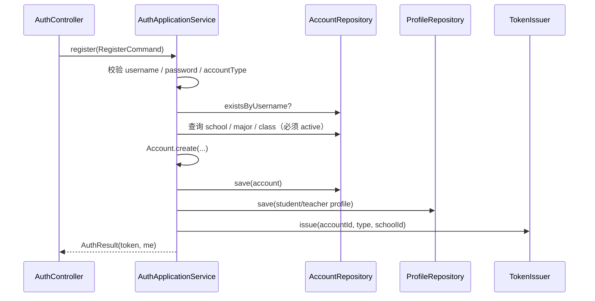

- 学生：校验学校 / 专业 / 年级 / 班级；班级必须 `active`。
- 教师：校验学校 / 专业；写 `teacher_majors` active。
- 管理员：`school_id=null`，注册后进建校页。
- 账号类型写入后不可变；无更新接口。

### 3.4 建校流程

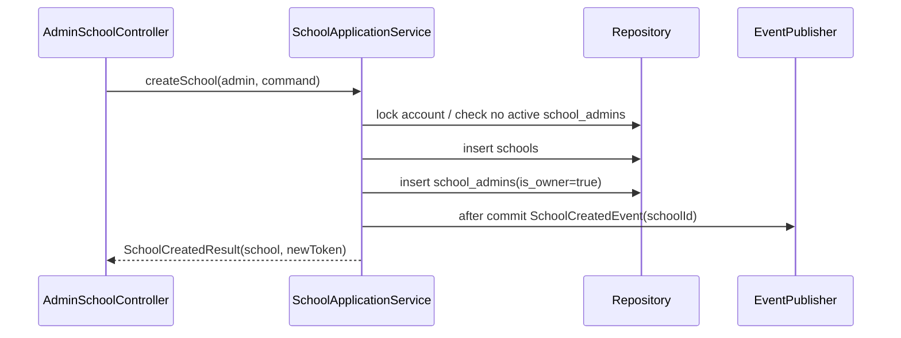

- 建校事务提交后发 `SchoolCreatedEvent`；M5 监听复制种子题库。
- 新 token 的 `school_id` 从 `school_admins` 解析；客户端替换旧 token。

### 3.5 组织导入

```java
ImportResult importMajors(...) {
    List<OrgImportRow> rows = parser.parse(input); // 最多 500 行 / 5MB
    List<ImportError> errors = validator.validateAll(rows);
    if (!errors.isEmpty()) throw new DomainException(IMPORT_VALIDATION_FAILED, errors);
    // 单事务：任一行失败整批回滚
    repository.upsertAll(rows);
    return new ImportResult(total, created, updated, List.of());
}
```

- 导入只做专业、班级；不导入教师 / 学生账号。
- 模板接口返回 CSV / XLSX 表头；错误在响应 `errors[]`，不生成服务器错误文件。

## 4. M2 课程

### 4.1 类清单

| 层 | 类 | 职责 |
|---|---|---|
| api | `CourseController` | 列表 / 详情 / 创建 / 编辑 / 归档 / 恢复 |
| api | `CourseMemberController` | 老师组 / 学生名单 / 加入退出 / 批量加人 |
| application | `CourseApplicationService` | 课程 CRUD、归档 |
| application | `CourseMembershipService` | 老师组、学生成员、批量加人 |
| application | `CourseQueryService` | 课程列表 / 详情读模型 |
| domain | `Course` | 课程聚合、状态、`end_at` |
| domain | `CourseTeacher` / `CourseStudent` | 成员关系 |
| domain | `CoursePolicy` | 专业 / 老师 / 学生 / 归档规则 |
| domain | `CourseArchivedEvent` / `CourseTeacherRemovedEvent` | 集成事件 |
| infra | `CourseJpaRepository` / `CourseMemberJpaRepository` | JPA |

### 4.2 核心方法

```java
public interface CourseApplicationService {
    CourseView create(CurrentUser teacher, CreateCourseCommand command);
    CourseView update(CurrentUser user, CourseId courseId, UpdateCourseCommand command);
    void archive(CurrentUser admin, CourseId courseId);
    void restore(CurrentUser admin, CourseId courseId);
    CourseDetailView get(CurrentUser user, CourseId courseId);
    PageResult<CourseCardView> list(CurrentUser user, CourseQuery query);
}

public interface CourseMembershipService {
    void addTeacher(CurrentUser user, CourseId courseId, AccountId teacherId);
    void removeTeacher(CurrentUser user, CourseId courseId, AccountId teacherId);
    void addStudentsByClass(CurrentUser user, CourseId courseId, ClassId classId);
    void addStudentByAccount(CurrentUser user, CourseId courseId, AccountId studentId);
    void removeStudent(CurrentUser user, CourseId courseId, AccountId studentId);
    void join(CurrentUser student, CourseId courseId);
    void leave(CurrentUser student, CourseId courseId);
    PageResult<CourseMemberView> listMembers(CurrentUser user, CourseId courseId, MemberQuery query);
}
```

### 4.3 创建课程

```mermaid
sequenceDiagram
  participant C as CourseController
  participant A as CourseApplicationService
  participant P as CoursePolicy
  participant DB as Repository
  C->>A: create(teacher, command)
  A->>P: validateTeacherMajors(teacher, majorIds)
  A->>P: validateNameUnique(schoolId, name)
  A->>DB: insert courses + course_majors + course_teachers
  A-->>C: CourseView
}
```

### 4.4 学生加入 / 批量加人

- `join`：校验学生同校、专业在课程范围、课程 active 且未到 `end_at`、无 active 关系；插入 `course_students(join_method=self)`。
- `addStudentsByClass`：校验班级 active / 同校 / 专业范围；班级内学生逐行插入；已存在跳过；返回 `{total, success, skipped, errors[]}`。
- `addStudentByAccount`：单条；已存在 409 / 跳过。
- 移出：软删除 `removed`，不删除历史。
- 课程归档：`archive` 锁课程行 → `status=archived` → after commit `CourseArchivedEvent`；学生列表隐藏，本组教师可直链只读统计 / 导出。

## 5. M5 题库

### 5.1 类清单

| 层 | 类 | 职责 |
|---|---|---|
| api | `CategoryController` / `QuestionController` | 类别 / 题目 CRUD |
| api | `AdminQuestionBankController` | demo 初始化 |
| application | `QuestionBankApplicationService` | 类别 / 题目 |
| application | `SeedService` | 建校复制 / 懒初始化 |
| application | `QuestionBankQueryService` | M3 选题查询 |
| domain | `Library` / `Category` / `Question` | 题库聚合 |
| domain | `QuestionView` / `QuestionSelection` | 查询 / 选题 |
| infra | `LibraryRepository` / `CategoryRepository` / `QuestionRepository` | JPA |
| infra | `SeedCatalogLoader` | `question-bank.json` |

### 5.2 核心方法

```java
public interface QuestionBankApplicationService {
    List<CategoryView> listCategories(CurrentUser user);
    CategoryView createCategory(CurrentUser user, CreateCategoryCommand command);
    CategoryView updateCategory(CurrentUser user, CategoryId id, UpdateCategoryCommand command);
    PageResult<QuestionView> listQuestions(CurrentUser user, QuestionQuery query);
    QuestionView createQuestion(CurrentUser user, CreateQuestionCommand command);
    QuestionView updateQuestion(CurrentUser user, QuestionId id, UpdateQuestionCommand command);
    void initDemo(CurrentUser admin);
}

public interface SeedService {
    void onSchoolCreated(SchoolCreatedEvent event); // after commit
    void ensureLibrary(SchoolId schoolId);          // lazy
    int copySeed(SchoolId schoolId, String seedVersion);
}

public interface QuestionBankQueryService {
    List<QuestionView> listForSelection(SchoolId schoolId, CategoryId categoryId, String keyword, PageQuery page);
    List<QuestionView> getForPublish(SchoolId schoolId, List<QuestionId> ids);
}
```

### 5.3 种子复制流程

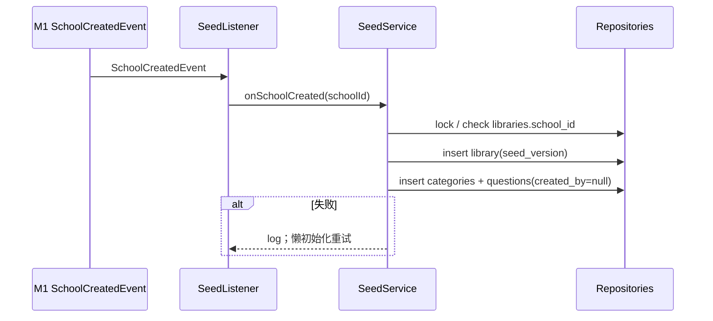

- 种子复制失败不阻塞建校；`ensureLibrary` 在首次读 / 写重试。
- 题目跳过答案要点为空的行；类别按名称去重；`libraries.school_id` 唯一兜底并发。
- M3 发布时调用 `getForPublish`；前端选题调用公开 GET。

## 6. M3 任务、课堂与录制

### 6.1 类清单

| 层 | 类 | 职责 |
|---|---|---|
| api | `TaskController` | 草稿 / 发布 / 关闭 / 学生任务 |
| api | `TaskMaterialController` | 材料上传 / 预览 / 删除 |
| api | `SessionController` | 创建 / 开始 / 结束 / 取消 / 提交 |
| api | `RecordingController` | multipart start / part-url / complete / abort |
| api | `ReplayController` | replay / events / texts |
| api | `WsTicketController` | WS ticket |
| api | `ClassroomWsHandler` | 控制 WS |
| api | `PerceptionWsHandler` | 音频 / 感知 WS |
| application | `TaskApplicationService` | 任务草稿 / 查询 / 删除 |
| application | `TaskPublishService` | 发布事务 |
| application | `TaskMaterialService` | 材料上传 / 解析 / 删除 |
| application | `SessionApplicationService` | 创建 / 开始 / 结束 / 取消 / 提交 |
| application | `SessionRuntimeRegistry` | actor 注册 / 获取 / 移除 |
| application | `RecordingApplicationService` | 录制编排 |
| application | `ReplayQueryService` | 回放 DTO |
| domain | `Task` / `TaskMode` / `TaskStatus` | 任务聚合 |
| domain | `VirtualStudentConfig` / `RubricWeights` / `QuestionConfig` | 配置 |
| domain | `TaskSnapshotFactory` / `TaskPublishPolicy` | 快照 / 发布规则 |
| domain | `SessionActor` / `SessionContext` / `SessionState` | 内存课堂 |
| domain | `ClassroomStateMachine` / `VirtualStudentEngine` | 课堂 / 虚拟学生 |
| domain | `InterviewStateMachine` | 面试 |
| domain | `Submission` / `Recording` / `RecordingStream` | 提交 / 录制 |
| domain | `SessionCommand` sealed interface | 命令 |
| domain | `SessionEvent` / `SessionText` / `Frame` | 上下文 |
| infra | `TaskRepository` / `SessionRepository` / … | JPA |
| infra | `ContextPersistenceWriter` | 异步持久化 |
| infra | `MinioObjectStorageAdapter` | multipart / presign |
| infra | `WsGateway` / `WsTicketStore` | 推送 / Redis ticket |
| infra | `MaterialParser` | PDFBox / POI |

### 6.2 核心方法：任务

```java
public interface TaskApplicationService {
    TaskView createDraft(CurrentUser teacher, CreateTaskCommand command);
    TaskView get(CurrentUser user, TaskId taskId);
    TaskView updateDraft(CurrentUser teacher, TaskId taskId, UpdateTaskCommand command);
    void deleteDraft(CurrentUser teacher, TaskId taskId);
    PageResult<TaskCardView> listCourseTasks(CurrentUser user, CourseId courseId, TaskQuery query);
    PageResult<StudentTaskView> listStudentTasks(CurrentUser student, StudentTaskQuery query);
    StudentTaskDetailView getStudentTask(CurrentUser student, TaskId taskId);
}

public interface TaskPublishService {
    PublishResult publish(CurrentUser teacher, TaskId taskId);
    void close(CurrentUser teacher, TaskId taskId);
}

public interface TaskMaterialService {
    MaterialView upload(CurrentUser teacher, TaskId taskId, MultipartFile file);
    MaterialView get(CurrentUser teacher, TaskId taskId);
    void delete(CurrentUser teacher, TaskId taskId);
}
```

### 6.3 发布任务流程

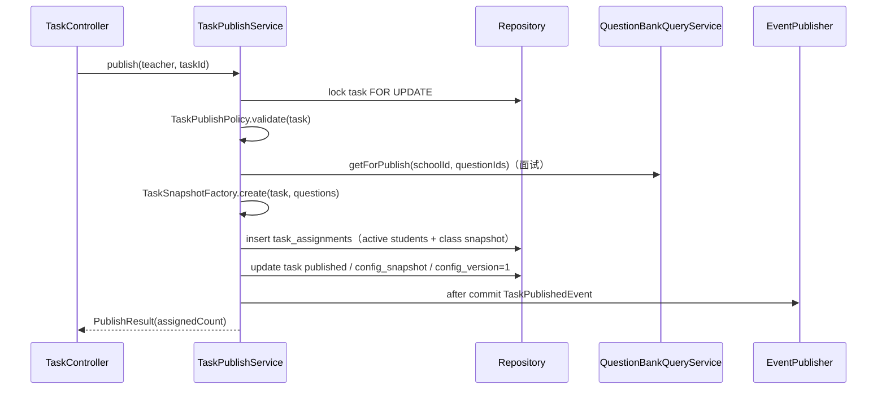

- 发布后配置锁定；`task_assignments` 记录发布时班级快照。
- 失败全部回滚；并发发布只有一个成功，另一个 409。

### 6.4 核心方法：Session

```java
public interface SessionApplicationService {
    SessionView createSession(CurrentUser student, TaskId taskId);
    SessionView get(CurrentUser user, SessionId sessionId);
    void start(CurrentUser student, SessionId sessionId);
    void end(CurrentUser student, SessionId sessionId);
    void cancel(CurrentUser student, SessionId sessionId);
    SubmissionView submit(CurrentUser student, SessionId sessionId);
}

public interface SessionRuntimeRegistry {
    SessionActor getOrCreate(SessionId sessionId);
    Optional<SessionActor> find(SessionId sessionId);
    void remove(SessionId sessionId);
}
```

### 6.5 SessionActor 方法

```java
public final class SessionActor {
    public SessionSnapshot snapshot();
    public CommandResult handle(SessionCommand command);
    public void onWsConnected(WsConnection connection);
    public void onWsDisconnected(Instant now); // 30s grace
    public void onTick(Instant now);
    public void forceFlush(); // before end / submit / fail
    public void fail(FailureReason reason);
    public List<SessionEvent> replayAfter(long seq);
}

public sealed interface SessionCommand permits
    RecordingReady, StartSession, ResumeSession, AskClass, AskStudentQuestion,
    CallOn, MarkAnswer, ManageStudent, EndDialogue, EndQa, EndSession,
    NextQuestion, EndInterview, Tick {}
```

- Actor 内状态：`SessionState`、`ClassroomStateMachine`、`VirtualStudentEngine`、`InterviewStateMachine`、`SessionContext`。
- Actor mailbox 串行处理命令；tick 由 `SessionTickScheduler` 每 1 秒投递。
- Actor 不直接写 DB；通过 `ContextPersistenceWriter` 端口。
- 控制 WS 断开：`onWsDisconnected` 记录 grace deadline；30 秒内 `ResumeSession` 恢复；超时 `fail`。
- `snapshot()` 返回 `last_seq`、课堂状态、虚拟学生状态、面试当前题 / `answer_id` / 剩余时间、录制状态。

### 6.6 课堂问答流程

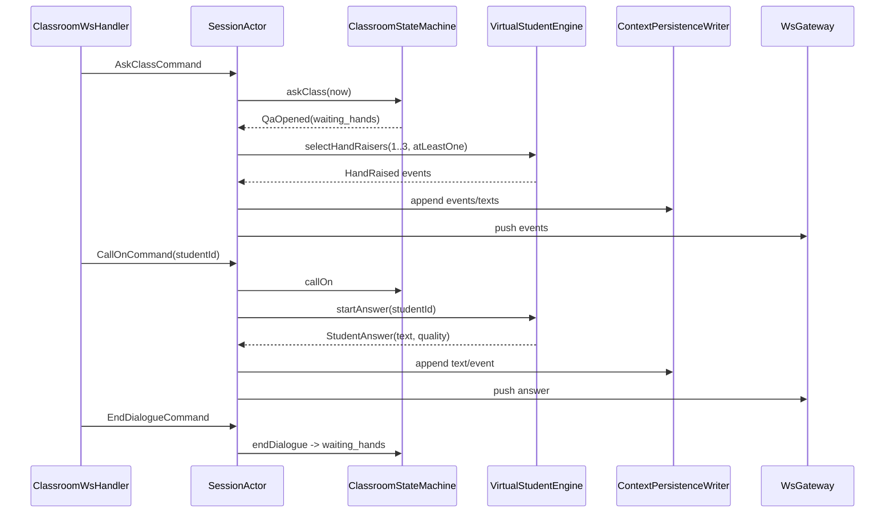

- 举手 1—3 人，保底 1 人；45 秒冷却；30 秒未点名回 `lecturing`。
- `teacher.end_dialogue` 回 `waiting_hands`；`teacher.end_qa` 回 `lecturing`。
- 回答质量公式：`clamp(ability*0.7 + clarity*0.3 + random(-0.15,0.15), 0, 1)`。

### 6.7 结构化面试流程

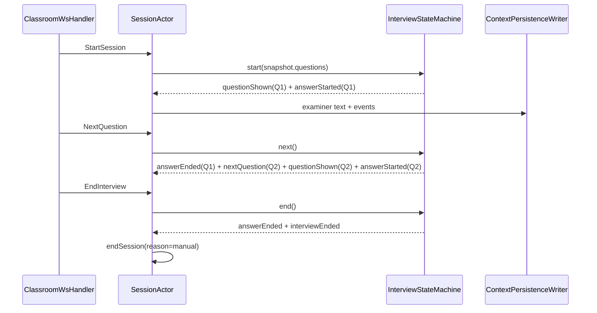

- 题目展示即开作答窗口；最后一题“下一题”返回 `INTERVIEW_NO_MORE_QUESTIONS`。
- 到总时长：`answerEnded` → `interviewEnded` → `sessionEnded(reason=timeout)`。
- ASR finalize 最多 2 秒，然后强制 flush。

### 6.8 录制 / 上传

```java
public interface RecordingApplicationService {
    MultipartUpload start(CurrentUser student, SessionId sessionId, StreamType type);
    String partUrl(CurrentUser student, SessionId sessionId, StreamType type, int partNumber);
    void complete(CurrentUser student, SessionId sessionId, StreamType type, CompletePartCommand command);
    void abort(CurrentUser student, SessionId sessionId, StreamType type);
    List<RecordingStreamView> list(CurrentUser user, SessionId sessionId);
}
```

- `start` 校验 session 属于本人、状态 preparing/in_progress、`required_streams`。
- 客户端 5 秒 timeslice、5MB part；Java 只创建 multipart / 发 URL / complete。
- 第一段保留；结束 `fix-webm-duration` 后重传 part 1，再 complete。
- 三路 / 两路 required streams 全部 uploaded 才能提交。
- 失败 / 积压 → stream failed → session failed。

### 6.9 提交流程

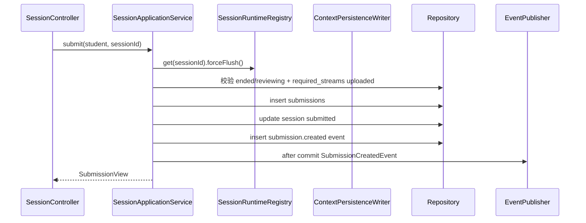

- 顺序固定：flush → 校验流 → submission / session / event 同事务 → after-commit M4/M7。
- flush 失败不生成 submission；session failed。
- 其他 attempt 录像按规则清理；只保留提交件。

### 6.10 回放

```java
public interface ReplayQueryService {
    ReplayView replay(CurrentUser user, SessionId sessionId);
    PageResult<SessionEventView> events(CurrentUser user, SessionId sessionId, long afterSeq, int limit);
    List<SessionTextView> texts(CurrentUser user, SessionId sessionId, String speakerType);
}
```

- 任务提交件：学生本人 + 课程老师组；管理员 403；临时录像仅学生本人；训练仅本人。
- 预签名 URL 15 分钟；音频主时钟；前端负责同步。

## 7. M4 评测

### 7.1 类清单

| 层 | 类 | 职责 |
|---|---|---|
| api | `EvaluationController` | 按提交件 / 报告 / 问题 |
| api | `TrainingEvaluationController` | 训练评测 |
| api | `InternalEvaluationController` | start / result / fail / input |
| application | `EvaluationApplicationService` | 创建 / 查询 / 报告 |
| application | `EvaluationTriggerListener` | 提交 / 训练选中触发 |
| application | `EvaluationCallbackService` | start / result / fail |
| application | `EvaluationJobScheduler` | 投递 / 重试 / dead |
| application | `EvaluationReconciler` | 缺失 / 过期对账 |
| application | `EvaluationInputService` | manifest / 分页输入 |
| application | `EvaluationReportQueryService` | 报告读模型 |
| domain | `Evaluation` | 评测聚合 |
| domain | `DimensionScore` / `EvaluationIssue` / `InputSnapshot` / `EvaluationJob` | 结果 / 快照 / job |
| domain | `EvaluationPolicy` / `EvaluationResultValidator` | 状态 / 校验 |
| domain | `EvaluationTerminalEvent` | 终态事件 |
| infra | `EvaluationRepository` / `EvaluationJobRepository` | JPA |
| infra | `EvaluationQueuePort` | Redis Streams |
| infra | `PythonEvaluationClient` | HTTP start / callback |
| infra | `JdbcEvaluationQuery` | 报告读模型 |

### 7.2 核心方法

```java
public interface EvaluationApplicationService {
    EvaluationView getBySubmission(CurrentUser user, SubmissionId submissionId);
    EvaluationView get(CurrentUser user, EvaluationId evaluationId);
    ReportView report(CurrentUser user, EvaluationId evaluationId);
    List<IssueView> issues(CurrentUser user, EvaluationId evaluationId);
}

public interface EvaluationTriggerListener {
    void onSubmissionCreated(SubmissionCreatedEvent event);
    void onTrainingRecordSelected(TrainingRecordSelectedEvent event);
}

public interface EvaluationCallbackService {
    void start(StartEvaluationCommand command);
    void complete(EvaluationResultCommand command);
    void fail(EvaluationFailCommand command);
}

public interface EvaluationJobScheduler {
    void dispatchQueued();
    void requeueStale();
    void deadLetter(EvaluationJobId jobId, String reason);
}
```

### 7.3 触发 / worker / 回调流程

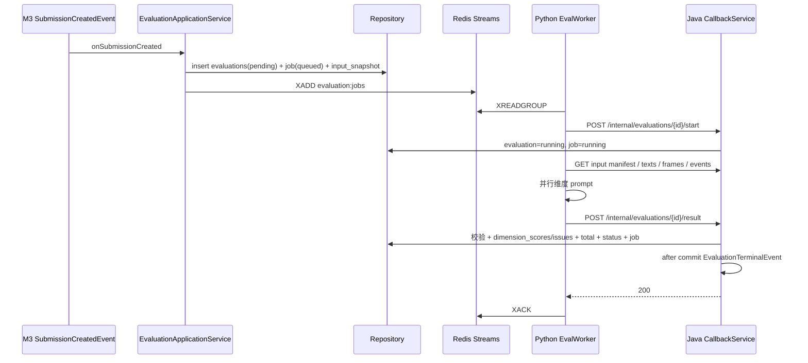

- Python 只返回维度 / 问题 / warnings；Java 计算总分、状态。
- `(evaluation_id, attempt)` 幂等；终态拒绝重试。
- 死信：已有维度 → partial；无维度 → failed。
- M7 监听 `EvaluationTerminalEvent` 重算最终分。

### 7.4 输入接口

```java
public interface EvaluationInputService {
    InputManifest manifest(EvaluationId evaluationId);
    PageResult<SessionTextView> texts(EvaluationId evaluationId, String afterId, int limit);
    PageResult<FrameView> frames(EvaluationId evaluationId, Long afterTs, String afterId, int limit);
    PageResult<SessionEventView> events(EvaluationId evaluationId, Long afterSeq, int limit);
}
```

- 只返回 `input_snapshots` 中固化的 ID / seq；不返回实时 session。
- frames 必须 `processed / failed`；pending 由提交前 barrier 保证。

## 8. M7 教师评测

### 8.1 类清单

| 层 | 类 | 职责 |
|---|---|---|
| api | `GradingConfigController` | 权重 / 模式 / 清空 |
| api | `GradingSubmissionController` | 名单 |
| api | `TeacherScoreController` | 单条 / 批量评分 |
| api | `StatisticsController` | 任务 / 课程统计 |
| api | `LeaderboardController` | 排行榜 |
| api | `ExportController` | CSV |
| api | `StudentResultController` | 学生成绩 |
| application | `GradingConfigService` | 默认 / 锁定 / 清空 |
| application | `TeacherScoreService` | 评分 / 批量 / version |
| application | `FinalScoreService` | 单条 / 任务重算 |
| application | `FinalScoreRecomputeJob` | 大批量异步 |
| application | `StatisticsQueryService` | 任务 / 课程 |
| application | `LeaderboardQueryService` | 排序 / 分页 |
| application | `CsvExportService` | 导出 |
| application | `StudentResultQueryService` | 学生结果 |
| domain | `GradingConfig` | 配置聚合 |
| domain | `TeacherScore` | 教师评分 |
| domain | `FinalScore` / `FinalScorePolicy` | 最终分 |
| domain | `FinalScoreCalculator` | 公式 / 状态 |
| infra | `GradingConfigRepository` / `TeacherScoreRepository` / `FinalScoreRepository` | JPA |
| infra | `FinalScoreBatchRepository` | 批量 SQL |
| infra | `StatisticsQueryDao` / `LeaderboardQueryDao` | JDBC 读模型 |
| infra | `CsvWriter` | CSV |

### 8.2 核心方法

```java
public interface GradingConfigService {
    GradingConfigView get(CurrentUser teacher, TaskId taskId);
    GradingConfigView update(CurrentUser teacher, TaskId taskId, UpdateGradingConfigCommand command);
    ClearResult clearScores(CurrentUser teacher, TaskId taskId);
}

public interface TeacherScoreService {
    TeacherScoreView save(CurrentUser teacher, SubmissionId submissionId, SaveTeacherScoreCommand command);
    BatchSaveResult batchSave(CurrentUser teacher, TaskId taskId, List<SaveTeacherScoreCommand> commands);
}

public interface FinalScoreService {
    void recompute(SubmissionId submissionId);
    void recomputeTask(TaskId taskId);
    void onEvaluationTerminal(EvaluationTerminalEvent event);
}

public interface StatisticsQueryService {
    TaskStatsView taskStats(CurrentUser teacher, TaskId taskId, ClassId classId);
    CourseStatsView courseStats(CurrentUser teacher, CourseId courseId, ClassId classId);
}
```

### 8.3 评分 / 最终分流程

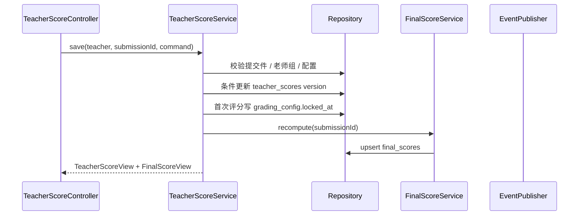

- 维度模式：服务端按任务 rubric 权重算 `teacher_total`；总分模式直接使用。
- `version` 冲突 409；批量逐行结果。
- 配置修改 / 清空 / 首次评分同一任务锁；锁后配置只读。
- 清空评分：删 teacher_scores → final_scores 置空 → 重算 `pending_teacher` / `pending_ai`。
- 200 人以内批量 SQL 同步；>200 异步 job。
- 排行榜 `NULLS LAST`；统计只用 completed。

## 9. M6 训练

### 9.1 类清单

| 层 | 类 | 职责 |
|---|---|---|
| api | `TrainingTemplateController` | 发布 / 下架 / 列表 / 详情 |
| api | `StudentTrainingController` | 学生模板 / 自由训练材料 |
| api | `TrainingSessionController` | 创建 / 结束 / 取消 |
| api | `TrainingRecordController` | 选中 / 列表 / 详情 / 删除 |
| application | `TrainingTemplateService` | 模板发布 / 下架 / 快照 |
| application | `TrainingTemplateReconciler` | 自动下架对账 |
| application | `TrainingSessionService` | 创建 / 结束 / 复用 M3 |
| application | `TrainingRecordService` | 选中 / 3 条上限 / 到期 |
| application | `TrainingMaterialService` | 自由训练材料 |
| domain | `TrainingTemplate` | 模板聚合 |
| domain | `TrainingRecord` | 训练记录 |
| domain | `TrainingPolicy` | 目标课程 / 老师组 / 记录上限 |
| domain | `TrainingConfigSnapshot` | 有效配置 |
| infra | `TrainingTemplateRepository` / `TrainingRecordRepository` / `TrainingMaterialRepository` | JPA |

### 9.2 核心方法

```java
public interface TrainingTemplateService {
    TrainingTemplateView publish(CurrentUser teacher, PublishTemplateCommand command);
    void unpublish(CurrentUser teacher, TemplateId templateId);
    PageResult<TrainingTemplateView> listTeacherTemplates(CurrentUser teacher, TemplateQuery query);
    TrainingTemplateView getTeacherTemplate(CurrentUser teacher, TemplateId templateId);
    TrainingTemplateView getStudentTemplate(CurrentUser student, TemplateId templateId);
}

public interface TrainingSessionService {
    TrainingSessionView create(CurrentUser student, CreateTrainingSessionCommand command);
    TrainingSessionView get(CurrentUser student, SessionId sessionId);
    void end(CurrentUser student, SessionId sessionId);
    void cancel(CurrentUser student, SessionId sessionId);
}

public interface TrainingRecordService {
    TrainingRecordView select(CurrentUser student, SessionId sessionId);
    PageResult<TrainingRecordView> list(CurrentUser student, TrainingRecordQuery query);
    TrainingRecordView get(CurrentUser student, TrainingRecordId recordId);
    void delete(CurrentUser student, TrainingRecordId recordId);
}
```

### 9.3 模板 / 训练流程

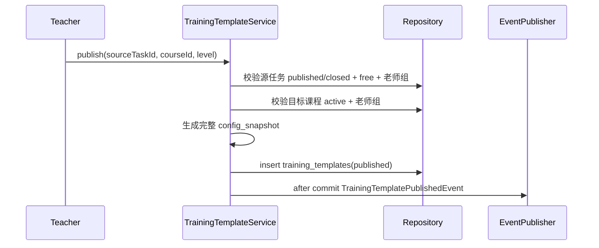

- 同源任务 + 课程 + 档位 published 唯一；重复 409。
- 课程归档 / 教师移出目标课程 → `CourseArchivedEvent` / `CourseTeacherRemovedEvent` → 自动下架。
- 学生创建训练：模板 / 自由训练 → 有效快照 → `m3.sessions` + `training_session_meta`；复用 M3 WS / 录制。
- 选中记录：校验 ended/reviewing + required streams uploaded → insert record → session selected → 3 条上限删最旧 → after commit `TrainingRecordSelectedEvent` → M4。
- 记录到期 / 删除：读接口校验 `expires_at`；清理任务按 training_record 根。

## 10. 跨模块集成类

| 事件 | 发布方 | 监听方 | 类 |
|---|---|---|---|
| `SchoolCreatedEvent` | M1 `SchoolApplicationService` | M5 | `SeedService.onSchoolCreated` |
| `SubmissionCreatedEvent` | M3 `SessionApplicationService` | M4 / M7 | `EvaluationTriggerListener` / `FinalScoreService` |
| `EvaluationTerminalEvent` | M4 `EvaluationCallbackService` | M7 / M6 | `FinalScoreService.onEvaluationTerminal` / `TrainingRecordService.onEvaluationTerminal` |
| `TrainingRecordSelectedEvent` | M6 `TrainingRecordService` | M4 | `EvaluationTriggerListener.onTrainingRecordSelected` |
| `CourseArchivedEvent` | M2 `CourseApplicationService` | M6 / M3/M4/M7 只读检查 | `TrainingTemplateReconciler` |
| `CourseTeacherRemovedEvent` | M2 `CourseMembershipService` | M6 | `TrainingTemplateReconciler` |

- 发布统一在 application service 事务提交后；监听器 `@TransactionalEventListener(AFTER_COMMIT)`。
- 事件监听幂等；reconciler 每 5 分钟兜底。
- 不在事件里传大对象；只传 ID / 状态 / 时间。

## 11. Python 实现设计

### 11.1 类清单

| 层 | 类 | 职责 |
|---|---|---|
| api | `LLMRouter` | `/internal/v1/llm/chat` / `json` |
| api | `OCRRoute` | `/internal/v1/ocr` |
| api | `ASRRoute` | `/internal/v1/asr/stream` |
| api | `VisionRoute` | `/internal/v1/vision/analyze` |
| api | `ClassroomRoute` | question / answer / classify |
| worker | `EvalWorker` | Redis Streams 消费 |
| worker | `EvaluationInputClient` | 拉 manifest / texts / frames / events |
| worker | `ResultCallback` | start / result / fail |
| capabilities | `LLMGateway` | 重试 / 超时 / JSON schema / token |
| capabilities | `OCRGateway` / `ASRGateway` / `VisionGateway` | 能力封装 |
| capabilities | `ClassroomContentCapability` | M3 内容 |
| capabilities | `EvaluationCapability` | 维度编排 |
| capabilities | `MediaCapability` | 音频特征 / 关键帧 |
| providers | `LLMProvider` / `OCRProvider` / `ASRProvider` / `VisionProvider` | 厂商接口 |
| providers | `DeepSeekProvider` / `OcrCloudProvider` / `AsrCloudProvider` / `MockProvider` | 实现 |
| schemas | `EvaluationResult` / `DimensionResult` / `Issue` | Pydantic |
| prompts | `PromptRegistry` | 版本化模板 |

### 11.2 核心方法

```python
class EvalWorker:
    async def run(self) -> None: ...
    async def handle(self, message: JobMessage) -> None: ...

class EvaluationInputClient:
    async def manifest(self, evaluation_id: str) -> Manifest: ...
    async def texts(self, evaluation_id: str, after_id: str | None, limit: int) -> Page: ...
    async def frames(self, evaluation_id: str, after_ts: int | None, after_id: str | None, limit: int) -> Page: ...
    async def events(self, evaluation_id: str, after_seq: int | None, limit: int) -> Page: ...

class EvaluationCapability:
    async def evaluate(self, context: EvaluationContext, config: EvalConfig) -> EvaluationResult: ...
    async def _evaluate_dimension(self, dimension: str, context: DimensionContext) -> DimensionResult: ...
    async def _suggest(self, dims: list[DimensionResult], issues: list[Issue]) -> list[Issue]: ...

class LLMGateway:
    async def json(self, prompt: Prompt, schema: type[BaseModel], model: str) -> LLMJsonResult: ...
    async def chat(self, messages: list[Message], model: str) -> LLMTextResult: ...

class MediaCapability:
    async def audio_features(self, audio_url: str) -> AudioFeatures: ...
    async def select_keyframes(self, frame_urls: list[str]) -> list[Keyframe]: ...
```

### 11.3 worker 流程

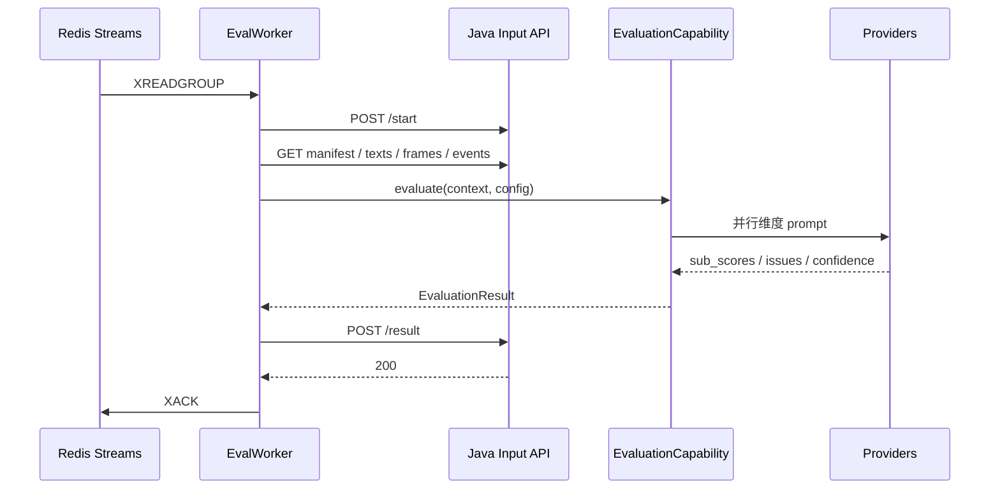

- 不写 DB；不计算总分 / 最终状态；不访问 M5/M6/M7。
- 新增维度：新增 `DimensionEvaluator` + prompt + schema + Java registry。
- 新增厂商：新增 provider；capabilities 不变。
- 失败：`/fail` 或 result partial；Java 决定状态。

## 12. 代码生成检查清单

### 12.1 每个模块

- [ ] `api` Controller 只做 DTO / 校验 / 调用 application。
- [ ] `application` 方法有 `@Transactional`，事务内不远程调用。
- [ ] `domain` 不依赖 Spring / JPA / HTTP。
- [ ] Repository / Port 接口在 domain / application，实现在 infrastructure。
- [ ] 跨模块只调用 application 接口 / 事件。
- [ ] 错误码来自 02；异常统一 `DomainException`。
- [ ] 资源级权限在 application 校验。
- [ ] 单元测试覆盖领域规则；集成测试用 Testcontainers。
- [ ] 事件 after-commit；监听器幂等；reconciler 兜底。

### 12.2 方法签名一致性

- Controller DTO 字段与 02 的 `snake_case` 对齐；Java DTO 用 Jackson `SNAKE_CASE`。
- Application command / query 用领域 ID / 值对象，不用 Controller DTO。
- Domain 方法只接受领域类型；不接收 `HttpServletRequest` / `MultipartFile`。
- Repository 返回 domain / entity；不返回 DTO。
- 查询服务返回 Query DTO；不返回聚合。

### 12.3 事务边界

| 用例 | 事务内 | 事务外 |
|---|---|---|
| 建校 | schools + school_admins | 新 token、事件、M5 seed |
| 发布任务 | task lock + snapshot + assignments | 通知、缓存 |
| 提交 | flush + submission + session + event | M4 / M7 触发 |
| 评测回调 | evaluation + dims + issues + job | 报告缓存、事件 |
| 教师评分 | teacher_score + final_score | 统计缓存 |
| 训练选中 | record + session + 上限删旧 | M4 触发 |

## 13. 实现顺序与分工建议

| 阶段 | 内容 | 依赖 |
|---|---|---|
| 1 | shared + m1auth + Flyway V1—V3 + Security | 无 |
| 2 | m2course + m5question | M1 |
| 3 | m3 任务配置 / 发布 / 快照 | M2、M5 |
| 4 | m3 SessionActor / WS / 课堂 / 面试 | 任务快照 |
| 5 | m3 录制 / 上传 / 回放 | Session |
| 6 | m4 Java + Python worker（AI_MOCK） | M3 提交、输入接口 |
| 7 | m7 评分 / 最终分 / 统计 | M4 terminal event |
| 8 | m6 训练模板 / 记录 | M3 / M4 |
| 9 | 集成事件 / reconciler / 测试 | 全部 |
| 10 | 前端按 09 / 13 对接 | API 稳定 |

## 14. 开放问题

| 编号 | 事项 | 当前建议 |
|---|---|---|
| Q1 | 是否生成 interface + impl 两层 | application 用 interface；domain 直接类；infrastructure 实现端口 |
| Q2 | 是否用 MapStruct | 核心聚合手写 mapper；简单 DTO 可用 MapStruct |
| Q3 | 读模型用 JdbcTemplate 还是 MyBatis | 本轮 JdbcTemplate；复杂 SQL 再评估 |
| Q4 | Python worker 是否独立仓库 | 同仓库 `python/`，独立镜像 |
| Q5 | 是否共享 DTO 代码 | 不共享；JSON schema + 各自类型 |
| Q6 | 是否先生成 mock API | 是；前端 / M4 可先 mock |
| Q7 | 生成顺序是否按人分 | 按第 13 节阶段；M3 拆三工作流 |
