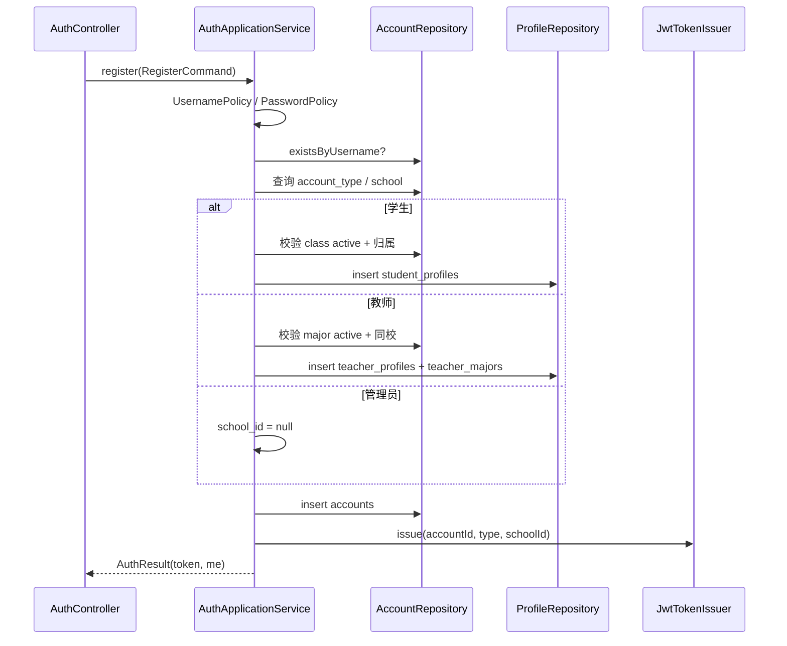
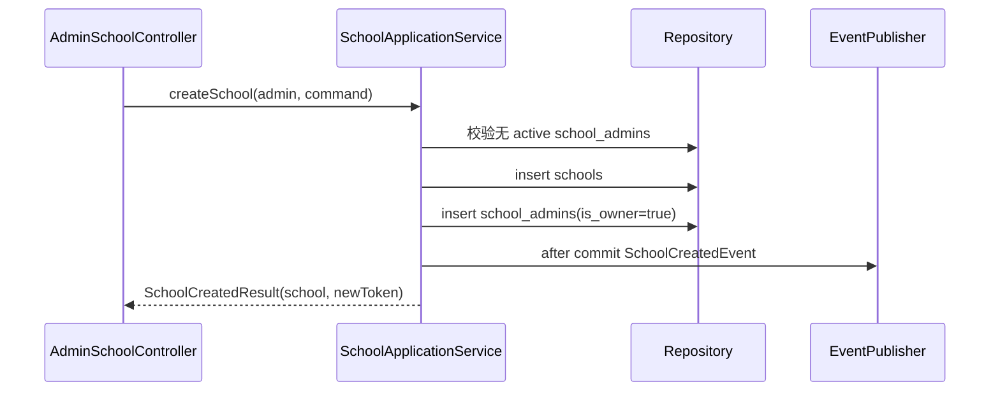

# 01 M1 实现设计

> 上位文档：[M1 需求](../requirements/M1-账号管理与身份认证.md)、[03 M1/M2 设计](../design/03-M1-M2-账号组织课程设计.md)、[15 代码规范与骨架](../design/15-代码规范与骨架.md)
> 版本：V0.2（讨论稿）　状态：待评审　更新日期：2026-11-07
> 范围：注册 / 密码登录 / 邮箱验证码登录 / 微信扫码登录 / OAuth 引导注册与绑定 / JWT / 建校 / 组织 / 教师专业；不写代码实现体
> 模块状态：G1 设计提交（10%）；G2—G8 未开始；Owner：Foundation Owner；测试：UT / IT / 契约 / E2E 未开始；最后更新：2026-11-07（详见[进度看板](../team/02-进度看板.md)）

## 1. 包与类

```text
com.shijiangtai.m1auth
├─ api/
│  ├─ AuthController
│  ├─ EmailCodeController
│  ├─ OAuthController
│  ├─ PublicOrgController
│  ├─ AdminSchoolController
│  ├─ AdminOrgController
│  ├─ AdminTeacherController
│  └─ dto/M1Dtos
├─ application/
│  ├─ AuthApplicationService
│  ├─ EmailCodeService
│  ├─ OAuthLoginService
│  ├─ OAuthRegistrationService
│  ├─ AccountBindingService
│  ├─ SchoolApplicationService
│  ├─ OrgApplicationService
│  ├─ OrgImportService
│  ├─ TeacherMajorService
│  └─ AccountQueryService
├─ domain/
│  ├─ Account, AccountType, PasswordPolicy, UsernamePolicy
│  ├─ OAuthIdentity, EmailLoginCode, AuthLoginEvent
│  ├─ School, Major, SchoolClass, TeacherMajorAssignment
│  ├─ OrgImportRow, ImportError
│  └─ SchoolCreatedEvent
└─ infrastructure/
   ├─ persistence/ (AccountEntity, SchoolEntity, MajorEntity, ClassEntity, …)
   ├─ security/ (JwtTokenIssuer, BCryptPasswordHasher)
   ├─ mail/ (SmtpMailSender, MockMailSender)
   ├─ oauth/ (WeChatOAuthProvider, RedisOAuthStateStore, InMemoryOAuthStateStore)
   ├─ import/ (CsvOrgParser, XlsxOrgParser)
   └─ repository/ (JPA repositories)
```

## 2. 类职责

| 类 | 层 | 职责 |
|---|---|---|
| `AuthController` | api | `/auth/register`、`/auth/login`、`/auth/me` |
| `EmailCodeController` | api | `/auth/email/code`、`/auth/login/email`、邮箱绑定 / 解绑 |
| `OAuthController` | api | 微信二维码 / 回调 / 状态 / exchange / 引导注册 / 绑定 |
| `PublicOrgController` | api | 注册选项：学校 / 专业 / 年级 / 班级 |
| `AdminSchoolController` | api | 建校、本校信息 |
| `AdminOrgController` | api | 专业 / 班级 CRUD、导入、模板 |
| `AdminTeacherController` | api | 教师列表、教师专业 |
| `AuthApplicationService` | application | 注册、密码登录、me |
| `EmailCodeService` | application | 发送 / 校验邮箱验证码、邮箱登录、绑定 |
| `OAuthLoginService` | application | 微信 state / ticket、已绑定登录、未绑定登记 |
| `OAuthRegistrationService` | application | 引导注册：账号 + 档案 + 微信身份同事务 |
| `AccountBindingService` | application | 绑定 / 解绑邮箱与微信、最后登录方式校验 |
| `SchoolApplicationService` | application | 建校、改校名、新 token |
| `OrgApplicationService` | application | 专业 / 班级 CRUD、班级匹配 |
| `OrgImportService` | application | CSV / XLSX 整批导入 |
| `TeacherMajorService` | application | 教师专业范围 |
| `AccountQueryService` | application | 账号 / 角色档案查询 |
| `Account` | domain | 账号聚合，类型不可变；email 需验证 |
| `OAuthIdentity` | domain | provider + provider_user_id 唯一；不存 token |
| `EmailLoginCode` | domain | 验证码哈希、过期、尝试 / 消费状态 |
| `AuthLoginEvent` | domain | 登录审计，不含敏感值 |
| `School` / `Major` / `SchoolClass` | domain | 学校 / 专业 / 班级 |
| `TeacherMajorAssignment` | domain | 教师专业 active / inactive |
| `PasswordPolicy` / `UsernamePolicy` | domain | 密码 / 用户名规则 |
| `SchoolCreatedEvent` | domain | 建校集成事件 |
| `JwtTokenIssuer` | infra | HS256、2h、claims |
| `BCryptPasswordHasher` | infra | BCrypt cost 12 |
| `SmtpMailSender` / `MockMailSender` | infra | 邮件发送；测试 / dev 用 Mock |
| `WeChatOAuthProvider` | infra | 微信二维码 URL、code 换 token、userinfo；secret 仅服务端 |
| `RedisOAuthStateStore` / `InMemoryOAuthStateStore` | infra | state / login_ticket / registration_ticket，TTL 5 分钟、一次性 |
| `CsvOrgParser` / `XlsxOrgParser` | infra | 导入解析 |
| `PermissionRegistry` / `ApiPermissionAuthorizationManager` | infra | URL 权限（后续接入） |

## 3. 核心方法签名

```java
public interface AuthApplicationService {
    AuthResult register(RegisterCommand command);
    AuthResult login(LoginCommand command);
    AccountView me(CurrentUser user);
}

public interface EmailCodeService {
    void sendLoginCode(String email, String requestIp);
    AuthResult loginWithEmail(String email, String code);
    void sendBindCode(CurrentUser user, String email);
    void bindEmail(CurrentUser user, String email, String code, String currentPassword);
    void unbindEmail(CurrentUser user, String currentPassword);
}

public interface OAuthLoginService {
    WeChatQrView createWechatQr(String requestIp);
    void handleWechatCallback(String code, String state);
    OAuthStatusView status(String state);
    AuthResult exchange(String ticket);
    void bindWechat(CurrentUser user, String ticket, String currentPassword);
    void unbindWechat(CurrentUser user, String currentPassword);
}

public interface OAuthRegistrationService {
    AuthResult registerWithWechat(OAuthRegisterCommand command);
}

public interface AccountBindingService {
    boolean hasOtherLoginMethod(AccountId accountId, String excludingMethod);
}

public interface SchoolApplicationService {
    SchoolCreatedResult createSchool(CurrentUser admin, CreateSchoolCommand command);
    SchoolView updateSchool(CurrentUser admin, UpdateSchoolCommand command);
}

public interface OrgApplicationService {
    List<MajorView> listMajors(CurrentUser user);
    MajorView createMajor(CurrentUser user, CreateMajorCommand command);
    MajorView updateMajor(CurrentUser user, MajorId id, UpdateMajorCommand command);
    List<ClassView> listClasses(CurrentUser user, MajorId majorId, String grade);
    ClassView createClass(CurrentUser user, CreateClassCommand command);
    ClassView updateClass(CurrentUser user, ClassId id, UpdateClassCommand command);
    ClassView matchClass(SchoolId schoolId, MajorId majorId, String grade, String className);
}

public interface OrgImportService {
    ImportResult importMajors(CurrentUser admin, InputStream input, String filename);
    ImportResult importClasses(CurrentUser admin, InputStream input, String filename);
    byte[] template(ImportType type);
}

public interface TeacherMajorService {
    List<TeacherView> listTeachers(CurrentUser admin);
    void updateMajors(CurrentUser admin, AccountId teacherId, List<MajorId> majorIds);
}
```

## 4. 核心调用流程

### 4.1 注册



- 账号类型写入后不可变；无更新接口。
- 学生班级必须 `classes.status='active'`；教师专业至少一个 active。
- 注册成功自动登录，返回 JWT；管理员未建校时 `school_id=null`。

### 4.2 登录

```text
AuthController.login
  → AuthApplicationService.login
  → AccountRepository.findByUsername
  → BCryptPasswordHasher.matches
  → JwtTokenIssuer.issue
  → AuthResult
```

- 失败统一 `UNAUTHORIZED`，不区分账号是否存在。
- JWT claims：`sub`、`account_type`、`school_id`、`exp`、`iat`、`jti`。
- 2 小时有效；无 refresh。

#### 4.2.1 邮箱验证码

```text
EmailCodeController.send
  → EmailCodeService.sendLoginCode
  → 生成 6 位码 → HMAC → 使旧码失效 → insert email_login_codes → MailSender
  → 202（不等待邮件结果；失败写日志 / 503 可选）

EmailCodeController.login
  → EmailCodeService.loginWithEmail
  → 查 account by lower(email), email_verified_at not null
  → 校验 hash / expires / attempts / consumed
  → consumed_at=now → JwtTokenIssuer.issue → AuthResult
```

- 未绑定邮箱 / 账号不存在 / 码错误统一 `UNAUTHORIZED`；发送统一 202。
- 验证码只存 HMAC；明文只在发送调用内存中；新码使旧码失效。

#### 4.2.2 微信扫码

```text
OAuthController.qr
  → OAuthLoginService.createWechatQr
  → state = random → Redis TTL 5m → authorize_url
OAuthController.callback
  → 校验 state → WeChatOAuthProvider.exchange(code)
  → 查 oauth_identities(provider, provider_user_id)
      ├─ 命中 → 存 login_ticket，status=authorized
      └─ 未命中 → 存 registration_ticket，status=needs_registration
OAuthController.exchange(ticket)
  → 取 login_ticket → JwtTokenIssuer.issue
```

- 微信回调由服务端处理；前端只轮询 status / exchange ticket。
- state / ticket 一次性；provider token 不落库；回调 URL 白名单。
- `OAuthProvider` 端口隔离微信实现，后续 provider 复用流程。

#### 4.2.3 OAuth 引导注册

```text
OAuthController.register(registration_ticket, account data)
  → OAuthRegistrationService
  → 校验 ticket / 账号类型 / 学校 / 专业 / 班级 / 用户名 / 邮箱
  → 事务：insert accounts + profile + teacher_majors / student_profiles
          + oauth_identities
  → JwtTokenIssuer.issue
```

- 任一步失败整体回滚，ticket 不消耗；成功后 ticket 删除。
- 管理员未建校时 token `school_id=null`，进入建校流程。
- 同一微信身份已绑定其他账号 → 409，不创建第二个账号。

### 4.3 建校



- 学校名称平台唯一；一校一管理员。
- 事务提交后发 `SchoolCreatedEvent`；M5 复制种子题库。
- 返回新 token，客户端替换旧 token。

### 4.4 组织导入

```text
AdminOrgController.importMajors/Classes
  → OrgImportService.import*
  → parser.parse(input)（CSV / XLSX，≤500 行 / 5MB）
  → validator.validateAll(rows)
  → 有错误：抛 DomainException，整批回滚
  → repository.upsertAll(rows)
  → ImportResult(total, created, updated, errors)
```

- 只导入专业 / 班级，不导入教师 / 学生账号。
- 专业列：`name`；班级列：`major_name,grade,name,status?`。
- 模板：`GET /admin/imports/templates/{type}`；错误在响应 `errors[]`，不落错误文件。

### 4.5 教师专业

```text
AdminTeacherController.updateMajors
  → TeacherMajorService.updateMajors
  → 锁教师账号
  → 校验教师同校 + 专业同校 active + 至少一个
  → 旧 active 行 status=inactive / effective_to
  → 新行 active / effective_from
```

- 已有课程老师组关系保留；新建课程 / 加入老师组按新范围校验。
- 教师本人不能修改；跨校 403。

## 5. 权限与事件

- 公开接口：`/api/v1/auth/login`、`/api/v1/auth/login/email`、`/api/v1/auth/email/code`、`/api/v1/auth/oauth/wechat/{qr,callback,status,exchange,register}`、`/register`、`/api/v1/public/**`、`/actuator/health`。
- 需登录：`/api/v1/auth/email/bind/**`、`DELETE /api/v1/auth/email`、`/api/v1/auth/oauth/wechat/bind`、`DELETE /api/v1/auth/oauth/wechat`；不得用 `/auth/email/**` / `/auth/oauth/wechat/**` 通配放行。
- 管理员接口：`/api/v1/admin/**`；未绑定管理员只能 `POST /admin/schools`。
- 资源级：管理员只能本校；教师 / 学生同校。
- `SchoolCreatedEvent {school_id}` after-commit，M5 监听。

## 6. 测试点

- 三种账号注册；账号类型不可变；重复用户名 409。
- 学生班级 active / 归属校验；教师专业 active；管理员 school_id 为空。
- 登录失败不泄露账号；JWT 2h 过期。
- 邮箱验证码：发送 / 校验 / 过期 / 重放 / 尝试上限 / 限流；三种登录 JWT claims 一致。
- 微信扫码：state 重放 / 过期、回调换 token、已绑定登录、未绑定引导注册、ticket 一次性。
- OAuth 引导注册：账号 / 档案 / 微信身份同事务；重复身份 409；失败回滚。
- 绑定 / 解绑：邮箱 / 微信唯一、最后登录方式拒绝、审计事件。
- 建校并发 / 一校一管理员；新 token。
- 导入整批回滚；重复 / 停用专业 / 跨校班级。
- 教师专业更新保留历史；至少一个 active。
- 公开选项不返回停用班级 / 专业。
