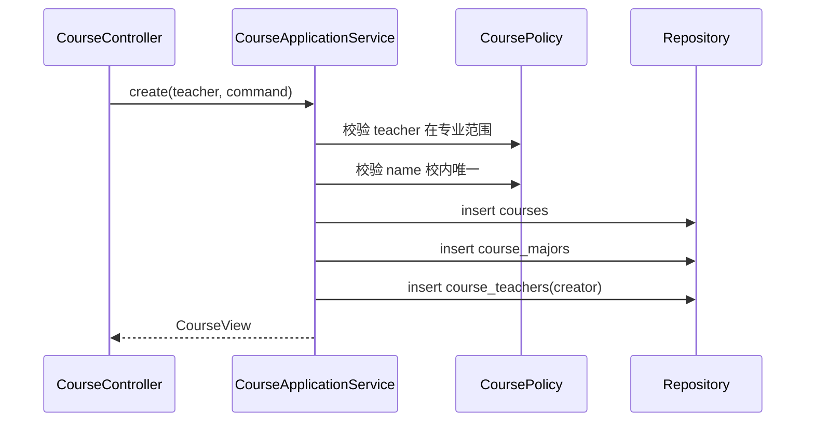
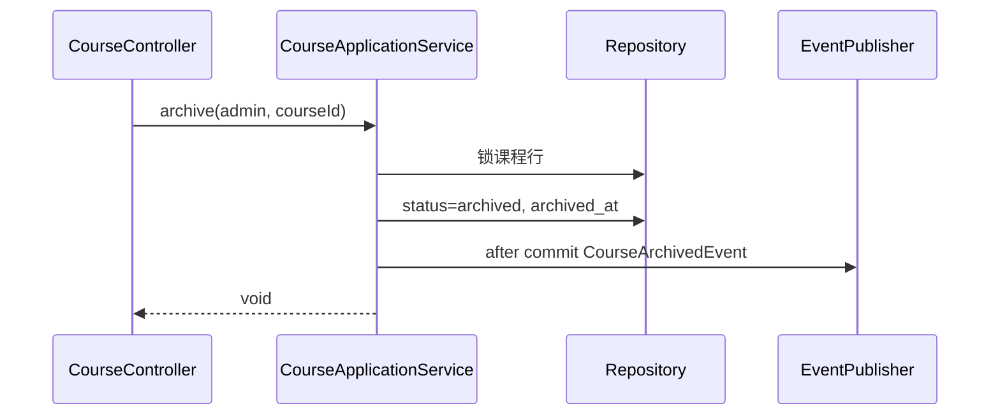

# 02 M2 实现设计

> 上位文档：[M2 需求](../requirements/M2-课程操作与管理.md)、[03 M1/M2 设计](../design/03-M1-M2-账号组织课程设计.md)、[15 代码规范与骨架](../design/15-代码规范与骨架.md)
> 版本：V0.1（讨论稿）　状态：待评审　更新日期：2026-11-03
> 范围：课程 CRUD、老师组、学生成员、归档 / 恢复；不写代码实现体
> 模块状态：G1 设计提交（10%）；G2—G8 未开始；Owner：Course/Question Owner；测试：UT / IT / 契约 / E2E 未开始；最后更新：2026-11-03（详见[进度看板](../team/02-进度看板.md)）

## 1. 包与类

```text
com.shijiangtai.m2course
├─ api/
│  ├─ CourseController
│  ├─ CourseMemberController
│  └─ dto/M2Dtos
├─ application/
│  ├─ CourseApplicationService
│  ├─ CourseMembershipService
│  └─ CourseQueryService
├─ domain/
│  ├─ Course, CourseStatus, CoursePolicy
│  ├─ CourseTeacher, CourseStudent, JoinMethod
│  └─ CourseArchivedEvent, CourseTeacherRemovedEvent
└─ infrastructure/
   └─ persistence/ (CourseEntity, CourseMajorEntity, CourseTeacherEntity, CourseStudentEntity, repositories)
```

## 2. 类职责

| 类 | 层 | 职责 |
|---|---|---|
| `CourseController` | api | 列表 / 详情 / 创建 / 编辑 / 归档 / 恢复 |
| `CourseMemberController` | api | 老师组 / 学生名单 / 加入退出 / 批量加人 |
| `CourseApplicationService` | application | 课程 CRUD / 归档 / 恢复 |
| `CourseMembershipService` | application | 老师组 / 学生成员 |
| `CourseQueryService` | application | 课程列表 / 详情读模型 |
| `Course` | domain | 课程聚合、`end_at`、归档状态 |
| `CourseTeacher` / `CourseStudent` | domain | 成员关系 |
| `CoursePolicy` | domain | 专业 / 老师 / 学生 / 归档规则 |
| `CourseArchivedEvent` | domain | 归档集成事件 |
| `CourseTeacherRemovedEvent` | domain | 教师移出集成事件 |

## 3. 核心方法签名

```java
public interface CourseApplicationService {
    CourseView create(CurrentUser teacher, CreateCourseCommand command);
    CourseView update(CurrentUser user, CourseId courseId, UpdateCourseCommand command);
    void archive(CurrentUser admin, CourseId courseId);
    void restore(CurrentUser admin, CourseId courseId);
    CourseDetailView get(CurrentUser user, CourseId courseId);
    PageResult<CourseCardView> list(CurrentUser user, CourseQuery query);
}

public interface CourseMembershipService {
    void addTeacher(CurrentUser user, CourseId courseId, AccountId teacherId);
    void removeTeacher(CurrentUser user, CourseId courseId, AccountId teacherId);
    void addStudentsByClass(CurrentUser user, CourseId courseId, ClassId classId);
    void addStudentByAccount(CurrentUser user, CourseId courseId, AccountId studentId);
    void removeStudent(CurrentUser user, CourseId courseId, AccountId studentId);
    void join(CurrentUser student, CourseId courseId);
    void leave(CurrentUser student, CourseId courseId);
    PageResult<CourseMemberView> listMembers(CurrentUser user, CourseId courseId, MemberQuery query);
}
```

## 4. 核心调用流程

### 4.1 创建课程



- 课程名称校内唯一；归档课程保留名称，下一届加年份 / 后缀。
- 学校 / 专业范围创建后不可改；名称 / `end_at` 老师组可改。
- `end_at` 必须晚于当前时间；创建已结束课程 422 `INVALID_END_AT`。

### 4.2 学生加入

```text
CourseMemberController.join
  → CourseMembershipService.join
  → 校验学生同校、专业在 course_majors
  → 校验课程 active 且 now < end_at
  → 校验无 active course_students
  → insert course_students(join_method=self)
```

- 退出：软删除 `left`，保留历史；重新加入生成新行。
- 重复加入 409 `ALREADY_JOINED`。

### 4.3 批量加人

```text
POST /courses/{id}/students/class  {class_id}
  → 校验班级 active / 同校 / 专业在课程范围
  → StudentProfileRepository.findByClassId
  → 逐行插入 / 跳过已存在
  → 返回 {total, success, skipped, errors[]}
```

- `POST /courses/{id}/students/account` 单条；已存在 409 / 跳过。
- 批量允许部分成功；与 M1 导入整批回滚不同。
- 管理员添加学生受课程专业范围约束；移出不受限。

### 4.4 老师组

```text
addTeacher
  → 校验教师同校、account_type=teacher、未在 active 组
  → 校验教师 active major 与 course_majors 有交集
  → insert course_teachers(active)

removeTeacher
  → 锁课程行
  → 校验至少保留一名 active 教师
  → update status=removed / left_at
  → after commit CourseTeacherRemovedEvent
```

- 组内平权；任何 active 组内教师或管理员可增删。
- 移出最后一名教师 422 `LAST_TEACHER`。

### 4.5 归档 / 恢复



- 归档不删老师组 / 学生 / 任务 / 录像 / 报告。
- 学生列表隐藏；本组教师可直链只读统计 / 导出；管理员可恢复。
- `end_at` 已过：停止加入 / 加人 / 新建任务；已有提交可评分。

## 5. 权限与事件

- `course:read`：学生（本校 + 专业范围）、教师（本校只读）、管理员（本校）。
- `course:create`：教师；管理员不可创建。
- `course:members:read`：本组教师 / 本校管理员；学生不可读名单。
- `course:members:manage`：本组教师 / 本校管理员。
- `CourseArchivedEvent {course_id}` after-commit；M6 自动下架训练模板。
- `CourseTeacherRemovedEvent {course_id, account_id}` after-commit；M6 自动下架该教师模板。

## 6. 测试点

- 建课名称唯一 / 专业范围 / 教师专业；管理员建课 403。
- 学生加入 / 退出 / 重新加入；重复加入 409。
- 班级批量 / 账号单条；部分成功；班级停用。
- 老师组至少一名；平权；最后一名 422。
- 归档 / 恢复；学生隐藏；教师直链只读；M6 事件。
- `end_at` 前后课程状态矩阵。
