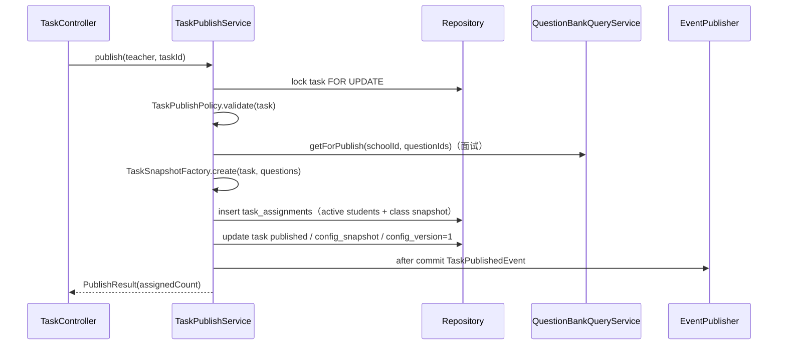
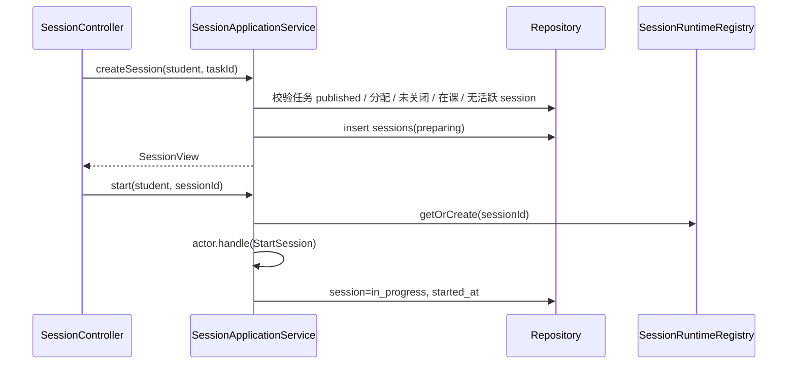
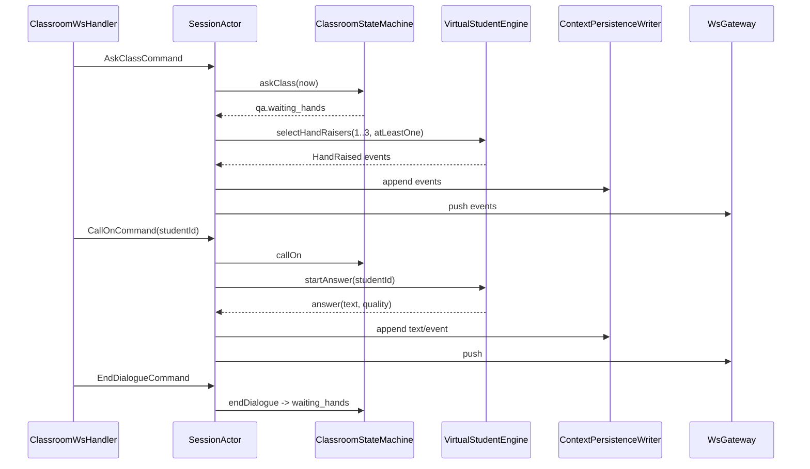
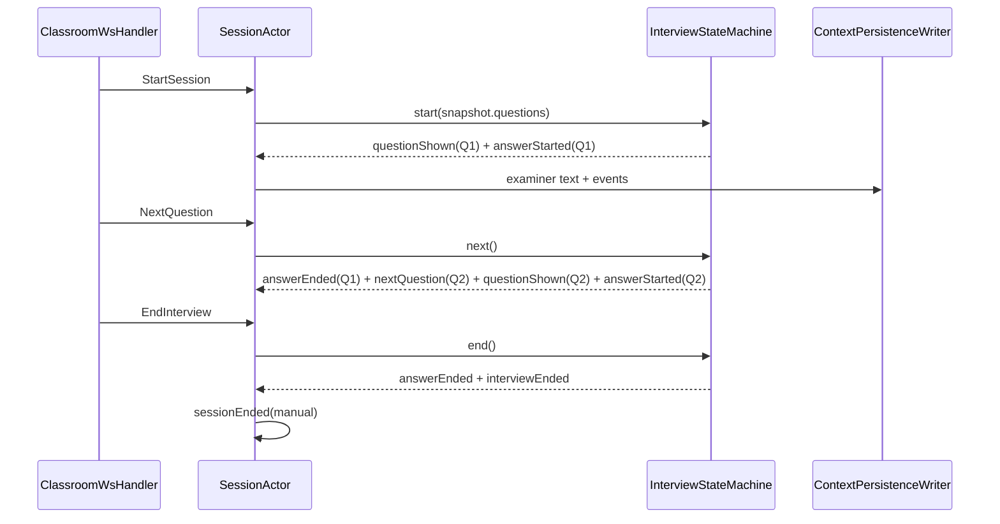
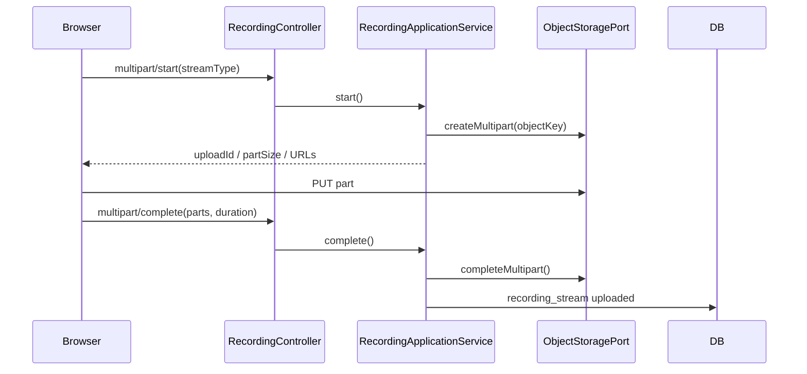
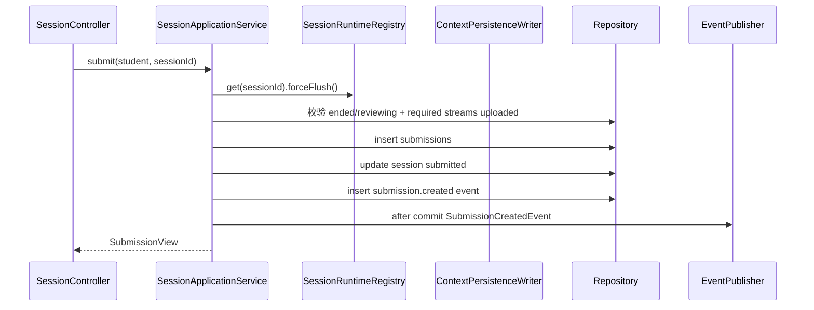

# 04 M3 实现设计

> 上位文档：[M3 需求](../requirements/M3-虚拟课堂与录制.md)、[05A](../design/05A-M3-课堂状态机与WebSocket.md)、[05B](../design/05B-M3-录制上传与回放.md)、[05C](../design/05C-M3-任务配置与结构化面试.md)、[15 代码规范与骨架](../design/15-代码规范与骨架.md)
> 版本：V0.1（讨论稿）　状态：待评审　更新日期：2026-11-03
> 范围：任务配置、SessionActor、课堂 / 面试、录制上传、回放；不写代码实现体
> 模块状态：G1 设计提交（10%）；G2—G8 未开始；Owner：M3 Owner（A/B）+ Media/Training Owner（C）；测试：UT / IT / 契约 / E2E 未开始；最后更新：2026-11-03（详见[进度看板](../team/02-进度看板.md)）

## 1. 包与类

```text
com.shijiangtai.m3classroom
├─ api/
│  ├─ TaskController
│  ├─ TaskMaterialController
│  ├─ StudentTaskController
│  ├─ SessionController
│  ├─ RecordingController
│  ├─ ReplayController
│  ├─ WsTicketController
│  ├─ ClassroomWsHandler
│  ├─ PerceptionWsHandler
│  └─ dto/M3Dtos
├─ application/
│  ├─ TaskApplicationService
│  ├─ TaskPublishService
│  ├─ TaskMaterialService
│  ├─ SessionApplicationService
│  ├─ SessionRuntimeRegistry
│  ├─ RecordingApplicationService
│  ├─ ReplayQueryService
│  └─ PerceptionApplicationService
├─ domain/
│  ├─ task/Task, TaskMode, TaskStatus, VirtualStudentConfig,
│  │       RubricWeights, QuestionConfig, TaskSnapshotFactory, TaskPublishPolicy
│  ├─ session/SessionActor, SessionState, SessionContext, SessionCommand, SessionEvent
│  ├─ classroom/ClassroomStateMachine, ClassroomMacroState, QaPhase,
│  │            VirtualStudentEngine, VirtualStudentRuntime, HandRaisePolicy,
│  │            AnswerQualityPolicy, DisciplineAggregator
│  ├─ interview/InterviewStateMachine, InterviewQuestionState
│  ├─ submission/Submission
│  ├─ recording/Recording, RecordingStream, StreamType, RequiredStreams
│  └─ event/TaskPublishedEvent, SessionEndedEvent, SubmissionCreatedEvent
└─ infrastructure/
   ├─ persistence/ (JPA entities / repositories / mappers)
   ├─ context/ContextPersistenceWriter
   ├─ storage/MinioObjectStorageAdapter, RecordingObjectKeyBuilder
   ├─ ws/WsGateway, WsTicketStore
   └─ perception/PythonPerceptionClient
```

## 2. 类职责

| 类 | 层 | 职责 |
|---|---|---|
| `TaskController` | api | 任务草稿 / 发布 / 关闭 / 学生任务 |
| `TaskMaterialController` | api | 材料上传 / 预览 / 删除 |
| `SessionController` | api | 创建 / 开始 / 结束 / 取消 / 提交 |
| `RecordingController` | api | multipart start / part-url / complete / abort |
| `ReplayController` | api | replay / events / texts |
| `WsTicketController` | api | 30 秒 ticket |
| `ClassroomWsHandler` | api | 控制 WS 命令 / 事件 |
| `PerceptionWsHandler` | api | 音频 / 感知 WS |
| `TaskApplicationService` | application | 草稿 / 查询 / 删除 |
| `TaskPublishService` | application | 发布事务 / 分配名单 |
| `TaskMaterialService` | application | 材料上传 / 解析 / 替换 |
| `SessionApplicationService` | application | session 生命周期 / 提交 |
| `SessionRuntimeRegistry` | application | actor 注册 / 获取 / 移除 |
| `RecordingApplicationService` | application | multipart / 完成 / 失败 |
| `ReplayQueryService` | application | 回放 DTO / 权限 |
| `Task` | domain | 任务聚合、发布后不可变 |
| `TaskSnapshotFactory` | domain | 生成配置快照 |
| `TaskPublishPolicy` | domain | 发布校验 |
| `SessionActor` | domain | 单 session 内存状态机 |
| `ClassroomStateMachine` | domain | lecturing / qa / ended |
| `VirtualStudentEngine` | domain | 注意力 / 纪律 / 举手 / 回答 / 对话 |
| `InterviewStateMachine` | domain | 题目 / 下一题 / 结束 / 超时 |
| `Submission` | domain | 提交件 |
| `Recording` / `RecordingStream` | domain | 三路 / 两路录制状态 |
| `ContextPersistenceWriter` | infra | 事件 / 文本 / 帧异步批量落库 |
| `WsGateway` | infra | 事件推送 |
| `WsTicketStore` | infra | Redis SETEX / GETDEL |
| `MinioObjectStorageAdapter` | infra | multipart / presign |

## 3. 核心方法签名

### 3.1 任务

```java
public interface TaskApplicationService {
    TaskView createDraft(CurrentUser teacher, CreateTaskCommand command);
    TaskView get(CurrentUser user, TaskId taskId);
    TaskView updateDraft(CurrentUser teacher, TaskId taskId, UpdateTaskCommand command);
    void deleteDraft(CurrentUser teacher, TaskId taskId);
    PageResult<TaskCardView> listCourseTasks(CurrentUser user, CourseId courseId, TaskQuery query);
    PageResult<StudentTaskView> listStudentTasks(CurrentUser student, StudentTaskQuery query);
    StudentTaskDetailView getStudentTask(CurrentUser student, TaskId taskId);
}

public interface TaskPublishService {
    PublishResult publish(CurrentUser teacher, TaskId taskId);
    void close(CurrentUser teacher, TaskId taskId);
}

public interface TaskMaterialService {
    MaterialView upload(CurrentUser teacher, TaskId taskId, MultipartFile file);
    MaterialView get(CurrentUser teacher, TaskId taskId);
    void delete(CurrentUser teacher, TaskId taskId);
}
```

### 3.2 Session

```java
public interface SessionApplicationService {
    SessionView createSession(CurrentUser student, TaskId taskId);
    SessionView get(CurrentUser user, SessionId sessionId);
    void start(CurrentUser student, SessionId sessionId);
    void end(CurrentUser student, SessionId sessionId);
    void cancel(CurrentUser student, SessionId sessionId);
    SubmissionView submit(CurrentUser student, SessionId sessionId);
}

public interface SessionRuntimeRegistry {
    SessionActor getOrCreate(SessionId sessionId);
    Optional<SessionActor> find(SessionId sessionId);
    void remove(SessionId sessionId);
}
```

### 3.3 SessionActor

```java
public final class SessionActor {
    public SessionSnapshot snapshot();
    public CommandResult handle(SessionCommand command);
    public void onWsConnected(WsConnection connection);
    public void onWsDisconnected(Instant now); // 30s grace
    public void onTick(Instant now);
    public void forceFlush(); // before end / submit / fail
    public void fail(FailureReason reason);
    public List<SessionEvent> replayAfter(long seq);
}

public sealed interface SessionCommand permits
    RecordingReady, StartSession, ResumeSession, AskClass, AskStudentQuestion,
    CallOn, MarkAnswer, ManageStudent, EndDialogue, EndQa, EndSession,
    NextQuestion, EndInterview, Tick {}
```

### 3.4 录制 / 回放

```java
public interface RecordingApplicationService {
    MultipartUpload start(CurrentUser student, SessionId sessionId, StreamType type);
    String partUrl(CurrentUser student, SessionId sessionId, StreamType type, int partNumber);
    void complete(CurrentUser student, SessionId sessionId, StreamType type, CompletePartCommand command);
    void abort(CurrentUser student, SessionId sessionId, StreamType type);
    List<RecordingStreamView> list(CurrentUser user, SessionId sessionId);
}

public interface ReplayQueryService {
    ReplayView replay(CurrentUser user, SessionId sessionId);
    PageResult<SessionEventView> events(CurrentUser user, SessionId sessionId, long afterSeq, int limit);
    List<SessionTextView> texts(CurrentUser user, SessionId sessionId, String speakerType);
}
```

## 4. 核心调用流程

### 4.1 任务发布



- 发布校验：老师组、课程 active / `end_at`、权重 100、材料解析、虚拟学生 1—30、面试 1—10 题、至少 1 名在课学生。
- 发布后配置锁定；重复发布 409；失败全部回滚。

### 4.2 创建 / 开始 session



- t0 = `session.started`；`recording.ready` 必须在 `session.start` 前。
- `required_streams`：自由 / 情景 camera+screen+audio；结构化面试 camera+audio。
- 同一学生同一任务只允许一个 `preparing / in_progress` session。

### 4.3 课堂问答



- 举手 1—3 人，保底 1 人；45 秒冷却；30 秒未点名回 `lecturing`。
- `end_dialogue` 回 `waiting_hands`；`end_qa` 回 `lecturing`。
- 回答质量 `clamp(ability*0.7 + clarity*0.3 + random(-0.15,0.15), 0, 1)`。

### 4.4 结构化面试



- 最后一题下一题 422 `INTERVIEW_NO_MORE_QUESTIONS`。
- 总时长到：`answerEnded` → `interviewEnded` → `sessionEnded(timeout)`。
- ASR finalize ≤2 秒后强制 flush。

### 4.5 录制 / 上传



- MediaRecorder 5 秒 timeslice；5MB part；三路并行。
- 第一段保留；`fix-webm-duration` 后重传 part 1；补时长失败禁止提交。
- required streams 全部 uploaded 才能提交。

### 4.6 提交



- flush 失败不生成 submission；session failed。
- 只保留提交件录像；其他 attempt 清理。

### 4.7 回放

```text
ReplayController.replay
  → ReplayQueryService.replay
  → 校验访问者（本人 / 老师组 / 训练本人）
  → 读取 recordings / recording_streams
  → 生成 15 分钟预签名 GET URL
  → 返回 streams + duration_ms + offsets
```

- 临时录像仅学生本人；教师只能看已提交件；管理员 403。
- 音频主时钟；前端同步；事件 / 文本单独接口。

### 4.8 重连

```text
控制 WS close
  → SessionActor.onWsDisconnected(now)
  → 30s grace timer；session 仍 in_progress
  → 30s 内重新 ticket + session.resume {last_seq, recording_state}
  → recording_state=active：cancel timer；replayAfter(last_seq)；session.resumed
  → recording_state=lost / 超时：fail(grace_timeout / recording_lost)
```

- 页面刷新 / 浏览器崩溃 = recording_state=lost；不做恢复。
- Java 重启：内存 actor 丢失；in_progress -> failed。

## 5. 事务与并发

| 用例 | 事务 |
|---|---|
| 发布任务 | 锁 task；校验 + 快照 + assignments + published |
| 创建 session | 校验 + insert session；无跨模块写 |
| 开始 / 命令 | actor mailbox 串行；状态 + 队列；关键事件 flush |
| 提交 | flush + submission/session/event 同事务；after-commit M4/M7 |
| 录制 complete | 校验 stream 属于 session；更新状态 |
| 回放 | 只读 |

- Actor 单线程 mailbox；同一 session 命令串行。
- 发布 / 配置按任务行 `FOR UPDATE`。
- 事件先入有序队列再推送；关键事件同步 flush。
- `session.snapshot.last_seq`；`session.resume` 补发事件。

## 6. 权限与事件

- 任务：课程老师组创建 / 发布 / 关闭；学生只看已分配任务。
- session：学生本人；老师组只读提交件；管理员 403。
- 训练：仅学生本人。
- `TaskPublishedEvent`、`SubmissionCreatedEvent`、`SessionEndedEvent`；事件 after-commit。
- `SubmissionCreatedEvent` 给 M4 / M7。

## 7. 测试点

- 任务配置 / 发布校验 / 快照不可变 / 0 学生 / 并发发布。
- session 状态机 / 非法命令 / 举手 1—3 / 30 秒超时 / 45 秒冷却。
- 回答质量 / 多轮对话 / 纪律聚合 record-only。
- 面试 Q1 / next / end / timeout / 最后一题。
- 录制 required streams / 5s / 5MB / duration patch / 失败。
- 提交 flush 顺序 / required streams / 只保留提交件。
- 回放 offset / seek / 权限 / 预签名过期。
- 30 秒 grace / resume / last_seq / 页面刷新 failed。
