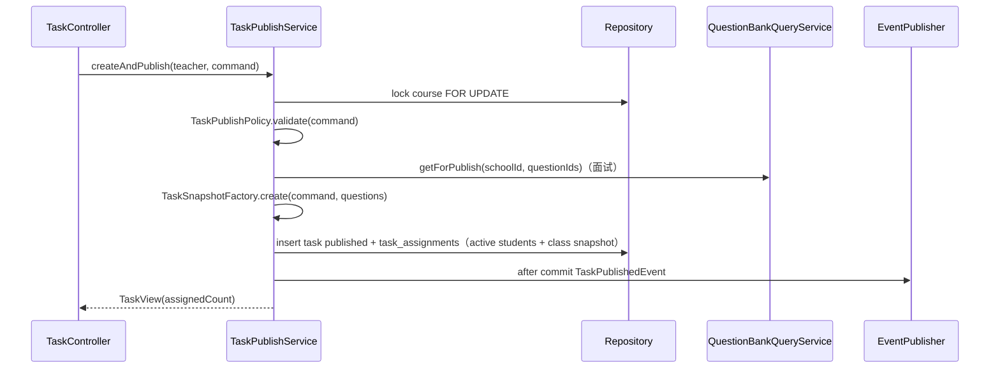
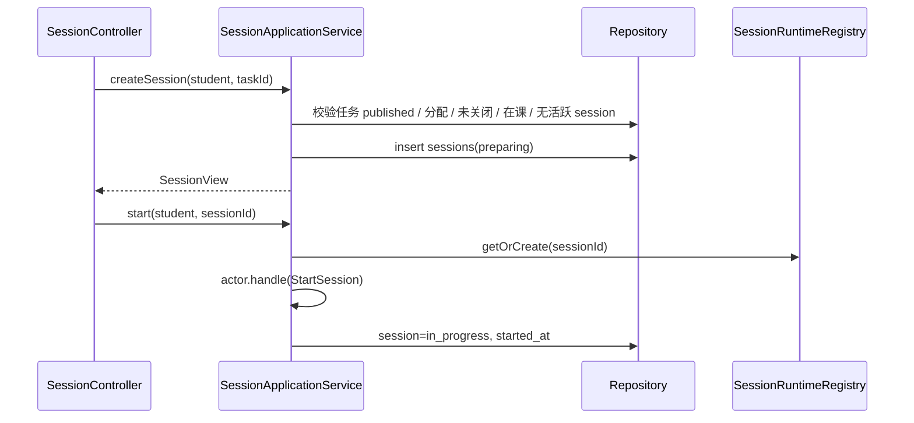
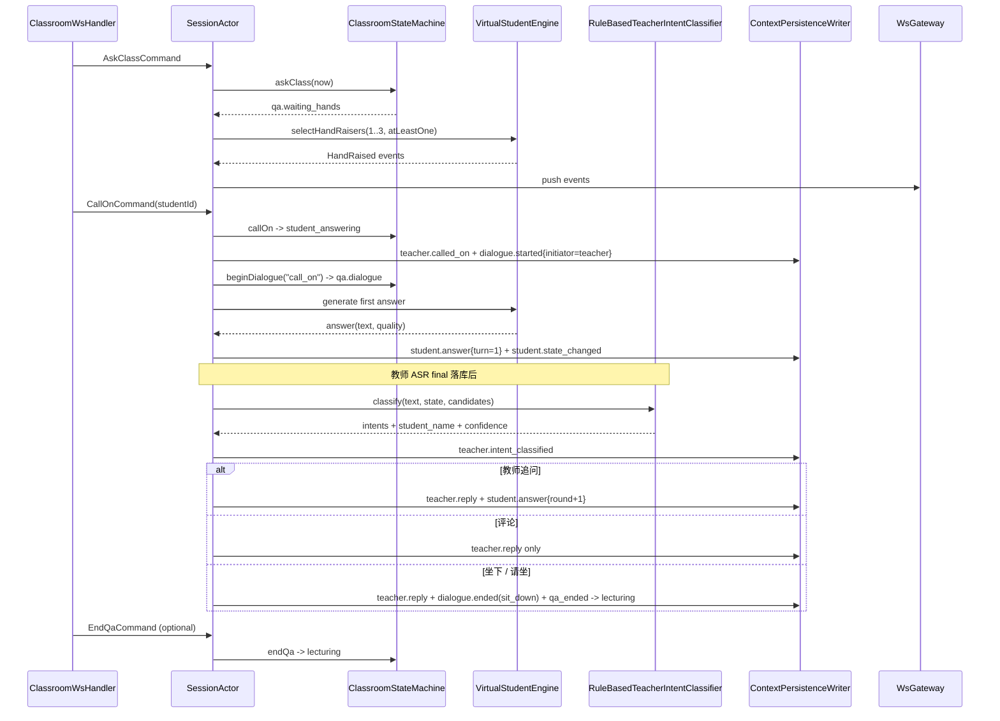
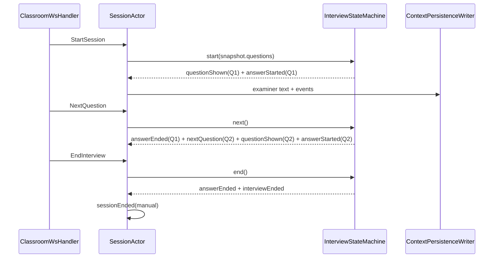
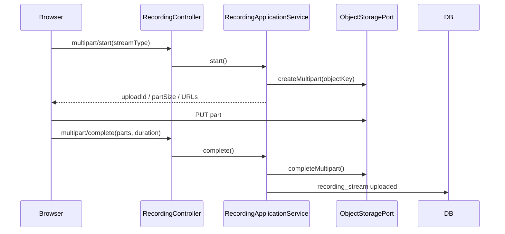
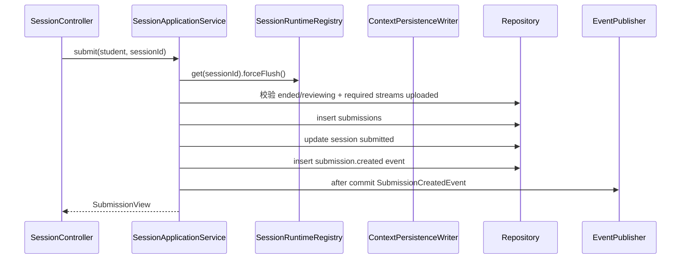

# 04 M3 实现设计

> 上位文档：[M3 需求](../requirements/M3-虚拟课堂与录制.md)、[05A](../design/05A-M3-课堂状态机与WebSocket.md)、[05B](../design/05B-M3-录制上传与回放.md)、[05C](../design/05C-M3-任务配置与结构化面试.md)、[15 代码规范与骨架](../design/15-代码规范与骨架.md)
> 版本：V0.4（对话与意图分类第一版）　状态：M3B 后端 P0 已实现（含异步持久化，2026-11-05）；2026-11-21 第一版“点名即对话 + 教师意图规则分类”已实现并通过 M3 单元 / 应用测试；M3C / 前端 E2E / WS 实库 IT / NFR 待续
> 范围：任务配置、SessionActor、课堂 / 面试、录制上传、回放；不含前端实现
> 模块状态：G1 设计提交（10%）；G2—G8 未开始；Owner：M3 Owner（A/B）+ Media/Training Owner（C）；测试：M3B UT / 契约已通过；第一版对话 / 规则分类 / 本地线性模型：M3 非 IT 558 tests / 0 failure，M3 IT 155/155 全绿（含 WS / 感知 / 录制 / 回放 / ArchUnit）；E2E / 性能安全未开始；最后更新：2026-11-21（详见[进度看板](../team/02-进度看板.md)）
> 2026-11-18 契约更新：M3 前后端已迁移为任务创建即发布、任务软删除；后端单元测试 / 集成测试与前端构建通过。`createPreparedTask` / `publish` 仅保留为测试准备钩子，不通过 TaskController 暴露。

## 1. 包与类

```text
com.shijiangtai.m3classroom
├─ api/
│  ├─ TaskController
│  ├─ TaskMaterialController
│  ├─ StudentTaskController
│  ├─ SessionController
│  ├─ RecordingController
│  ├─ ReplayController
│  ├─ WsTicketController
│  ├─ ClassroomWsHandler
│  ├─ PerceptionScreenController
│  └─ dto/M3Dtos
├─ application/
│  ├─ TaskApplicationService
│  ├─ TaskPublishService
│  ├─ TaskMaterialService
│  ├─ SessionApplicationService
│  ├─ SessionRuntimeRegistry
│  ├─ RecordingApplicationService
│  ├─ ReplayQueryService
│  ├─ PerceptionApplicationService
│  ├─ DirectContextPersistenceWriter
│  └─ port/ (ContextPersistenceWriter, SessionBatchStore, AsrStreamClient, OcrClient,
│            TeacherSpeechClassifier, SessionFrameStore, ...)
├─ domain/
│  ├─ task/Task, TaskMode, TaskStatus, VirtualStudentConfig,
│  │       RubricWeights, QuestionConfig, TaskSnapshotFactory, TaskPublishPolicy
│  ├─ session/SessionActor, SessionState, SessionContext, SessionCommand, SessionEvent,
│  │          SessionFrame, FrameType, FrameStatus, FrameTypeClassifier, OcrBox
│  ├─ classroom/ClassroomStateMachine, ClassroomMacroState, QaPhase, DialogueState,
│  │            VirtualStudentEngine, VirtualStudentRuntime, HandRaisePolicy,
│  │            AnswerQualityPolicy, DisciplineAggregator,
│  │            TeacherIntent, TeacherIntentHit, TeacherUtteranceIntent,
│  │            TeacherUtteranceContext, TeacherIntentClassifier,
│  │            RuleBasedTeacherIntentClassifier, HybridTeacherIntentClassifier
│  ├─ interview/InterviewStateMachine, InterviewQuestionState
│  ├─ submission/Submission
│  ├─ recording/Recording, RecordingStream, StreamType, RequiredStreams
│  └─ event/TaskPublishedEvent, SessionEndedEvent, SubmissionCreatedEvent
└─ infrastructure/
   ├─ persistence/ (JPA entities / repositories / mappers)
   ├─ persistence/jpa/ (SessionFrameStoreAdapter, SessionEventStoreAdapter,
   │                    SessionTextStoreAdapter, JpaSessionBatchStore,
   │                    JpaContextPersistenceWriter)
   ├─ storage/MinioObjectStorageAdapter, RecordingObjectKeyBuilder
   ├─ ws/ClassroomWebSocketHandler, PerceptionWebSocketHandler,
   │     PerceptionConnectionRegistry, PerceptionProtocolParser, WsTicketStore
   └─ perception/PythonPerceptionHttpClient, PythonAsrStreamClient,
                PerceptionAiProperties, LinearTeacherIntentClassifier
```

## 2. 类职责

| 类 | 层 | 职责 |
|---|---|---|
| `TaskController` | api | 任务创建（直接发布）/ 编辑 / 关闭 / 软删除 / 学生任务 |
| `TaskMaterialController` | api | 材料上传 / 预览 / 删除 |
| `SessionController` | api | 创建 / 开始 / 结束 / 取消 / 提交 |
| `RecordingController` | api | multipart start / part-url / complete / abort |
| `ReplayController` | api | replay / events / texts |
| `WsTicketController` | api | 30 秒 ticket |
| `ClassroomWsHandler` | api | 控制 WS 命令 / 事件 |
| `PerceptionScreenController` | api | 屏幕截图上传；202 + `frame_id` / `status=pending` |
| `PerceptionWebSocketHandler` | infra | 感知 WS：`audio.start` / `audio.stop`、ASR 转发、`asr.partial` / `asr.final`、AI 降级 |
| `PerceptionProtocolParser` | infra | 感知 WS 文本协议校验（`pcm16` / 16000 / 单声道） |
| `PerceptionConnectionRegistry` | infra | 单 session 感知连接替换（旧连接 1000）与终态关闭（4002） |
| `PythonAsrStreamClient` | infra | Python 流式 ASR WebSocket 适配器 |
| `PythonPerceptionHttpClient` | infra | Python OCR / 教师话语分类 HTTP 适配器 |
| `SessionFrameStore` / `SessionFrameStoreAdapter` | application / infra | `m3.frames` 持久化：pending → processed / failed（感知线程同步写入，不经异步 writer） |
| `FrameTypeClassifier` | domain | `frame_type` 分类：低置信 / 翻页 / 普通 |
| `TaskApplicationService` | application | 创建 / 查询 / 编辑 / 软删除 |
| `TaskPublishService` | application | 创建即发布事务 / 配置快照 / 分配名单 |
| `TaskMaterialService` | application | 材料上传 / 解析 / 替换 |
| `SessionApplicationService` | application | session 生命周期 / 提交 |
| `SessionRuntimeRegistry` | application | actor 注册 / 获取 / 移除 |
| `RecordingApplicationService` | application | multipart / 完成 / 失败 |
| `ReplayQueryService` | application | 回放 DTO / 权限 |
| `PerceptionApplicationService` | application | 截图校验 / pending 帧落库 / 异步 OCR / 事件触发 |
| `Task` | domain | 任务聚合、创建即发布、软删除 |
| `TaskSnapshotFactory` | domain | 生成配置快照 |
| `TaskPublishPolicy` | domain | 发布校验 |
| `SessionActor` | domain | 单 session 内存状态机；点名即进入对话、教师意图裁决、教师发起追问 / 学生发起追问 / 坐下结束 |
| `ClassroomStateMachine` | domain | lecturing / qa / ended；`beginDialogue` 从首答 / 首问过渡进入 `qa.dialogue`；`endDialogue(trigger, now)` 支持 `end_dialogue` / `no_follow_up` / `max_rounds` |
| `DialogueState` | domain | 单个对话的 `dialogue_id` / `student_id` / `initiator` / `phase`（等待教师 / 学生）/ 轮次（最多 3 轮）/ `awaitingSinceMs` |
| `TeacherIntent` / `TeacherIntentHit` / `TeacherUtteranceIntent` | domain | 教师意图枚举、单意图置信度、一次分类的多标签结果 |
| `TeacherUtteranceContext` | domain | 分类输入：文本、宏观状态、qa_phase、对话发起方、当前学生、候选学生 |
| `TeacherIntentClassifier` | domain | 教师意图分类端口；规则 / 本地线性模型 / 混合实现 |
| `RuleBasedTeacherIntentClassifier` | domain | 规则：9 类多标签 + 姓名子串匹配 + 极性；纯 Java、无网络 |
| `HybridTeacherIntentClassifier` | domain | 模型 + 规则按标签取最大置信度；姓名 / 极性来自规则 |
| `LinearTeacherIntentClassifier` | infrastructure | 加载离线训练 JSON，纯 Java 字符 n-gram TF-IDF + logistic regression 推理；模型缺失回退规则 |
| `VirtualStudentEngine` | domain | 注意力 / 纪律 / 举手 / 回答 / 对话 |
| `InterviewStateMachine` | domain | 题目 / 下一题 / 结束 / 超时 |
| `Submission` | domain | 提交件 |
| `Recording` / `RecordingStream` | domain | 三路 / 两路录制状态 |
| `ContextPersistenceWriter` | application / port | 事件 / 文本写入端口：`appendEvent` / `saveText` / `flush` / `close`；已实现 |
| `DirectContextPersistenceWriter` | application | 同步直写实现；旧 actor / registry 构造器与单测默认使用 |
| `JpaContextPersistenceWriter` | infra | 已实现：每 session 有序队列；1 秒 / 100 条 / 64 KB 触发；终态同步 flush；有界队列 + 重试 |
| `SessionBatchStore` | application / port | 一批 events + texts 单事务写入（先 texts 后 events） |
| `WsGateway` | infra | 事件推送 |
| `WsTicketStore` | infra | Redis SETEX / GETDEL |
| `MinioObjectStorageAdapter` | infra | multipart / presign |

## 3. 核心方法签名

### 3.1 任务

```java
public interface TaskApplicationService {
    TaskView create(CurrentUser teacher, CreateTaskCommand command); // 创建并发布
    TaskView get(CurrentUser user, TaskId taskId);
    TaskView update(CurrentUser teacher, TaskId taskId, UpdateTaskCommand command); // 无 session / 提交时
    void softDelete(CurrentUser teacher, TaskId taskId);
    PageResult<TaskCardView> listCourseTasks(CurrentUser user, CourseId courseId, TaskQuery query);
    PageResult<StudentTaskView> listStudentTasks(CurrentUser student, StudentTaskQuery query);
    StudentTaskDetailView getStudentTask(CurrentUser student, TaskId taskId);
}

public interface TaskPublishService {
    TaskView createAndPublish(CurrentUser teacher, CreateTaskCommand command);
    TaskView republish(CurrentUser teacher, TaskId taskId, UpdateTaskCommand command);
    void close(CurrentUser teacher, TaskId taskId);
}

public interface TaskMaterialService {
    MaterialView upload(CurrentUser teacher, TaskId taskId, MultipartFile file);
    MaterialView get(CurrentUser teacher, TaskId taskId);
    void delete(CurrentUser teacher, TaskId taskId);
}
```

### 3.2 Session

```java
public interface SessionApplicationService {
    SessionView createSession(CurrentUser student, TaskId taskId);
    SessionView get(CurrentUser user, SessionId sessionId);
    void start(CurrentUser student, SessionId sessionId);
    void end(CurrentUser student, SessionId sessionId);
    void cancel(CurrentUser student, SessionId sessionId);
    SubmissionView submit(CurrentUser student, SessionId sessionId);
}

public interface SessionRuntimeRegistry {
    SessionActor getOrCreate(SessionId sessionId);
    Optional<SessionActor> find(SessionId sessionId);
    void remove(SessionId sessionId);
}
```

`SessionRuntimeRegistry` 的生产构造器（`@Autowired`）用 `Random::new` 为每个 actor 创建随机源；另有
`SessionRuntimeRegistry(..., ContentClient, Supplier<RandomGenerator> randomFactory)` 重载作为测试
接缝：集成测试传入共享的确定性生成器，使追问掷骰可复现。生产行为不变。

### 3.3 SessionActor

```java
public final class SessionActor {
    public SessionSnapshot snapshot();
    public CommandResult handle(SessionCommand command);
    public void onWsConnected(WsConnection connection);
    public void onWsDisconnected(Instant now); // 30s grace
    public void onTick(Instant now);
    public void forceFlush(); // before end / submit / fail
    public void fail(FailureReason reason);
    public List<SessionEvent> replayAfter(long seq);

    // 感知钩子（M3B 感知切片）
    public synchronized Optional<UUID> recordSpeechFinal(
            String speakerType, UUID speakerRef, String text,
            Long startMs, Long endMs, BigDecimal confidence);
    public synchronized void onTeacherSpeechClassified(double confidence);
    public synchronized void onScreenProcessed(UUID frameId, long frameAtMs, String frameType);
    public synchronized long currentAtMs();
    public synchronized UUID currentAnswerId();
    public Runnable addStatusListener(Consumer<SessionStatus> listener);
    public synchronized boolean isInProgress();
}

public final class ClassroomStateMachine {
    // 首条回答 / 提问生成完成后进入 qa.dialogue
    public List<ClassroomEvent> beginDialogue(String trigger, Instant now);
    // 现有重载保持兼容：委托 trigger=end_dialogue
    public List<ClassroomEvent> endDialogue(Instant now);
    // 多轮对话终止：trigger ∈ {end_dialogue, no_follow_up, max_rounds}
    public List<ClassroomEvent> endDialogue(String trigger, Instant now);
    // 结束整个问答：sit_down / end_qa / manual
    public List<ClassroomEvent> endQa(String reason, Instant now);
    public List<ClassroomEvent> endQa(String reason, String trigger, Instant now);
}

public interface TeacherIntentClassifier {
    TeacherUtteranceIntent classify(TeacherUtteranceContext context);
    // 规则 / shadow 默认 false；active 线性 / 混合模型可为 true
    default boolean drivesLecturingQuestions() { return false; }
}

public final class RuleBasedTeacherIntentClassifier implements TeacherIntentClassifier {
    public static final String MODEL_VERSION = "teacher-intent-rules-v1";
}

public final class HybridTeacherIntentClassifier implements TeacherIntentClassifier {
    public HybridTeacherIntentClassifier(
            TeacherIntentClassifier model, TeacherIntentClassifier rules);
}

public final class LinearTeacherIntentClassifier implements TeacherIntentClassifier {
    public LinearTeacherIntentClassifier(Path modelPath, ObjectMapper objectMapper);
    public static String prepare(String text, List<CandidateStudent> candidates);
}

// M3Config: m3.classroom.teacher-intent.model-path 为空 -> 规则；
// 有值且加载成功 -> Hybrid(linear, rules)；加载失败 -> 规则 + WARN。
```

- `SessionRuntimeRegistry` 的生产构造器接收 `TeacherIntentClassifier` 并传给每个
  `SessionActor`；测试构造器默认使用 `RuleBasedTeacherIntentClassifier`。
- 模型产物由 `ai/training/teacher_intent/train.py` 生成，包含 vocabulary / idf /
  weights / intercepts；Java 与 Python `infer.py` 的分数在 1e-4 内一致。

```java
public sealed interface SessionCommand permits
    RecordingReady, StartSession, ResumeSession, AskClass, AskStudentQuestion,
    CallOn, MarkAnswer, ManageStudent, EndDialogue, EndQa, EndSession,
    NextQuestion, EndInterview, Tick {}
```

第一版对话的 actor 内部方法（`SessionActor`）：

```java
// 点名成功的实现路径（handleCallOn 内联）：
// teacher.called_on → 创建 DialogueState(initiator) → dialogue.started →
// classroom.beginDialogue → 生成首条 student.answer / student.question（turn=1）

// 教师 ASR final 落库后调用：规则分类 → teacher.intent_classified；
// 对话中按 initiator / phase 决定追问、评论、坐下、结束问答
private void handleTeacherUtterance(UUID textId, String text,
        Long startMs, Long endMs, Instant now);

// 对话内教师回合：按 initiator 分支
// - teacher 发起：教师追问 → student.answer（round+1）；评论 → teacher.reply only
// - student 发起：教师回答 → teacher.reply → awaiting_student →
//   学生按 question_rate*0.5 追问或 no_follow_up
// - sit_down / end_qa → dialogue.ended + qa_ended -> lecturing
private void handleDialogueTeacherUtterance(
        UUID textId, Long startMs, Long endMs,
        TeacherUtteranceIntent intent, Instant now);

// waiting_hands 中的语音 call_on / end_qa / manage_discipline
private void handleWaitingHandsTeacherUtterance(
        TeacherUtteranceIntent intent, Instant now);

// active 本地模型在讲解态高置信 ask_* -> 复用 onTeacherSpeechClassified
private void handleLocalVoiceQuestion(TeacherUtteranceIntent intent);

// 统一终止：dialogue.ended → 学生 focused；清空 dialogue / dialogueAnswerId；
// 不改变 classroom 状态机（由调用方追加领域事件）
private List<SessionEvent> endActiveDialogue(String reason, Instant now);

// 生成并落库 kind=answer 文本，追加 student.answer（带 dialogue_id / turn），
// 学生回答后进入 awaiting_teacher
private List<SessionEvent> emitStudentAnswerInDialogue(
        VirtualStudentRuntime student, Instant now);

// 生成并落库 kind=follow_up 文本，追加 student.follow_up（带 dialogue_id / turn），
// 进入 awaiting_teacher
private List<SessionEvent> emitFollowUp(
        VirtualStudentRuntime student, Instant now, boolean applyAttention);

// 教师意图事件 / 教师回合事件；全文只在 session_texts 存一份
private void appendTeacherIntentClassified(
        UUID textId, TeacherUtteranceIntent intent, Instant now);
private void appendTeacherReply(
        UUID textId, TeacherUtteranceIntent intent, Instant now);

// 语音点名 / 纪律辅助
private Optional<VirtualStudentRuntime> findStudentByName(String name);
private void applyVoiceManagement(TeacherUtteranceIntent intent, Instant now);
```

- `handleCallOn`：`teacher.called_on` → 学生 `called_on` → `dialogue.started {initiator}`
  → `classroom.beginDialogue("call_on")` → 首条 `student.answer` / `student.question`
  （`turn=1`）→ 学生进入 `dialogue`。
- 教师发起：首答后 `phase=awaiting_teacher`；教师 final 命中提问 → `dialogue.nextRound()`
  + `teacher.reply` + `student.answer`；评论 → 只写 `teacher.reply`；`sit_down` →
  `dialogue.ended(sit_down)` + `classroom.endQa("sit_down")` → `lecturing`。
- 学生发起：首问后 `phase=awaiting_teacher`；教师回答 → `teacher.reply` +
  `phase=awaiting_student`；学生命中追问 → `student.follow_up`，否则
  `dialogue.ended(no_follow_up)` → `waiting_hands`。
- 迟到 / 重复 final：`finalStart < dialogue.awaitingSinceMs()` 只落库 / 写
  `teacher.intent_classified`，不推进；同一 `text_id` 的动作只执行一次。
- 不做自动标记：`comment_answer` 不写 `teacher.marked`；教师手动标记是唯一权威。
- `teacher.end_dialogue` 按钮只结束当前对话回 `waiting_hands`；语音「坐下 / 请坐」结束整个问答回 `lecturing`。
- `handleEndQa` / `handleAsk` / `endClassroomSession` / `fail` 在各自领域事件前先
  `endActiveDialogue(reason)`；`CommandResult.events()` 包含对话事件，WS ack 与推送一致。
- 第一版不新增数据库表：分类结果写 `m3.events` 的 `teacher.intent_classified`，文本仍写
  `m3.session_texts`；后续需要多标签审计 / 再训练时再评估 `m3.utterance_intents`。

### 3.4 录制 / 回放

```java
public interface RecordingApplicationService {
    MultipartUpload start(CurrentUser student, SessionId sessionId, StreamType type);
    String partUrl(CurrentUser student, SessionId sessionId, StreamType type, int partNumber);
    void complete(CurrentUser student, SessionId sessionId, StreamType type, CompletePartCommand command);
    void abort(CurrentUser student, SessionId sessionId, StreamType type);
    List<RecordingStreamView> list(CurrentUser user, SessionId sessionId);
}

public interface ReplayQueryService {
    ReplayView replay(CurrentUser user, SessionId sessionId);
    PageResult<SessionEventView> events(CurrentUser user, SessionId sessionId, long afterSeq, int limit);
    List<SessionTextView> texts(CurrentUser user, SessionId sessionId, String speakerType);
}
```

### 3.5 感知通道

```java
public class PerceptionApplicationService {
    public PerceptionFrameView ingestScreen(
            CurrentUser user, SessionId sessionId, byte[] jpeg,
            String contentType, long atMs, BigDecimal changeScore);
}

public record PerceptionFrameView(UUID frameId, String status) {}

public final class PerceptionProtocolParser {
    public static final int SAMPLE_RATE = 16_000;
    public static final String FORMAT = "pcm16";
    public static final int CHANNELS = 1;

    public sealed interface Message permits AudioStart, AudioStop {}
    public record AudioStart(int sampleRate, String format, int channels) implements Message {}
    public record AudioStop() implements Message {}

    public static Message parse(String json); // DomainException(VALIDATION_ERROR)
}

@Component
public final class PerceptionConnectionRegistry {
    public void register(SessionId sessionId, WebSocketSession socket, SessionActor actor);
    public void unregister(SessionId sessionId, WebSocketSession socket);
}

@Component
public final class PerceptionWebSocketHandler extends AbstractWebSocketHandler {
    static final int CLOSE_AUTH = 4001;
    static final int CLOSE_FAILED = 4002;
    static final int CLOSE_STATE = 4003;
    static final Duration DRAIN_TIMEOUT = Duration.ofSeconds(2);
}

public interface AsrStreamClient {
    AsrSession open(AsrRequest request);
}

public interface AsrSession extends AutoCloseable {
    void send(byte[] pcm);
    void finish();
    void onChunk(Consumer<AsrChunk> listener);
    void onClosed(Runnable listener);
    void onError(Consumer<RuntimeException> listener);
    void close();
}

public record AsrRequest(SessionId sessionId, int sampleRate, String format, String language) {}
public record AsrChunk(String text, boolean finalChunk, Long beginMs, Long endMs,
                       BigDecimal confidence) {}

public interface OcrClient {
    OcrResult recognize(byte[] jpeg);
}

public record OcrResult(String text, List<OcrBox> boxes, BigDecimal confidence,
                        String modelVersion) {}

public interface TeacherSpeechClassifier {
    ClassifyResult classify(String text, List<String> recentTexts, String mode);
}

public record ClassifyResult(String label, BigDecimal confidence,
                             String modelVersion, String promptVersion) {}

public interface SessionFrameStore {
    void save(SessionFrame frame);
    Optional<SessionFrame> find(UUID frameId);
    void markProcessed(UUID frameId, String text, List<OcrBox> boxes,
                       BigDecimal confidence, FrameType frameType, String objectKey);
    void markFailed(UUID frameId, String errorMessage); // 只降级 pending 帧
}

public record PerceptionAiProperties(String baseUrl, String serviceToken,
        Duration ocrTimeout, Duration classifyTimeout, Duration asrConnectTimeout) {}

public class PythonAsrStreamClient implements AsrStreamClient {
    public PythonAsrStreamClient(PerceptionAiProperties properties, ObjectMapper objectMapper);
    public AsrSession open(AsrRequest request);
}

public class PythonPerceptionHttpClient implements OcrClient, TeacherSpeechClassifier {
    public PythonPerceptionHttpClient(PerceptionAiProperties properties, ObjectMapper objectMapper);
    public OcrResult recognize(byte[] jpeg);
    public ClassifyResult classify(String text, List<String> recentTexts, String mode);
}
```

- `PerceptionApplicationService`：同步校验 JPEG（≤5 MB）、`at_ms >= 0`、`change_score ∈ [0,1]`、owner、`in_progress`；写 pending 帧后提交有界单线程 OCR；OCR 成功 → `processed` + `perception.screen_changed`；OCR 失败 → `failed`，事件失败不降级已 processed 帧。
- `PerceptionWebSocketHandler`：`audio.start` 校验 `pcm16` / 16000 / 单声道并打开 ASR；partial/final 推送；`audio.stop` 后 `finish()` + 2 秒 drain；AI 失败只发 `error SERVICE_UNAVAILABLE`，不改 session 状态。
- `PerceptionConnectionRegistry`：同 session 单连接；新连接替换旧连接（1000）；actor 终态时关闭当前连接（4002）。
- `PythonAsrStreamClient`：`http→ws` / `https→wss`，query `session_id/sample_rate/format/language`；有界发送队列 + 单发送线程；`finish` 发送 `{"type":"finish"}`。
- `PythonPerceptionHttpClient`：OCR `image_base64`、分类 `text/recent_texts/mode`（snake_case）；非 2xx / 超时 / 缺字段抛 `RuntimeException`，由调用方降级。
- `SessionFrameStoreAdapter`：`m3.frames` JPA 适配器；`bounding_boxes` 存 jsonb；`markFailed` 只更新 pending。

### 3.6 持久化 writer（已实现，2026-11-05）

```java
public interface ContextPersistenceWriter {
    void appendEvent(SessionEvent event);
    void saveText(SessionText text);
    void flush(SessionId sessionId);
    default void close(SessionId sessionId) {}
}

public interface SessionBatchStore {
    void write(List<SessionEvent> events, List<SessionText> texts);
}

public final class DirectContextPersistenceWriter implements ContextPersistenceWriter {
    public DirectContextPersistenceWriter(SessionEventStore eventStore, SessionTextStore textStore);
    // appendEvent / saveText 直接写 store；flush / close 为 no-op
}

public class JpaContextPersistenceWriter implements ContextPersistenceWriter {
    public JpaContextPersistenceWriter(SessionBatchStore store); // 生产构造器
    // 每 session 一个有序队列；1 秒 / 100 条 / 64 KB；终态 flush；10 000 条有界
}
```

- `ContextPersistenceWriter` 是**应用端口**，不是计划中的 infra 占位；`SessionActor` 的所有事件 / 文本写路径和 `forceFlush()` 都经过它。
- `JpaContextPersistenceWriter` 的 flush 线程只操作队列与 batch store，不回调和获取 actor 监视器；actor 线程可安全等待 flush 锁。
- `DirectContextPersistenceWriter` 保留旧构造器的同步语义，既有单测 / IT fixture 无需改动。

## 4. 核心调用流程

### 4.1 任务创建 / 发布



- 创建校验：老师组、课程 active / `end_at`、权重 100、材料解析、虚拟学生 1—30、面试 1—10 题、至少 1 名在课学生。
- 创建即发布；失败全部回滚。编辑仅在无 session / 提交时允许，成功后重新生成快照与分配名单。
- 存在进行中 session 时禁止编辑 / 软删除；软删除保留提交 / 报告 / 评分。

### 4.2 创建 / 开始 session



- t0 = `session.started`；`recording.ready` 必须在 `session.start` 前。
- `required_streams`：自由 / 情景 camera+screen+audio；结构化面试 camera+audio。
- 同一学生同一任务只允许一个 `preparing / in_progress` session。

### 4.3 课堂问答



- 举手 1—3 人，保底 1 人；45 秒冷却；30 秒未点名回 `lecturing`。
- 点名成功即进入 `qa.dialogue`，两种方向：
  - `initiator=teacher`：首条 `student.answer` 后只有教师追问才生成下一条回答；
  - `initiator=student`：首条 `student.question` 后教师回答，学生按 `question_rate * 0.5`
    决定是否继续追问。
- 教师评论只写 `teacher.reply`，不生成回答、不自动标记；`sit_down` / 「请坐」结束整个问答
  回 `lecturing`；`teacher.end_dialogue` 按钮只结束当前对话回 `waiting_hands`。
- 迟到 final 以 `dialogue.awaitingSinceMs()` 为界；低置信意图只写
  `teacher.intent_classified`，不推进状态。
- 所有终止路径统一 `dialogue.ended` → 学生 `focused` → 调用方领域事件。
- 回答质量 `clamp(ability*0.7 + clarity*0.3 + random(-0.15,0.15), 0, 1)`。

### 4.4 结构化面试



- 最后一题下一题 422 `INTERVIEW_NO_MORE_QUESTIONS`。
- 总时长到：`answerEnded` → `interviewEnded` → `sessionEnded(timeout)`。
- ASR finalize ≤2 秒后强制 flush。

### 4.5 录制 / 上传



- MediaRecorder 5 秒 timeslice；5MB part；三路并行。
- 第一段保留；`fix-webm-duration` 后重传 part 1；补时长失败禁止提交。
- required streams 全部 uploaded 才能提交。

### 4.6 提交



- flush 失败不生成 submission；session failed。
- 只保留提交件录像；其他 attempt 清理。
- 本轮 M3B 只提供 actor `forceFlush()` 接缝；提交 / required_streams / submission 写入仍属 M3C，本节为提交流程设计。

### 4.7 回放

```text
ReplayController.replay
  → ReplayQueryService.replay
  → 校验访问者（本人 / 老师组 / 训练本人）
  → 读取 recordings / recording_streams
  → 生成 15 分钟预签名 GET URL
  → 返回 streams + duration_ms + offsets
```

- 临时录像仅学生本人；教师只能看已提交件；管理员 403。
- 音频主时钟；前端同步；事件 / 文本单独接口。

### 4.8 重连

```text
控制 WS close
  → SessionActor.onWsDisconnected(now)
  → 30s grace timer；session 仍 in_progress
  → 30s 内重新 ticket + session.resume {last_seq, recording_state}
  → recording_state=active：cancel timer；replayAfter(last_seq)；session.resumed
  → recording_state=lost / 超时：fail(grace_timeout / recording_lost)
```

- 页面刷新 / 浏览器崩溃 = recording_state=lost；不做恢复。
- Java 重启：内存 actor 丢失；in_progress -> failed。

## 5. 事务与并发

| 用例 | 事务 |
|---|---|
| 发布任务 | 锁 task；校验 + 快照 + assignments + published |
| 创建 session | 校验 + insert session；无跨模块写 |
| 开始 / 命令 | actor mailbox 串行；状态变更；事件 / 文本入有序队列；关键事件同步 flush |
| 异步持久化批次 | `JpaSessionBatchStore.write` 单事务：先 upsert texts 后 events；`REQUIRES_NEW` 独立提交 |
| 终态 flush | actor 线程同步 drain；仅 `session.ended` 为 flush-before-push；`interview.ended` 走普通 `append`（先推送），随后由终态 flush 落库；`session.failed` 推送在 flush 前；`session.ended` flush 失败 → failed + `SESSION_FAILED` |
| 提交 | flush + submission/session/event 同事务；after-commit M4/M7（M3C） |
| 录制 complete | 校验 stream 属于 session；更新状态 |
| 回放 | 只读 |

- Actor 单线程 mailbox；同一 session 命令串行。
- 发布 / 配置按任务行 `FOR UPDATE`。
- 事件先入有序队列再推送；终态同步 flush 中只有 `session.ended` 是 flush-before-push；`interview.ended` 先推送，由后续终态 flush 落库。
- 每个 session 一个 writer 队列；同 session 顺序由 actor 串行入队保证；共享 flush 线程池不回调 actor，避免锁环。
- 批次事务使用 `REQUIRES_NEW`：单批失败只回滚自身，不会把 REST 命令事务标记为 rollback-only；终态 flush 可在终态行保存前提交（会话行已存在，事件 / 文本 FK 可满足）。
- 普通异步 flush 失败：原批按序回队首，下一轮 / 下一 tick 重试；不阻塞 tick。
- 帧不入异步队列：`PerceptionApplicationService` 同步写 pending 帧并异步 OCR，OCR 更新依赖 read-after-write。
- `session.snapshot.last_seq`：活跃 actor 取内存 `lastSeq()`，无 actor 时取 DB `maxSeq`；`session.resume` 补发事件。

## 6. 权限与事件

- 任务：课程老师组创建 / 发布 / 关闭；学生只看已分配任务。
- session：学生本人；老师组只读提交件；管理员 403。
- 训练：仅学生本人。
- `TaskPublishedEvent`、`SubmissionCreatedEvent`、`SessionEndedEvent`；事件 after-commit。
- `SubmissionCreatedEvent` 给 M4 / M7。

## 7. 测试点

- 任务配置 / 发布校验 / 快照不可变 / 0 学生 / 并发发布。
- session 状态机 / 非法命令 / 举手 1—3 / 30 秒超时 / 45 秒冷却。
- 回答质量 / 对话：
  - 点名即进入 `qa.dialogue`，`dialogue.started.initiator` 正确；
  - 教师发起：教师追问 → `student.answer` 轮次 +1；评论 → 只写 `teacher.reply`，轮次不变；`sit_down` → `qa_ended` → `lecturing`；
  - 学生发起：教师回答 → `teacher.reply` → 学生追问 / `no_follow_up`；
  - 迟到 final 边界（`dialogue.awaitingSinceMs`）、`max_rounds`、`dialogue_id` 校验；
  - `teacher.intent_classified` 每条教师 final 都写，低置信不执行动作。
- 教师意图规则：9 类、单句多意图（`很好，请坐`）、姓名唯一匹配 / 歧义、极性、空文本。
- 本地线性模型：JSON 加载、字符 n-gram TF-IDF、姓名掩码、低分不伪造标签、Java / Python
  分数 1e-4 一致、Hybrid 按标签取最大置信度、模型缺失 / 损坏回退规则。
- 数据管线：seed 数据 schema、弱标注窗口 / 最近文本归属、训练 / 导出 / 指标、模型产物可加载。
- 纪律聚合 record-only。
- 面试 Q1 / next / end / timeout / 最后一题。
- 录制 required streams / 5s / 5MB / duration patch / 失败。
- 提交 flush 顺序 / required streams / 只保留提交件（M3C）。
- 回放 offset / seek / 权限 / 预签名过期。
- 30 秒 grace / resume / last_seq / 页面刷新 failed。
- 异步持久化（M3-T16）：1 秒 / 100 条 / 64 KB 触发；终态强制 flush 覆盖 `session.ended` / `interview.ended` / `session.failed`（仅 `session.ended` 为 flush-before-push）；`session.ended` flush 失败重试 3 次后 → failed / `SESSION_FAILED`；重复批次幂等；批次 `REQUIRES_NEW` 隔离；队列有界；活跃 actor `last_seq` 取内存；教师文本未落库仍进入 LLM 请求。
- M3-T19：`session.resume {recording_state=lost}` → failed；页面刷新 / 断开不 resume 的 30 秒 grace 超时 → failed；正常 `teacher.end_session` → `session.ended`，不 failed。
