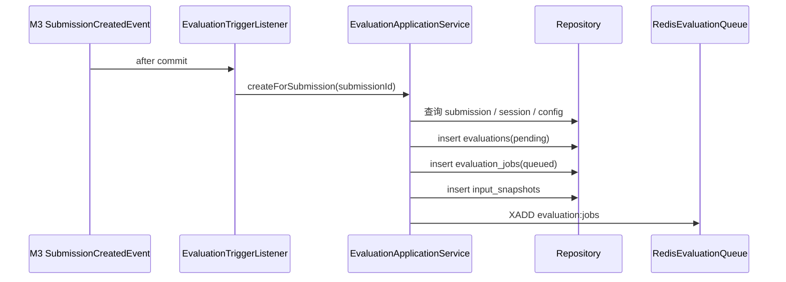
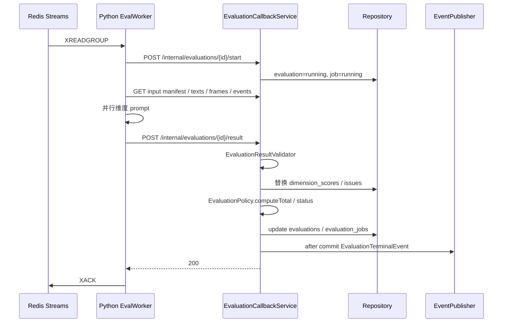

# 05 M4 实现设计

> 上位文档：[M4 需求](../requirements/M4-AI评测与反馈.md)、[06 M4 设计](../design/06-M4-AI评测与反馈.md)、[15 代码规范与骨架](../design/15-代码规范与骨架.md)
> 版本：V0.1（讨论稿）　状态：待评审　更新日期：2026-11-03
> 范围：评测触发、job、输入接口、回调、报告；Python worker 见 08；不写代码实现体
> 模块状态：G1 设计提交（10%）；G2—G8 未开始；Owner：AI Owner；测试：UT / IT / 契约 / E2E 未开始；最后更新：2026-11-03（详见[进度看板](../team/02-进度看板.md)）

## 1. 包与类

```text
com.shijiangtai.m4eval
├─ api/
│  ├─ EvaluationController
│  ├─ TrainingEvaluationController
│  ├─ InternalEvaluationController
│  └─ dto/M4Dtos
├─ application/
│  ├─ EvaluationApplicationService
│  ├─ EvaluationTriggerListener
│  ├─ EvaluationCallbackService
│  ├─ EvaluationJobScheduler
│  ├─ EvaluationReconciler
│  ├─ EvaluationInputService
│  └─ EvaluationReportQueryService
├─ domain/
│  ├─ Evaluation, EvaluationStatus
│  ├─ DimensionScore, EvaluationIssue, InputSnapshot
│  ├─ EvaluationJob, EvaluationPolicy, EvaluationResultValidator
│  └─ EvaluationTerminalEvent, SubmissionCreatedEvent, TrainingRecordSelectedEvent
└─ infrastructure/
   ├─ persistence/ (repositories, mappers)
   ├─ queue/RedisEvaluationQueue
   ├─ client/PythonEvaluationClient
   └─ query/JdbcEvaluationQuery
```

## 2. 类职责

| 类 | 层 | 职责 |
|---|---|---|
| `EvaluationController` | api | 按提交件 / 报告 / 问题 |
| `TrainingEvaluationController` | api | 训练评测 |
| `InternalEvaluationController` | api | start / result / fail / input |
| `EvaluationApplicationService` | application | 创建 / 查询 / 报告 |
| `EvaluationTriggerListener` | application | submission / training 选中触发 |
| `EvaluationCallbackService` | application | start / result / fail |
| `EvaluationJobScheduler` | application | 投递 / 重试 / dead |
| `EvaluationReconciler` | application | 缺失 / 过期对账 |
| `EvaluationInputService` | application | manifest / 分页输入 |
| `EvaluationReportQueryService` | application | 报告读模型 |
| `Evaluation` | domain | 评测聚合 / 状态 / 总分 |
| `DimensionScore` / `EvaluationIssue` | domain | 维度 / 问题 |
| `InputSnapshot` | domain | 不可变输入快照 |
| `EvaluationJob` | domain | 队列 / attempt |
| `EvaluationPolicy` | domain | warnings / partial / 状态 |
| `EvaluationResultValidator` | domain | 回调校验 |
| `EvaluationTerminalEvent` | domain | 终态事件 |
| `RedisEvaluationQueue` | infra | Redis Streams |
| `PythonEvaluationClient` | infra | 内部 HTTP |
| `JdbcEvaluationQuery` | infra | 报告读模型 |

## 3. 核心方法签名

```java
public interface EvaluationApplicationService {
    EvaluationView getBySubmission(CurrentUser user, SubmissionId submissionId);
    EvaluationView get(CurrentUser user, EvaluationId evaluationId);
    ReportView report(CurrentUser user, EvaluationId evaluationId);
    List<IssueView> issues(CurrentUser user, EvaluationId evaluationId);
}

public interface EvaluationTriggerListener {
    void onSubmissionCreated(SubmissionCreatedEvent event);
    void onTrainingRecordSelected(TrainingRecordSelectedEvent event);
}

public interface EvaluationCallbackService {
    void start(StartEvaluationCommand command);
    void complete(EvaluationResultCommand command);
    void fail(EvaluationFailCommand command);
}

public interface EvaluationJobScheduler {
    void dispatchQueued();
    void requeueStale();
    void deadLetter(UUID jobId, String reason);
}

public interface EvaluationInputService {
    InputManifest manifest(EvaluationId evaluationId);
    PageResult<SessionTextView> texts(EvaluationId evaluationId, String afterId, int limit);
    PageResult<FrameView> frames(EvaluationId evaluationId, Long afterTs, String afterId, int limit);
    PageResult<SessionEventView> events(EvaluationId evaluationId, Long afterSeq, int limit);
}
```

## 4. 核心调用流程

### 4.1 提交触发



- `UNIQUE(source_type, source_id)` 幂等；重复事件返回已有评测。
- 训练：`TrainingRecordSelectedEvent` → `createForTrainingRecord`。
- `input_snapshots` 固化 text/frame/event/recording ID；M4 不读实时 session。

### 4.2 Worker / 回调



- `(evaluation_id, attempt)` 幂等；旧 attempt 200 ignored；更高 409；终态拒绝。
- Java 计算总分 / 状态；Python 只返回维度 / 子项 / 问题 / warnings。
- 死信：已有维度 → partial；无维度 → failed。
- `completed_at` 对所有终态写入。

### 4.3 报告

```text
EvaluationController.report
  → EvaluationReportQueryService
  → 校验本人 / 老师组 / 训练本人
  → 读取 evaluation + dimension_scores + issues
  → 组装 radar / dimensions / suggestions / meta
```

- `pending / running` 409 `EVALUATION_NOT_READY`。
- `partial`：total null，展示已完成维度 + missing。
- `failed`：422 `EVALUATION_FAILED`；失败原因从 detail 查。
- 管理员 403；训练 owner-only。

### 4.4 重试 / 对账

```text
EvaluationJobScheduler
  → 每 10s 扫描 queued + next_retry_at <= now
  → attempts++ / XADD
  → running 超过 10min 重投
  → attempts >=3：dead stream + failed/partial
EvaluationReconciler
  → 每 60s 扫描缺失 evaluation 的 submission / training_record
  → 创建 pending + job
```

- 退避 15s / 60s / 180s。
- 回调失败不 XACK；pending reclaim 10min。

## 5. 事务与状态

| 用例 | 事务 |
|---|---|
| 创建评测 | evaluations + job + input_snapshot |
| start | evaluation + job 状态 |
| result | evaluation + dimension_scores + issues + job 原子更新 |
| fail | evaluation + job；保留已有维度 |
| 报告 | 只读 |

状态：

```text
pending → running → completed / partial / failed
```

- `warnings` 不改变状态；`partial_reasons` 只放必需项。
- 零权重维度缺失不判 partial。

## 6. 权限与事件

- 学生本人；任务老师组；训练本人；管理员 403。
- 内部接口 `X-Service-Token`；不公网。
- `EvaluationTerminalEvent`：evaluation_id、source_type、source_id、status、completed_at、attempt。
- M7 消费终态；M6 消费训练终态；训练事件 M7 忽略。

## 7. 测试点

- 提交 / 训练触发；幂等；input snapshot。
- start / result / fail；attempt 幂等 / 旧 / 高。
- 维度校验 / 总分 / warnings / partial / 零权重。
- 重试 / dead / worker 崩溃 / 回调失败。
- 报告权限 / partial / failed / 训练私有。
- 3 个评测并发 <90s；token 预算。
