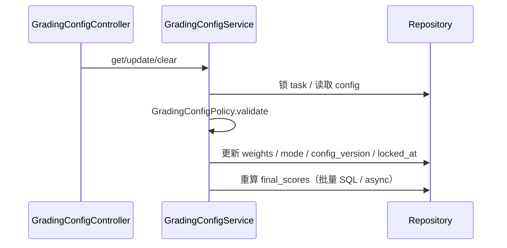
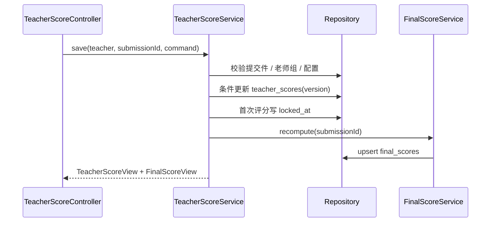

# 06 M7 实现设计

> 上位文档：[M7 需求](../requirements/M7-教师评测与数据统计.md)、[07 M7 设计](../design/07-M7-教师评测与数据统计.md)、[15 代码规范与骨架](../design/15-代码规范与骨架.md)
> 版本：V0.1（讨论稿）　状态：待评审　更新日期：2026-11-03
> 范围：评分配置、教师评分、最终分、统计、排行榜、CSV、学生结果；不写代码实现体
> 模块状态：G1 设计提交（10%）；G2—G8 未开始；Owner：Score/QA Owner；测试：UT / IT / 契约 / E2E 未开始；最后更新：2026-11-03（详见[进度看板](../team/02-进度看板.md)）

## 1. 包与类

```text
com.shijiangtai.m7teacher
├─ api/
│  ├─ GradingConfigController
│  ├─ GradingSubmissionController
│  ├─ TeacherScoreController
│  ├─ StatisticsController
│  ├─ LeaderboardController
│  ├─ ExportController
│  ├─ StudentResultController
│  └─ dto/M7Dtos
├─ application/
│  ├─ GradingConfigService
│  ├─ TeacherScoreService
│  ├─ FinalScoreService
│  ├─ FinalScoreRecomputeJob
│  ├─ StatisticsQueryService
│  ├─ LeaderboardQueryService
│  ├─ CsvExportService
│  └─ StudentResultQueryService
├─ domain/
│  ├─ GradingConfig, ScoringMode, GradingConfigPolicy
│  ├─ TeacherScore, TeacherScorePolicy
│  ├─ FinalScore, FinalScoreStatus, FinalScorePolicy, FinalScoreCalculator
│  └─ EvaluationTerminalEvent
└─ infrastructure/
   ├─ persistence/ (repositories, entities)
   ├─ query/ (StatisticsQueryDao, LeaderboardQueryDao)
   └─ export/CsvWriter
```

## 2. 类职责

| 类 | 层 | 职责 |
|---|---|---|
| `GradingConfigController` | api | 权重 / 模式 / 清空 |
| `GradingSubmissionController` | api | 评分名单 / 状态 |
| `TeacherScoreController` | api | 单条 / 批量评分 |
| `StatisticsController` | api | 任务 / 课程统计 |
| `LeaderboardController` | api | 排行榜 |
| `ExportController` | api | CSV |
| `StudentResultController` | api | 学生成绩 |
| `GradingConfigService` | application | 默认 / 锁定 / 清空 |
| `TeacherScoreService` | application | 评分 / 批量 / version |
| `FinalScoreService` | application | 单条 / 任务重算 |
| `FinalScoreRecomputeJob` | application | 大批量异步 |
| `StatisticsQueryService` | application | 任务 / 课程统计 |
| `LeaderboardQueryService` | application | 排序 / 分页 |
| `CsvExportService` | application | 导出 |
| `StudentResultQueryService` | application | 学生结果 |
| `GradingConfig` | domain | 配置聚合 / 锁定 |
| `TeacherScore` | domain | 教师评分 / version |
| `FinalScore` | domain | 最终分 / 状态 |
| `FinalScoreCalculator` | domain | 公式 / 状态优先级 |
| `StatisticsQueryDao` | infra | JDBC 统计 |
| `CsvWriter` | infra | UTF-8 BOM / 公式注入 |

## 3. 核心方法签名

```java
public interface GradingConfigService {
    GradingConfigView get(CurrentUser teacher, TaskId taskId);
    GradingConfigView update(CurrentUser teacher, TaskId taskId, UpdateGradingConfigCommand command);
    ClearResult clearScores(CurrentUser teacher, TaskId taskId);
}

public interface TeacherScoreService {
    TeacherScoreView save(CurrentUser teacher, SubmissionId submissionId, SaveTeacherScoreCommand command);
    BatchSaveResult batchSave(CurrentUser teacher, TaskId taskId, List<SaveTeacherScoreCommand> commands);
}

public interface FinalScoreService {
    void recompute(SubmissionId submissionId);
    void recomputeTask(TaskId taskId);
    void onEvaluationTerminal(EvaluationTerminalEvent event);
}

public interface StatisticsQueryService {
    TaskStatsView taskStats(CurrentUser teacher, TaskId taskId, ClassId classId);
    CourseStatsView courseStats(CurrentUser teacher, CourseId courseId, ClassId classId);
}

public interface CsvExportService {
    void export(CurrentUser teacher, TaskId taskId, ExportQuery query, OutputStream out);
}
```

## 4. 核心调用流程

### 4.1 评分配置



- 默认 70/30、dimension；GET 懒创建，归档只读不写。
- 首次评分写 `locked_at`；配置修改 / 清空 / 首次评分同一任务锁。
- 清空：删 teacher_scores → final_scores 置空 → pending_teacher / pending_ai。

### 4.2 教师评分



- 维度模式：服务端按 rubric 权重算 `teacher_total`；总分模式直接使用。
- `version` 冲突 409；批量逐行结果，允许部分成功。
- 首次并发插入命中 `UNIQUE(submission_id)` → 409。

### 4.3 最终分

```text
FinalScoreService.recompute(submissionId)
  → 读 submission / task config / AI evaluation / teacher score
  → FinalScoreCalculator
  → final_total = ai_total*ai_weight/100 + teacher_total*teacher_weight/100
  → final_dimensions（维度模式合成 / 总分模式用 AI 维度）
  → 状态优先级：
      ai_partial → ai_failed → pending_ai → pending_teacher → completed
  → upsert final_scores
```

- 零权重项不要求分数；`ai_weight=0` 忽略 AI 状态。
- `final_total` / `final_dimensions` 仅 completed 非空。
- 配置 / AI / 教师分变化后重算；批量 SQL；>200 人异步 job。
- M4 `EvaluationTerminalEvent` after-commit 触发。

### 4.4 统计 / 排行榜 / 导出

```text
StatisticsController.taskStats
  → StatisticsQueryService
  → 统计 assigned / submitted / completed / pending / in_progress
  → 维度平均 / 薄弱项最低 2 / 样本 <3
  → 只统计 completed

LeaderboardController
  → LeaderboardQueryService
  → ORDER BY final_total DESC NULLS LAST, teacher_total DESC NULLS LAST,
             ai_total DESC NULLS LAST, student_account_id ASC

ExportController
  → CsvExportService
  → 当前筛选 / UTF-8 BOM / RFC 4180 / 公式注入防护 / ≤10000 行
```

- 班级使用 `task_assignments.class_id_snapshot` / 提交快照；无班级归「未分班」。
- 课程统计：所有 completed 提交件 pooled average，不是任务平均再平均。
- 学生结果：completed 才显示最终分；pending 只显示状态；训练不进入 M7。
- 评分 / 统计 / 学生成绩页在存在 `pending_ai` 时 3—5 秒轮询。

## 5. 事务与并发

| 用例 | 事务 |
|---|---|
| 配置 update / clear | 锁 task；config + teacher_scores / final_scores |
| 单条评分 | teacher_score 条件更新 + final_score |
| 批量评分 | 每行独立；汇总结果 |
| 最终分重算 | 单条 upsert / 批量 SQL |
| 统计 / 导出 | 只读 |

- 乐观锁：teacher score `version`；配置 `config_version`。
- 悲观锁：任务级 `FOR UPDATE`。
- `final_scores.teacher_score_id / ai_evaluation_id` `ON DELETE SET NULL`。

## 6. 权限

- 教师：本课程老师组；归档只读；统计 / 导出仍可用（直链）。
- 学生：本人；不能看他人 / 班级聚合。
- 管理员：403。
- 训练：不进入 M7。

## 7. 测试点

- 默认配置 / 锁定 / 清空 / 版本冲突。
- 维度 / 总分评分；教师总分；评语长度。
- 最终分公式 / 状态优先级 / 零权重 / partial / failed。
- 统计口径 / 薄弱项 / 样本不足 / 排行榜 NULLS LAST。
- CSV BOM / 转义 / 空表头 / 10000 行 / 公式注入。
- 学生本人 / 他人 / 老师组 / 管理员 403；归档只读。
- 200 人批量重算 / 异步 job。
