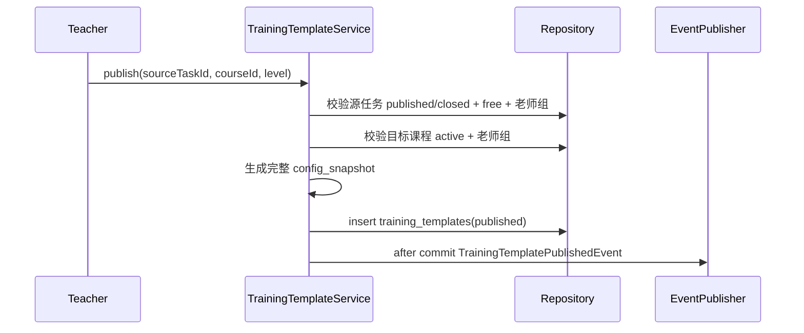
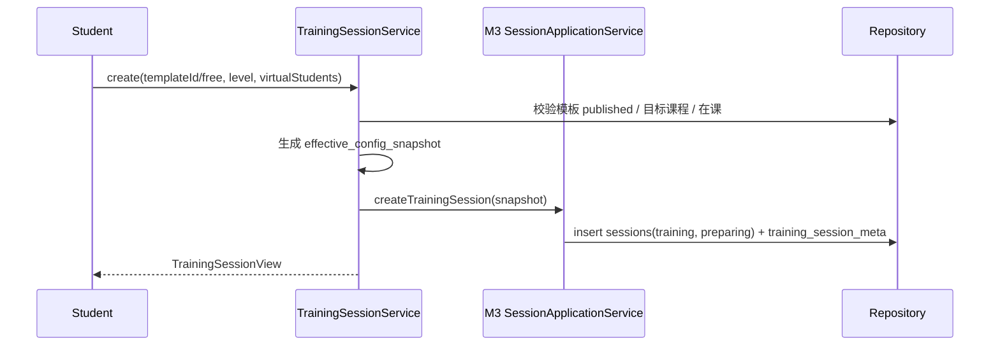
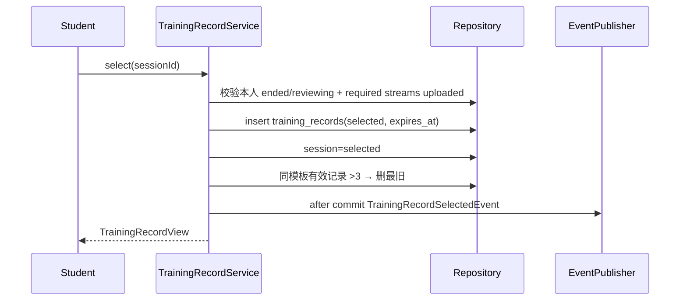

# 07 M6 实现设计

> 上位文档：[M6 需求](../requirements/M6-训练模式.md)、[08 M6 设计](../design/08-M6-训练模式.md)、[15 代码规范与骨架](../design/15-代码规范与骨架.md)
> 版本：V0.1（讨论稿）　状态：待评审　更新日期：2026-11-03
> 范围：训练模板、训练 session、训练记录、隐私；不写代码实现体
> 模块状态：G1 设计提交（10%）；G2—G8 未开始；Owner：Media/Training Owner；测试：UT / IT / 契约 / E2E 未开始；最后更新：2026-11-03（详见[进度看板](../team/02-进度看板.md)）

## 1. 包与类

```text
com.shijiangtai.m6training
├─ api/
│  ├─ TrainingTemplateController
│  ├─ StudentTrainingController
│  ├─ TrainingSessionController
│  ├─ TrainingRecordController
│  ├─ TrainingMaterialController
│  └─ dto/M6Dtos
├─ application/
│  ├─ TrainingTemplateService
│  ├─ TrainingTemplateReconciler
│  ├─ TrainingSessionService
│  ├─ TrainingRecordService
│  └─ TrainingMaterialService
├─ domain/
│  ├─ TrainingTemplate, TrainingLevel, TrainingPolicy
│  ├─ TrainingRecord, TrainingRecordPolicy
│  └─ TrainingConfigSnapshot, TrainingRecordSelectedEvent
└─ infrastructure/
   ├─ persistence/ (repositories, entities)
   └─ reuse/ (M3 SessionApplicationService, M4 trigger port)
```

## 2. 类职责

| 类 | 层 | 职责 |
|---|---|---|
| `TrainingTemplateController` | api | 发布 / 下架 / 列表 / 详情 |
| `StudentTrainingController` | api | 学生模板 / 自由训练材料 |
| `TrainingSessionController` | api | 创建 / 结束 / 取消 |
| `TrainingRecordController` | api | 选中 / 列表 / 详情 / 删除 |
| `TrainingMaterialController` | api | 自由训练材料 |
| `TrainingTemplateService` | application | 模板发布 / 下架 / 快照 |
| `TrainingTemplateReconciler` | application | 课程归档 / 教师移出自动下架 |
| `TrainingSessionService` | application | 创建 / 结束 / 复用 M3 |
| `TrainingRecordService` | application | 选中 / 3 条上限 / 到期 |
| `TrainingMaterialService` | application | 材料上传 / 过期 |
| `TrainingTemplate` | domain | 模板聚合 |
| `TrainingRecord` | domain | 训练记录 |
| `TrainingPolicy` | domain | 目标课程 / 老师组 / 记录上限 |
| `TrainingConfigSnapshot` | domain | 有效配置 |

## 3. 核心方法签名

```java
public interface TrainingTemplateService {
    TrainingTemplateView publish(CurrentUser teacher, PublishTemplateCommand command);
    void unpublish(CurrentUser teacher, TemplateId templateId);
    PageResult<TrainingTemplateView> listTeacherTemplates(CurrentUser teacher, TemplateQuery query);
    TrainingTemplateView getTeacherTemplate(CurrentUser teacher, TemplateId templateId);
    TrainingTemplateView getStudentTemplate(CurrentUser student, TemplateId templateId);
}

public interface TrainingSessionService {
    TrainingSessionView create(CurrentUser student, CreateTrainingSessionCommand command);
    TrainingSessionView get(CurrentUser student, SessionId sessionId);
    void end(CurrentUser student, SessionId sessionId);
    void cancel(CurrentUser student, SessionId sessionId);
}

public interface TrainingRecordService {
    TrainingRecordView select(CurrentUser student, SessionId sessionId);
    PageResult<TrainingRecordView> list(CurrentUser student, TrainingRecordQuery query);
    TrainingRecordView get(CurrentUser student, TrainingRecordId recordId);
    void delete(CurrentUser student, TrainingRecordId recordId);
}
```

## 4. 核心调用流程

### 4.1 发布模板



- 同源任务 + 课程 + 档位 published 唯一；重复 409。
- 目标课程可与源任务不同；教师须在两个老师组。
- 模板快照含完整参考材料；学生不可见。

### 4.2 自动下架

```text
CourseArchivedEvent / CourseTeacherRemovedEvent
  → TrainingTemplateReconciler
  → 目标课程 status != active 或创建者不在 course_teachers active
  → status=unpublished / unpublished_at
```

- 事件丢失由 5 分钟对账兜底。
- 模板下架不影响已选中 TrainingRecord；未选中 session 按 24h 临时规则。

### 4.3 创建训练 session



- 模板训练：时长 / 权重固定；学生只改虚拟学生。
- 自由训练：默认 3 人 / 0.5；进阶 15/20；模拟 20/20。
- 同一学生同时只有一个活跃 training session。

### 4.4 选中记录



- 评测通过 `evaluations.training_record_id` 查询，不双写 evaluation_id。
- 每模板 / 自由训练分组最多 3 条；记录 1 个月；学生可删除。
- 训练报告仅本人；教师 / 管理员 403。

### 4.5 到期 / 清理

```text
TrainingRecordService / cleanup job
  → 读路径校验 expires_at > now
  → status=expired / deleted
  → 删 MinIO 录像 / 材料
  → 删 training_records → evaluation → session
```

- 清理根为 training_record；不依赖删 session。
- 训练材料未使用 24h 过期。

## 5. 事务与并发

| 用例 | 事务 |
|---|---|
| 发布模板 | 校验 + 快照 + insert template |
| 创建 session | 校验 + sessions + training_session_meta |
| 选中记录 | insert record + session selected + 删最旧（锁学生+模板分组） |
| 删除 / 到期 | 标记 + 异步清理 |

- 记录上限按“学生 + 模板 / 自由训练分组”加锁。
- 模板自动下架事件 after-commit；reconciler 兜底。

## 6. 权限与事件

- 教师：仅自己创建的模板；学生：目标课程在课 + published。
- 训练录像 / 报告仅本人；管理员 403。
- 通用 M3/M4 接口必须拒绝教师访问 training session / training_record。
- `TrainingRecordSelectedEvent` → M4。
- `CourseArchivedEvent` / `CourseTeacherRemovedEvent` → M6 自动下架。

## 7. 测试点

- 模板发布 / 重复 / 源任务非法 / 目标课程。
- 自动下架 / 学生列表隐藏。
- 模板训练 / 自由训练 / 时长 / 权重不可改。
- 训练 session 状态 / 不生成 Submission / M7 不可见。
- 选中 / 3 条上限 / 第 4 条删最旧 / 自由训练分组。
- 记录到期 / 删除 / 读路径校验 / 清理。
- 训练报告仅本人；通用接口 403。
