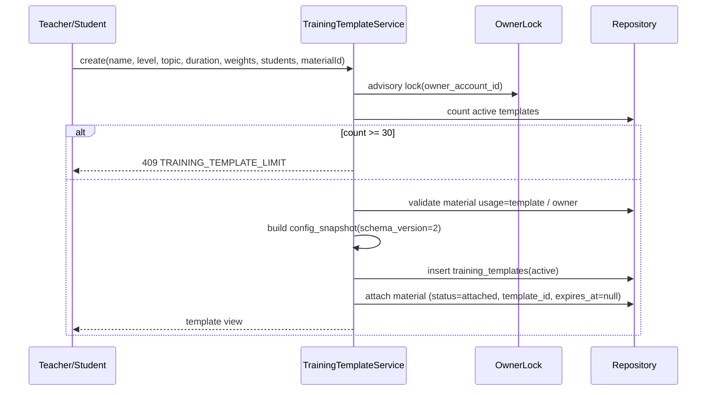
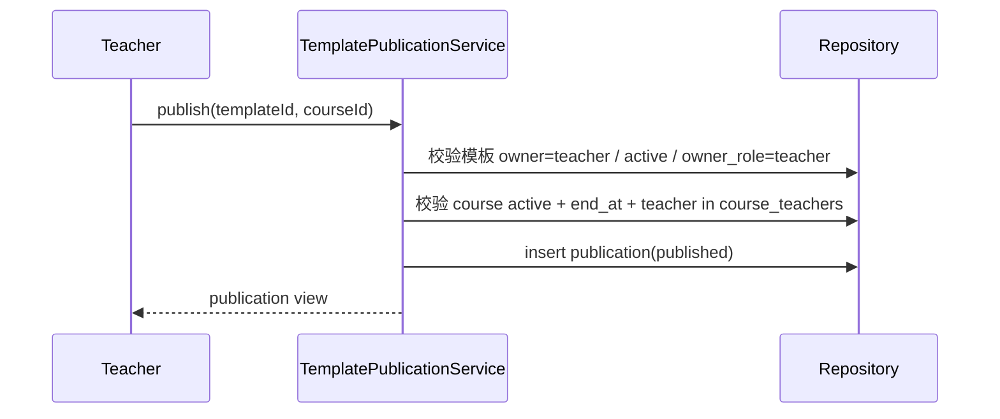
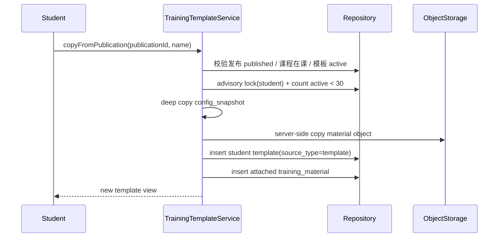
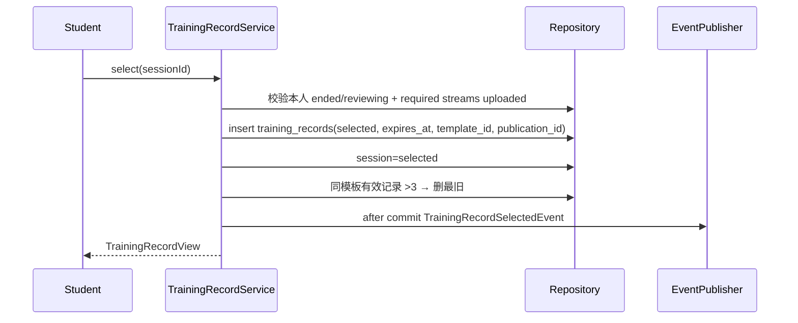
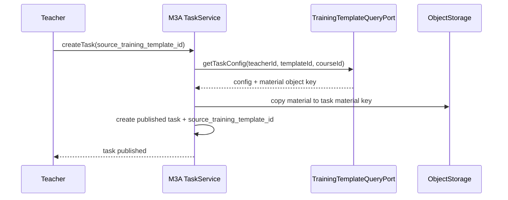

# 07 M6 实现设计

> 上位文档：[M6 需求](../requirements/M6-训练模式.md)、[08 M6 设计](../design/08-M6-训练模式.md)、[15 代码规范与骨架](../design/15-代码规范与骨架.md)
> 版本：V0.3（契约对齐）　状态：待评审　更新日期：2026-11-18
> 范围：个人训练模板、课程发布、训练 session、训练记录、隐私、M3A 任务预填；不写代码实现体
> 模块状态：G1 设计提交（10%）；G2—G8 未开始；Owner：Media/Training Owner；测试：UT / IT / 契约 / E2E 未开始；最后更新：2026-11-18（详见[进度看板](../team/02-进度看板.md)）；2026-11-18 契约更新：模板删除为软删除，自动下架、释放额度并清理关联记录 / 材料。

## 1. 包与类

```text
com.shijiangtai.m6training
├─ api/
│  ├─ PersonalTrainingTemplateController
│  ├─ TrainingTemplatePublicationController
│  ├─ StudentTrainingTemplateController
│  ├─ TrainingSessionController
│  ├─ TrainingRecordController
│  ├─ TrainingMaterialController
│  └─ dto/M6Dtos
├─ application/
│  ├─ TrainingTemplateService
│  ├─ TemplatePublicationService
│  ├─ TrainingTemplateReconciler
│  ├─ TrainingSessionService
│  ├─ TrainingRecordService
│  ├─ TrainingMaterialService
│  └─ TrainingTaskPrefillService (实现 M3A 定义的 TrainingTemplateQueryPort)
├─ domain/
│  ├─ TrainingTemplate, TrainingTemplatePublication
│  ├─ TrainingLevel, TrainingPolicy, TemplateQuotaPolicy
│  ├─ TrainingMaterial, TrainingMaterialUsage
│  ├─ TrainingRecord, TrainingRecordPolicy
│  └─ TrainingConfigSnapshot, TrainingRecordSelectedEvent
└─ infrastructure/
   ├─ persistence/ (repositories, entities)
   ├─ storage/ (MinIO copy / delete)
   └─ reuse/ (M3 SessionApplicationService, M4 trigger port)
```

## 2. 类职责

| 类 | 层 | 职责 |
|---|---|---|
| `PersonalTrainingTemplateController` | api | 我的模板 CRUD / 软删除 / 复制 / 任务预填配置 |
| `TrainingTemplatePublicationController` | api | 发布列表 / 发布 / 下架 |
| `StudentTrainingTemplateController` | api | 学生可见发布 / 发布详情 |
| `TrainingSessionController` | api | 创建 / 结束 / 取消 |
| `TrainingRecordController` | api | 选中 / 列表 / 详情 / 删除 |
| `TrainingMaterialController` | api | 模板材料 / 自由训练材料 |
| `TrainingTemplateService` | application | 个人模板创建 / 编辑 / 软删除 / 复制；30 额度 |
| `TemplatePublicationService` | application | 发布 / 下架 / 自动下架；多课程 |
| `TrainingTemplateReconciler` | application | 课程归档 / 教师移出 / 模板删除对账 |
| `TrainingSessionService` | application | 创建 / 结束 / 复用 M3；模板 / 发布来源校验 |
| `TrainingRecordService` | application | 选中 / 3 条上限 / 到期 |
| `TrainingMaterialService` | application | 模板 / 自由训练材料上传、附着、过期 |
| `TrainingTaskPrefillService` | application | 实现 `TrainingTemplateQueryPort`，供 M3A 读取教师模板 |
| `TrainingTemplate` | domain | 个人模板聚合；状态 / 来源 / 配置 |
| `TrainingTemplatePublication` | domain | 发布聚合；状态 / 原因 |
| `TrainingRecord` | domain | 训练记录 |
| `TrainingPolicy` | domain | 发布可见性 / 老师组 / 记录上限 |
| `TemplateQuotaPolicy` | domain | active 30 上限 |
| `TrainingConfigSnapshot` | domain | 模板 / 有效配置快照（schema v2） |

## 3. 核心方法签名

```java
public interface TrainingTemplateService {
    TrainingTemplateView create(CurrentUser owner, CreateTrainingTemplateCommand command);
    TrainingTemplateView update(CurrentUser owner, TemplateId templateId, UpdateTrainingTemplateCommand command);
    TrainingTemplateView get(CurrentUser owner, TemplateId templateId);
    PageResult<TrainingTemplateView> list(CurrentUser owner, TemplateQuery query);
    void delete(CurrentUser owner, TemplateId templateId); // 软删除；下架发布、释放额度、清理记录 / 材料
    TrainingTemplateView copyFromPublication(CurrentUser student, CopyTemplateCommand command);
    TaskTemplateConfig getTaskConfig(CurrentUser teacher, TemplateId templateId);
}

public interface TemplatePublicationService {
    TrainingPublicationView publish(CurrentUser teacher, TemplateId templateId, CourseId courseId);
    void unpublish(CurrentUser teacher, PublicationId publicationId);
    PageResult<TrainingPublicationView> list(CurrentUser teacher, PublicationQuery query);
    PageResult<StudentTemplateCardView> listStudentVisible(CurrentUser student, StudentTemplateQuery query);
    StudentTemplateDetailView getStudentVisible(CurrentUser student, PublicationId publicationId);
}

public interface TrainingSessionService {
    TrainingSessionView create(CurrentUser student, CreateTrainingSessionCommand command);
    TrainingSessionView get(CurrentUser student, SessionId sessionId);
    void end(CurrentUser student, SessionId sessionId);
    void cancel(CurrentUser student, SessionId sessionId);
}

public interface TrainingRecordService {
    TrainingRecordView select(CurrentUser student, SessionId sessionId);
    PageResult<TrainingRecordView> list(CurrentUser student, TrainingRecordQuery query);
    TrainingRecordView get(CurrentUser student, TrainingRecordId recordId);
    void delete(CurrentUser student, TrainingRecordId recordId);
}

// Consumer-owned port defined in M3A; M6 provides the adapter implementation.
public interface TrainingTemplateQueryPort {
    Optional<TaskTemplateConfig> getTaskConfig(UUID teacherId, UUID templateId, UUID courseId);
}
```

## 4. 核心调用流程

### 4.1 创建个人模板



- 教师、学生共用；`owner_role` 由当前身份确定。
- 虚拟学生为空时取默认 3 人；`mock_exam` 推荐时长 = 最高时长。
- 额度锁与插入同事务；已删除模板不计数。

### 4.2 编辑 / 删除

```text
PATCH:
  owner 校验 → 若 teacher 且存在 published 发布 → 配置字段锁定 409
  → 重建 config_snapshot → 更新 updated_at
  → material_id 变化：旧 material deleted / 新 material attached

DELETE:
  owner 校验 → 自动下架所有 published 发布(reason=template_deleted)
  → status=archived, archived_at=now（内部软删除）
  → 清理关联 TrainingRecord / 录像 / 报告 / 模板材料
  → 释放 30 active 额度
```

- 学生模板无发布，可随时全字段编辑。
- 已开始 session 使用自己的 effective snapshot，不受编辑影响。
- 删除不可恢复；学生副本与关联任务快照保留。

### 4.3 发布 / 下架



```text
CourseArchivedEvent / CourseTeacherRemovedEvent
  → TrainingTemplateReconciler
  → published 发布中：课程非 active / 模板非 active / owner 不在老师组
  → status=unpublished / unpublished_at / unpublish_reason
```

- 同模板 + 课程 published 唯一；重复 409。
- 一个模板可发布多门课程。
- 重新发布新建行；旧行保留审计。
- 事件丢失由 5 分钟对账兜底。

### 4.4 学生复制教师发布



- 材料复制失败 → 502 `TRAINING_TEMPLATE_COPY_FAILED`，事务回滚，不留下模板 / 材料行。
- 副本 `source_template_id` / `source_publication_id` 仅追溯；来源下架 / 删除 / 退课不影响副本。
- 副本全字段可编辑（含档位、时长、权重）。
- 副本独立计 3 条训练记录额度。

### 4.5 创建训练 session

```mermaid
sequenceDiagram
  participant S as Student
  participant A as TrainingSessionService
  participant DB as Repository
  participant M3 as M3 SessionApplicationService
  S->>A: create(templateId | publicationId | free, level, virtualStudents)
  alt publicationId
    A->>DB: 校验发布 published / 课程在课 / 模板 active
    A->>A: snapshot = template + virtualStudents; publication/course
  else templateId
    A->>DB: 校验 template owner=student / active
    A->>A: snapshot = template + virtualStudents; publication=null
  else free
    A->>A: defaults + topic/material/virtualStudents
  end
  A->>DB: 校验无活跃 training session
  A->>DB: insert sessions(training, preparing) + training_session_meta
  A-->>S: TrainingSessionView
```

- `template_id` 与 `publication_id` 二选一；同时传 → 422。
- 训练中不可覆盖模板课题 / 时长 / 权重 / 材料；只替换虚拟学生。
- 自由训练默认 3 人 / 0.5；进阶 15/20；模拟 20/20。
- 同一学生同时只有一个活跃 training session。

### 4.6 选中记录



- 评测通过 `evaluations.training_record_id` 查询，不双写 evaluation_id。
- 每模板 / 自由训练分组最多 3 条；记录 1 个月；学生可删除。
- 训练报告仅本人；教师 / 管理员 403。

### 4.7 教师任务预填



- 模板必须属于教师、active、owner_role=teacher；否则 422 `TASK_TEMPLATE_INVALID`。
- 材料复制失败 → 502 `TASK_TEMPLATE_MATERIAL_COPY_FAILED`，不留下任务。
- 任务创建后与模板解耦；`source_training_template_id` 仅追溯。

### 4.8 到期 / 清理

```text
TrainingRecordService / cleanup job
  → 读路径校验 expires_at > now
  → status=expired / deleted
  → 删 MinIO 录像 / 自由训练材料
  → 删 training_records → evaluation → session
```

- 清理根为 training_record；不依赖删 session。
- 自由训练材料未使用 24h 过期；模板材料随模板保留，替换后的旧材料异步清理。
- 模板删除清理关联记录 / 材料；学生副本与任务快照保留。

## 5. 事务与并发

| 用例 | 事务 |
|---|---|
| 创建 / 复制模板 | owner advisory lock + count active < 30 + insert |
| 编辑模板 | owner + 发布锁校验 + 更新快照 + 材料附着 |
| 发布模板 | 校验 + 唯一索引 + insert publication |
| 删除模板 | 下架全部发布 + status=archived（软删除）+ 清理记录 / 材料 + 释放额度 |
| 创建 session | 校验 + sessions + training_session_meta |
| 选中记录 | insert record + session selected + 删最旧（锁学生+模板分组） |
| 复制模板 | 额度锁 + 模板行 + material 行 + MinIO copy；失败补偿 |
| 删除 / 到期 | 标记 + 异步清理 |

- 记录上限按“学生 + 模板 / 自由训练分组”加锁。
- 模板额度按 owner 加锁；发布唯一由部分唯一索引兜底。
- 模板自动下架事件 after-commit；reconciler 兜底。

## 6. 权限与事件

- 教师：仅自己的个人模板 / 发布；学生：自己的个人模板 + 目标课程 published 发布。
- 训练录像 / 报告仅本人；管理员 403。
- 通用 M3/M4 接口必须拒绝教师访问 training session / training_record。
- `TrainingRecordSelectedEvent` → M4。
- `CourseArchivedEvent` / `CourseTeacherRemovedEvent` → M6 自动下架。
- 权限码：
  - `training:template:personal`：个人模板 CRUD / 复制 / 任务预填配置 / 模板材料；
  - `training:template:read`：发布列表 / 学生可见发布；
  - `training:template:manage`：教师发布 / 下架。

## 7. 测试点

- 个人模板创建 / 编辑 / 删除；30 上限；删除释放额度；清理记录 / 材料。
- 教师模板有 published 发布时配置锁定；下架后可编辑。
- 发布到多课程 / 重复发布 / 自动下架 / 对账。
- 学生复制可见发布；副本全字段可编辑；来源下架 / 删除 / 退课不影响副本。
- 复制额度超限 / 材料复制失败回滚。
- 模板训练 / 学生个人模板训练 / 自由训练；时长 / 权重在 session 中不可覆盖。
- 训练 session 状态 / 不生成 Submission / M7 不可见。
- 选中 / 3 条上限 / 第 4 条删最旧 / 自由训练分组 / 副本独立分组。
- 记录到期 / 删除 / 读路径校验 / 清理。
- 教师任务预填：本人 active 模板 / 非本人 / 学生模板 / 已删除模板 / 材料复制失败。
- 训练报告仅本人；通用接口 403。
