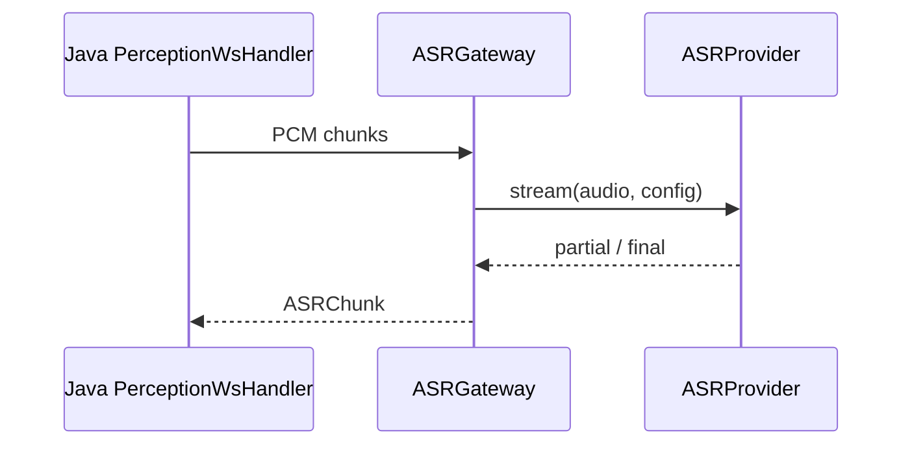
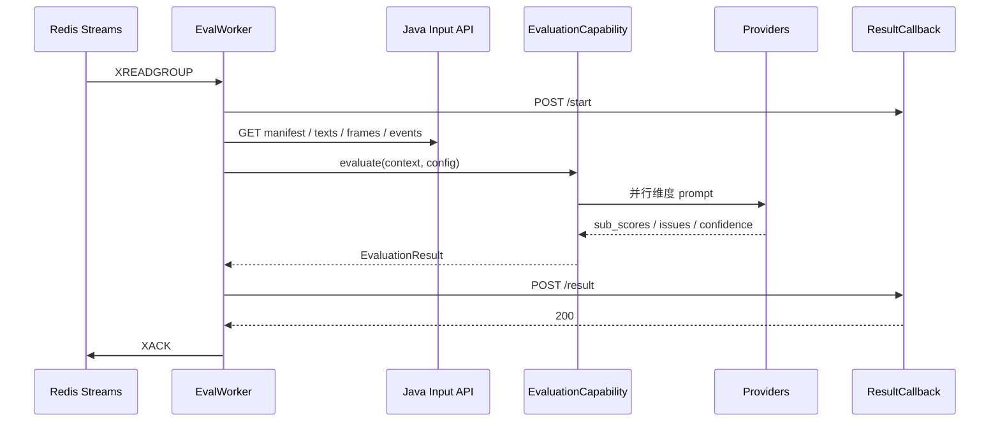

# 08 Python AI 实现设计

> 上位文档：[06 M4 设计](../design/06-M4-AI评测与反馈.md)、[13 代码设计](../design/13-代码设计.md)、[15 代码规范与骨架](../design/15-代码规范与骨架.md)
> 版本：V0.1（讨论稿）　状态：待评审　更新日期：2026-11-03
> 范围：provider 适配、capability 封装、M4 worker、prompt / 校验 / 回调；不写代码实现体
> 模块状态：G1 设计提交（10%）；M3 Python 调用层（DeepSeek / Paraformer / Qwen-OCR + FastAPI）代码与 28 条 mock 测试已落地，G2 / G3 未关闭；M4 worker 未开始；Owner：AI Owner + M3 Owner（classroom / ASR / OCR）；最后更新：2026-11-04（详见[进度看板](../team/02-进度看板.md)）

## 1. 包与类

```text
ai/
├─ app/
│  ├─ main.py
│  ├─ config.py
│  ├─ api/
│  │  ├─ llm_routes.py
│  │  ├─ ocr_routes.py
│  │  ├─ asr_routes.py
│  │  ├─ vision_routes.py
│  │  ├─ classroom_routes.py
│  │  └─ evaluation_routes.py
│  ├─ providers/
│  │  ├─ base.py (LLMProvider, OCRProvider, ASRProvider, VisionProvider)
│  │  ├─ deepseek.py
│  │  ├─ ocr_cloud.py
│  │  ├─ asr_cloud.py
│  │  └─ mock.py
│  ├─ capabilities/
│  │  ├─ llm_gateway.py
│  │  ├─ ocr_gateway.py
│  │  ├─ asr_gateway.py
│  │  ├─ vision_gateway.py
│  │  ├─ classroom_content.py
│  │  ├─ evaluation.py
│  │  └─ media.py
│  ├─ prompts/
│  ├─ schemas/
│  ├─ worker/
│  │  ├─ main.py
│  │  ├─ consumer.py
│  │  ├─ input_client.py
│  │  └─ callback.py
│  └─ observability/
└─ tests/
```

## 2. 类职责

| 类 | 层 | 职责 |
|---|---|---|
| `LLMProvider` | providers | `chat` / `stream` 厂商接口 |
| `OCRProvider` | providers | 图片 OCR |
| `ASRProvider` | providers | 流式 / 批量 ASR |
| `VisionProvider` | providers | 关键帧视觉 |
| `DeepSeekProvider` | providers | DeepSeek / OpenAI 兼容 |
| `OcrCloudProvider` / `AsrCloudProvider` | providers | 云 OCR / ASR |
| `MockProvider` / `MockLLMProvider` | providers | CI / demo 固定结果；LLM 与 ASR 的 `stream` 签名不同，分别实现 |
| `LLMGateway` | capabilities | 重试 / 超时 / JSON schema / token |
| `OCRGateway` / `ASRGateway` / `VisionGateway` | capabilities | 能力封装 |
| `ClassroomContentCapability` | capabilities | 学生问题 / 回答 / 分类 |
| `EvaluationCapability` | capabilities | 维度 prompt / 并行 / 建议 |
| `MediaCapability` | capabilities | 音频特征 / 关键帧 |
| `EvalWorker` | worker | Redis Streams 消费 |
| `EvaluationInputClient` | worker | 拉 manifest / 分页输入 |
| `ResultCallback` | worker | start / result / fail |
| `PromptRegistry` | prompts | 版本化模板 |
| `EvaluationResult` / `DimensionResult` / `Issue` | schemas | Pydantic 输出 |

## 3. 核心方法签名

```python
class LLMProvider(Protocol):
    async def chat(self, messages: list[Message], model: str, timeout_s: float) -> LLMResponse: ...
    async def stream(self, messages: list[Message], model: str, timeout_s: float) -> AsyncIterator[LLMChunk]: ...

class LLMGateway:
    async def json(self, prompt: Prompt, schema: type[BaseModel], model: str) -> LLMJsonResult: ...
    async def chat(self, messages: list[Message], model: str) -> LLMTextResult: ...

class OCRGateway:
    async def recognize(self, image_url: str) -> OCRResult: ...

class ASRGateway:
    async def stream(self, audio: AsyncIterator[bytes], config: ASRConfig) -> AsyncIterator[ASRChunk]: ...

class EvaluationCapability:
    async def evaluate(self, context: EvaluationContext, config: EvalConfig) -> EvaluationResult: ...
    async def _evaluate_dimension(self, dimension: str, ctx: DimensionContext) -> DimensionResult: ...
    async def _suggest(self, dims: list[DimensionResult], issues: list[Issue]) -> list[Issue]: ...

class MediaCapability:
    async def audio_features(self, audio_url: str) -> AudioFeatures: ...
    async def select_keyframes(self, frame_urls: list[str]) -> list[Keyframe]: ...

class EvalWorker:
    async def run(self) -> None: ...
    async def handle(self, message: JobMessage) -> None: ...

class EvaluationInputClient:
    async def manifest(self, evaluation_id: str) -> Manifest: ...
    async def texts(self, evaluation_id: str, after_id: str | None, limit: int) -> Page: ...
    async def frames(self, evaluation_id: str, after_ts: int | None, after_id: str | None, limit: int) -> Page: ...
    async def events(self, evaluation_id: str, after_seq: int | None, limit: int) -> Page: ...
```

## 4. 核心调用流程

### 4.1 M3 实时 ASR / OCR



- 只做流式转写 / 时间戳归一化；session 状态在 Java。
- partial 只推前端；final 由 Java 落库。

### 4.2 M3 内容生成

```text
POST /internal/v1/classroom/question
  → ClassroomContentCapability
  → PromptRegistry
  → LLMGateway.json
  → {text, context_sufficient, input_question_complete, output_complete, confidence}
```

- Java 负责扩窗（2/4/6 分钟）与重试；Python 只返回 flags / 内容。

### 4.3 M4 worker



- worker 不写 DB；不计算总分 / 最终状态。
- `(job_id, attempt)` 由 Java 幂等；回调失败不 XACK。
- 单 worker 并发 3；全局 LLM 并发 8；整份 90s。

### 4.4 维度评测

```text
EvaluationCapability.evaluate(context, config)
  → 适用维度列表（free/scenario 5；interview 3）
  → asyncio.gather(_evaluate_dimension)
  → 聚合 issues / warnings
  → _suggest(dims, issues)
  → EvaluationResult
```

- 内容：参考材料 / 答案要点 + 文本；长材料 top-k。
- 表达：音频特征 + LLM fluency。
- 互动：事件统计 + 问答文本。
- 板书：OCR 时间线 + 关键帧视觉。
- 时间：转写时间戳 + 阶段 / 题目窗口。

### 4.5 回调

```text
ResultCallback.start(job_id, attempt)
  → POST /internal/evaluations/{id}/start

ResultCallback.result(job_id, attempt, EvaluationResult)
  → POST /internal/evaluations/{id}/result

ResultCallback.fail(job_id, attempt, error)
  → POST /internal/evaluations/{id}/fail
```

- `X-Service-Token`；`job_id + attempt`。
- 失败结果保留已完成维度；`partial_reasons` 由 Python 返回，Java 最终判定。

## 5. 配置与安全

- `DEEPSEEK_API_KEY` / `DEEPSEEK_BASE_URL` / `DEEPSEEK_MODEL`
- `OCR_PROVIDER` / `OCR_API_KEY` / `OCR_ENDPOINT`
- `ASR_PROVIDER` / `ASR_API_KEY` / `ASR_ENDPOINT`
- `REDIS_URL`、`JAVA_BASE_URL`、`SERVICE_TOKEN`
- `AI_MOCK=true`、`MAX_CONCURRENCY`、`LLM_TIMEOUT_S`
- 不配置 `DATABASE_URL`；不连业务库。
- 日志脱敏：不打印密钥、全文、预签名 URL。

## 6. 测试点

- Provider contract：mock HTTP / 超时 / 429 / 非法 JSON。
- Capability：schema 校验 / 重试 / token / prompt 版本。
- Evaluation fixture：free / scenario / interview / partial / failed。
- Worker：XREADGROUP / start / result / fail / XACK / 重试。
- 不在 CI 调真实厂商；staging 手工抽检。
